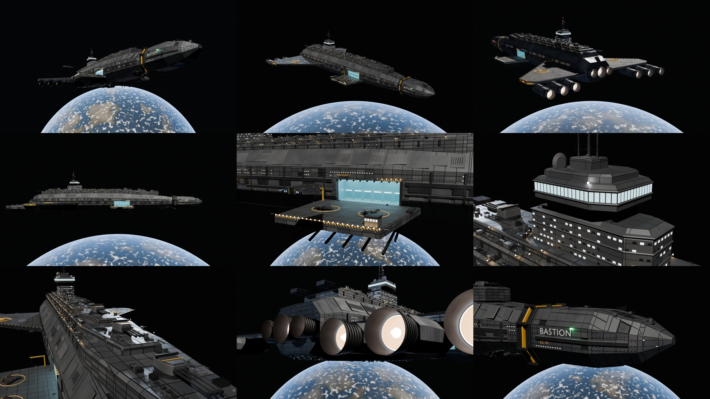

# Bastion 2: das Trägerschiff neu gebaut (Schaumodell)

Gebaut am 17.11.2026. Wunsch: „Die Bastion auch in Blender überarbeiten mit dem, was du gelernt hast, mehr Details, noch besser als alles bisher.“
Die alte Bastion (`asset-src/neu/bastion/Bastion.blend`, 514 m gebaut, im Spiel ×1,9) bleibt unberührt. Die neue liegt in `asset-src/neu/bastion2/` und ist seit dem 17.11.2026 im Spiel (Abschnitt „Im Spiel“).



## Anordnung

Gleich wie bei der alten Bastion, damit sie später an dieselben Spielpunkte passt (Andocken über der Plattform an Steuerbord, Start in der Hangaröffnung).
Diesmal ist sie in **echten Metern** gebaut (Blender-Meter = Spiel-Meter, also später `CARRIER_K` = 1): +Y Bug, +X Steuerbord, +Z oben.

- 975 m lang (Heck y −470 bis Bugspitze +495, ohne Düsen), 532 m Spannweite über die Flügel, rund 1,18 Mio. Dreiecke.
- **Rumpf**: Facettenkörper aus Stationen (`HY/HW/HT/HB`), Kielpanzer unten, Panzerplatten am Bug, zwei Panzergürtel je Seite (an den Hangars unterbrochen), Rippen alle 36 m, eine Reihe Rettungskapsel-Luken mit Ockerrand, Kühlerfelder.
- **Bugmodul** hinter einem Kragen (dunkle Ringe, Ockerband, Rippen) mit Sensorkuppel, Antennenfeld, Schriftzug BASTION und Kennung LC 01.
- **Gestufte Decks** (drei Stufen) mit Fensterreihen und Aufbauten (Raster-Greebles: Blöcke, Lüfter, Tanks, Kuppeln, Rohre, Kühlrippen) links und rechts einer freien Mittelgasse.
- **Turm** achtern (y −243): Schaft mit Fenstern und Gesimsen, Brücke mit umlaufendem Fensterband, Dach, Masten mit Warnlichtern, zwei Radarschirme.
- **Bewaffnung**: vier schwere Drillingsgeschütze (drei gestaffelt am Vordeck, eins achtern), etwa 40 Nahverteidigungstürme an Deckkanten, Bug und Unterseite.
- **Hangars** auf beiden Seiten (y −15 bis 75, z −26 bis 4, 30 m tief, per Boolean geschnitten): Boden mit Markierungen, Deckenträger mit Lichtbändern, Rückwand mit Toren, Warnrahmen, halbdurchsichtiges Feld. Davor je eine **Landeplattform** (106 × 140 m) mit Landekreisen, Randlichtern, Kontrollkanzel, Kran, Ladegut und Tragwerk zum Rumpf.
- **Flügel** achtern als Flugdeck: Kantenleiste, Mittellinie, drei Landekreise, Bastion-Zeichen, Randlichter, Warnfeld an der Spitze, Positionslichter, Aufbauten unten.
- **Antrieb**: sechs Triebwerksgondeln unter den Flügeln mit offenen Düsenglocken, Glutscheibe, Kern und Kühlringen, dazu drei Hauptdüsen im Heck.
- **Fenster**: rund 6.000 kleine Fenster in Gruppen an oder aus (warm und kalt), damit man die Größe sieht.
- **Vergleich**: zwei Würger auf der Steuerbord-Plattform, der Kormoran im Anflug (aus deren Roh-GLBs geladen).

## Nachgeschärft (17.11.2026)

- Bordwand gegliedert: Fenster nur noch im oberen Band (am Bugmodul überall). Darunter liegen geschichtete Panzerplatten in zwei Lagen, ganz unten eine Lage über den Rettungskapseln. Die Platten folgen dem Knick der Bordwand und sind dort geteilt.
- Zweiton: unteres Band der Bordwand und Unterseite blaugrau, oben grau.
- Obere Schräge mit Platten (gestückelt, teils mit Lüftern), Pfeiler an den Deckwänden alle 24 m, rote Warnlichter an den Deckkanten.
- Flügeldeck: erhabene Deckplatten und zwei versenkte Aufzüge je Flügel.
- Düsen: dunkle, matte Wand statt spiegelndem Stahl, heller Ring im Hals, Glut zurückgenommen.
- Licht: stärkeres Gegenlicht vom Planeten, kühles Kantenlicht von hinten. Der Planet liegt je Ansicht 100 km hinter dem Schiff im unteren Bilddrittel.
- Neue Ansicht „held“: von schräg unten vorn mit Weitwinkel.

## Dateien

`asset-src/neu/bastion2/`: `bas_kit.py` (Bau; Werkzeuge aus Kormoran und Würger, Materialien aus `bastion/bk_lib.py` plus eigene großflächige Materialien), `bas_lauf.py` (ohne Fenster bauen und rendern), `bas_blatt.py` (Übersichtsblatt).

```bash
cd asset-src/neu/bastion2 && /c/EXTRA/Blender/blender.exe -b --python bas_lauf.py -- alle
```

Ansichten: gesamt, heck, seite, unten, hangar, turm, deck, triebwerke, bug (alle im Weltraum mit Planet). Proben über `KOR_SAMPLES` (Standard 96). Ein voller Lauf mit 128 Proben dauert rund 5 Minuten, also im Hintergrund starten.

## Gelernt (Schiffsgröße)

- Werkzeuge aus kleinen Schiffen brauchen andere Maße: Fugen 0,1 bis 0,3 m statt 1,4 cm, keine Schrauben, Platten 8 bis 16 m. Kleine Rasterzellen mit breiten dunklen Fugen sahen in der Nähe wie Fliesen aus (Turm).
- `mk()` aus bk_lib taugt nicht für 1 km: Der Schmutz hängt an der Höhe z (0 bis 0,5 m) und verdunkelt alles unter z = 0. Deshalb gibt es hier `big()` mit Flecken über Dutzende Meter.
- Viele kleine Teile in einem Objekt (`Batch`) statt Tausender Einzelobjekte: Bauzeit rund 30 s.
- Düsenglocken müssen offen sein (`bell`), sonst verdeckt der Deckel die Glut. Die Glut zurückhaltend einstellen, sonst leuchten die Glocken wie Lampenschirme.
- Kamera-`clip_end` weit genug für den Planeten (400 km). Die Sonne mit `to_track_quat` auf die Richtung setzen statt Winkel zu raten.
- Getönte Platten auf langen Schrägen ergaben Streifen: Schrägen bekommen einen Ton.
- Schrift auf der Bordwand nur, wo die Seite wirklich senkrecht und gleich breit ist, sonst steckt sie im Rumpf.

## Im Spiel

- Weg: `sh asset-src/neu/bastion2/bas_spiel.sh` (baut Bastion2.blend neu, `bas_export.py` → Bastion2_roh.glb, simplify-hard 0,5 / Fehler 0,0002 → `asset-src/glb/station/Carrier.glb`), danach `npm run assets`.
- Export ohne Fasen (die Fasen machten den Großteil der 1,2 Mio. Dreiecke aus): 283.000 Dreiecke roh, vereinfacht 201.000, gepackt 2,8 MB. Leuchtende Materialien heißen `bastion_windows`, `bastion_lamps`, `bastion_engine_glow`, `bastion_hangar_field`. Rumpffarben im Export ×1,9 (Panzer, Metall, Düsen ×1,5), sonst wirkte der Rumpf im Spiel fast schwarz.
- `buildCarrierModel` (src/models/stationModels.ts): `CARRIER_K` = 1, Punkte in Blender-Koordinaten mit `B(x, y, z)` → Spiel (x, z, −y). Andocken über der Steuerbord-Plattform B(110, 30, −10). Start in der Mitte der Hangaröffnung B(57,5, 30, −10), Blick nach außen. Die Öffnung ist dafür 34 m hoch (z −26 bis 8), der begehbare Hangar hat ein Tor von 62 × 32 m, sein Boden liegt auf Plattformhöhe.
- 312 Kollisionskugeln: Rumpf paarweise (an den Hangars höher und kleiner), Decks, Turm, Flügel, Triebwerke, Plattformen (Kugeln unter der Deckfläche, damit der Startweg frei bleibt). Geprüft: Startweg frei, Andockpunkt erreichbar, Rumpf, Flügel und Turm schieben das Schiff hinaus.
- Glühen an den sechs Flügeltriebwerken und den drei Hauptdüsen, je acht Randlichter an den Plattformen. Die Eidwacht in Kapitel 3 nutzt dasselbe Modell (verkleinert, ausgebrannt).

## Offen

- Im Spiel wirkt die Schattenseite dunkel. Der Rumpf hat nur glatte Farben, ohne die Flecken aus Cycles.
- Rückmeldung des Nutzers.
