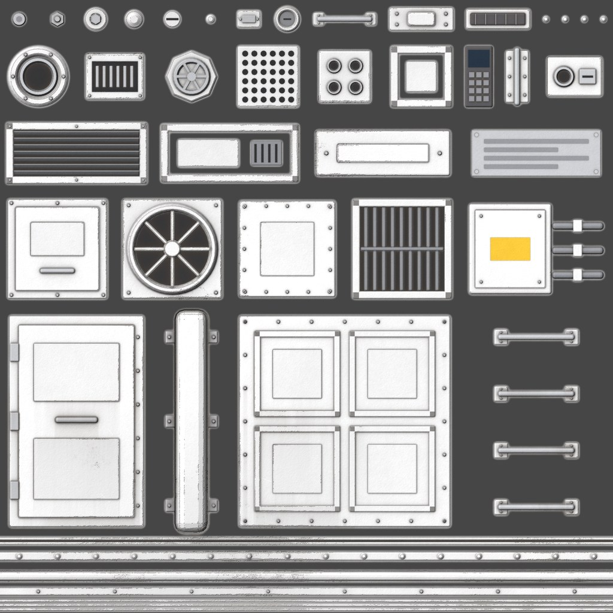
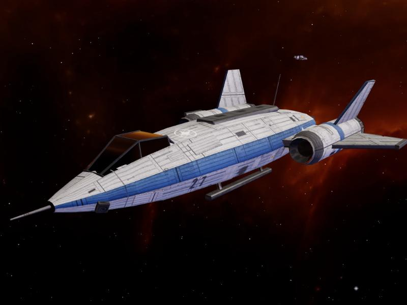
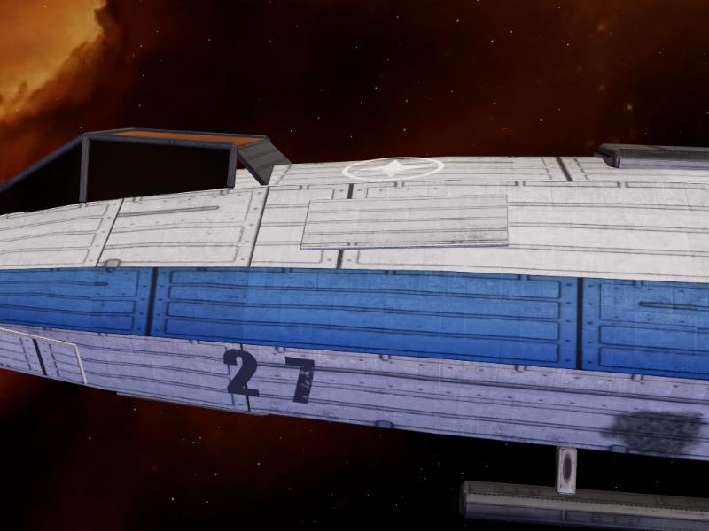
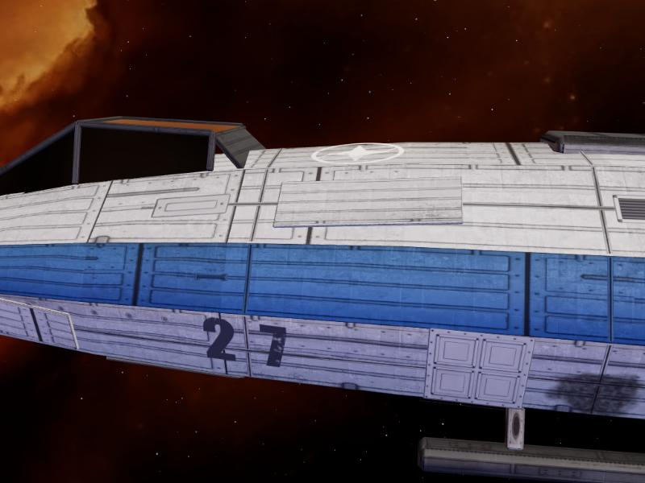

# Baukasten für Gebäude und Umgebungen (ab Alpha 0.66)

Mit dem Baukasten entstehen detaillierte Gebäude per Skript in Blender. Die Details (Paneele, Schrauben, Lamellen, Abnutzung, Schmutz)
kommen aus einem gemeinsamen Texturblatt; die Bauteile sind kleine Funktionen, die Flächen darauf abbilden. Ein neues Gebäude braucht deshalb
nur ein kurzes Skript und im Spiel fast keinen Code.

Bilder aller Teile: `docs/baukasten/katalog_1_gebaeude.jpg`, `katalog_2_technik_fracht.jpg`, `katalog_3_landefeld.jpg`.

## Dateien

| Datei | Inhalt |
|---|---|
| `asset-src/neu/baukasten/trim_build.py` + `Trimsheet.blend` | Texturblatt: Details als echte Geometrie, von oben gerendert, daraus Farbe, Relief, ORM |
| `scripts/make-kit-decals.mjs` | Aufkleber-Atlas: Ziffern, Wörter, Zeichen, Schilder, Schmutz |
| `asset-src/neu/baukasten/kit_lib.py` | Die Bibliothek: Grundformen, Bauteile, Verdeckung, Export |
| `asset-src/neu/baukasten/kit_catalog.py` + `Baukasten.blend` | Katalog aller Teile, Vorschaubilder (`stage()`, `shot()`) |
| `asset-src/neu/baukasten/kit_atlas.json`, `kit_decals.json` | Lage der Streifen, Kacheln und Aufkleber (werden erzeugt, nicht von Hand ändern) |
| `asset-src/tex/kit_trim_col/_nrm/_orm@2048.png`, `kit_decals@2048.png` | Die fertigen Bilder |
| `src/models/kit.ts` | Materialien im Spiel, `applyKit()`, Zusatzangaben `kitMeta()` |
| `asset-src/neu/aussenposten/posten_kit.py` | Beispiel: der Außenposten (rund 90 Zeilen) |

## Ein neues Gebäude bauen

1. Skript schreiben (Vorlage: `posten_kit.py`): `K = lib.Kit('Name')`, Bauteile aufrufen, `return K.build('Sammlung')`.
2. In Blender laden und ausführen (Textblöcke `kit_lib` und das eigene Skript), mit `kit_catalog.stage()` und `shot()` ansehen.
3. `lib.bake_ao(ob)` rechnet die Verdeckung in die Eckfarben, `lib.export(ob, 'Name', meta)` schreibt
   `asset-src/glb/station/Name.glb` und `asset-src/data/kit_Name.json` (Leuchtpunkte, eigene Angaben wie das Landefeld).
4. `npm run assets`. Im Spiel: Vorlage holen, `applyKit(body)` aufrufen, Leuchtpunkte aus `kitMeta('Name').lights` setzen
   (Beispiel: `buildBaseModel()` in `src/models/stationModels.ts`).

Maße in Metern. In Blender zeigt die Vorderseite eines Teils nach −Y, +Z ist oben; der Ursprung eines Teils ist die Mitte seiner Grundfläche.
Mit `with K.at((x, y, z), drehung):` wird alles darin verschoben und um Z gedreht.

## Bauteile (Methoden von `Kit`)

- **Grundformen:** `box` (Kasten mit gefasten Kanten), `beam` (Balken zwischen zwei Punkten), `tube` (Rohr, Tank, Reifen), `sphere`,
  `prism` (Querschnitt gezogen, z. B. Pultdach), `slab` (Betonplatte), `surf`/`face` (einzelne Fläche), `ring` (umlaufender Rahmen).
- **Gebäude:** `block` (Baukörper mit Sockel und Attika), `wing` (Flügel mit Pultdach und Trägern), `gate` (großes Tor), `door`, `windows`,
  `ramp`, `stairs`, `walkway`, `platform`, `railing`, `ladder`, `pipe`, `cable`.
- **Technik:** `panel` (Wandkasten mit Motiv), `vent_unit`, `generator`, `mast_light`, `antenna`, `dish`, `turret`, `tank`, `silo`.
- **Fracht und Fahrzeuge:** `crate`, `container`, `barrel`, `cage`, `hauler`, `cart`, `wheel`.
- **Gelände:** `pad` (Landefeld), `post`, `beacon`, `barrier`, `signpost` (Schild auf Pfosten), `sign` (Leuchtschild).
- **Aufgesetztes:** `tile` (Kachelmotiv: vent, fan, hatch, ctrl, crate, door), `decal` (Aufkleber), `number` (Ziffernfolge),
  `glow`/`glowbox` (leuchtende Fläche), `glass`, `light` (Leuchtpunkt fürs Spiel).

Streifen (`side=`, `top=`): `wall` (Paneele, reihenweise), `siding` (Lamellen), `roofing` (Dachbahnen), `floor` (Gitterrost), `beam`, `girder`,
`hazard` (Warnstreifen, Tönung `none`), `pipe`, `hose`, `plain`, `edge`. Tönungen stehen in `TINT` (linear: 0,06 ist dunkelgrau, 0,3 hellgrau).

## Drittes Texturblatt: die Ferrox (`kit_fx`, Alpha 1.11)

- Quelle: `asset-src/neu/ferrox/trim_ferrox.py` in `Trimsheet_Ferrox.blend` (nutzt die Werkzeuge aus `trim_build.py` wie `trim_int.py`). Aufruf: `build()`, `render()`, `compose()`, `veins()`.
- Bilder: `asset-src/tex/kit_fx_col/_nrm/_orm/_emi@2048.png`; Lage der Streifen in `baukasten/kit_fx_atlas.json`. `kit_lib.py` lädt das Blatt von selbst, wenn die Datei da ist.
- Streifen: `fx_plate` (große Platten der Erbauer), `fx_fine` (Lamellen), `fx_rib` (Rippen), `fx_seam` (Naht mit Bolzen), `fx_plain`. Kacheln: `fx_ring`, `fx_lens`, `fx_vent`, `fx_cut`, `fx_noz`, `fx_hatch`.
- Das Blatt ist schon dunkel; die Tönungen `fx`, `fx_dim`, `fx_light`, `fx_rust` hellen nur ab oder färben. `veins()` schreibt das Leuchtbild (Adern, Linse, Düse).
- Kästen und Rohre aus diesem Blatt bekommen ihre Fasen und Deckel ebenfalls daraus (`fx_seam`, `fx_plain`) statt der lackierten Kante der Menschenbauten.
- Materialien im Spiel: `ferroxMaterials()` in `src/models/kit.ts` (eigene Fassung von `kit_trim` ohne Staub, `kit_fx` mit Leuchtbild, `kit_ferrit`).
- **Die Rendezeit sprengt die Abfrage über das Blender-Werkzeug:** `render()` läuft trotzdem zu Ende; auf die fünf Dateien `_tmp/kit_fx_*.npy` warten, dann `compose()`.
- **Sichtseite beachten:** Eigene Flächen (`K.face`, `K.ngon`) müssen gegen den Uhrzeigersinn von außen gesehen angelegt sein. Blender zeigt beide Seiten, das Spiel nur die vordere. Prüfen: Anteil der Flächen, deren Normale zur Körperachse zeigt.

## Relief-Blatt: aufgesetzte Bauteile (`kit_relief`, Alpha 1.13)

Vorbild sind die „Floater“-Decals aus Star Citizen (Studie von Magnus Tellmann auf ArtStation): Kleine Bauteile werden einmal als echte Geometrie gebaut, in Bilder gebacken und im Spiel als flache Vierecke mit weicher Maske auf die Wände gelegt. Ein Teil kostet zwei Dreiecke.

- **Quelle:** `asset-src/neu/baukasten/trim_relief.py` in `Trimsheet_Relief.blend` (Werkzeuge aus `trim_build.py`). Aufruf: `build()`, `render()`, `compose()`, `mask()`. Maßstab 4 m über das Blatt (512 px je Meter, viermal so fein wie das Wandblatt).
- **Bilder:** `asset-src/tex/kit_relief_col/_nrm/_orm/_mask@2048.png`. Maske: Grün = Deckkraft (das Bauteil und ein schmaler Hof für den Schatten an seinem Fuß), Rot = Höhe von 0 bis 10 cm (für eine spätere Tiefenwirkung). Lage der Felder: `kit_relief_atlas.json`.
- **34 Motive:** Schrauben und Nieten (`b_round`, `b_hex`, `b_washer`, `b_dome`, `b_flat`, `rivet`, `rivets`, `cap`, `latch`), Griffe und Beschläge (`handle`, `hinge`, `bracket`, `lock`, `keypad`, `nameplate`, `lamp`), Anschlüsse (`port`, `socket`, `valve`, `cable`), Lüfter (`vent_slot`, `vent_grid`, `fan`, `grille`), Mulden und Deckel (`pan_sq`, `pan_rect`, `pan_pill`, `cover`), Klappen und Kästen (`hatch_s`, `hatch_l`, `panel_big`, `junction`, `duct`, `rungs`).
- **Fünf Streifen** (kacheln längs): `r_seam` (Fuge), `r_weld` (Naht mit Nieten), `r_rib` (Rippe), `r_lip` (verschraubte Leiste), `r_groove` (Rillen).
- **Im Skript:** `K.relief(name, mitte, rechts, oben, tint=…)` setzt ein Teil in echter Größe (mit Breite und Höhe wird es gestreckt), `K.seam(a, b, normale, name, tint)` zieht einen Streifen. `tint` ist die Lackfarbe der Fläche darunter.
- **Von selbst** bekommen Türen einen Griff, ein Tastenfeld und ein Schild, Wandkästen Schrauben in den Ecken, Baukörper eine verschraubte Leiste über dem Sockel. Das greift bei jedem Gebäude, sobald es neu gebaut wird.
- **Im Spiel:** Material `kit_relief` in `src/models/kit.ts` (durchscheinend nach Maske, schreibt keine Tiefe, liegt in der Zeichenfolge vor den Aufklebern).

**Warum die Lackfarbe mitgegeben wird:** Star Citizen mischt bei einem Decal nur die Oberflächenrichtung in die Fläche darunter. Das braucht einen Renderweg mit Zwischenspeicher für Normalen, den das Spiel nicht hat. Unsere Flächen sind aber immer „Blatt mal Lackfarbe“; trägt das aufgesetzte Teil dieselbe Farbe, wirkt es wie ein Teil der Fläche. Schmutzfahnen des Untergrunds laufen nicht über das Teil weiter.

**Probe am Außenposten (81 Teile, 162 Dreiecke mehr bei 36.000):** `docs/bilder/relief-113-turm.jpg` und `relief-113-tuer.jpg`, je links ohne und rechts mit Relief.

**Offen:** die Tiefenwirkung (Parallaxe aus der Höhe im Rotkanal), eine Abnutzung je Bauteil über Eckfarben, und das Nachziehen der übrigen Gebäude (Bastion, Hangar, Städte, Schmelzwerk): jedes muss mit seinem Skript neu gebaut und neu berechnet werden.

**Merken:** Helfer, die im Feld zeichnen, müssen die Ecke des Felds kennen (`Br` statt `bar`); beim ersten Durchgang lagen alle Rundstäbe oben links im Blatt. Und: Flächen, die auf einer strukturierten Wand liegen, fallen wenig auf; am meisten bringen die Teile auf ruhigen Flächen.

## Schiffe mit dem Baukasten: Testschiff „Sperber“ (Alpha 1.14)

Ein eigener Entwurf als Probe, ob die Bauweise der Gebäude (Texturblatt, Lackfarben je Fläche, Relief-Decals) auch für Schiffe trägt. Der Sperber ist ein kleiner Kurier, 24 m lang und 16 m breit. Er liegt als Schaustück 370 m neben der Lichtwall-Werft (nicht fliegbar, ohne Kollision).

- **Quelle:** `asset-src/neu/testschiff/testschiff_kit.py` in `Testschiff.blend`. Aufruf wie bei den Gebäuden: `build(lib)`, `lib.bake_ao(ob, dist=3.0, ground=False)`, `lib.export(ob, 'Testschiff', meta())`. Ergebnis: `asset-src/glb/station/Testschiff.glb` (471 KB) und `asset-src/data/kit_Testschiff.json` (acht Leuchtpunkte).
- **Umfang:** 4.708 Dreiecke, davon 4.188 Rumpf und Anbauten, 432 Relief (216 Teile), 32 Aufkleber, 44 Triebwerksglut, 12 Glas. Keine eigene Textur: alles kommt aus `kit_trim`, `kit_relief` und `kit_decals`.
- **Rumpf aus Spanten:** Eine Liste von Querschnitten (`ST0`: Lage, halbe Breite, Höhe, Mitte) wird geglättet verdichtet; jeder Querschnitt hat sieben Punkte je Seite. Jedes Band zwischen zwei Punkten hat seinen Streifen und seine Lackart (`SEG`): helle Flanken, ein blaues Band, dunkler Bauch.
- **Lackarten:** `PRIM` (hell), `SEC` (mittelgrau), `DARK`, `ACC` (blau), `METAL`. Die Farbe steckt in den Eckfarben, nicht in der Textur; ein anderes Farbschema ist eine Zeile.
- **Helfer für gekrümmte Flächen:** `frame(y, k, t, seite)` liefert zu einer Stelle am Rumpf den Punkt, zwei Richtungen in der Fläche und die Normale. Darauf setzen `rel(...)` (Relief-Teil), `dec(...)` (Aufkleber), `slab(...)` (aufgesetzte Platte mit Fase), `ring(y)` (Spantfuge rundum) und `stringer(...)` (Längsfuge).
- **Im Spiel:** `shipMaterials()` in `src/models/kit.ts` (Blatt ohne Planetenstaub, weniger Metall, etwas rauer, schwaches Eigenlicht für die Schattenseite; Blatt und Relief gleich behandelt). Aufgestellt wird das Schiff in `src/game/testship.ts`.

**Was das Relief bringt** (links ohne, rechts mit; 432 Dreiecke):

| ohne | mit |
|---|---|
|  |  |

**Merken:**
- Eine Drehmatrix für `box(rot=…)` aus drei Richtungen baut man mit `Matrix((u, v, n)).transposed().to_4x4()`. Mit `to_4d()` je Zeile steht in der vierten Spalte eine Eins, und der Kasten wird zu meterlangen Zacken verzerrt.
- Zusammengesetzte Streifennamen (`siding`, `roofing`, `wall`) gehen nicht in `face` und `ngon`; dort `wall_b`, `roof` und die anderen echten Streifen nehmen.
- Leuchtpunkte an Triebwerken im Spiel klein halten: Ein großer Schein hellt die dunklen Düsen auf, bis sie weiß wirken.
- Heller Lack brennt in der Sonne des Alls schnell aus; `shipMaterials()` nimmt deshalb die Farbe auf 78 % zurück.

**Offen:** Das Schiff ist kein Spielerschiff (kein Cockpit, keine Werte, keine Kollision). Die Kanzel ist kantig, die Tiefenwirkung des Reliefs fehlt wie an den Gebäuden. Für eine Flotte in dieser Bauweise müsste jedes Schiff der bisherigen Reihe neu gebaut werden.

## Texturblatt und Aufkleber ändern

- **Texturblatt:** `Trimsheet.blend` öffnen, Textblock `trim_build` ausführen: `build()` (Geometrie), `render()` (fünf Durchgänge, dauert
  rund zwei Minuten), `compose()` (Abnutzung, Schmutz, Bilder schreiben). Wer nur Abnutzung oder Schmutz ändert, braucht nur `compose()`.
  Neue Streifen oder Kacheln in `STRIPS`/`TILES` eintragen; die Streifen müssen über 12 m periodisch sein.
- **Aufkleber:** `node scripts/make-kit-decals.mjs`. Neue Felder dort eintragen; sie stehen danach in `kit_decals.json`.
- Danach `npm run assets`.

## Was man wissen muss

- Baukasten-Modelle tragen keine Bilder, nur Materialnamen `kit_*`, Texturkoordinaten und Eckfarben. Die Asset-Pipeline erkennt sie am
  Materialnamen und lässt die Texturkoordinaten ungepackt (sie kacheln über 1 hinaus).
- Eckfarbe = Lackfarbe × Verdeckung. `bake_ao` rechnet zweimal, damit Aufkleber, Kacheln und Bodenmarkierungen (alles in
  `with K.overlay():`) die Fläche darunter nicht verdunkeln.
- Aufkleber sind flach: auf gewölbten Flächen (Tanks) ein Schild davor setzen statt direkt aufzukleben.
- Relief im Spiel: `normalScale = (1, -1)`, weil die Bilder nicht gespiegelt geladen werden.
- Staub und Schnee auf waagrechten Flächen setzt das Spiel je Planet (`setKitDust`).
- Lange Rechnungen in Blender (Rendern) laufen weiter, auch wenn die Verbindung die Antwort nicht abwartet: auf die Ausgabedatei warten.

## Innenräume der Stationen (ab Alpha 0.67)

Für begehbare Stationen gibt es ein zweites Texturblatt, Leuchtschilder und eigene Teile. Bilder: `docs/baukasten/innen_1_promenade.jpg`, `innen_2_laeden.jpg`.

| Datei | Inhalt |
|---|---|
| `asset-src/neu/baukasten/trim_int.py` + `Trimsheet_Innen.blend` | Innenraum-Blatt `kit_int_*`: Wandpaneele, Technikband, Bodenplatten, Deckenplatten, Tragrippe, Rollladen, Stoff, Leiste; Motive Regal, Automat, Terminal, Spind, Schiebetür, Wandausstattung |
| `scripts/make-kit-signs.mjs` | Leuchtschilder `kit_signs`: Wegweiser, Hallennummern, Piktogramme, Abflugtafel (weiß, im Spiel in der Akzentfarbe der Station) und vier farbige Werbetafeln |
| `asset-src/neu/baukasten/kit_interior.py` | Innenraum-Teile; `install(lib)` hängt sie an `Kit` |
| `asset-src/neu/station/promenade_kit.py` + `Promenade.blend` | Beispiel: Promenade und Korridor aller Stationen |

- **Teile:** `wall`, `floor`, `ceiling` (Raumflächen), `portal` (Tragrahmen), `light_bar`, `hanging_sign`, `wall_sign`, `ad_screen`, `floor_strip`,
  `floor_line`, `duct`, `shop_bay` (Ladennische; merkt Händlerplatz, Ansprechpunkt und Schildplatz in `K.slots`), `shutter`, `vending`, `kiosk`,
  `lockers`, `sdoor`, `panel_i`, `bench`, `plant`, `planter`, `bin`, `stanchion`, `dais`. Dazu `sign` (Leuchtschild aus dem Atlas),
  `lamp` (Lichtquelle nur für die Berechnung) und `block_rect` (Standfläche, landet als `blocks` in den Zusatzangaben).
- **Streifen innen:** `iwalls`, `itech`, `ifloors`, `iceils`, `shutters` (reihenweise) sowie `rib`, `fabric`, `itrim`, `iplain`. Tönungen `i_*` in `TINT`.
- **Licht:** Mit `K.lm = True` bekommen große Flächen ein Feld in der Lichtkarte (zweiter Satz Texturkoordinaten), alles Übrige trägt sein Licht
  in den Eckfarben. `lib.bake_light(ob, 'name')` rechnet beides mit Cycles; Lichtquellen sind alle leuchtenden Flächen (Stärken in `EMIT`) und
  `K.lamp(...)`. Das Bild heißt `asset-src/tex/<name>_lightmap@2048.png`. Die Berechnung dauert rund drei Minuten.
- **Zusatzobjekte:** Teile, die das Spiel einzeln schalten soll (Rollläden leerer Läden), werden als eigene `Kit`-Objekte gebaut, mit
  `lib.bake_vertex_light(ob, ref)` beleuchtet und über `export(..., extra=[...])` in dieselbe Datei geschrieben. Im Spiel findet man sie am Namen.
- **Im Spiel:** `applyKit(body, { lightmap: 'promenade_lightmap', intensity, accent })` (src/models/kit.ts). Wegweiser und Lichtfugen (`kit_accent`,
  `kit_sign`) nehmen die Akzentfarbe der Station. In Korridor und Halle nimmt `zoneLight()` (src/game/interior.ts) Grund- und Gegenlicht des
  Spiels zurück, damit das vorberechnete Licht trägt. Ladenplätze, Standflächen und Maße liest das Spiel aus `data/kit_Promenade.json`.
- **Nach einer Dateiöffnung in Blender** erst im nächsten Aufruf rechnen lassen: Direkt danach fehlt das Fenster, das die Berechnung braucht.

## Hangar (ab Alpha 0.68)

Der Hangar aller Stationen ist ebenfalls ein Baukasten-Modell: `asset-src/neu/station/hangar_kit.py` + `Hangar_Kit.blend` → `asset-src/glb/station/Hangar.glb`,
Lichtkarte `asset-src/tex/hangar_lightmap@2048.png`. Maße wie im Spiel (184 × 162 × 42 m, Tor 124 × 32 m, drei Stellplätze).

- **Neue Teile für große Hallen** (kit_interior.py): `wall_open` (Wand mit Öffnungen), `buttress` (Wandpfeiler mit Lampen), `alcove` (Frachtnische hinter der
  Wand), `wall_lamp`, `pad_mark` (Stellplatz), `crane` (Brückenkran), `booth` (Leitstand), `console` (Bedienpult). `slab(..., holes=[...])` spart Felder
  der Bodenplatte aus, wenn dort ein anderer Belag liegt.
- **Aufbau:** Wände in fünf Zonen (Sockel, Trägerband, Lamellen, Farbband, obere Paneele), sieben Pfeiler je Seite, drei Frachtnischen je Seite,
  Laufstege, Rohre, Deckenträger mit Brückenkran, Leitstand über der Tür, Torwand mit Warnlicht.
- **Frei bleiben müssen** (steht auch im Kopf des Skripts): die Stellplätze, die Flugbahn zum Tor, der Streifen hinter dem mittleren Stellplatz
  (Story-Figuren) und die Laufwege der Passanten bei x = ±86, y = 40, y = 42 und y = −90.
- **Lichtkarte:** Die Halle ist groß, deshalb bekommen nur Flächen ab 14 m² ein eigenes Feld (`K.lm_min`); es bleiben knapp 5 Bildpunkte je Meter.
- **Flächen nie fast deckungsgleich legen:** Zwei Beläge mit wenigen Millimetern Abstand flimmern aus der Ferne. Entweder die untere Fläche aussparen
  (`holes`) oder mindestens 2 bis 3 cm Abstand lassen (Bodenlinien liegen deshalb bei 2 cm).
- **Im Spiel:** `addHangarModel()` in src/game/interior.ts erkennt das Baukasten-Modell an `data/kit_Hangar.json` und nimmt Standflächen von dort.
  Im ganzen Innenraum sind dann Grund-, Sonnen- und Gegenlicht des Spiels zurückgenommen (`zoneLight`), damit das berechnete Licht trägt.

## Minen (ab Alpha 0.77)

`asset-src/neu/mine/mine_kit.py` baut mit dem Baukasten die Module der Minen (Ausbau, Gleis, Leitungen, Grubenlampe, Tresortor, Schaltkasten,
Förderkorb, Förderwagen, drei Kisten mit Deckel, Stolleneingang mit Förderturm). Details und Ablauf: `docs/dungeons.md`.

## Städte (ab Alpha 0.92)

Städte entstehen ebenfalls mit dem Baukasten (Beispiel: `asset-src/neu/stadt/stadt_kit.py`, Talstadt). Ablauf und Einbindung: `docs/staedte.md`.

- **Leuchtschriften:** eigener Atlas `kit_city` (`scripts/make-kit-city.mjs`): Neonschriften (TALSTADT, MARKT, HERBERGE, Zur Schleuse …), Leuchtkästen (FLUGLEITUNG, HAMMERWERK,
  HANGAR 1, SANITÄT, ERSATZTEILE), Blocknummern, senkrechte Fassadenschilder (BAR, HOTEL, MARKT, KINO) und zwei Plakate. Im Skript: `K.neon(name, mitte, u, v, breite)`,
  Material `kit_neon` (eigene Farben, nicht in der Akzentfarbe). Die Werbetafeln aus `kit_signs` (`K.sign('ad_werft', …)`) gehen auch draußen.
- **Unterteilung:** `K.seg` (Vorgabe 3 m) bestimmt, wie breit die Spalten großer Flächen sind. Für ferne, große Bauten (Hallenhülle, Stadtmauer) 8–10 m:
  deutlich weniger Dreiecke, kaum sichtbarer Unterschied.
