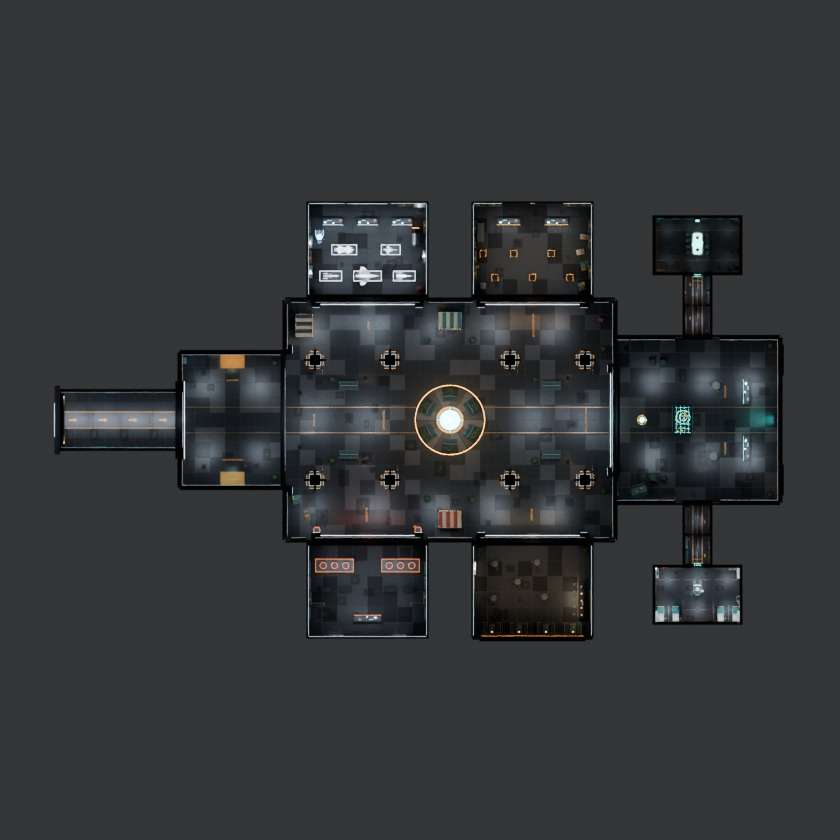
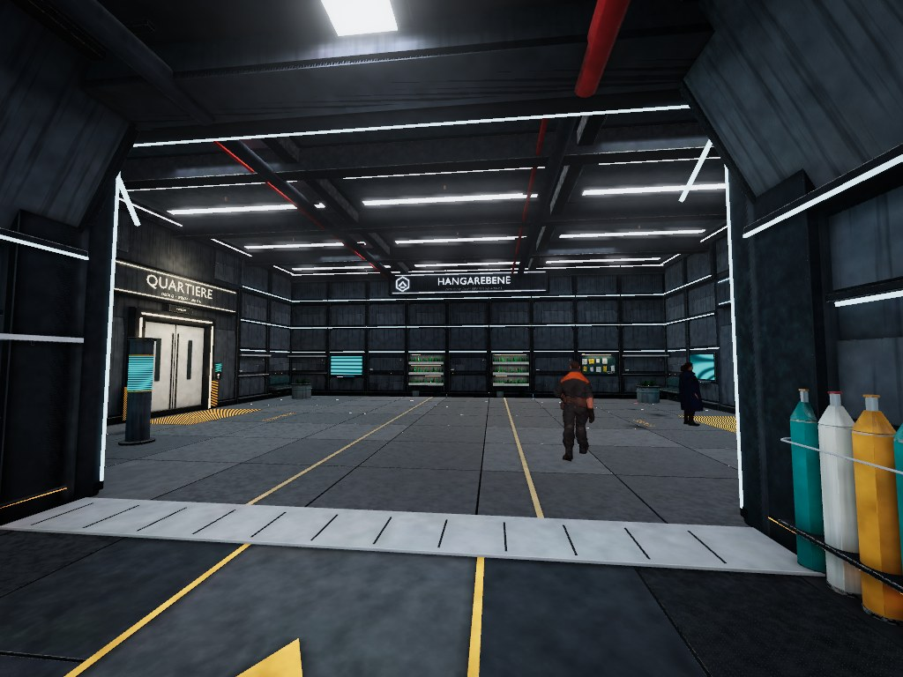
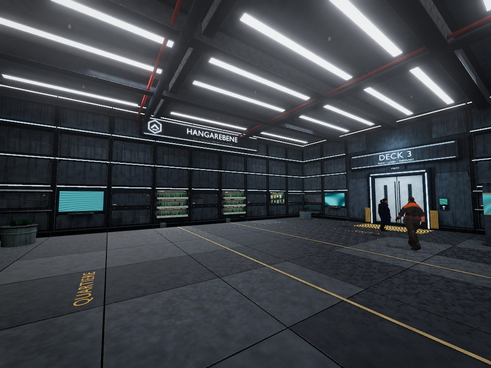
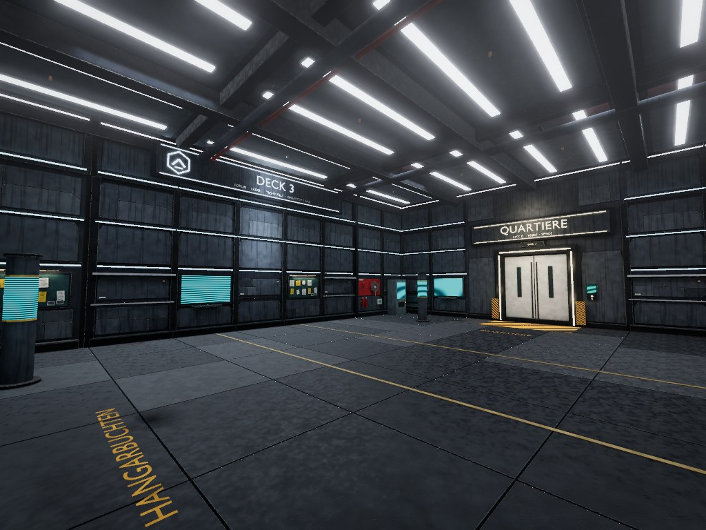

# Bastion: Deck 3, dritte Fassung (Forum)

Seit dem 26.11.2026. Ersetzt die Rundhalle (`docs/rundhalle.md`, Alpha 1.52). Der Nutzer: „Bau die Rundhalle neu, größer, noch schöner als
jetzt, muss auch nicht ein Kreis sein, können mehrere große Bereiche miteinander verbunden sein, die Läden können auch größer sein mit mehr
Details, Ausstellungen der Waren usw“ und, zum Aufzug der Hangarbuchten: „Dass da Quartier steht ist blöd.“ Später am selben Tag: „Baue für die
Ausrüstungen Manny Skelette und packe die neuen Overalls und Rucksäcke Helme hin. Versuche den Look so nah wie möglich wie in Blender ins
Spiel zu bringen.“

## Zwei Ebenen (seit dem 27.11.2026)

Der Nutzer nach der Freigabe von Alpha 1.67: „Bei dem Hangar für die Spieler. Dort soll kein Deck sein, nur Hangarzugang und die beiden Aufzüge.
Nicht nochmal Treffpunkt und Läden“. Vorher ging man vom Hangar durch Korridor und Vorhalle zu Fuß ins Forum; wer mit dem Aufzug in seine
Bucht fuhr, stand danach wieder vor demselben Deck.

| Ebene | Bereiche | Abschluss |
|---|---|---|
| Hangarebene (`h`) | Hangar, Korridor, Vorhalle | Wand mit dem Schild HANGAREBENE, wo sonst das Forum beginnt |
| Deck 3 (`d`) | Vorhalle, Forum, Läden, Einsatzzentrale, Flügel | Wand mit dem Schild DECK 3 in der Mündung des Korridors |

- Die Vorhalle steht einmal im Modell und gilt für beide Ebenen. Was nur auf einer Ebene da ist, liegt in den Lichtraum-Teilen `pd_ebene_h`
  und `pd_ebene_d` (Abschlusswand, Schrift am Südaufzug, Etagenanzeige, Bodenschrift). Beim Backen stehen diese beiden Teile nur für ihr
  eigenes Bild in der Szene (`lm2_raum.py`, Angabe `solo`), das Licht der übrigen Teile bleibt, wie es war.
- Der Südaufzug verbindet die Ebenen. Auf der Hangarebene heißt er DECK 3 und fährt mit **E** ohne Auswahl hinauf. Auf Deck 3 heißt er
  HANGARBUCHTEN und zeigt die Buchtenwahl (eigene Bucht, Einladungen, Gäste einladen).
- Der Aufzug QUARTIERE steht auf beiden Ebenen; nach dem Quartier kommt man auf der Ebene an, von der man gefahren ist.
- Spieldaten: `ebenen` in `deck_bastion3.json` (Ebene je Lichtraum-Teil, Ebene je Weg der Läufer, Sperre je Ebene).
- Spiel: `deck.ts` (`EBENE`, `Deck.ebenen`, `seen` mit Ebene, Wegweiser über den Aufzug), `interior.ts` (`ebeneFahrt`, `buchtFahrt`,
  `stationEbene`). Wer in einem Bereich steht, den es nur auf einer Ebene gibt (Testlabor, Story-Bot, Spielstand), ist von selbst auf dieser
  Ebene. Im Spielstand steht `eb: 'd'`, wenn der Pilot auf Deck 3 war (in der Vorhalle sagt der Ort allein es nicht).
- Im Netz gehört die ganze Hangarebene zur Bucht (`<station>#h:<Besitzer>`): In Korridor und Vorhalle der Bucht sieht man nur, wer in
  derselben Bucht ist.
- Blender: `pd_lauf.py` zeigt je Ansicht die passende Ebene (`EBENE_H` in `pd_deck.py`: gang, hangarebene, deckaufzug).

## Aufbau

Plan: x nach Osten, vom Hangartor weg; y nach Norden. Maße im Baukasten ab dem Tor (x = 0); die Spieldaten liegen um 32 m verschoben
(Tor bei x = −32), damit das Quartier (Anbau bei x 0, y 150) seinen Platz behält.

| Bereich | Maße | Inhalt |
|---|---|---|
| Korridor (nur Hangarebene) | 16 × 8 m, 5 m hoch | vier Joche wie bisher, Tor zum Hangar 7 × 4,4 m |
| Vorhalle (beide Ebenen) | 14 × 18 m, 6,2 m hoch | zwei Aufzüge mit eigenem Leuchtschild: QUARTIERE (Nordwand) und an der Südwand HANGARBUCHTEN (Deck 3) oder DECK 3 (Hangarebene) |
| Forum | 44 × 32 m; Mittelschiff 16 m breit und 11 m hoch, Seitenschiffe 8,4 m | acht Stützen, Lichtgaden, Trommel (Radius 7 m, Decke 14,6 m) über dem Treffpunkt mit der Galaxiekarte, Marktstände, Banner, Bänke, Laternen |
| vier Läden | je 16 × 13 m, 4,6 m hoch, Portal 12 × 4,2 m | siehe unten |
| Einsatzzentrale | 22 × 22 m, 6,2 m hoch | Aufträge und Missionen an zwei Tresen vor der Auftragswand, Lagetisch, Fenster nach Osten; Türen zu Besprechung (Nord) und Krankenstation (Süd) |

| Laden | Lage | Dienste | Auslage |
|---|---|---|---|
| WERFT | Nordwest | Werft, Werkstatt, Service | fünf Schiffsmodelle aus den echten Fernmodellen (Milan, Dohle, Elster, Harpyie, Wisent) auf Sockeln, Bauplanwand, Lackmuster, Triebwerk auf dem Bock, Schiffsholo |
| HANDELSKONTOR | Nordost | Markt, Lager | sechs Erzvitrinen (Eisen, Kupfer, Titan, Iridium, Eis, Ferrit), Barrenstapel, Kurstafeln, Warenregale, Prüfwaage |
| AUSRÜSTER | Südwest | Ausrüster | acht Schaupuppen mit der echten Ausrüstung (siehe unten), Waffenwände, Helmregale, zwei Rucksackwände, Vitrinen, Stiefelbänke |
| KANTINE | Südost | Kantine (Kulisse, vergibt eine Stationsaufgabe) | Fensterfront ins All mit vier Sitznischen, Theke mit Flaschenwand, Bistrotische |

## Schaupuppen

Die Sockel mit Schild und Preis stehen im Deck (`pd_kit.py n_pd_puppensockel`), die Figuren stellt das Spiel auf (`src/game/schaupuppe.ts`):
je Puppe ein eigenes UE5-Skelett (`figur.ts`), darauf der Körper von Figur 1 in mattem Puppengrau ohne Haare (`Tracht.puppe`) und die echten
Ausrüstungsteile aus dem Paket des Nutzers. Plätze und Tracht stehen in `pd_deck.py` (`TRACHTEN`) und kommen über die Deckdaten (`puppen`).

| Schild | trägt |
|---|---|
| FELDOVERALL | overall_01, stiefel_01 |
| GEFECHTSSATZ | overall_01, weste_01, helm_01, handschuh_01, stiefel_01 |
| RAUMANZUG | overall_02, handschuh_01, stiefel_02 |
| EVA-SATZ | overall_02, helm_02, handschuh_01, stiefel_02 |
| GEFECHTSHELM GH-2 | helm_01, stiefel_01 |
| PLATTENTRÄGER PT-3 | weste_01, handschuh_01, stiefel_01 |
| EVA-HELM | helm_02, stiefel_02 |
| RAUMSTIEFEL | handschuh_01, stiefel_02 |

- Haltung: ein Standbild aus der Stehbewegung des Bewegungssatzes (je Puppe ein anderer Zeitpunkt), danach stehen die Knochen fest.
- Licht: festes Ladenlicht von oben in den Materialien der Puppen (die Strahler des Decks gehen mit dem Piloten mit).
- Geladen wird erst in der Nähe des Ladens (46 m), gezeichnet bis 62 m und nur im Blickfeld; beim Verlassen des Innenraums wird alles freigegeben.
- Rucksäcke: Im Paket gibt es dafür kein Modell. An der Rückwand hängen drei Auslagestücke aus dem Baukasten (Umhängetasche, Feldrucksack,
  Lastengestell); an den Puppen hängt keiner.

## Aufzüge

- QUARTIERE (Nordwand der Vorhalle): wie bisher (`quartier.ts`), ohne den Block „Hangarbuchten“.
- HANGARBUCHTEN (Südwand der Vorhalle, Deck 3): eigener Ansprechpunkt „Aufzug · Hangarbuchten“ (`interior.ts`, Modus `bucht` in `ui/dock.ts vQuartier`):
  eigene Bucht, Einladungen annehmen, Gäste einladen (`docs/hangarbuchten.md`). Auf der Hangarebene ist es der Aufzug DECK 3 (`ebeneFahrt`).

## Dateien

| Datei (asset-src/neu/bastion) | Inhalt |
|---|---|
| `pd_kit.py` | Bausteine: Böden, Decken, Hochwände, Stützen, Lichtgaden, Trommel, Ladenschale, Aufzugfront, Durchgang, Fenster; Auslagen der Läden |
| `pd_deck.py` | Aufbau aus den Bausteinen (dazu die der Rundhalle aus `rh_kit.py`, `rh_leben.py`), Lampen, Kameras, `TRACHTEN` |
| `pd_lauf.py` | bauen und rendern: `blender -b --python pd_lauf.py -- <ansicht …> [--pct=60] [--samples=64] [--tris=1]` → `BastionDeck3.blend`, `pd-<ansicht>.jpg` |
| `pd_spiel.py` | Spieldaten `asset-src/data/deck_bastion3.json` und die Teile für den Lichtraum 2 (`lm2_deck3.json`) |
| `pd_back_lauf.py` | bauen, Spieldaten schreiben, Licht backen (`lm2_raum.py`): `blender -b --python pd_back_lauf.py [-- nur_daten]`, danach `npm run assets` |

`rh_deck.py` und `rh_leben.py` laufen dabei nur als Helfer (`NUR_HELFER_RH`), ihr eigener Aufbau der Rundhalle bleibt aus.

## Im Spiel (`src/game/deck.ts buildRund`)

Das Deck benutzt weiter den Aufbau der Rundhalle (Vielecke für Lauf- und Standflächen, Orte mit Deckenhöhe, Lichtraum 2). Neu sind Angaben
für freie Grundrisse, alle wahlweise (ohne sie gilt die alte Rundhalle):

| Feld | Bedeutung |
|---|---|
| `zonen`, `sicht` | Sichtzonen als Vielecke (der erste Treffer gilt) und je Zone die Zonen, in denen man Figuren sieht |
| `tore` | Tore zwischen den Zonen: Der Wegweiser sucht darüber den Weg (Breitensuche), der Hangar hängt über das Tor am Korridor |
| `lampen` | je Lichtraum-Teil Höhe und Reichweite der Schlüssellampen |
| `tiefe`, `weit` | Tiefe des Decks ab dem Hangartor (112 m) und Sichtweite der Bereiche (150 m: das ganze Deck) |
| `aufzug` | Aufzüge Quartiere und Hangarbuchten (x, y, Blick in Grad) |
| `puppen` | Schaupuppen (Ort, Höhe, Blick, Teile, Schild) |
| `abgang` | wohin die Figuren der Geschichte nach ihrem Auftritt gehen (in die Vorhalle, aus der Sichtlinie zum Hangar) |

Lichtraum: 16 Teile (Korridor, Vorhalle, Forum West und Ost je Boden, Wand, Decke, vier Läden, Einsatzzentrale, zwei Flügel).

## Geprüft und offen

Zwei Ebenen, geprüft am 27.11.2026 (Entwicklungsserver): Laufprobe je Ebene (`__walkRund`: alle Ansprechpunkte und Wegpunkte erreichbar, vom Hangar aus ist das Forum zu), Aufzugfahrt in beide Richtungen, Wegweiser über den Aufzug, Spielstand mit Ebene, Story-Bot durch Prolog und fünf Kapitel ohne Fehler, zwei Spieler (getrennte Hangarebenen, gemeinsames Deck 3, Einladung in die Bucht, Rückfahrt), Bildvergleich mit Blender. Nicht geprüft: die gebaute Fassung.

Geprüft am 27.11.2026 (Entwicklungsserver): alle Ansprechpunkte, die Galaxiekarte und alle Wegpunkte der Läufer erreichbar
(`scripts/decktest.js __walkRund`), beide Aufzüge (Fahrt in die Bucht, ins Quartier und zurück), Wegweiser durch die Portale, Story-Bot durch
Prolog und fünf Kapitel ohne Fehler, Bildvergleich mit den Blender-Ansichten. Gebaute Fassung: Start über „Weiterspielen“ auf dem Deck, Laden
und Puppen sichtbar, keine Fehler in der Konsole.

Lehren:
- Eine durchgehende Rückwand (`Seite.rueck`) verschloss zuerst alle Portale. Vor dem Backen die Ansichten rendern, die DURCH die Öffnungen
  schauen (`gang`, `forum`, `ausruester`, `kantine`), nicht nur die von innen.
- Erst die Daten prüfen (`pd_back_lauf.py -- nur_daten`, `npm run assets`, `__walkRund`), dann backen: Der Bake dauert 28 Minuten.
- Unter dem Boden liegt im Spiel eine dunkle Fläche (`Deckunterlage`): Durch die Fuge an der Rinne des Korridors schien sonst das All.

Offen:
- Rucksäcke nur als Auslage an der Wand; an den Puppen erst, wenn es Modelle dafür gibt.
- Der Boden spiegelt im Spiel schwächer als in Blender.
- Nicht geprüft: zwei Spieler zugleich auf dem neuen Deck, Bildrate auf einem schwachen Rechner, Lückensuche über alle Blickrichtungen.
