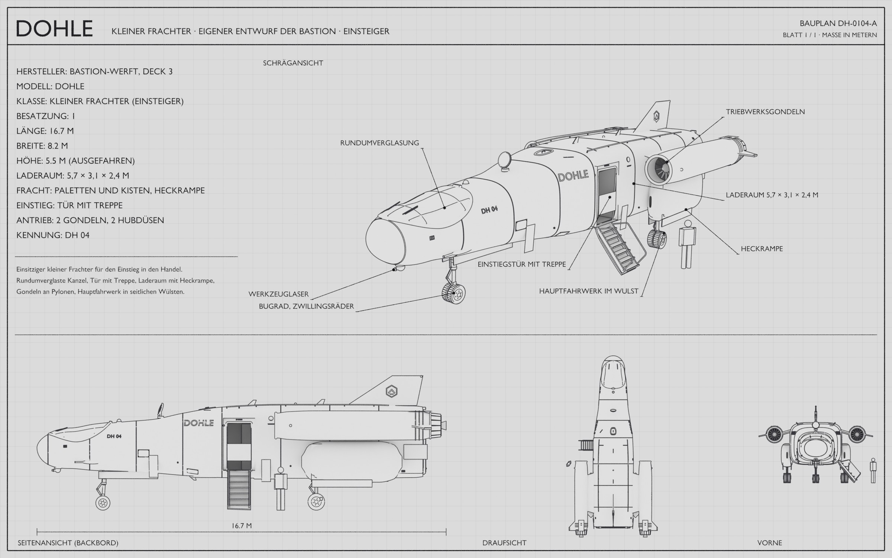
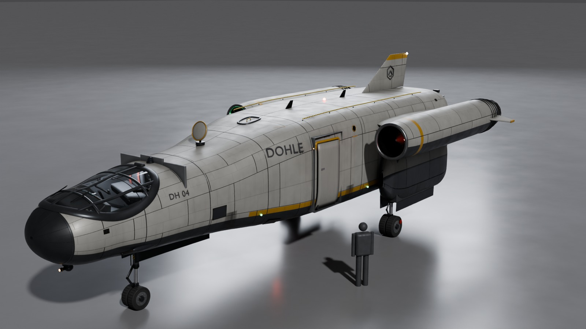
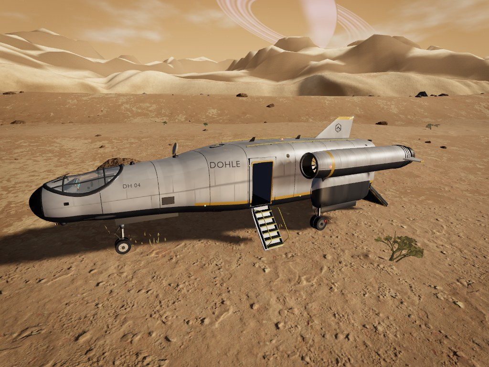
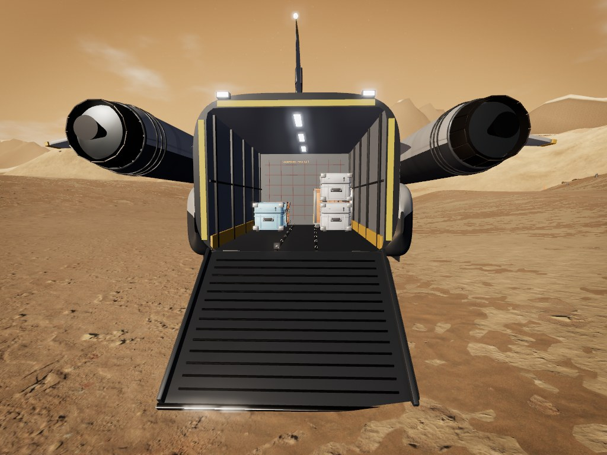
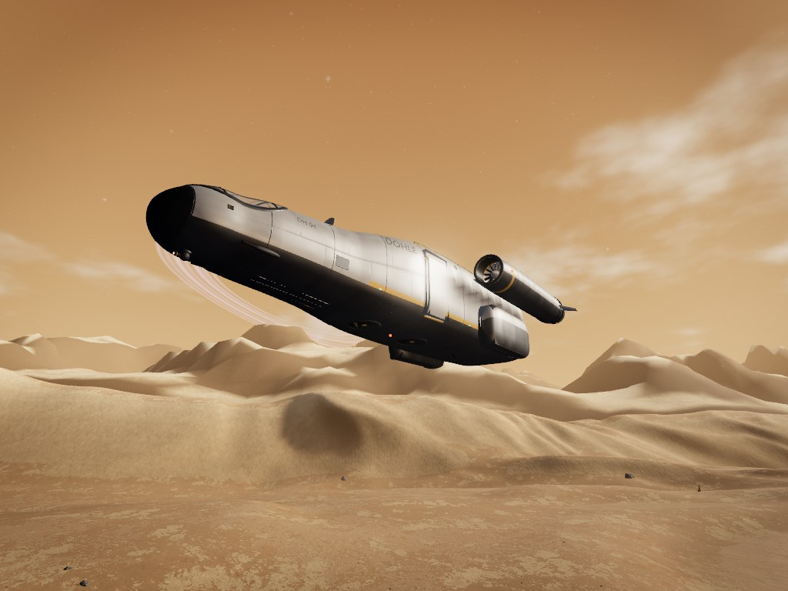

# Dohle: kleiner Frachter für Einsteiger

Gebaut am 25.11.2026, als Gegenstück zum Milan. Wunsch des Nutzers: ein zweiter Einsteigerflieger, „frachtfreundlich“, einsitzig, „genauso viel Mühe wie jetzt“. Eigener Entwurf ohne Vorbild. Der Name passt zu den Vögeln der Bastion (Milan, Elster, Kormoran).







## Maße und Aufbau

16,7 × 8,2 × 5,5 m (Fahrwerk ausgefahren). Achsen wie beim Milan: +X nach vorn, +Y Backbord, +Z oben, Boden bei z = 0. Rund 189.000 Dreiecke in Blender.

- **Rumpf:** Superellipsen-Spanten. Stumpfe Cockpitnase mit Rundumverglasung, Übergang, kastenförmiges Frachtmodul, offenes Heck. Oben Sandweiß, unten Schiefer, Ocker für Kanten und Warnmarken, dunkle Nase. Plattenfugen und Nieten im Shader.
- **Cockpit:** hinter der Verglasung Sitz, Pult mit Anzeigen, Deckenpult und Konsolen. Stufen führen hinunter in den Gang.
- **Einstieg:** Tür links mit eingebauter Treppe. Sie klappt unten angeschlagen nach außen bis auf den Boden. Dahinter liegen ein Vorraum und ein Gang nach vorn.
- **Laderaum:** 5,7 × 3,1 × 2,4 m für Paletten und Normkisten. Heckrampe bis zum Boden, Zurrschienen, Leuchten, Netz, Warnmarken, Aufschrift „LADERAUM · MAX 2,5 T“.
- **Antrieb:** zwei Gondeln oben an Pylonen (Einlauf mit Lüfterrad, Schubdüse mit Klappen), Leitflossen, Seitenleitwerk. Zwei Hubdüsen unter dem Rumpf.
- **Fahrwerk (einziehbar):**
  - Bugbein mit Zwillingsrädern, fährt nach hinten ein, zwei Klappen
  - Hauptbeine mit Zwillingsrädern, fahren nach hinten in seitliche Wülste, je zwei Klappen
- **Sonst:** Ladescheinwerfer über der Heckluke, Dachluke mit Handläufen, Antennen, Positionslichter, Werkzeuglaser unter dem Kinn, zwei leichte Kanonen an den Rumpfseiten, Steuerdüsen, Wartungsklappen, Beschriftung (DH 04, DOHLE, EINSTIEG).

## Bewegliche Teile

Wie beim Milan hängen die Teile an Gelenken (`gelenk()` aus `mil_kit.py`). `zustand(fw, rampe, tuer)` stellt jeden Zustand. `doh_export.py` schreibt `doh-gelenke.json`.

| Gruppe | Teile | im Spiel |
|---|---|---|
| fw (3,6 s) | Bugbein, zwei Bugklappen, zwei Hauptbeine, vier Wulstklappen | `setGear`: im Flug eingefahren, im Landeanflug und am Boden ausgefahren |
| rampe (3,5 s) | Heckrampe | `setDoors`: am Boden offen, im Flug, wenn der Traktorstrahl eine Kiste heranzieht |
| tuer (2,4 s) | Tür mit Treppe | `setDoors`, nur bei ausgefahrenem Fahrwerk (`boden`) |

## Im Spiel

- Klasse `dohle` (`src/data/ships.ts`), 1.500 Cr in jeder Werft. Werte: Hülle 150, Schild 40, Tempo 235, Wendigkeit 0,75, Fracht 60, Munition 200, keine Flugkörper, Bergbaulaser 0,7. Zum Vergleich der Milan: Hülle 115, Tempo 290, Fracht 10.
- Laderaum `RAEUME.Dohle` (`src/game/laderaum.ts`): zwei Reihen. Die Ladung steht sichtbar als Kisten und Paletten darin. Paletten passen, Halbcontainer nicht (nur Wisent). Kein Stellplatz für Fahrzeuge.
- Traktorstrahl: Ladepunkt ist die Rampenspitze, die Rampe öffnet, wenn eine Kiste naht.
- Landen: Die Rampe muss aufsetzen (`aufsetzen`, wie bei Kormoran und Wisent). Auf schrägem Boden bleibt das Schiff waagrecht und die Nase steht höher.
- Zu Fuß: Aussteigen am Fuß der Treppe (`treppenFuss` in `ausstieg.ts`), einsteigen in der Nähe mit E. Außenbordeinsatz über die Rampe (Laderaum wird leer gepumpt).
- Ohne Fahrzeug-Stellplatz zeigt der Rover keinen Hinweis „über die Rampe hineinfahren“. Man steigt neben dem Schiff ein (`surface.ts`, `stellplaetze`).
- Anker in Schiffskoordinaten (Mitte des Modells 1,0 / 0 / 2,746):
  - Düsen ±2,95 / 0,7 / 8,15
  - Kanonen ±1,0 / −0,79 / −6,81
  - Laser 0 / −1,12 / −7,74
- HUD-Umriss `SIL.dohle` (`src/ui/hud.ts`). Fliegt auch im Stadtverkehr (`city.ts`).
- Weg: `sh asset-src/neu/dohle/doh_spiel.sh`, danach `npm run assets`.
  - `Dohle.glb`: 189.000 → 113.000 Dreiecke
  - `DohleFern.glb`: 39.000 Dreiecke

## Dateien

`asset-src/neu/dohle/`:
- `doh_kit.py` (Bau; Helfer aus `../milan/mil_kit.py`)
- `doh_lauf.py` (ohne Fenster bauen und rendern)
- `doh_export.py`, `doh_spiel.sh`
- Bilder `doh-*.jpg`

```bash
cd asset-src/neu/dohle && /c/EXTRA/Blender/blender.exe -b --python doh_lauf.py -- alle
cd asset-src/neu/dohle && /c/EXTRA/Blender/blender.exe -b --python doh_lauf.py -- bauplan
```

## Gelernt

- Die Fächer der Fahrwerkswülste ragten zuerst unten heraus. `sp_bot()` rechnet die Unterkante des Wulsts und schneidet die Kästen darauf zu.
- `matrix_world` gleich nach dem Erzeugen ist noch die Einheitsmatrix (der Depsgraph ist nicht gelaufen). Die Lage der Wulstklappen daher aus `T(location)` zusammensetzen.
- Beim Spiegeln auf die rechte Seite auch das Vorzeichen der Flossen-y-Achse umdrehen.

## Offen

- Rückmeldung des Nutzers.
- Ob die Dohle zur Wahl beim Spielstart stehen soll (bisher nur Kauf in der Werft).
- Lackierungen aus der Werft greifen nicht (eigene Materialien wie bei allen eigenen Modellen).
