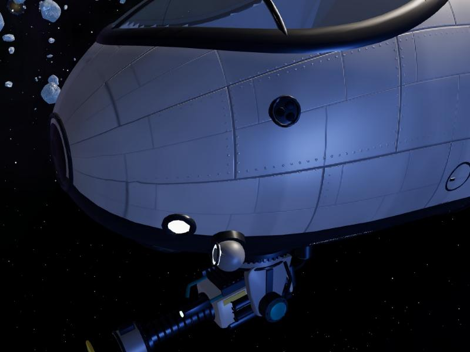

# Elster: einsitziges Bergbauschiff (Schaumodell)

Gebaut am 17.11.2026. Wunsch: „Dieses Schiff entwerfen“ mit Bildern eines Bergbauschiffs aus einem anderen Spiel (Bauplan, Seitenansicht) und eines Bauplan-Posters. Es ist ein **eigener Entwurf in dieser Art, keine Kopie**:

- kantiger Industrie-Look in Altweiß, Grau und Petrol statt Chrom;
- ein Laser auf einem Schwenkturm unter dem Kinn statt eines Greifarms;
- je Seite zwei liegende Erzkanister im Gitterrahmen statt kastenförmiger Erzsäcke;
- zwei tief liegende Triebwerksgondeln und Kühlrippen auf dem Rücken.

Der Name passt zur Prospektor-Klasse `elster` im Spiel, die bisher das gekaufte Modell „Zenith“ nutzt. Seit Alpha 1.39 (17.11.2026) das Modell der Klasse `elster` im Spiel (Abschnitt „Im Spiel“).


## Fassung 2: rund statt kantig (18.11.2026)

Rückmeldung des Nutzers zur ersten Fassung: „Sie sollte wie das Vorbild eher runde Akzente haben, nicht so kantig. Das Modell schaut sehr schlicht aus. Gib dir mehr Mühe.“ `els_kit.py` ist neu geschrieben, die erste Fassung liegt als `els_kit_v1.py` daneben (und im Git, Alpha 1.39). Seit dem 18.11.2026 ist Fassung 2 lokal im Spiel (Abschnitt „Im Spiel: Fassung 2“).

- **Rumpf**: glatte Spanten aus Superellipsen (Breite, Ober- und Unterkante, Exponent je Station in `TBL`, monoton kubisch interpoliert), Eiernase, gerundetes Heck mit kleiner Hilfsdüse. 96 Punkte je Spant, 147 Spanten. Zweifarbig: oben Altweiß, unten Gussgrau, dazwischen ein Petrolband; dunkle Sensorspitze mit Ring.
- **Plattenfugen und Nieten im Shader** (`panel_mat`): UV-Karte „Platten“ mit u = x und v = Winkel × 1,7 m, zwei versetzte Ziegelmuster als Fugen (vertieft), Nieten neben den Hauptfugen (erhaben), Flecken, Schmutz in Ecken, Laufspuren, abgegriffene Kanten. Achtung: Das ist Shader-Arbeit und fürs Spiel erst nach dem Backen sichtbar.
- **Glaskuppel**: Das Glas folgt der Rumpfform (Polarnetz in einer Ellipse auf der Fläche, 12 mm angehoben). Rahmen, Mittelstrebe und zwei Spanten sind Bänder mit rundem Profil auf der Fläche (`hull_band`). Darunter liegt eine Cockpitwanne mit Sitz, Pult, drei Anzeigen und Seitenkonsolen.
- **Runde Wülste** zwischen den Abschnitten (vorn Petrol) mit Nietreihen, feine Hauptfugen, Ring um die Bugspitze.
- **Gondeln**: runde Manteltriebwerke mit Einlasslippe, Lüfterrad (16 Schaufeln, Nabe, Lagerkreuz), Schubdüse mit 16 Klappen, Mittelkegel und Glut, Kühlringe. Pylone im Tropfenprofil, kleine Leitflossen mit runder Kante.
- **Rückenhaube** mit Kühlschlitzen, zwei runden Lüftern, Sensorkuppel davor, Klingenantenne, Blitzlicht.
- **Bergbau**: Kugellaser unter dem Kinn (Drehkranz, Kugel mit Achskappen, Rohr mit vier Fokusspulen, Kühlmantel, Emitter mit Linse). Fangstrahler als Kugelköpfe seitlich am Kinn. Vier Erzkanister mit gewölbten Kappen in ockerfarbenen Rundklammern mit Spannschlössern, gebogenen Tragarmen und Schienen. Handräder, Manometer, Schilder, Erzleitungen mit Schellen.
- **Seiten**: Tür mit runden Ecken, die sich der Wölbung anpasst (`side_patch`), Rahmen, Fenster, Griffe, Leiter. Runde Ladeschleuse mit Irisblende auf beiden Seiten, drei Bullaugen an Steuerbord, runde Wartungsklappen, Lufteinlässe mit runden Enden, Leitungen an der unteren Flanke, Scheinwerfer und Steuerdüsen in runden Töpfen, Kinnfenster.
- **Beine** mit Verkleidung, Knie, rundem Fußteller und drei Fußstreben.
- **Beschriftung**: ELSTER und EL 03 auf den Gondeln, Bastion-Zeichen, kleine Hinweise (NOTÖFFNUNG, EINSTIEG, LADESCHLEUSE, LASERBEREICH FREIHALTEN, WARTUNG, ERDUNG …).
- Rund 23,1 × 8,5 × 5,7 m, etwa 283.000 Dreiecke (fürs Spiel später stark vereinfachen).
- Neue Ansichten `nase` und `gondel`. Der Bauplan zeigt die Hauptfugen über markierte Kanten (Freestyle-Kantenmarken).
- **Nachgeschärft (18.11.2026)**:
  - Das Glas ist klar statt fast schwarz, und die Cockpitwanne ist heller, so sieht man den Innenraum. Dazu kommen ein Steuerknüppel, eine HUD-Scheibe, Pulttasten und ein Pultlicht.
  - Die Kanister sind heller und haben sieben Längsrippen und ein leuchtendes Füllstandsfenster.
  - Neu auf dem Rücken: ein Grat mit Handläufen, eine runde Dachluke mit Griff und eine Radarschale. Auf der Haube sitzen eine Mittelschiene und Warnstreifen, hinten zwei Peitschenantennen.
  - Unterseite: Kiel, runde Bauchklappen, Antennen, Abläufe, rote Bauchlichter und Begrenzungslichter längs der Flanken.
  - Neue Ansichten `ruecken` und `unten` (im Flug, ohne Beine).
- **Fahrwerk und Bergbaulaser neu (18.11.2026)**, Rückmeldung: „Fahrwerk ist noch zu schlicht, ungenau … der Bergbaulaser ist zu schlicht, nicht realistisch“.
  - Jedes Bein (`landing_leg`) hat:
    - einen Schacht mit dunklem Grund und Rahmen und zwei halb offenen Klappen mit Scharnier und Klappenzylinder
    - einen Lagerbock mit Querbolzen und ein Federbein (Zylinder mit Ringen und Warnband, Stopfbuchse, verchromter Kolben, Abstreifer, Gabelkopf)
    - einen Scherenlenker vorn, eine Knickstrebe nach innen mit Gelenk und roter Verriegelung und einen Stellzylinder
    - zwei Hydraulikleitungen mit Schellen, ein Fahrwerkslicht und die Kennung FW 1–4
    - ein Kugelgelenk mit Gabel und einen Fußteller mit Nabe, acht Rippen, Rand, Gummisohle, Bodensensor und Zurraugen
  - Der Bergbaulaser hat:
    - eine Kranzplatte mit Schraubenkranz, einen Zahnkranz (56 Zähne) mit Drehantrieb und Ritzel und eine Jochplatte
    - Gabelarme mit Versteifung, Höhenmotoren mit Deckel und Schrauben und Motorkabel
    - im Laserkopf ein Resonatorgehäuse mit Kühlkörper (14 Rippen), vier Kondensatoren, Kühl- und Energieleitungen und Warnstreifen
    - ein Strahlrohr mit zwei verschraubten Flanschen und Kühlwendel, eine Fokuseinheit mit Motor und eine Linse
    - eine Blende mit acht Lamellen, eine Schutzhaube mit Warnrand, einen Entfernungsmesser und die Aufschrift LASER KL. 4
  - Hilfen dafür: `rod` (Zylinder zwischen zwei Punkten), `slab` (Quader mit eigenen Achsen), `link_bar` (Lenker mit Augen), `bolts`.
  - Neue Nahansichten `fahrwerk`, `fahrwerk2` (Hangar) und `laser`. Das Modell hat jetzt rund 386.000 Dreiecke.

## Aufbau (Fassung 1)

- 22,8 × 7,0 × 6,3 m (mit Beinen), +X nach vorn, Boden bei z = 0. Rund 100.000 Dreiecke.
- **Rumpf**: Facettenkörper aus Stationen (`EX/EW/ET/EB`), Petrolband längs der Flanke, Rücken- und Bauchplatten. Große Kanzel mit tief gezogenen Seitenscheiben, Kinnfenster.
- **Cockpit**: Sitz mit Gurten, Pult mit drei Anzeigen, Armlehnen mit Griffen.
- **Bergbau**: Laserturm (Drehkranz, Gabel, Gehäuse mit vier Fokusspulen, Emitter, Kühlrippen) und zwei Fangstrahler an der Nase. Vier Erzkanister mit Kappen, Spannbändern, Warnband und Füllstutzen in Gitterrahmen mit Tragarmen. Erzleitungen vom Laser zu den Kanistern.
- **Antrieb**: zwei Gondeln mit Einlassgitter, offenen Düsenglocken und Kühlringen auf Pylonen. Zwei schräge Kühlrippenfelder auf dem Rücken.
- **Landung und Einstieg**: vier Beine mit Kniegelenk und Hydraulik, Tür an Backbord mit Leiter.
- **Kleinteile**: Steuerdüsen, Lufteinlässe, Wartungsklappen, Sensormast, Antenne, Positions-, Blitz- und Arbeitslichter (mit Scheinwerfern). Beschriftung ELSTER, EL 03, ERZ 1–4, NICHT BETRETEN, VORSICHT LASER, Bastion-Zeichen.

## Nachgeschärft (17.11.2026)

- Fugen weicher: helleres Fugengrau statt Schwarz (schwarze Linien wirkten auf Weiß wie Fliesen). Die drei Lacktöne liegen näher beisammen, und es gibt keine zufälligen vertieften Klappen mehr.
- Erzrahmen in abgenutztem Ocker statt Schwarz: Industriegerät, gibt der Elster ihren Charakter.
- Kanister mit sieben Längsrippen, Petrolband, Ventil mit Handrad und Manometer.
- Beine kräftiger: dickere Streben, Schutzblech, Kniebolzen.
- Rücken mit Dachluke, zwei Lüftern und Warnstreifen als Laufmarkierung. Haltegriffe neben der Tür.
- Gebrauchsspuren: Laufspuren an den Flanken und Gondeln, Staub unter der Schwelle, Ruß hinter den Gondeln und am Heck, abgelaufene Stellen auf dem Rücken.

## Dateien

`asset-src/neu/elster/`: `els_kit.py` (Bau), `els_lauf.py` (ohne Fenster bauen und rendern; `-- bauplan` erzeugt das Bauplan-Blatt), `els_blatt.py` (Übersichtsblatt).
`els_kit.py` lädt Werkzeuge, Materialien, Bühnen und Kameras aus `../wuerger/wue_kit.py` (`NUR_HELFER = True`) und ersetzt danach Farben und Kameras.

```bash
cd asset-src/neu/elster && /c/EXTRA/Blender/blender.exe -b --python els_lauf.py -- alle
cd asset-src/neu/elster && /c/EXTRA/Blender/blender.exe -b --python els_lauf.py -- bauplan
```

Ansichten: schraeg, draufsicht, seite, front, heck, hangar, cockpit (ohne Glas), detail, weltraum, abbau (Laserstrahl auf einen Felsbrocken mit Erzadern, gelöste Brocken, Glutlicht).

## Bauplan-Blatt

`bauplan()` in `els_kit.py` rendert eine Linienzeichnung (Freestyle auf weißem Einheitsmaterial) in vier Ansichten: Schräg, Seite, Draufsicht, vorne. Dazu kommen ein Raster, Kenndaten und Beschriftungen mit Hinweislinien. Die Hinweislinien rechnet es über `world_to_camera_view` aus den Punkten am Schiff (`PLAN_FEAT`).
Text und Linien rendert eine eigene Szene schwarz auf Weiß, danach werden sie per numpy mit dem Blatt multipliziert. Eigenes Layout, keine Herstellerzeichen anderer Spiele.

## Gelernt

- `Part` aus dem Würger war nicht verschachtelbar. Hier merkt sich jedes `Part` die äußere Liste, das innere Leerobjekt hängt am äußeren.
- Felsbrocken: einzelne eingefärbte Dreiecke sahen nach Spielzeug aus. Besser sind eine feine Unterteilung, dreifache Verformung und Erzadern im Shader.
- Cockpitbilder ohne Kanzelglas rendern, sonst sieht man nur Spiegelungen.

## Im Spiel: Fassung 2 (18.11.2026, noch nicht veröffentlicht)




- Weg: `sh asset-src/neu/elster/els_spiel.sh`, danach `npm run assets`. Das Skript baut Elster.blend neu, exportiert mit `els_export.py` und vereinfacht in zwei Stufen:
  - `Elster.glb` (nah): 386.000 → 161.000 Dreiecke, Fehler 0,0005 (rund 1 cm), gepackt 2,3 MB
  - `ElsterFern.glb` (fern): 32.000 Dreiecke, 0,65 MB
- **Plattenfugen ohne Texturen**: Die Rumpfmaterialien heißen `ext_pan_weiss/gun/petrol/dunkel`. Ihre Texturkoordinaten sind Meter auf dem Rumpf, wie die UV „Platten“ in Blender.
  - `panelShader` in `src/models/gltfShips.ts` rechnet Fugen, Unterfugen, Nieten, Flecken und Laufspuren im Shader nach dem Muster des Blender-Shaders. Die Fugen sind über die Normale vertieft, die Nieten erhaben, und sie werden matter.
  - Das ist gestochen scharf in jeder Nähe, braucht keinen Texturspeicher und blendet Linien aus, sobald sie kleiner als ein Pixel werden.
  - Kanten-Abrieb (Bevel) und Ecken-Schmutz (AO) aus Blender fehlen im Spiel.
- Der Vorsatz `ext_` sorgt dafür, dass die Texturkoordinaten erhalten bleiben: `simplify-hard.mjs` entfernt sie nicht mehr (auch nicht beim Aufräumen), und `build-assets.mjs` packt sie ungerundet (Baukasten-Pfad).
- **Fernmodell**: `modelInstance` baut ein `THREE.LOD`, wenn es ein Modell `<Name>Fern` gibt, und schaltet ab sechs Schiffslängen um (bei der Elster 139 m).
- Glas: hell getönt, Alpha 0,22. Das Cockpit mit Sitz und Pult ist durch das Glas sichtbar.
- Umrechnung Blender → Schiffskoordinaten (Mitte des Modells −0,75 / 0 / 3,311): x = −y, y = z − 3,311, z = −(x + 0,75). Die Punkte schreibt `els_kit.py` nach `els-anker.json`.
- Spielpunkte:
  - Triebwerksglut ±3,15 / −0,01 / 11,25
  - Laser aus der Linse 0 / −2,39 / −11,09
  - Kanone am Fangstrahler 1,32 / −0,74 / −10,49
- Länge 23,1 m. Die HUD-Silhouette ist neu: runder Rumpf, Gondeln, Kanister.
- Das Fahrwerk samt Schacht und Klappen trägt das Material „gear“: Im Flug ist es ausgeblendet, im Hangar steht es auf dem Boden.
- Geprüft:
  - Entwicklungsfassung: Flug, Nahaufnahme mit Fugen und Nieten, Fernmodell-Umschaltung (nah 161.000, fern 32.000 Dreiecke), Landung im Hangar
  - gebaute Fassung: Spielstand mit Elster im All geladen, Triebwerksglut sichtbar, keine Konsolenfehler

## Im Spiel: Fassung 1 (Alpha 1.39)

- Klasse `elster` (src/data/ships.ts): Modell `Elster` statt des gekauften „Zenith“, Länge 22,8 m. Werte unverändert (Prospektor, 3.200 Cr). Unter 30 m: man steigt im Hangar ein und fliegt los.
- Weg: `sh asset-src/neu/elster/els_spiel.sh` (baut Elster.blend neu, `els_export.py` → Elster_roh.glb, simplify-hard 0,6 → asset-src/glb/ship/Elster.glb, 85.000 → 52.000 Dreiecke, 2,2 MB), danach `npm run assets`.
- Umrechnung Blender → Schiffskoordinaten (Nase nach −Z, Mitte des Modells im Ursprung): x = −y, y = z − 3,13, z = −(x + 0,8).
- Triebwerksglut an den Düsen (±2,35 / 0,02 / 11,4), Bergbaulaser aus dem Emitter des Laserturms (0 / −2,14 / −11,1), Kanonen an den Fangstrahlern (±0,85 / −1,13 / −10,4). HUD-Silhouette `SIL.elster` neu (src/ui/hud.ts).
- Beine und Leiter tragen das Material „gear“: im Flug ausgeblendet, im Hangar stehen sie auf dem Boden. Geprüft in der Entwicklungsfassung (Flug, Heck, Landung im Hangar) und in der gebauten Fassung.
- Alles, was die Klasse `elster` nutzt, zeigt jetzt das neue Modell: Verkehr in der Stadt (city.ts NPC_CLS), Wracks (salvage.ts). Das Zenith-Modell bleibt im Paket für die Vorschau.

## Offen

- Animation für Beine und Leiter (bisher nur ein- und ausgeblendet). Die Lackierungen aus der Werft greifen nicht, weil das Modell eigene Materialien hat (wie Kormoran und Würger).
- Rückmeldung des Nutzers.
