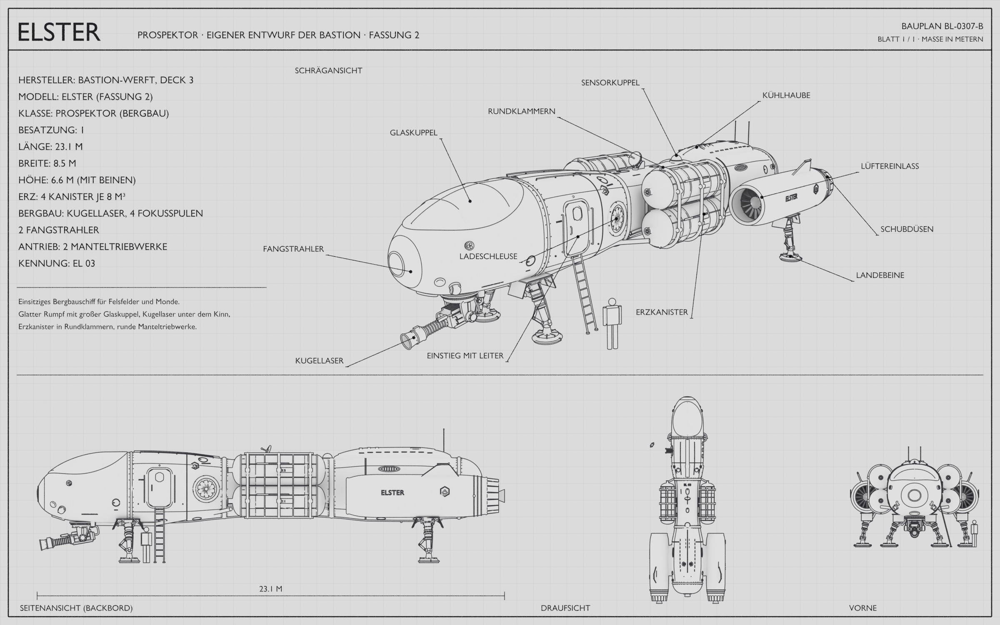
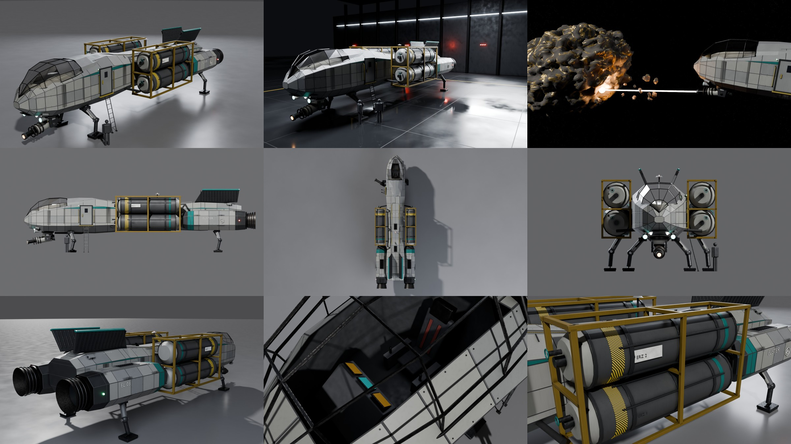
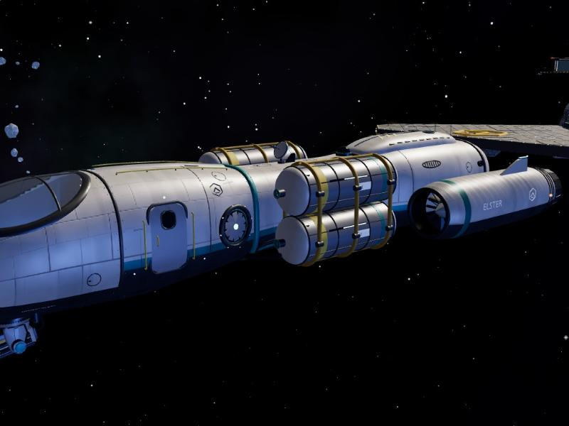

# Elster: einsitziges Bergbauschiff (Schaumodell)

Gebaut am 17.11.2026. Wunsch: „Dieses Schiff entwerfen“ mit Bildern eines Bergbauschiffs aus einem anderen Spiel (Bauplan, Seitenansicht) und eines Bauplan-Posters. Es ist ein **eigener Entwurf in dieser Art, keine Kopie**:

- kantiger Industrie-Look in Altweiß, Grau und Petrol statt Chrom;
- ein Laser auf einem Schwenkturm unter dem Kinn statt eines Greifarms;
- je Seite zwei liegende Erzkanister im Gitterrahmen statt kastenförmiger Erzsäcke;
- zwei tief liegende Triebwerksgondeln und Kühlrippen auf dem Rücken.

Der Name passt zur Prospektor-Klasse `elster` im Spiel, die bisher das gekaufte Modell „Zenith“ nutzt. Seit Alpha 1.39 (17.11.2026) das Modell der Klasse `elster` im Spiel (Abschnitt „Im Spiel“).




## Aufbau

- 22,8 × 7,0 × 6,3 m (mit Beinen), +X nach vorn, Boden bei z = 0. Rund 100.000 Dreiecke.
- **Rumpf**: Facettenkörper aus Stationen (`EX/EW/ET/EB`), Petrolband längs der Flanke, Rücken- und Bauchplatten. Große Kanzel mit tief gezogenen Seitenscheiben, Kinnfenster.
- **Cockpit**: Sitz mit Gurten, Pult mit drei Anzeigen, Armlehnen mit Griffen.
- **Bergbau**: Laserturm (Drehkranz, Gabel, Gehäuse mit vier Fokusspulen, Emitter, Kühlrippen) und zwei Fangstrahler an der Nase. Vier Erzkanister mit Kappen, Spannbändern, Warnband und Füllstutzen in Gitterrahmen mit Tragarmen. Erzleitungen vom Laser zu den Kanistern.
- **Antrieb**: zwei Gondeln mit Einlassgitter, offenen Düsenglocken und Kühlringen auf Pylonen. Zwei schräge Kühlrippenfelder auf dem Rücken.
- **Landung und Einstieg**: vier Beine mit Kniegelenk und Hydraulik, Tür an Backbord mit Leiter.
- **Kleinteile**: Steuerdüsen, Lufteinlässe, Wartungsklappen, Sensormast, Antenne, Positions-, Blitz- und Arbeitslichter (mit Scheinwerfern). Beschriftung ELSTER, EL 03, ERZ 1–4, NICHT BETRETEN, VORSICHT LASER, Bastion-Zeichen.

## Nachgeschärft (17.11.2026)

- Fugen weicher: helleres Fugengrau statt Schwarz (schwarze Linien wirkten auf Weiß wie Fliesen). Die drei Lacktöne liegen näher beisammen, und es gibt keine zufälligen vertieften Klappen mehr.
- Erzrahmen in abgenutztem Ocker statt Schwarz: Industriegerät, gibt der Elster ihren Charakter.
- Kanister mit sieben Längsrippen, Petrolband, Ventil mit Handrad und Manometer.
- Beine kräftiger: dickere Streben, Schutzblech, Kniebolzen.
- Rücken mit Dachluke, zwei Lüftern und Warnstreifen als Laufmarkierung. Haltegriffe neben der Tür.
- Gebrauchsspuren: Laufspuren an den Flanken und Gondeln, Staub unter der Schwelle, Ruß hinter den Gondeln und am Heck, abgelaufene Stellen auf dem Rücken.

## Dateien

`asset-src/neu/elster/`: `els_kit.py` (Bau), `els_lauf.py` (ohne Fenster bauen und rendern; `-- bauplan` erzeugt das Bauplan-Blatt), `els_blatt.py` (Übersichtsblatt).
`els_kit.py` lädt Werkzeuge, Materialien, Bühnen und Kameras aus `../wuerger/wue_kit.py` (`NUR_HELFER = True`) und ersetzt danach Farben und Kameras.

```bash
cd asset-src/neu/elster && /c/EXTRA/Blender/blender.exe -b --python els_lauf.py -- alle
cd asset-src/neu/elster && /c/EXTRA/Blender/blender.exe -b --python els_lauf.py -- bauplan
```

Ansichten: schraeg, draufsicht, seite, front, heck, hangar, cockpit (ohne Glas), detail, weltraum, abbau (Laserstrahl auf einen Felsbrocken mit Erzadern, gelöste Brocken, Glutlicht).

## Bauplan-Blatt

`bauplan()` in `els_kit.py` rendert eine Linienzeichnung (Freestyle auf weißem Einheitsmaterial) in vier Ansichten: Schräg, Seite, Draufsicht, vorne. Dazu kommen ein Raster, Kenndaten und Beschriftungen mit Hinweislinien. Die Hinweislinien rechnet es über `world_to_camera_view` aus den Punkten am Schiff (`PLAN_FEAT`).
Text und Linien rendert eine eigene Szene schwarz auf Weiß, danach werden sie per numpy mit dem Blatt multipliziert. Eigenes Layout, keine Herstellerzeichen anderer Spiele.

## Gelernt

- `Part` aus dem Würger war nicht verschachtelbar. Hier merkt sich jedes `Part` die äußere Liste, das innere Leerobjekt hängt am äußeren.
- Felsbrocken: einzelne eingefärbte Dreiecke sahen nach Spielzeug aus. Besser sind eine feine Unterteilung, dreifache Verformung und Erzadern im Shader.
- Cockpitbilder ohne Kanzelglas rendern, sonst sieht man nur Spiegelungen.

## Im Spiel (Alpha 1.39)



- Klasse `elster` (src/data/ships.ts): Modell `Elster` statt des gekauften „Zenith“, Länge 22,8 m. Werte unverändert (Prospektor, 3.200 Cr). Unter 30 m: man steigt im Hangar ein und fliegt los.
- Weg: `sh asset-src/neu/elster/els_spiel.sh` (baut Elster.blend neu, `els_export.py` → Elster_roh.glb, simplify-hard 0,6 → asset-src/glb/ship/Elster.glb, 85.000 → 52.000 Dreiecke, 2,2 MB), danach `npm run assets`.
- Umrechnung Blender → Schiffskoordinaten (Nase nach −Z, Mitte des Modells im Ursprung): x = −y, y = z − 3,13, z = −(x + 0,8).
- Triebwerksglut an den Düsen (±2,35 / 0,02 / 11,4), Bergbaulaser aus dem Emitter des Laserturms (0 / −2,14 / −11,1), Kanonen an den Fangstrahlern (±0,85 / −1,13 / −10,4). HUD-Silhouette `SIL.elster` neu (src/ui/hud.ts).
- Beine und Leiter tragen das Material „gear“: im Flug ausgeblendet, im Hangar stehen sie auf dem Boden. Geprüft in der Entwicklungsfassung (Flug, Heck, Landung im Hangar) und in der gebauten Fassung.
- Alles, was die Klasse `elster` nutzt, zeigt jetzt das neue Modell: Verkehr in der Stadt (city.ts NPC_CLS), Wracks (salvage.ts). Das Zenith-Modell bleibt im Paket für die Vorschau.

## Offen

- Animation für Beine und Leiter (bisher nur ein- und ausgeblendet). Die Lackierungen aus der Werft greifen nicht, weil das Modell eigene Materialien hat (wie Kormoran und Würger).
- Rückmeldung des Nutzers.
