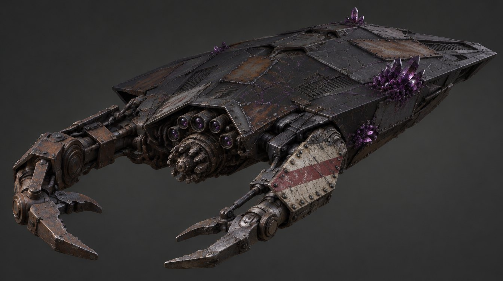
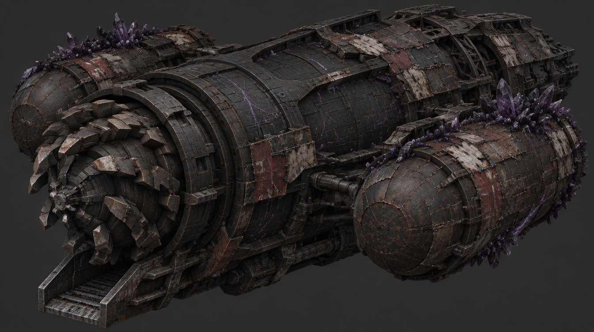
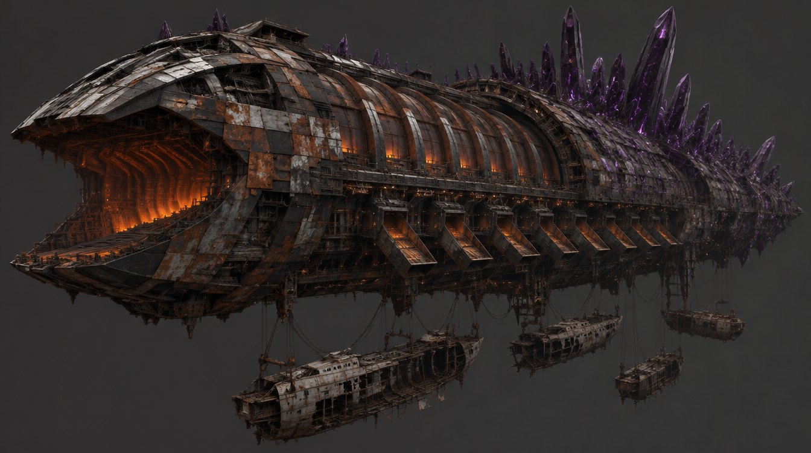
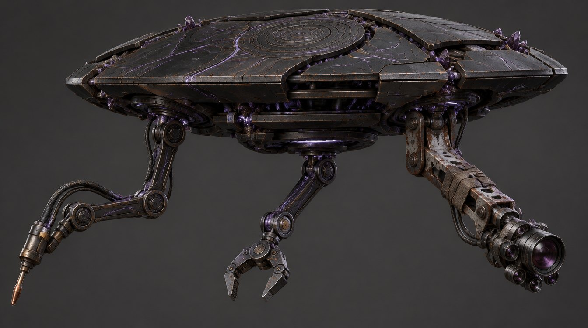
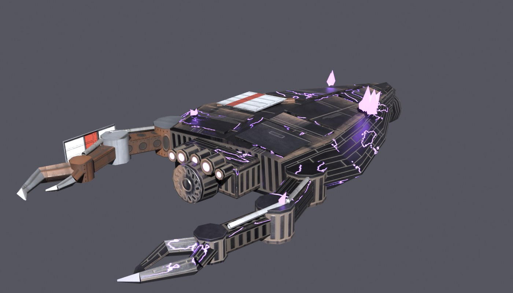
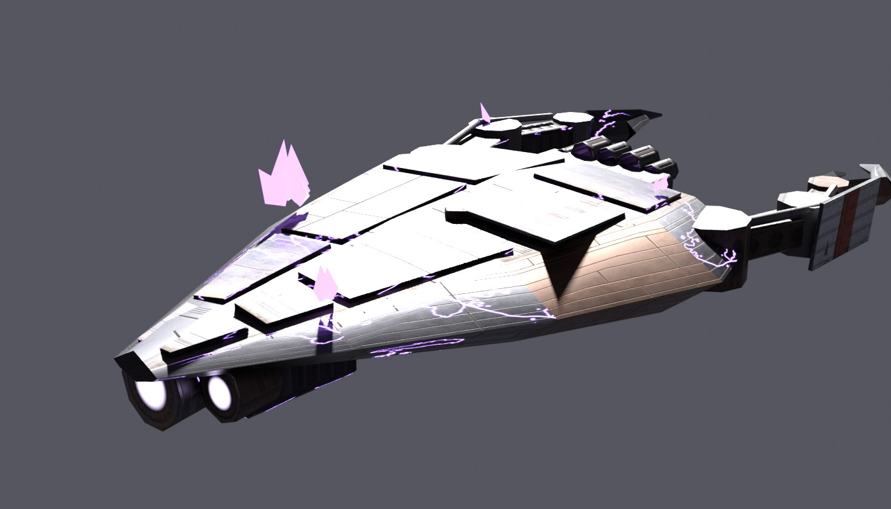
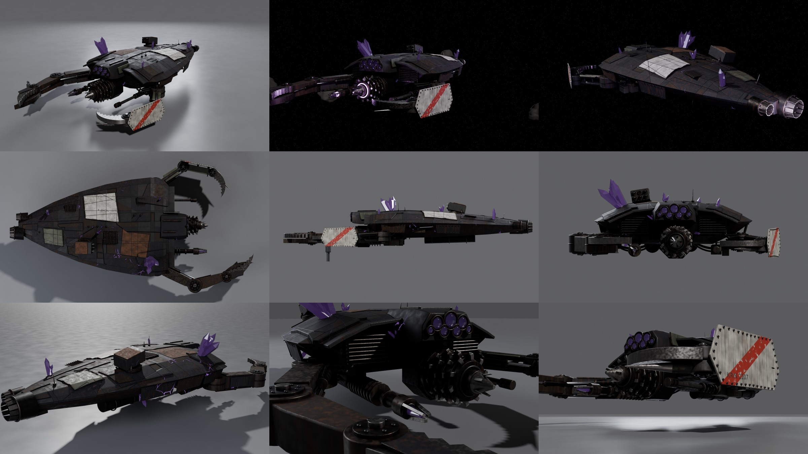
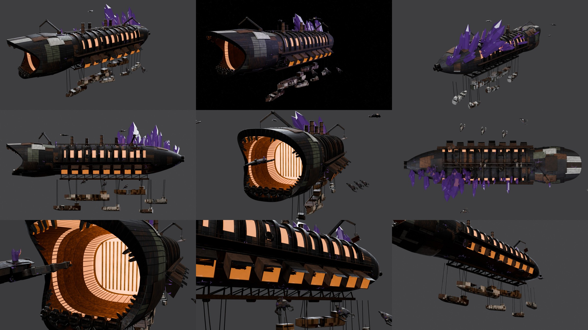

# Aussehen der Ferrox · Entwurf zum Freigeben

Stand: 2026-11-14. **Freigegeben („Passt so“):** alle sieben Entscheidungen gelten wie vorgeschlagen. Die vier Konzeptbilder sind bestätigt („Ja, Jäger bauen“). **Stand der Umsetzung:** Texturblatt und Jäger sind gebaut und seit Alpha 1.11 im Spiel; Bomber, Bienenstock und Wächter stehen noch aus.

## Ausgangslage

- Im Spiel stehen drei Raumschiffe aus Grundformen (`src/models/ferrox.ts`): ein Kegel mit Flügeln, ein Kasten mit Kegelnase, ein Zwanzigflächner mit Stacheln. Alle in schwarzem Chrom mit violettem Leuchten.
- Zu Fuß kämpft man gegen ein gekauftes Drohnenmodell, das mit diesen Schiffen nichts gemeinsam hat.
- Die Geschichte sagt seit Kapitel 4 etwas anderes: Die Ferrox sind die Schürfmaschinen der Erbauer, die nie abgeschaltet wurden. Davon sieht man nichts.

## Leitidee: Werkzeug, nicht Waffe

**Kein Ferrox wurde zum Kämpfen gebaut.** Alles, was dem Piloten wehtut, ist ein Werkzeug: ein Schneidstrahl, ein Greifer, ein Bohrkopf, eine Schleuder für Schlacke. Der Spieler soll beim zweiten Hinsehen erkennen, dass er von Bergbaugerät angegriffen wird. Das ist der Spiegel der Geschichte: Die Crew fliegt selbst mit Bergbaulasern.

## Formensprache: drei Schichten an jeder Maschine

1. **Kern der Erbauer.** Das ursprüngliche Gerät: dunkle, sehr genau gearbeitete Platten mit feinen violetten Adern, wie am Archiv auf Kernkristall. Alt, abgeschliffen, an wenigen Stellen noch makellos.
2. **Flickwerk.** Die Maschinen reparieren sich mit dem, was sie fressen. Aufgeschweißte Bleche aus Menschenschiffen, sichtbar fremd: ein Stück Frachterhülle mit verblasstem Farbstreifen, Nietenreihen, ein halbes Lukenschott. Grob gefügt, schief.
3. **Ferrit.** Kristalle wachsen aus Fugen und Wunden. Je älter die Maschine, desto mehr. Junge Jäger tragen fast keines, ein Bienenstock ist auf einer Seite zugewachsen.

Dazu fünf feste Regeln:

- **Unsymmetrisch.** Links und rechts sind nie gleich. Ein Greifer ist ersetzt, eine Platte fehlt.
- **Kein Gesicht, kein Cockpit.** Statt eines Auges ein Bündel kleiner Linsen an der Stelle, wo das Werkzeug sitzt.
- **Rost statt Chrom.** Mattes Schwarz und dunkles Stahlgrau, braune Rostfahnen, stumpf. Der Name kommt vom Rost; heute glänzen sie wie poliert.
- **Violett sparsam.** Nur als dünne Adern, im Ferrit und im Werkzeug, wenn es arbeitet. Keine großen Leuchtflächen. Das Triebwerk brennt blass violett-weiß.
- **Jeder Typ hat einen eigenen Umriss**, den man auf einen Kilometer erkennt.

## Die Typen

Die Größen bleiben wie heute, damit sich Treffer, Sichtbarkeit und Spielgefühl nicht ändern.

| Im Funk heißt er | War einmal | Größe | Umriss | Werkzeug (im Spiel: Waffe) |
|---|---|---|---|---|
| **Jäger** | Schürfdrohne: sucht Erz, schneidet es heraus | 16 m lang, 26 m breit | Flacher Keil mit zwei ungleichen Greifarmen nach vorn, dazwischen der Schneidkopf. Erinnert an einen Hirschkäfer. | Schneidstrahl aus dem Kopf (die heutigen Schüsse). Beim Feuern glüht der Kopf. |
| **Bomber** | Brecher: zerkleinert Brocken und wirft sie zum Sammler | 35 m | Dicke Trommel mit einer Bohrkrone vorn, die sich langsam dreht, und zwei Schlacketanks an den Seiten. | Schleudert gepresste Schlacke (die heutigen Bomben). Die Krone läuft an, bevor er wirft. |
| **Bienenstock** | Schmelzhütte: nimmt Erz auf, baut daraus neue Maschinen | 200 m | Langer, gerippter Ofenkörper statt eines Sterns. Vorn ein offenes Maul, in dem es glüht. Seitlich Startschächte. Eine Seite ist von Ferrit-Spitzen überwachsen. An Trossen hängen halb gefressene Schiffsrümpfe. | Setzt Jäger aus den Schächten aus; Schneidstrahlen zur Nahabwehr. |
| **Wächter** (zu Fuß) | Wartungsgerät im Inneren von Anlagen | 0,9 m, schwebt | Flacher Rumpf mit drei dünnen Armen: Schweißbrenner, Greifer, Linsenbündel. | Schweißbrenner auf Abstand. |
| **Wächterkern** (zu Fuß) | Fest eingebaute Aufsicht eines Speichers | 2 m | Wie der Wächter, aber dreimal so groß, mit einer Krone aus Ferrit. | Starker Brenner. |

**Im Funk bleiben die Namen der Piloten:** Jäger, Bomber, Bienenstock. So sind die Zeilen aufgenommen, und so reden Leute, die nicht wissen, was sie vor sich haben. „Schürfer“ sagt nur der Ferrit-Leser.

**Später möglich, nicht Teil dieses Entwurfs:** der **Schlepper**. Kleine Klammergeräte, die sich zu Hunderten an einen Rumpf heften und ihn wegziehen. Varga beschreibt sie in Kapitel 4, zu sehen sind bisher nur Ferrit-Klammern.

## Entscheidungen, die du treffen musst

1. **Leitidee „Werkzeug, nicht Waffe“.** Die Ferrox sehen nach verwildertem Bergbaugerät aus, nicht nach Kampfschiffen. Mein Vorschlag: ja.
2. **Weniger Leuchten.** Rostiges Schwarz mit dünnen violetten Adern statt glänzendem Chrom mit Leuchtbalken. Damit sind sie im Dunkeln schwerer zu sehen; die Zielmarke im HUD bleibt. Mein Vorschlag: ja.
3. **Bienenstock als Schmelzhütte.** Ein langer Ofen mit Maul statt der Stachelkugel. Das ändert sein Aussehen am stärksten. Mein Vorschlag: ja.
4. **Menschenschrott am Rumpf.** Erkennbare Teile gefressener Schiffe an jeder Maschine. Das macht sie unheimlicher und erzählt, wohin die verlorenen Frachter gehen. Mein Vorschlag: ja.
5. **Wächter zu Fuß ersetzen.** Das gekaufte Drohnenmodell bringt vier fertige Bewegungen mit; ein eigenes Modell braucht dieselben neu. Mein Vorschlag: erst nach den drei Raumschiffen, als eigenes Vorhaben.
6. **Wer baut.** Zwei Wege:
   - Ich baue die Modelle in Blender (wie die Gebäude aus dem Baukasten). Kostet nichts, das Ergebnis ist kantig und sauber, aber weniger organisch.
   - Du erzeugst sie mit Tripo aus Bildvorgaben (wie die Figuren), ich bereite sie fürs Spiel auf. Das wirkt gewachsener, braucht aber deine Zeit.
   Mein Vorschlag: Jäger und Bomber baue ich, den Bienenstock machst du mit Tripo, weil er am meisten von der überwachsenen Form lebt.
7. **Konzeptbilder vorab.** Vier Bilder über Higgsfield, eines je Typ, zusammen 1 Credit. Du siehst die Richtung, bevor jemand ein Modell baut. Mein Vorschlag: ja.

## Bildvorgaben (Englisch, für Konzeptbilder oder Tripo)

Gemeinsamer Schluss für alle vier:

> Realistic hard-surface science fiction concept art, photographic materials, matte black and dark gunmetal, brown rust streaks, thin faint violet veins, clusters of dark violet crystals growing from seams, asymmetrical, no cockpit, no face, no weapons, no text, no cartoon style, no toy look. Neutral dark grey background, soft studio lighting, three-quarter front view.

**Jäger**

> A derelict autonomous mining drone the size of a small aircraft, flat wedge-shaped body, two mismatched grabber arms reaching forward like the mandibles of a stag beetle, a cutting head with a cluster of small lenses between them. Ancient precise dark plating patched with crudely welded scrap panels from human cargo ships, one panel with a faded paint stripe and rivets. A few small crystals on its back.

**Bomber**

> A heavy derelict autonomous ore crusher machine, thick barrel-shaped body, a large rotary drill crown at the front, two battered slag tanks on the sides, a short launch chute under the drill. Ancient precise dark plating patched with crudely welded scrap panels from human ships. Crystals growing along the seams of the tanks.

**Bienenstock**

> A gigantic derelict autonomous smelter ship, long ribbed furnace hull, a wide open intake maw at the front glowing dull orange from inside, rows of launch chutes along one flank, the other flank overgrown with tall spires of dark violet crystal. Half-eaten hulls of cargo ships hang from cables beneath it. Ancient precise dark plating patched with scrap. Seen from a distance, vast scale.

**Wächter**

> A small hovering maintenance robot, flat oval body about one metre wide, three thin articulated arms: a welding torch, a small gripper, a cluster of lenses. Ancient precise dark plating with thin violet veins, one arm replaced by a mismatched scrap part. Tiny crystals at the joints.

## Konzeptbilder (14.11.2026)

Erzeugt mit den Vorgaben oben über Higgsfield (`gpt_image_2_6`, vier Bilder, 1 Credit):

| Typ | Bild | Was vom Bild gilt |
|---|---|---|
| Jäger |  | Keil, zwei ungleiche Greifer, Linsenbündel über dem Schneidkopf, ein Blech mit rotem Streifen als Menschenschrott. |
| Bomber |  | Trommel mit Bohrkrone, zwei Tanks, Wurfschacht unten. Die rot-weißen Flicken sind hier zu viele; im Modell deutlich weniger. |
| Bienenstock |  | Ofenrumpf mit glühendem Maul, Startschächte an der Flanke, Ferrit-Spitzen am Heck, Rümpfe an Trossen. |
| Wächter |  | Flache Scheibe mit drei Armen: Brenner, Greifer, Linsen. Ein Arm aus Schrott. |

Die Bilder zeigen die Richtung, nicht das Ergebnis im Spiel: Ein Jäger mit 3.000 Dreiecken trägt diese Einzelheiten in der Textur, nicht in der Form.

## Der Jäger im Spiel (Alpha 1.11)

- 1.456 Dreiecke (Rumpf 846, rechter Arm 300, linker Arm 310), drei Knoten: Rumpf, `arm_r`, `arm_l`. Datei 137 KB.
- Rechts der Arm der Erbauer mit zwei Zangen, links ein kürzerer Ersatz aus Schiffsstahl mit einem Schild (hell mit rotem Streifen), einem Haken und einem Dorn.
- Die Greifer bewegen sich: Auf Patrouille sind sie fast geschlossen und pendeln träge, im Angriff stehen sie weit offen und schnappen.
- Fünf Linsen über dem Schneidkopf, zwei ungleiche Düsen, vier Gruppen Ferrit, auf dem Dach ein aufgenietetes Schiffsblech.
- Triebwerksschein und Schweif sind blasser als bisher (gilt vorerst auch für den alten Bomber).
- Abweichungen vom Bild: Der Rumpf ist kantiger (ein Keil aus vier Abschnitten), der Schneidkopf dreht sich nicht, die Zangen haben keine Zähne.
- Nicht geprüft: das Aussehen im Gefecht aus der Sicht des Piloten bei voller Bildrate, und Mitspieler (dort bleiben die Greifer in Ruhelage).

## Jäger, Fassung 2: Schaumodell in Blender (18.11.2026)

Wunsch: „Entwerfe jetzt anhand der Bilder einen Ferrox Jäger in Blender. Ich erwarte ein Ergebnis auf dem Niveau der letzten Schiffe oder noch besser.“
Gebaut wie Würger, Elster und Wisent als Schaumodell (noch nicht im Spiel; die Fassung 1 aus Alpha 1.11 fliegt weiter).

- **Dateien:** `asset-src/neu/fxjaeger/` (`fxj_kit.py` Bau, `fxj_lauf.py` Bau und Bilder, `fxj_blatt.py` Übersichtsblatt), Ausgabe `FerroxJaeger.blend`,
  Bilder `fxj-<ansicht>.jpg` (schraeg, front, seite, draufsicht, heck, detail, unten, weltraum, jagd). Aufruf:
  `blender.exe -b --python fxj_lauf.py -- alle` (Proben schneller mit `KOR_SAMPLES=48`). Werkzeuge, Platten und Nieten kommen aus `../wuerger/wue_kit.py`.
- **Maße:** 23,6 × 12,6 m, schwebt (Rumpfmitte 3,2 m über dem Boden), rund 130.000 Dreiecke.
- **Rumpf:** flacher Keil aus neun Spanten mit Grat, Schulterfacette, Seitenkante, Lippe und starkem Einzug darunter; Plattenraster mit schrägen Fugen,
  sieben erhabene Platten der Erbauer, darüber drei schief aufgeschweißte Bleche (hell mit „FRACHT 4“, oliv, Rostblech) mit Schweißnähten;
  Panzerschürzen rechts drei, links zwei (in der Lücke liegen Zylinder, Kasten und Kabel offen); Stirn mit Krempe, zwei Gittern und Schläuchen.
- **Kopf:** achteckiger Kragen, Trommel mit vier Zahnkränzen (einige Zähne ausgebrochen), Bohrspitze; darüber ein Keil als Linsenhaube mit sieben
  ungleichen Linsen aus dunklem Glas mit kleinem violettem Kern (kein Gesicht). Im Weltraum glüht ein Ring zwischen Trommel und Spitze.
- **Arme:** rechts der Arm der Erbauer (Kastenoberarm mit zwei Zylindern, gebogener Unterarm, große gezahnte Zange aus zwei Backen),
  links der Ersatz aus Menschenstahl (zwei Rohrträger mit Querstreben, Haken und Dorn) mit dem Frachterblech „KRN 2207“ außen am Unterarm.
- **Bewaffnung** (Wunsch „er braucht auch Bewaffnung“, weiter nach „Werkzeug, nicht Waffe“: umgebautes Bergbaugerät und Beute):
  rechts unter dem Rumpf die **Schneidlanze** der Erbauer (Gehäuse, Lauf mit neun Kühlrippen, Fokusringe, drei Zinken um einen Ferrit-Emitter,
  glüht beim Feuern), links eine **erbeutete Menschenkanone** (angeschweißte Halteplatten, Gehäuse in Oliv mit „BK 30“, Laufmantel, Mündungsbremse,
  Patronenkasten „30 MM“ mit Gurtzuführung), auf dem Rücken ein **Sprengladungswerfer** (Drehkranz, Kasten mit sechs Rohren, ein Rohr leer,
  Ladungen mit glühendem Band, zwei Richtzylinder). Fürs Spiel: Lanze = die heutigen Schüsse, Werfer = Raketen, Kanone als zweite Waffe denkbar.
  Mündungspunkte in `fxj-anker.json` (`lanze`, `kanone`, `werfer`).
- **Ferrit:** sechs Gruppen, die größte auf der rechten Schulter; Adern violett, sparsam, nur fleckweise (Voronoi-Kanten im Material).
- **Lehren:** Spiegelndes Metall wirkt im grauen Studio wie helle Fliesen; matte Platten mit wenig Glanz (low_spec 0,18) lesen sich wie Rost und Ruß.
  Schrift, die über einer Fläche schwebt, wirft im Sonnenlicht einen zweiten Schriftzug als Schatten (Schatten der Schrift aus).
  Ein Abgaskegel aus leuchtender Hülle zeigt in Cycles seine Rückwand als harten Zylinder; die Glut sitzt deshalb nah an der Düsenöffnung.
- **Im Spiel (ersetzt Fassung 1):** `fxj_export.py` schreibt `asset-src/glb/station/Ferrox_Jaeger2.glb` (Nahmodell, rund 27.000 Dreiecke:
  Rumpf und die Knoten `arm_r` = Arm der Erbauer auf −X, `arm_l` = Ersatzarm auf +X) und `Ferrox_Jaeger2Fern.glb` (ein Netz ohne Teile unter 60 cm,
  rund 8.500 Dreiecke), dazu `fxj-spiel.json` mit Mündungen, Düsen und Schultern in Spielkoordinaten (Nase +Z, oben +Y, Ursprung Rumpfmitte).
  Aufruf: `blender.exe -b FerroxJaeger.blend --python fxj_export.py`, danach `npm run assets`.
  - Materialien in drei Gruppen mit Eckfarben (`fx2_plat`, `fx2_stahl`, `fx2_blech`, dazu Glas, Ferrit und Glut): so braucht ein Jäger 29 Zeichenaufrufe
    statt 85. Rost, Flecken und Adern rechnet `fx2Material()` in `src/models/ferrox.ts` im Shader aus der Lage im Modell (keine Texturen).
  - `ferroxDrone()` baut ein `THREE.LOD` (Fernmodell ab 300 m), Düsen- und Linsenschein als Sprites, Faktor 1,1 (`userData.big`, im Spiel rund 26 m wie früher).
  - Greifer: Beim Packen landen Verschiebung und Maßstab in den Knoten der Arme; deshalb hängt jeder Arm unter einem eigenen Gelenk an der Schulter
    (`FX2_PIVOT`). `combat.ts` dreht nach außen je nach Seite des Arms (Vorzeichen aus der Lage), passend für Fassung 1 und 2.
  - Schüsse kommen aus der Schneidlanze (`userData.muzzle`), der Schweif beginnt an den Düsen (`userData.trailZ`).
  - Fassung 1 (`station/Ferrox_Jaeger`) bleibt als Ersatz, falls die neuen Dateien fehlen.

## Bienenstock: Schaumodell in Blender (18.11.2026)

Wunsch: „Wir sollten das Mutterschiff oder Bienenstock der Ferrox entwerfen. Mach das Modell in Blender. Zeig mir den Entwurf.“
Anders als in Entscheidung 6 vorgeschlagen (Tripo) also in Blender gebaut, nach dem Konzeptbild. Noch nicht im Spiel.

- **Dateien:** `asset-src/neu/fxbienen/` (`fxb_kit.py` Bau, `fxb_lauf.py -- alle` Bau und Bilder, `fxb_blatt.py` Übersichtsblatt),
  Ausgabe `FerroxBienenstock.blend`, Bilder `fxb-<ansicht>.jpg`. Werkzeuge, Materialien und Kristalle aus `../fxjaeger/fxj_kit.py`
  (dort gibt es dafür `NUR_HELFER_FXJ`).
- **Maßstab 1 : 10** (1 Blender-Einheit = 10 m). Gebaut wird in der ersten Größe, am Ende vergrößert `rescale(K)` alles um K = 1,9 auf rund
  **400 m Rumpf** (Wunsch nach der ersten Fassung: „ein wenig größer, ca. 400 m, mehr Details“). Die Vergrößerung wird in die Daten geschrieben,
  damit die Muster der Materialien (Objektkoordinaten, für Meter gebaut) ihre Größe behalten und am großen Rumpf feiner wirken.
  Maße mit Wracks und Kristallen rund 427 × 152 × 218 m; rund 290.000 Dreiecke ohne die Jäger (mit den acht Jäger-Instanzen 1,5 Millionen).
- **Rumpf:** Superellipsen-Spanten, Kopf breiter als der Leib, Plattenraster mit großen Flickenfeldern (Rost, Menschenblech, Oliv),
  am Kopf geschichtete Panzerplatten mit Nieten. Zwölf Spanten außen über der Ofenmitte, dazwischen 160 orange Glutfenster.
- **Maul:** Ober- und Unterkiefer ragen weit vor, die Mundwinkel liegen zurück. Innen ein gerippter Schlund (jede dritte Rippe glüht)
  bis zur Glutwand mit Roststäben; Brechwalzen im Unterkiefer, unregelmäßige Zähne an der Lippe (Werkzeug, nicht Waffe).
- **Linke Flanke:** Galerie mit Geländer, Leitungen und Kästen, darunter acht Startschächte (Trichter, innen glühend, Klappen mit Zylindern).
- **Rechte Flanke und Heck:** Ferrit-Spitzen bis rund 30 m hoch, an der Flanke kleinere Gruppen; drei Heckdüsen in blassem Violett.
- **Bauch:** Gerüst aus Trägern, Hängestreben, Querjochen und Seilwinden; an Trossen hängen sechs halb gefressene Frachter
  (Bug, Kiel, Spanten in den Fraßlöchern, Deckreste, Brückenaufbau).
- **Schmelzhütte auf dem Rücken** (zweite Fassung): vier Schornsteine mit Glut, zwei Greifkräne (einer hebt ein Blech), vier Leitungsstränge mit
  Stützen, Lüfter und Sensormasten; an den unteren Flanken Leitungen mit Schellen, Kästen und runde Luken; weitere Panzerplatten an den Kopfseiten;
  ein Frachter steckt halb im Maul. Plattenraster feiner (72 Felder um den Rumpf).
- **Größenvergleich:** acht echte Jäger (Fassung 2, aus `FerroxJaeger.blend` angehängt und als Instanzen gesetzt) fallen aus den Schächten und fliegen vor dem Maul.
- **Im Spiel (ersetzt den Zwanzigflächner):** das Wrack im Maul wurde vorher auf Wunsch entfernt. `fxb_export.py` schreibt
  `asset-src/glb/station/Ferrox_Bienenstock.glb` (Nahmodell, rund 107.000 Dreiecke, 4,6 MB) und `Ferrox_BienenstockFern.glb` (ohne Teile unter 6 m,
  rund 17.000 Dreiecke, ab 1.600 m), dazu `fxb-spiel.json` mit Maul, Glutwand, Startschächten, Düsen und Schornsteinen in Spielkoordinaten
  (Meter, Maul +Z). Aufruf: `blender.exe -b FerroxBienenstock.blend --python fxb_export.py`, danach `npm run assets`.
  - `hive2()` in `src/models/ferrox.ts`: gleiche Materialgruppen und derselbe Rost- und Adern-Shader wie beim Jäger 2, Glut als Sprites
    (Schlund, Glutwand, Schornsteine, Schächte, Düsen), zufällige Ausrichtung je Bienenstock, er dreht sich nicht mehr (`userData.still`).
  - `combat.ts`: Trefferkugeln als Kette über die ganze Länge (`userData.spheres`, `hitBall()`, gilt für Laser und Raketen); Jäger fallen aus den
    Startschächten (`userData.launch`); Schüsse kommen aus dem Maul (`userData.maw`); die Shader werden beim Betreten des Sektors vorgewärmt.
  - Der Zwanzigflächner bleibt Ersatz, falls die Dateien fehlen.

## Technik (für die Umsetzung)

- Ein gemeinsames Texturblatt für alle Ferrox (Platte der Erbauer, Menschenblech, Rost, Adern, Ferrit), damit sie zusammengehören und wenig Speicher kosten.
- Dreiecke: Jäger höchstens 3.000 (oft fünfzehn und mehr im Bild), Bomber 6.000, Bienenstock 40.000 mit einfacher Fernfassung.
- Trefferkugeln bleiben: Jäger 13 m, Bomber 18 m, Bienenstock 80 m.
- Bewegliche Teile: Greifer des Jägers, Bohrkrone des Bombers, Ring oder Trommel am Bienenstock (heute dreht sich der Ring).
- Die Ferrit-Kristalle an Wracks und im Archiv bleiben, wie sie sind; die Maschinen übernehmen deren Material.

## Reihenfolge

1. Konzeptbilder (falls Entscheidung 7: ja), du wählst aus.
2. Texturblatt und Jäger, im Spiel prüfen.
3. Bomber.
4. Bienenstock.
5. Wächter zu Fuß (falls Entscheidung 5: ja).

Jeder Schritt ist für sich veröffentlichbar; alte und neue Modelle können nebeneinander im Spiel stehen.
