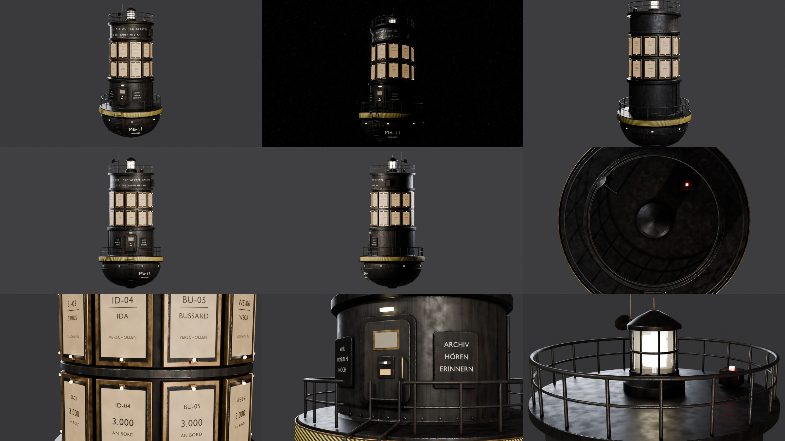
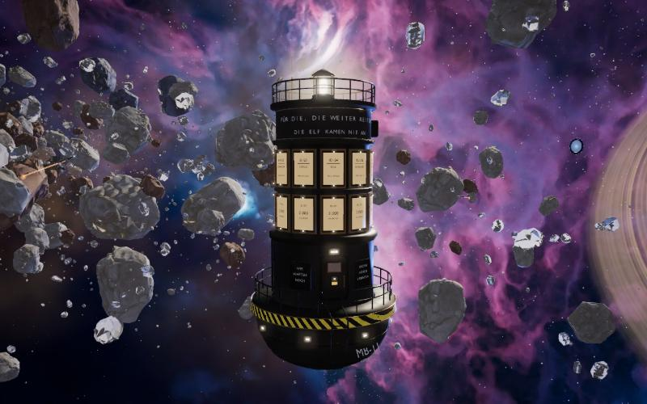

# Gedenkboje MB-11

Stand: 18.11.2026. Schaumodell in Blender nach einem Bild des Nutzers („Schau dir diese Boje an. Sie soll ca. 8–10 m groß sein. Gedenkboje.
Entwerfe sie 1:1 in Blender“). Noch nicht im Spiel.

## Idee

Eine Boje für die elf Schiffe, die hinter dem Halden-Tor nie ankamen (`docs/story.md`). Form wie im Bild; die Texte sind auf Deutsch
(Wahl des Nutzers), die Tafeln tragen die Schiffe der Flotte.

## Aufbau (von unten)

- **Fuß:** bauchiger Drehkörper (4,2 m Durchmesser) mit Kielstück, Nähten, Schraubenring, acht Lichtern und der Kennung „MB-11 · GEDENKBOJE“.
- **Deckring:** 4,5 m Durchmesser, umlaufender Warnstreifen mit Bronzekanten, Geländer (vorn an der Leiter offen).
- **Leib:** Luke mit Rahmen, Fenster, Schaltfeld, Griff und Leuchte; links „Wir warten noch“, rechts „Archiv · Hören · Erinnern“;
  Plattenfugen, Leitungsrohre, Leiter vom Fuß über den Deckring.
- **Gedenktafeln:** zwei Reihen mit je elf hinterleuchteten Tafeln in Bronzerahmen, oben und unten je ein Lämpchen.
  Oben Kennung, Name und „verschollen“ (AN-01 Anna, KR-02 Kranich, SI-03 Sirius, ID-04 Ida, BU-05 Bussard, WE-06 Wega, WS-07 Weitsicht,
  EM-08 Emma, RE-09 Reiher, AT-10 Atair, KL-11 Klara; WS-07 wie in der Geschichte), unten Kennung und „3.000 an Bord“.
- **Inschrift:** „FÜR DIE, DIE WEITER REISTEN“ und „DIE ELF KAMEN NIE AN“ als Einzelbuchstaben rund um das obere Band.
- **Oben:** Plattform mit Geländer, Antenne mit kleinem Spiegel, Peilkasten mit rotem Licht, Leuchtlaterne mit Glas, Gitter und Dach.

Höhe 9,2 m (mit Blitzableiter 9,7 m), rund 94.000 Dreiecke.

## Dateien

`asset-src/neu/gedenkboje/`: `gb_kit.py` (Bau), `gb_lauf.py -- alle` (Bau und Bilder), `gb_blatt.py` (Übersichtsblatt), Ausgabe `Gedenkboje.blend`,
Bilder `gb-<ansicht>.jpg` (schraeg, front, seite, draufsicht, heck, tafeln, luke, laterne, weltraum). Werkzeuge und Materialien aus
`../fxjaeger/fxj_kit.py` (Helfermodus `NUR_HELFER_FXJ`).

## Im Spiel (23.11.2026)

- **Platz:** Sonnenfeld, am Rand des großen Trümmerfelds (Reste des Halden-Tors, erstes Feld des Sektors), 220 m vor den Felsen auf der Seite
  zum Tor nach Heimstatt, 25 m über der Feldebene. Vorderseite (Tür, „Wir warten noch“) zeigt zum Tor; die Boje dreht sich langsam (eine Runde
  in gut acht Minuten). Felsen im Umkreis von 160 m werden entfernt. Im Vorspann (Jahr 0) gibt es sie nicht.
- **Ort** in `orte.ts` („Gedenkboje MB-11“): Navigation, Sektorkarte, Fernansicht und HUD-Name kommen von dort. Kollision über vier Kugeln.
- **Archiv:** [E] in 70 m spielt sechs Funksprüche nacheinander (rund 35 s): Ansage der Boje, drei Sprüche der Bastion aus Jahr 0 (Durchgang,
  Einsturz, „Wir rufen weiter“), der Eid von Maren Hollweg, die elf Namen mit „Wir warten noch“. [E] noch einmal hält an. Beim ersten Besuch
  ein Funkspruch der Sonnenwacht (`P.gedenk`).
- **Modell:** `asset-src/neu/bojen_export.py` (für beide Bojen): `blender.exe -b Gedenkboje.blend --python ../bojen_export.py` →
  `asset-src/glb/station/Gedenkboje.glb` (rund 40.000 Dreiecke, Schrift unvereinfacht mit gröberer Kurvenauflösung und 6 mm angehoben,
  sonst überdeckt sie die vereinfachte Wand) und `GedenkbojeFern.glb` (rund 7.000, ab 260 m). Materialien `bj_*` mit Eckfarben, Flecken und
  Warnstreifen im Shader (`src/models/bojen.ts`). Leuchtlaterne und rotes Licht zusätzlich als Lichtpunkte.
- Geprüft: Entwicklungsserver (Ansicht, Archiv ganz durchgehört, Abprallen) und gebaute Fassung (Spielstand an der Boje, Hinweis „[E] Archiv hören“,
  keine Fehler in der Konsole).

## Offen

- Ob die Tafeln nach Kapitel 5 wechseln sollen: Dort kommen zehn der elf Schiffe zurück, der Kranich bleibt als Wrack in der Narbe.
