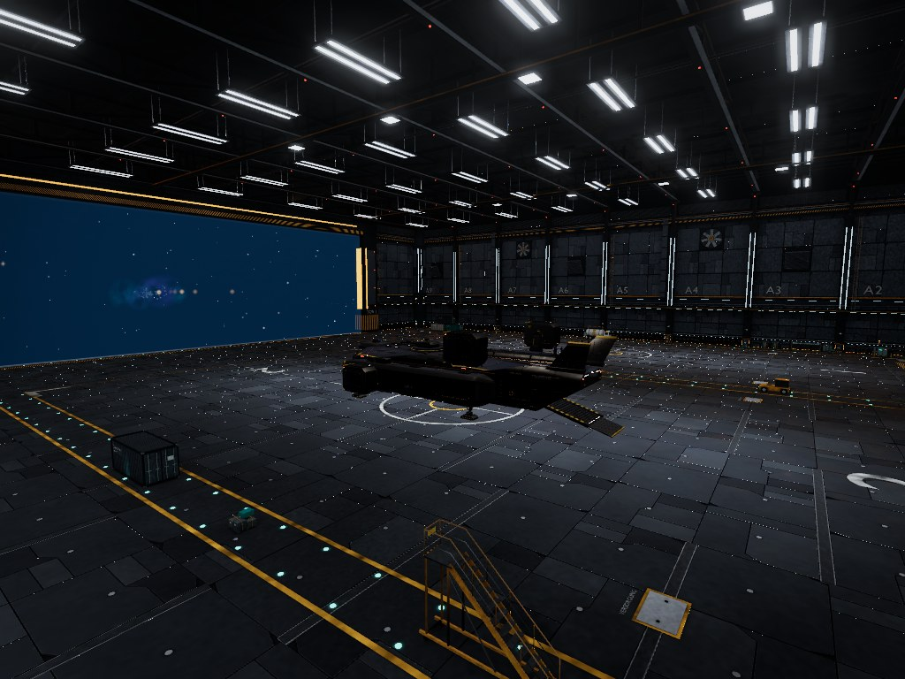

# Hangarbuchten

Seit dem 26.11.2026. Der Nutzer: „wenn man zum Beispiel sich in der Bastion trifft, hat ja jeder sein Schiff im Hangar stehen. Aber ich kann ja dann nicht im Schiff meines Freundes einsteigen. Wie lösen wir das? Wollen wir zum Beispiel für jeden einen einzelnen Hangar machen, wie auch das Quartier ähnlich, und damit Aufzug hoch Richtung Deck?“ Entschieden: eigene Bucht je Pilot, Zutritt per Einladung.

## Regeln

- **Jeder Pilot hat an jeder Station seine eigene Hangarbucht.** Wer andockt oder vom Deck durch die Schleuse in den Hangar geht, steht in seiner Bucht bei seinen Schiffen.
- **Im Hangar sieht man nur Piloten, die in derselben Bucht stehen.** Auf dem Deck und der Promenade sehen sich alle wie bisher.
- **In eine fremde Bucht kommt nur, wen der Besitzer einlädt.** Die Einladung gilt 15 Minuten und nur, solange beide an derselben Station angedockt sind.
- **Dort steht das Schiff des Besitzers** mit offener Rampe. Am Schiff [E]: an Bord gehen (nur Schiffe mit begehbarem Innenraum).
- **Legt der Besitzer ab, fliegt der Gast mit** (Mitflug, siehe [harpyie.md](harpyie.md)). Sein eigenes Schiff bleibt angedockt und folgt per Autopilot, wenn die beiden woanders andocken oder der Gast auf einem Planeten aussteigt.
- **Wer die fremde Bucht durch die Schleuse zum Deck verlässt,** kommt beim nächsten Mal wieder in die eigene.

## Bedienung

| Wo | Was |
|---|---|
| Buchtenwahl an der Rückwand jedes Hangars | Gäste in die eigene Bucht einladen, Einladungen annehmen, zurück in die eigene Bucht |
| Aufzug „Quartiere“ auf Deck 3 der Bastion | dieselbe Auswahl, zusätzlich zu den Quartieren |
| Schiff des Gastgebers | [E] an Bord gehen, an der Luke [E] wieder von Bord |

Der Wechsel in eine Bucht ist eine kurze Fahrt mit Blende (wie beim Quartier), man kommt an der Rückwand des Hangars an.

## Technik

- `src/game/hangarbucht.ts`: Zustand `HB` (Besitzer der besuchten Bucht, sein Schiff, Einladungen) und die Verbindungen `buchtHooks`.
- Ortskennung im Netz (`quartier.ts ortKennung`): im Hangar `<station>#h:<Besitzer>`. `interior.ts updateWalk` setzt jedes Bild, ob die Figur im Hangar steht (`HB.zone`, z größer als die Rückwand).
- `interior.ts refreshHangarShips`: in einer fremden Bucht steht statt der eigenen Schiffe das Schiff des Besitzers (Klasse und Lackierung aus seinem Netzstand); `syncParkedShip` blendet das eigene aus. `buchtFahrt` wechselt die Bucht.
- `net.ts`: Einladung als Koop-Meldung `hi` (kein Eingriff am Server), `buchtHooks.fahren` prüft, dass der Besitzer noch hier angedockt ist. Legt er ab oder wechselt er das Schiff, wird die Bucht nachgeführt.
- Ablegen mit Gast (`net.ts gastZiele`, Zweig Hangar): Sobald das Schiff des Besitzers fliegt, verlässt der Gast die Station (`main.ts mitAblegen`) und steht an derselben Stelle an Bord des fliegenden Schiffs. Sein Rückfallort ist die Station, an der sein Schiff steht.
- Anzeige: `ui/dock.ts vQuartier`, Modus `bucht` (Buchtenwahl) und Block „Hangarbuchten“ im Aufzug.

## Offen

- Es steht nur das aktive Schiff des Gastgebers in seiner Bucht, nicht seine abgestellten weiteren Schiffe.
- Der Aufzug auf Deck 3 trägt weiter nur das Schild „Quartiere“.
- Wer in einer fremden Bucht steht, während der Besitzer zurückkommt und landet, sieht keine Landung, das Schiff steht einfach wieder da.
