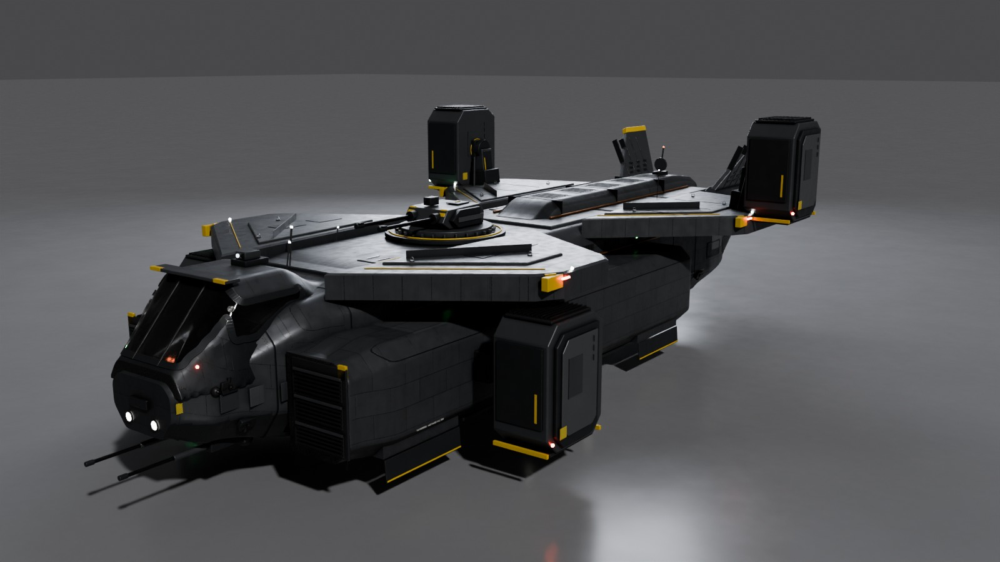
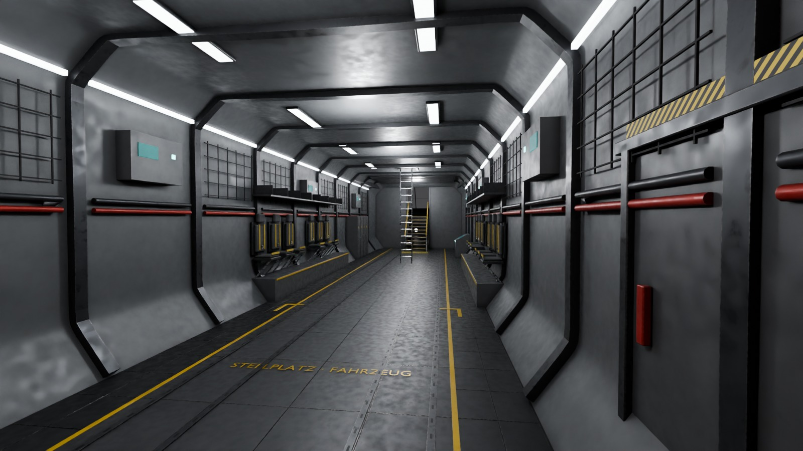
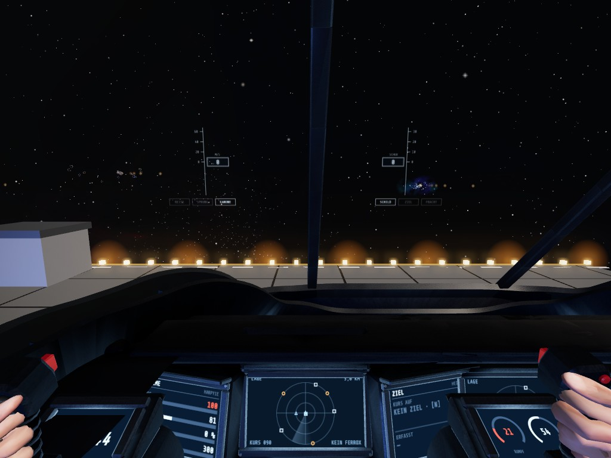

# Harpyie HP-1

Eigenes schweres Landungsschiff, gebaut am 26.11.2026. Der Nutzer schickte Bilder eines Landungsschiffs aus einem anderen Spiel: „Baue dieses Schiff nach in dem dunklen Grauton mit leicht gelben Akzenten … das muss besser sein als alles … alle Details … sehr realistisch … darf viele Dreiecke haben.“ Die Vorlage wird nicht kopiert (wie bei Kormoran, Würger, Elster, Wisent): Die Harpyie ist ein eigener Entwurf desselben Typs, mit eigener Form und eigenem Namen.


| | |
|---|---|
| Maße | 37,6 × 19,7 × 10,2 m |
| Besatzung | 2 im Cockpit, 12 Klappsitze im Truppenraum |
| Spielwerte | `harpyie` in `src/data/ships.ts`: 38.000 Cr, Rumpf 480, Schild 180, Fracht 140, 8 Flugkörper |
| Laderaum | Truppenraum 22 m, Heckrampe 4,6 m breit, ein Dachs |
| Begehbar | ja, 122 m² Laufkarte vom Fuß der Heckrampe über die Treppe bis in die Cockpitsitze |

## Aufbau außen

`asset-src/neu/harpyie/har_kit.py`, Achsen wie bei den übrigen eigenen Schiffen: +X vorn, +Y Backbord, +Z oben, Boden z = 0.

- Rumpf (Truppenraum) kantig, Querschnitt aus einer Tabelle (`RT`) weich überblendet; die Nase verjüngt sich, die Heckschräge ist die Rampe (Rumpfpunkte an der Schräge nach Bogenlänge verteilt, wie bei der Möwe).
- Zwei seitliche Panzerwülste (`wulst`) mit dem Fahrwerk, vorn drei Einlassschlitze, aufgesetzte Seitenpanzer, Andockringe, Leiter.
- Kanzelbuckel auf der Nase: schmaler als die Dachfläche (sitzt auf, steht nicht über die Fase), Frontscheibe mit zwei Sprossen, Seitenfenster bis an die Frontscheibe, glatte Rahmen über den Rasterstufen.
- Flügel statt flacher Platten (Nutzer: „aerodynamisch sind diese Flugflächen vorne natürlich nicht … runde Leading Edge“): Profil mit runder Vorderkante, gewölbter Oberseite, flacherer Unterseite, nach außen dünner, gelbe Spitzen.
- Rückenturm mit Doppelrohr, Rückengrat mit Lüftern und Leitungen, Kommunikationsmast, Dachpanzer in Lagen, zwei nach außen geneigte Heckflossen.
- Vier Triebwerksgondeln: vorn an Auslegern aus den Wülsten, hinten auf Pylonen über den hinteren Flügeln. Gelandet zeigen die Düsen nach unten. Im Flug schwenken die Gondeln um 90° (Gruppe `fw`), dann zeigen die Düsen nach hinten und der Einlass oben nach vorn.
- Fahrwerk: vier Beine klappen um die Hüfte in Schächte im Boden der Wülste, die Füße klappen gegenläufig mit (verschachteltes Gelenk wie bei der Möwe), Schachtklappen zuletzt.





## Innenraum und Cockpit

- `har_innen.py`: Truppenraum mit zwölf Klappsitzen auf Podesten, Netzen und Ablagen, Waffenspinden (`locker`), Systempult (`scanner`), Rampenpult (`ramp`), Leiter zum Rückenturm, Spanten mit Lichtleisten, Stellplatz für ein Fahrzeug. Vorn führt eine Treppe durch das Schott ins Cockpit.
- `har_cockpit.py`: Cockpit-Baukasten Stil 2 (Vorlage `moe_cockpit.py`), zwei Plätze, Boden 4,1 m, Augpunkt bei x 14,55. Ich-Sicht aus `HarpyieCockpit.glb`.






## Ablauf

```sh
sh asset-src/neu/harpyie/har_spiel.sh     # bauen, exportieren, Cockpit backen, vereinfachen, Laufkarte
npm run assets
```

Ansichten: `KOR_SAMPLES=24 blender -b --python har_lauf.py -- bild bug flug heckoffen in_truppenraum cp_vorn …`

## Offen

- Weitere Detailrunden außen (der Nutzer wünscht „alle Details“); Rückenturm und Kinnkanonen sind im Spiel noch nicht als eigene Waffen angesteuert.
- Seitentür ist nur Optik; Gäste im Mehrspieler kommen über die Heckrampe.
