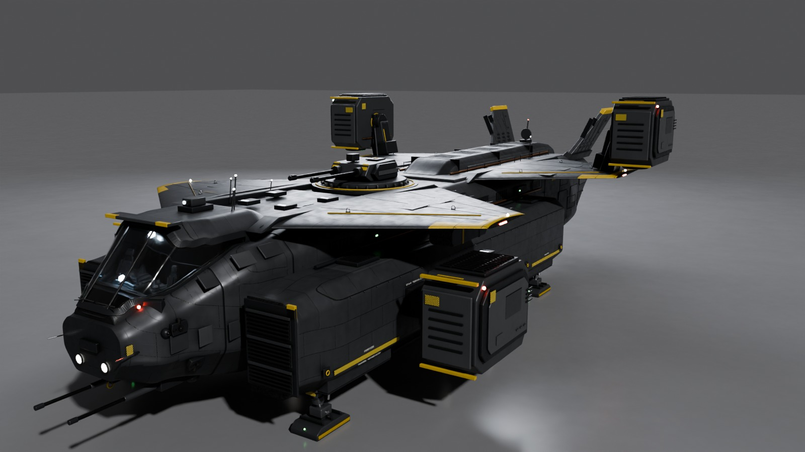
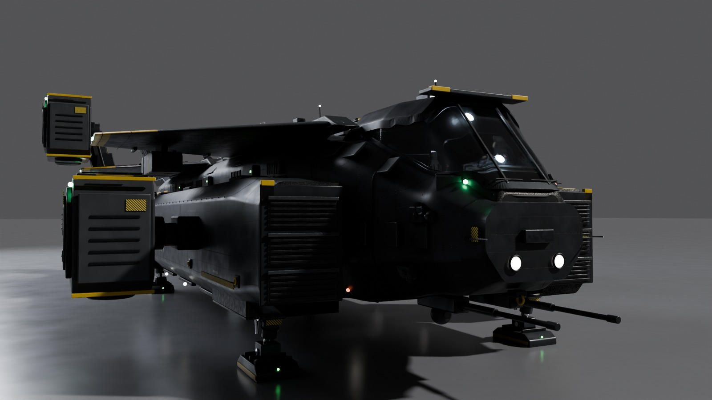
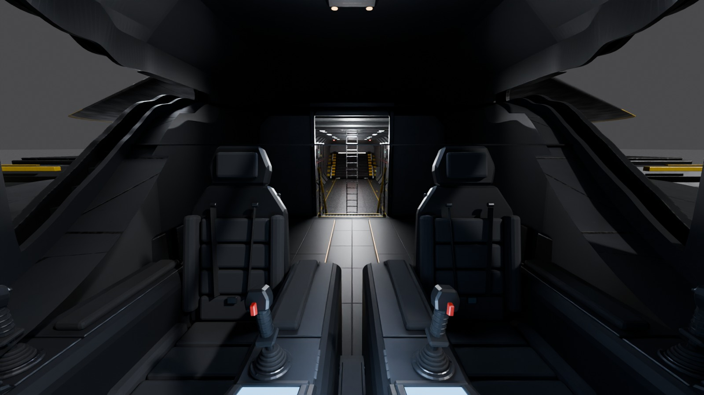
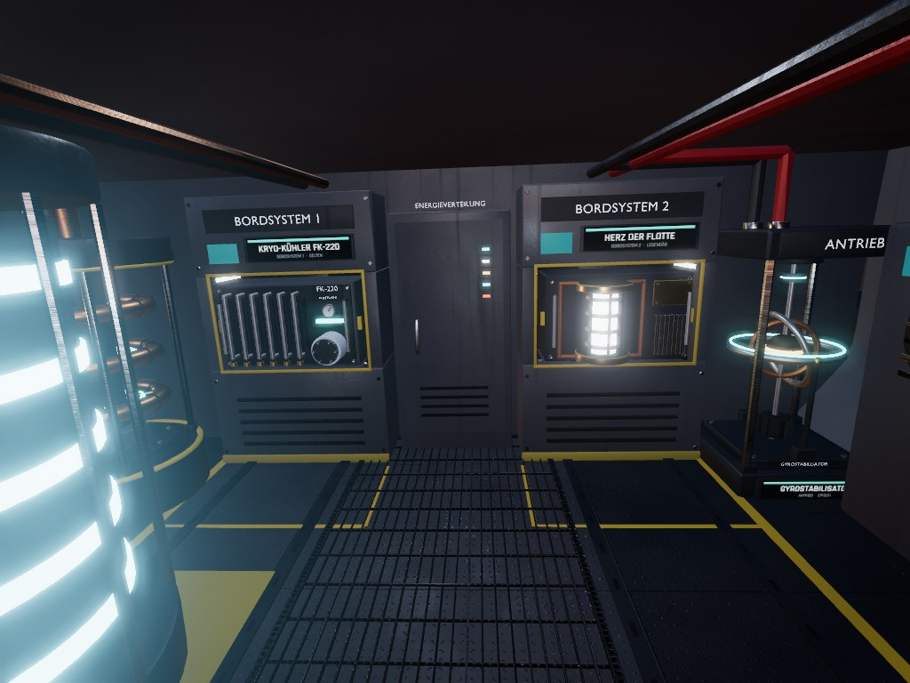

# Harpyie HP-1

Eigenes schweres Landungsschiff, gebaut am 26.11.2026. Der Nutzer schickte Bilder eines Landungsschiffs aus einem anderen Spiel: „Baue dieses Schiff nach in dem dunklen Grauton mit leicht gelben Akzenten … das muss besser sein als alles … alle Details … sehr realistisch … darf viele Dreiecke haben.“ Die Vorlage wird nicht kopiert (wie bei Kormoran, Würger, Elster, Wisent): Die Harpyie ist ein eigener Entwurf desselben Typs, mit eigener Form und eigenem Namen.



| | |
|---|---|
| Maße | 37,6 × 19,7 × 10,2 m |
| Besatzung | 2 im Cockpit, 1 Schütze, 4 Kojen, 12 Klappsitze im Truppenraum |
| Spielwerte | `harpyie` in `src/data/ships.ts`: 38.000 Cr, Rumpf 480, Schild 180, Fracht 140, 8 Flugkörper |
| Laderaum | Truppenraum 22 m, Heckrampe 4,6 m breit, ein Dachs |
| Begehbar | ja, 146 m² Laufkarte: Heckrampe, Truppenraum, Waffenkammer, Technikraum, Treppe, Oberdeck, Cockpit |

## Aufbau außen

`asset-src/neu/harpyie/har_kit.py`, Achsen wie bei den übrigen eigenen Schiffen: +X vorn, +Y Backbord, +Z oben, Boden z = 0.

- Rumpf (Truppenraum) kantig, Querschnitt aus einer Tabelle (`RT`) weich überblendet; die Nase verjüngt sich, die Heckschräge ist die Rampe (Rumpfpunkte an der Schräge nach Bogenlänge verteilt, wie bei der Möwe).
- Zwei seitliche Panzerwülste (`wulst`) mit dem Fahrwerk, vorn drei Einlassschlitze, aufgesetzte Seitenpanzer, Andockringe, Leiter.
- Kanzelbuckel auf der Nase: schmaler als die Dachfläche (sitzt auf, steht nicht über die Fase), Frontscheibe mit zwei Sprossen, Seitenfenster bis an die Frontscheibe, glatte Rahmen über den Rasterstufen.
- Flügel statt flacher Platten (Nutzer: „aerodynamisch sind diese Flugflächen vorne natürlich nicht … runde Leading Edge“): Profil mit runder Vorderkante, gewölbter Oberseite, flacherer Unterseite, nach außen dünner, gelbe Spitzen.
- Rückenturm mit Doppelrohr, Rückengrat mit Lüftern und Leitungen, Kommunikationsmast, Dachpanzer in Lagen, zwei nach außen geneigte Heckflossen.
- Vier Triebwerksgondeln: vorn an Auslegern aus den Wülsten, hinten auf Pylonen über den hinteren Flügeln. Gelandet zeigen die Düsen nach unten. Im Flug schwenken die Gondeln um 90° (Gruppe `fw`), dann zeigen die Düsen nach hinten und der Einlass oben nach vorn.
- Fahrwerk: vier Beine klappen um die Hüfte in Schächte im Boden der Wülste, die Füße klappen gegenläufig mit (verschachteltes Gelenk wie bei der Möwe), Schachtklappen zuletzt.




## Innenraum und Cockpit

Nutzer: „Hast du den ganzen Innenraum? Was ist alles im Flieger drin, außer der Bucht für die Truppen und das Cockpit?“ Zuerst gab es nur diese beiden. Seit der zweiten Runde nutzt der Ausbau die 4,2 m Höhe des Rumpfs mit zwei Decks im vorderen Teil (`har_innen.py`):

- **Truppenraum** (hinten, volle Höhe): zwölf Klappsitze auf Podesten, Netze, Ablagen, Rampenpult (`ramp`), Stellplatz für einen Dachs, Spanten mit Lichtleisten.
- **Oberdeck** (x 1,9 … 10,3, Boden 4,15 m wie das Cockpit, 2,07 m lichte Höhe), über eine Treppe aus dem Truppenraum: Schützenplatz unter dem Rückenturm (Drehsitz, Richtgriffe, Visierschirm, Korbring in der Decke), Anzugschränke, Geräteregal, zwei Doppelstockkojen (`bed`), Messe mit Tisch und Bank (`log`: Einsatzschirm), Kombüse mit Hängeschrank. Vorn das Schott mit Tür ins Cockpit.
- **Unterdeck** darunter: Waffenkammer, offen zum Truppenraum (Waffenspinde `locker`, Waffenständer, Systempult `scanner`), dahinter ein Schott mit Tür zum **Technikraum** (Energiekern, Lebenserhaltung mit Tanks und Luftwäscher, Energieverteilung, Deckenleitungen) mit den fünf Modulplätzen (siehe unten).
- **Cockpit** (`har_cockpit.py`, Cockpit-Baukasten Stil 2): zwei Plätze, Augpunkt bei x 14,55. Ich-Sicht aus `HarpyieCockpit.glb`.
- Die Panzerwülste enthalten nur die Fahrwerksschächte, sie sind nicht begehbar.

Damit das Oberdeck bis zum Cockpitschott Kopfhöhe hat, bleibt das Rumpfdach bis x 10,5 auf voller Höhe (Tabelle `RT`); die Spanten sind über dem Oberdeck flach.





## Details außen (zweite Runde)

`greebles2()` in `har_kit.py`: Raketenbehälter unter den vorderen Flügeln, Klappenfugen, Scharnierverkleidungen und statische Entlader, Lüfterkästen, Luken und Leitungskanal auf den Wülsten, Warnstreifen und Schrift an den Fahrwerksschächten, Hebepunkte, Bolzenreihen, aufgesetzte Heckpanzer, Tankstutzen, Sprossen, Handläufe auf dem Dach, Staurohre, Scheibenwischer, Schlepphaken, Warnrahmen an der Rampenöffnung, Ruderfugen und Nummer an den Flossen, Bauchantennen und Bauchscheinwerfer, Beschriftung auf Flügeln und Wülsten. An den Gondeln Bolzenkränze, Leitungen und Lüfterkästen.


## Rückenturm und Schützenplatz

Seit dem 26.11.2026 (`src/game/turm.ts`). Der Nutzer: „Fliegt man alleine, soll der Turm mit auf das Ziel des Piloten schießen“, dazu der Schützenplatz für einen zweiten Spieler und für den Piloten selbst.

- **Aufgeschaltet (Pilot allein):** Der Turm folgt dem Ziel, das der Pilot erfasst hat, und feuert mit der Feuertaste mit. Er hält das Ziel auch, wenn es aus dem Fadenkreuz wandert, solange es in seinem Schussfeld und in 1.400 m Reichweite bleibt. 60 % der Feuerrate. Munition aus dem gemeinsamen Vorrat.
- **Schützenplatz** (Oberdeck, unter dem Turm, [E]): Blick der Turmkamera, die Maus richtet, linke Taste feuert mit voller Feuerrate, rechte Taste vergrößert, [E] steht wieder auf. Dauerfeuer überhitzt die Rohre nach rund drei Sekunden. Geht gelandet und im Flug (das Schiff hält dann Kurs, `bordflug.ts`), nicht im Hangar.
- **Schussfeld:** rundum, Höhe −5° … +70°. Nach vorn nicht unter die Waagerechte (Kanzel), zwischen den Heckflossen nicht unter 10°. Unter dem Rumpf gibt es kein Schussfeld; dort lässt der Turm das Ziel los. Er dreht mit rund 90° je Sekunde.
- **Raketen** starten aus den Behältern unter den vorderen Flügeln.
- **Modell:** Der Turm ist in zwei Teile getrennt, Kennung `turm` (dreht um die Hochachse) und `rohr` (Rohrwiege, darunter). Gelenke in `gltfShips.ts` (`TURM`, `setTurm`), Punkte aus `har-gelenke.json` (`turm`).


### Mitflug

Ein Mitspieler geht über die offene Heckrampe eines gelandeten Schiffs an Bord. Der Nutzer (26.11.2026): „Mitflug soll überall funktionieren. Orbit, Sprung, Andocken.“ So läuft es (`net.ts` Abschnitt Mitreise, `main.ts` `interiorHooks.mit…`):

- **Abheben:** Der Gast bleibt an Bord. Der Innenraum folgt dem fliegenden Schiff mit voller Lage (`interior.ts folgeGast`), der Gast kann herumlaufen und sich an den Schützenplatz setzen. Er schießt eigene Geschosse und meldet die Stellung des Turms (`tu`); solange Meldungen kommen, ruht beim Besitzer das Aufschalten.
- **Orbit, Landeanflug, Sprung:** Der Besitzer kündigt den Übergang an (`mw`, mit der Dauer). Der Gast baut dieselbe Welt auf, wartet dort auf das Schiff und steht danach an derselben Stelle wieder an Bord, auch am Schützenplatz.
- **Andocken:** Dockt das Schiff an, dockt der Gast an derselben Station an. Sein eigenes Schiff ist ihm per Autopilot gefolgt und steht dort im Hangar.
- **Aussteigen nach der Reise:** Steigt der Gast auf einem anderen Planeten aus, oder mehr als 300 m von seinem Schiff entfernt, landet sein Schiff per Autopilot neben dem Schiff, aus dem er steigt.
- **Verbindung weg** (Besitzer offline, Schiff kommt in der neuen Welt nicht an): Der Gast steht wieder bei seinem Schiff, dort, wo er eingestiegen ist.
- **Spielstand:** Solange der Gast unterwegs ist, wird sein Stand nicht geschrieben (`saveHooks.block`). Wer mittendrin das Spiel schließt, beginnt beim eigenen Schiff.

Grenzen:

- Einsteigen geht an einem gelandeten Schiff auf einem Planeten und in der Hangarbucht des Besitzers (mit Einladung, [hangarbuchten.md](hangarbuchten.md)).
- Andere sehen den Gast während des Flugs nicht als Figur, sein eigenes Schiff ist für sie in dieser Zeit ausgeblendet (Zustand `gast`).
- Als Gast verbraucht der Schütze keine Munition des Besitzers.

Falle aus dem Bau: In Koop-Meldungen (`coopSend`) darf kein Feld `t` heißen, es überschreibt die Art der Nachricht.

## Modulplätze im Technikraum

Die fünf Schiffsmodule haben feste Plätze im Technikraum; das eingebaute Modul steht dort als Modell. Alles dazu in [schiffsmodule.md](schiffsmodule.md).



## Ablauf

```sh
sh asset-src/neu/harpyie/har_spiel.sh     # bauen, exportieren, Cockpit backen, vereinfachen, Laufkarte
npm run assets
```

Ansichten: `KOR_SAMPLES=24 blender -b --python har_lauf.py -- bild bug flug heckoffen in_truppenraum cp_vorn …`

## Offen

- Kinnkanonen sind die Bordkanonen des Piloten; sie schwenken nicht.

- Seitentür ist nur Optik; Gäste im Mehrspieler kommen über die Heckrampe.
