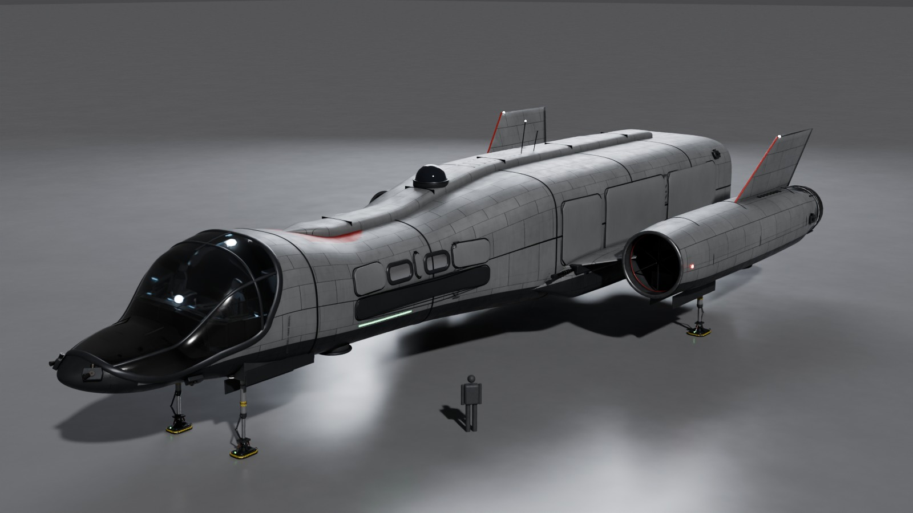
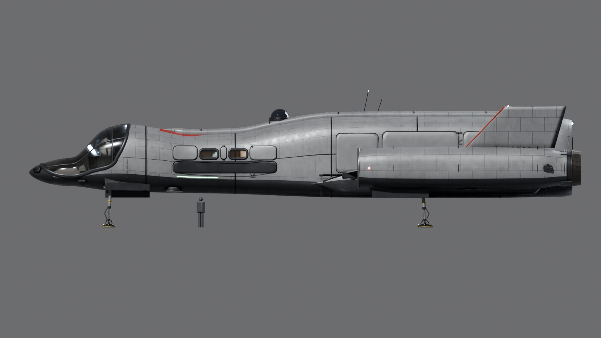
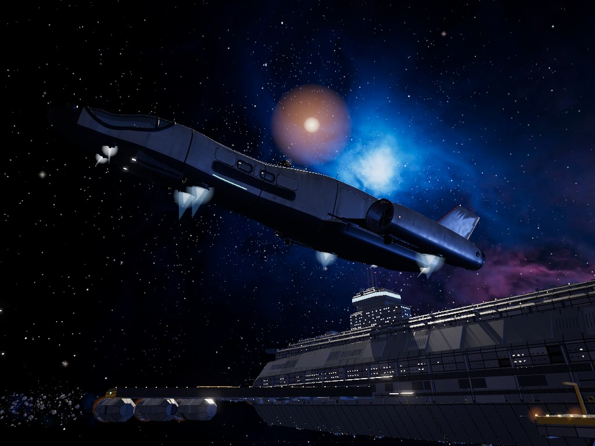
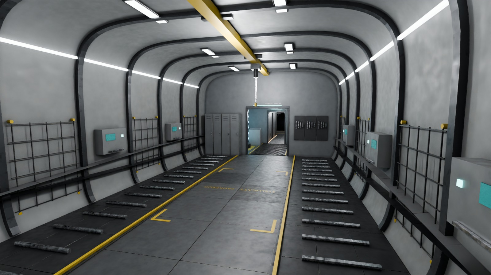
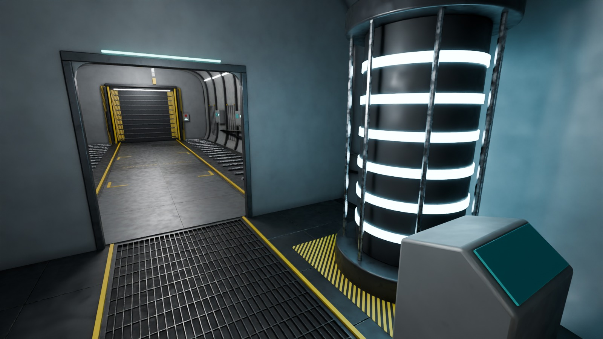
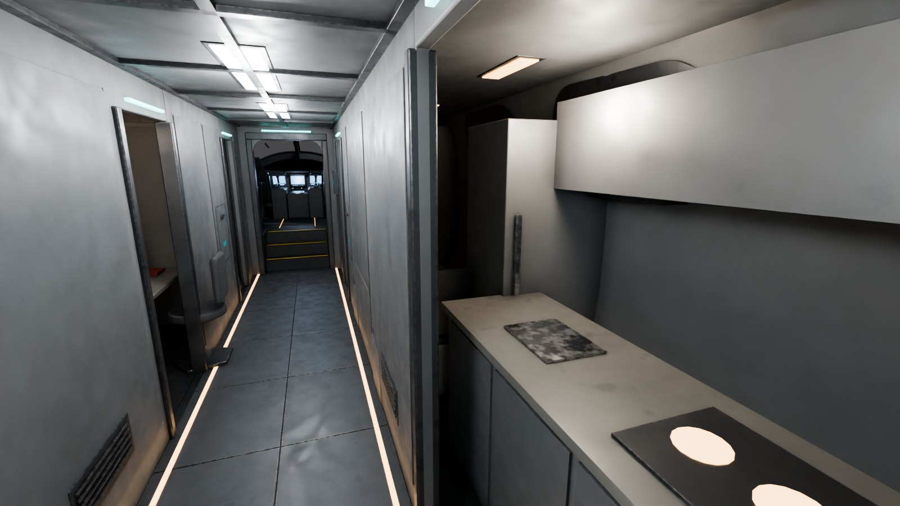
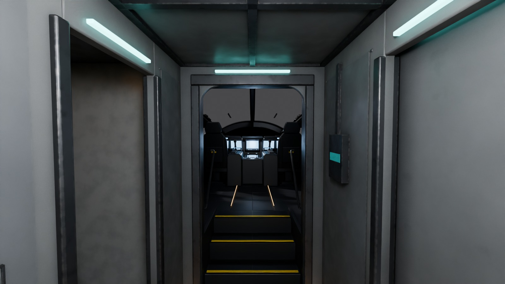
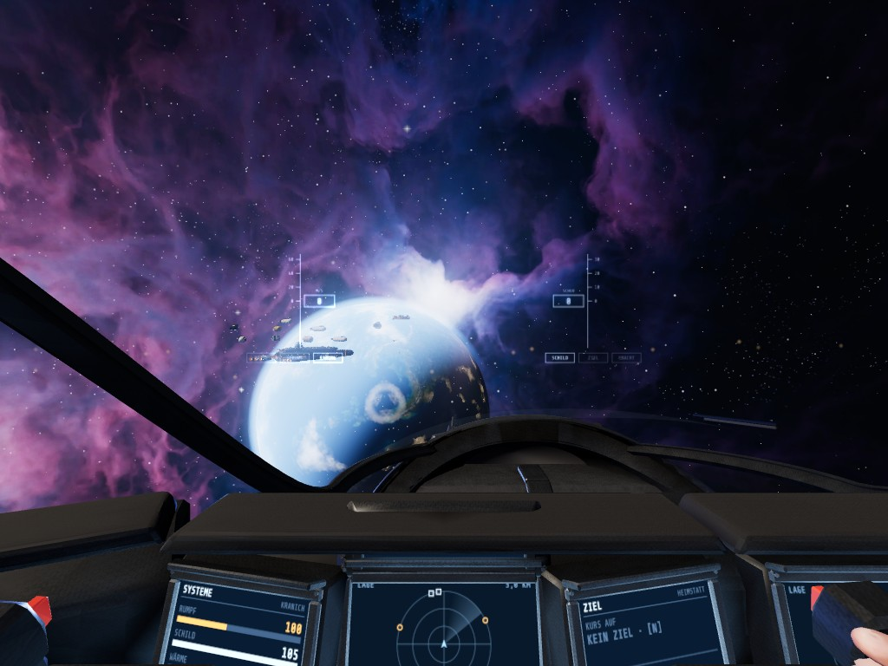
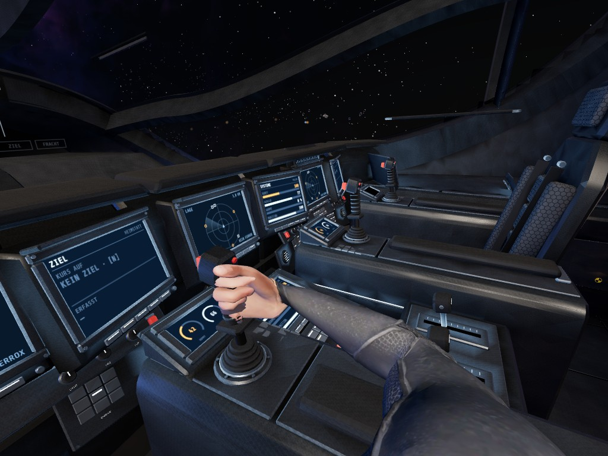

# Kranich KR-1

Eigenes Mehrzweckschiff für zwei, gebaut am 26.11.2026. Auftrag des Nutzers: „Jetzt ein neues Schiff erstellen, mit allem, was du bisher gelernt hast. Es soll außen wie innen besser als alles bisher aussehen und funktionieren. Für den Innenraum und das Cockpit soll alles im Modell passen, den kompletten Raum innen ausnutzen, keine Lücken lassen. Das volle Cockpitmodell mit ins Schiffspaket bauen.“ Dazu der Antrieb: Düsen nach unten für den senkrechten Start und Steuerdüsen zum Manövrieren.

Eigener Entwurf, kein Vorbild aus einem anderen Spiel. Die Gestalt folgt dem Vogel: kräftiger Körper (Laderaum), schlanker Hals (Wohnteil), Kopf mit Rundumverglasung (Cockpit), eine rote Krone hinter dem Cockpit.



| | |
|---|---|
| Maße | 32,1 × 15,1 × 8,0 m (Länge, Breite mit Gondeln, Höhe mit Fahrwerk) |
| Besatzung | 2 (Pilot links, Kopilot rechts) |
| Spielwerte | `kranich` in `src/data/ships.ts`: 14.500 Cr, Rumpf 240, Schild 105, Fracht 110, Scanner 2100, 4 Flugkörper |
| Laderaum | 12,4 m, Heckluke 3,1 × 2,8 m; ein Wiesel passt, ein Dachs nicht |
| Begehbar | ja, 96 m² Laufkarte vom Rampenfuß bis in beide Cockpitsitze |

## Aufbau

Außen (`asset-src/neu/kranich/kra_kit.py`, Achsen wie Milan und Dohle: +X nach vorn, +Y Backbord, +Z oben, Boden z = 0):

- Rumpf aus Superellipsen-Spanten (Tabelle `TBL`), Ogivnase mit dunklem Radom, flache Heckplatte mit Rampe.
- Verglasung als Superellipse in (x, Winkel), nach vorn länger (`GH_V`): eine Glasnase bis 15,3 m. Das Glas reicht bis unter die Rumpfmitte (`GT` 1,75). Schmale Seitenstreben, die Mittelstrebe nur über den Köpfen, ein Querspant hinter dem Kopf.
- Kopf: hohe Kanzel (Oberkante 6,0 m), die Nase fällt steil ab und liegt unter dem Augpunkt.
- Rückengrat mit Scanner und Antennen, Seitenwülste am Laderaum (nur außen sichtbar, die Teile im Rumpf sind weggelassen), Panzerplatten mit Fugen, vier Bullaugen am Hals mit echtem Loch im Rumpf.
- Zwei Gondeln an Stummelflügeln mit Einlauf und Lüfterrad, Schubdüse mit Klappen, zwei schräge Leitwerke.
- Vier Landebeine mit Füßen (keine Räder): vorn fahren sie nach hinten in den Bug, hinten nach vorn in die Gondeln; je zwei Schachtklappen schließen zuletzt.
- Heckrampe in zwei Teilen: sie schwenkt auf 28,5° nach unten, die Verlängerung fährt aus und setzt auf.



## Antrieb

- Zwei Haupttriebwerke am Ende der Gondeln (Glühpunkt und Strahl wie bei allen Schiffen, `playerShips.ts enginePts`).
- Vier Hubdüsen unten: zwei unter dem Gangboden vorn, zwei unter den Gondeln. Leitschaufeln im Schacht, blaue Glut.
- Zehn Steuerdüsenblöcke mit je drei Düsen (seitlich, senkrecht, längs): Nase oben und unten, Heck oben und unten, je beide Seiten, dazu je einer außen an den Gondelenden.
- Im Spiel: `src/game/hilfsduesen.ts`. Die Hubdüsen arbeiten beim Steigen (Leertaste), schwach beim Sinken und auf Planeten in Bodennähe (stärker je tiefer: Starten, Landen, Schweben). Jede Steuerdüse feuert, wenn ihr Rückstoß zur gewünschten Bewegung passt: Drehmoment in Richtung der Drehung (Nicken, Gieren, Rollen) oder Kraft in Richtung des Schiebens (A/D, Leertaste/Strg, Bremsen mit S). Lage und Richtung kommen aus dem Export (`kra-gelenke.json` → `duesen`). Die Düsen sind nur sichtbar, solange die Haupttriebwerke es sind (am Boden, außenbords und angedockt aus).
- Für weitere Schiffe: einen Eintrag in der Tabelle `D` in `hilfsduesen.ts` (Punkte und Richtungen in Schiffskoordinaten).
- Strahlen mit wenig Deckkraft: Der Glanzfilter des Spiels bläht helle Kegel zu weißen Spitzen auf.



## Innenraum

`kra_innen.py`. Grundsatz gegen Lücken: Die Innenhaut ist der Rumpf, um 17 cm nach innen versetzt (gleiche Spanten). Böden haben den genauen Umriss der Innenhaut, Schotten ihren Querschnitt (Streifenbau, Türen mit runden Ecken), Decken schließen an die Haut an. Möbel an der Wand folgen der Rumpfform (`wandkasten`, `wmin`): Im Hals zieht der Rumpf unten stark ein, gerade Kästen stachen dort durch die Außenhaut.

Von hinten nach vorn (Boden 2,35 m über Grund, Cockpit 3,30 m):

- **Laderaum** (x −15,4 … −3,0): Heckrampe mit Bedienfeld und Warnstreifen, Mittelbahn mit Platten und Stellplatz für einen Wiesel, seitlich Rollenbahnen mit Zurrschienen, Spanten mit Frachtnetzen und Wandkästen, Lichtbänder, Kranschiene mit Laufkatze, Spinde und Werkzeugwand an der Vorderwand.
- **Technik** (−3,0 … 1,4): Energiekern mit Glutringen im Käfig und Kupferleitungen zur Decke, Kernpult, zwei Gastanks, Luftwäscher, Werkbank, Leitungsbündel über dem Gitterrost-Gang.
- **Wohnteil** (1,4 … 8,6): Gang mit Lichtstreifen und Wandfeldern. Links die Kabine mit zwei Kojen übereinander, Schrank, Schreibplatz unter dem Bullauge und die Waschzelle; rechts Kombüse mit Kochfeld, Spüle und Kühlschrank, Messe mit Tisch und Bänken, Anzugschrank mit Sanitätskasten.
- **Cockpit** (8,6 … Nase): siehe unten.






Auslöser (`asset-src/glb/ship/Kranich.look.json`): Pilotensitz, Schreibplatz (Logbuch), Kojen (Ausruhen), Spinde, Kernpult (Scanner), Rampenschalter.

## Cockpit im Schiffsmodell

`kra_cockpit.py` baut mit dem Cockpit-Baukasten Stil 2 (`asset-src/neu/cockpit/cp_lib.py`, `cp_teile.py`) direkt im Schiffsmodell. Der Baukasten läuft in eigenem Namensraum; sein unterster Rahmen dreht seine Bau-Koordinaten (X rechts, Y vorn) in die des Schiffs (−90° um Z).

- Schott mit Tür auf Gangboden, Schwelle, fünf Stufen hinauf (die erste hinter dem Türsturz, sonst fehlt der Laufkarte Kopfhöhe).
- Zwei Plätze mit Sitz, Armkonsolen und Knüppeln, Pult mit drei Anzeigen und Flügel, Pedale, Mittelkonsole mit Karte, Schiffsanzeige und Schubhebeln, Deckenkonsole unter der Mittelstrebe.
- Seitenbänke zwischen Armkonsole und Wand (in Abschnitten, sie folgen der Wand), Feuerlöscher und Sanitätskasten, Haltegriffe.
- Hinter den Sitzen links die Energieverteilung, rechts ein Steh-Pult für Sensoren und Bordwaffen mit Schwenkbildschirm.
- Deck unter der Scheibe bis in die Nase mit Sensoren; Innenhaut mit Flansch und Laibung an der Verglasung, tiefe Streben von der Außen- bis zur Innenhaut.

Im Schiffsmodell tragen die Cockpitteile die Kennung „ ~cp“ (sichtbar von außen und beim Herumlaufen, Bildschirme matt). In der Ich-Sicht (Taste K) blendet das Spiel sie aus und zeigt `KranichCockpit.glb`: dieselben Teile mit gebackenem Licht, dazu Außenhaut, Rahmen und Glas für die Schatten (`kra_export_cockpit.py`, dann `cp_export.py`). Der Innenraum hinter der Tür bleibt sichtbar. Eintrag `COCKPITS.kranich` in `src/game/cockpit.ts`.




## Pipeline

```bash
sh asset-src/neu/kranich/kra_spiel.sh      # bauen, exportieren, Cockpit backen, vereinfachen, Laufkarte (etwa 1,5 min)
npm run assets
```

- `kra_lauf.py -- <ansichten>` baut `Kranich.blend` und rendert Bilder (`schraeg`, `seite`, `in_laderaum`, `in_technik`, `in_gang`, `in_kabine`, `in_kombuese`, `in_cpgang`, `cp_vorn`, `cp_rechts`, `cp_hinten`, `rampe` …).
- `kra_export.py`: `Kranich_roh.glb` (zu) und `Kranich_offen_roh.glb` (Rampe offen, glatte Lauffläche, nur für die Laufkarte). Lädt den Baukasten nicht (der Würger-Baukasten leert die Szene), Gelenke und Maße stehen in `kra-anker.json`. Schreibt `kra-gelenke.json` (Gelenke in Koordinaten der GLB-Datei, Düsen, Augpunkt, Griffe, Auslöser in Schiffskoordinaten).
- Rumpf mit Plattenfugen als `ext_pan_k*` (UV auf das Spielmaß 1,6 × 0,9 m gestreckt), Innenraum mit `~iw/~ib/~ig/~im`.
- Spieldateien: `Kranich.glb` 288.000 Dreiecke (3,5 MB im Spiel), `KranichFern.glb` 46.000, `KranichCockpit.glb` 330.000 (6,8 MB), Laufkarte `asset-src/walk/Kranich.json`.

## Im Spiel eingetragen

`ships.ts` (Klasse), `gltfShips.ts` (`DOORS.Kranich`, `RAMP_ENTRY`), `laderaum.ts` (`RAEUME.Kranich`: Kistenreihen, Stellplatz), `fahrzeuge.ts` (`STELL.kranich`), `ausstieg.ts` (über die Rampe), `playerShips.ts` (Triebwerke, Kanone), `hud.ts` (Umriss), `cockpit.ts`, `interior.ts` (Kernglut an Bord gedämpft), `city.ts` (fliegt im Stadtverkehr), `hilfsduesen.ts`.

## Sicht aus dem Cockpit (26.11.2026)

Nutzer nach dem ersten Stand: „Man hat eine sehr schlechte Sicht nach außen, da das Armaturenbrett sozusagen sehr hoch ist und sehr wenig Glas und dicke Streben.“ Geändert:

- Geradeaus sah man in die Nase: Ihre Oberkante lag über dem Augpunkt. Jetzt hohe Kanzel, steile Nase, Cockpitboden 3,30 m (vorher 2,92), Augpunkt 1,2 m über dem Boden.
- Glasnase statt spitz zulaufendem Glas, Glas bis unter die Rumpfmitte.
- Pult und Mittelkonsole 20 cm tiefer als im Baukasten (`PULT_TIEF`).
- Streben 4,5 bis 5 cm breit und flach (vorher 7 bis 8 cm und bis zur Innenhaut tief), Mittelstrebe vorn weg, Flansch innen schmal.
- Messung: Strahlen vom Augpunkt treffen geradeaus erst ab 8 bis 12° unter dem Horizont auf etwas (vorher schon am Horizont die Pultkante).

## Gelernt

- Sicht prüfen mit Strahlen vom Augpunkt (Glas ausgeblendet), nicht nur mit Bildern: Ein Bild mit gesenktem Blick täuscht.

- Ein Gelenk unter einem anderen Gelenk braucht seine Elternumkehr aus `location`, nicht aus `matrix_world`: Die ist direkt nach dem Anlegen noch nicht gerechnet, die Rampenverlängerung hing sonst 15 m hinter dem Schiff.
- Kopfhöhe an Türen: Die Laufkarte prüft 1,95 m über jeder Zelle. Eine Stufe unter dem Türsturz trennt das Cockpit vom Rest.
- Ein 7 cm breiter Spalt zwischen Schott und Stufe reicht bis zum Rumpfboden und unterbricht die Laufkarte.
- Durchstoßprüfung: Eckpunkte aller Innenteile gegen die Außenhaut testen (`|y|` größer als der Rumpf an dieser Stelle). Erst sammeln, dann den Baukasten laden, weil der die Szene leert.

## Offen

- Hub- und Steuerdüsen für die übrigen Schiffe (Tabelle `D` in `hilfsduesen.ts`).
- Kopilotenplatz ohne eigene Bewegung (Knüppel rechts fest), wie bei der Kormoran.
- Beschriftungen außen sind klein; Feinarbeit am Stummelflügel.
