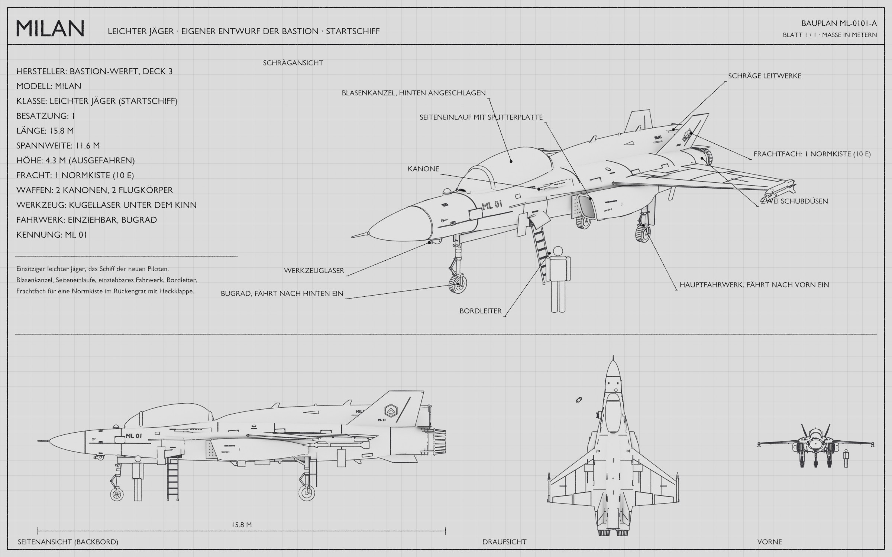
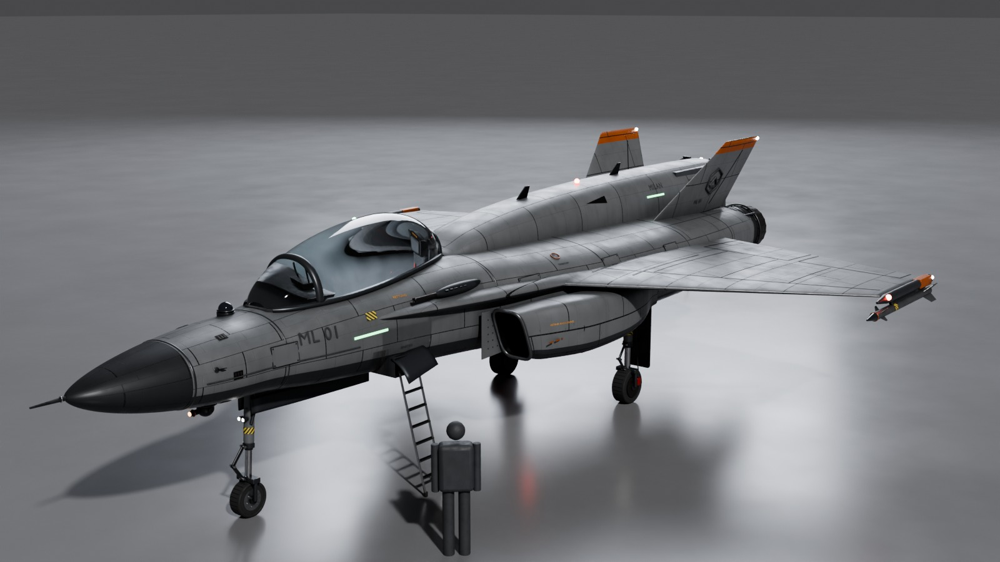
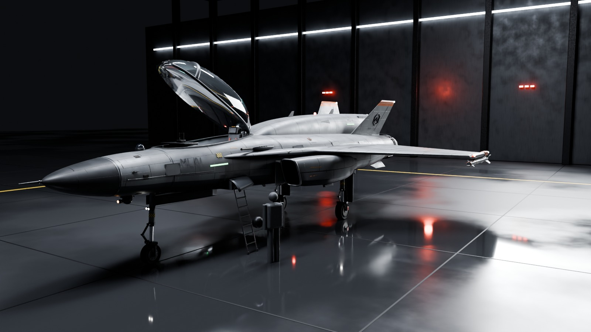
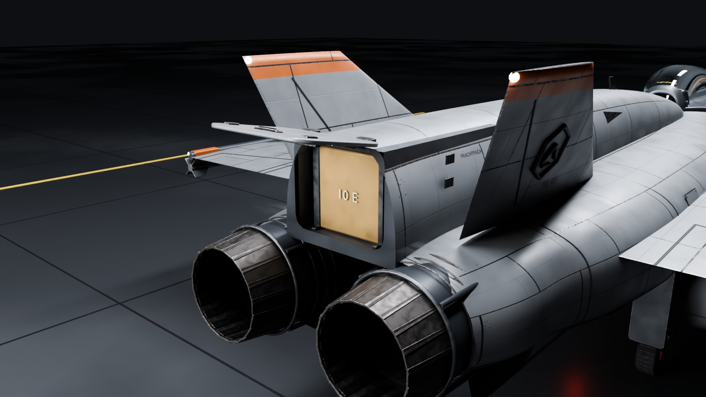

# Milan: leichter Jäger, das Startschiff

Gebaut am 25.11.2026. Wunsch des Nutzers: Die Venom (gekauftes Modell) soll raus und durch ein eigenes Schiff ersetzt werden. Vorgaben:
- kleiner Jäger mit einem Sitz und Cockpit
- plausibel, also mit Einstieg
- Platz für ein bisschen Fracht, etwa eine Kiste mit 10 Einheiten hinten mit Öffnung
- ausfahrbares Fahrwerk
- „besser als alles bisher“

Es ist ein eigener Entwurf ohne Vorbild. Der Name passt zu den anderen Greifvögeln der Bastion (Würger, Elster, Kormoran).






## Maße und Aufbau

15,8 × 11,6 × 4,3 m (Fahrwerk ausgefahren). Achsen wie bei Würger und Elster: +X nach vorn, +Y Backbord, +Z oben, Boden bei z = 0. Rund 205.000 Dreiecke in Blender.

- **Rumpf:** Superellipsen-Spanten aus der Tabelle `TBL` mit Ogivnase und dunklem Radom. Breiter Mittelrumpf mit Seitenkante, flaches Heck mit zwei Schubdüsen. Oben Taubengrau, unten Graphit, wenige orangene Akzente. Plattenfugen und Nieten im Shader (UV „Platten“, wie bei der Elster).
- **Seiteneinläufe:**
  - Schaufel mit schräger Mündung
  - Grenzschichtspalt mit Splitterplatte, Abstandshaltern und Lochfeld
  - Lippe, dunkler Kanal und Verdichterrad tief im Kanal
- **Kanzel:** einteilige Blase mit Bügel, hinterem Rahmen und Schienen. Sie ist hinten angeschlagen und klappt vorn hoch. Darunter das Cockpit:
  - Schleudersitz mit Gurtzeug und Zuggriff
  - Tafel mit drei Anzeigen, Blendschutz und HUD
  - Mittelknüppel, Schubhebel, Seitenkonsolen, Pedale, Avionikkasten
- **Rückengrat mit Frachtfach:** Im Heck des Grats liegt ein Fach für genau eine Normkiste (1,2 × 0,8 × 0,8 m = 10 E). Es hat Zurrschienen, eine Leuchte und eine Heckklappe, die oben angeschlagen ist und nach oben aufklappt.
- **Flügel:** Schulterflügel mit Wurzelleiste über den Einläufen, echtem Profil (NACA, 5 → 4 %), Klappen- und Querruderfugen, Ruderantrieben, Kantenleiste und Laufweg. An den Spitzen sitzen Startschienen mit Flugkörpern, Positionslichtern und orangen Spitzenbändern.
- **Leitwerke:** zwei Seitenleitwerke, 21° nach außen geneigt, mit Ruderfuge, Licht und Zeichen der Bastion. Dazu zwei Bauchflossen.
- **Fahrwerk (einziehbar):**
  - **Bugrad:** fährt nach hinten in einen Schacht. Federbein mit Kolben, Drehmomentlenker, Gabel, Rollscheinwerfer, Lenkzylinder und zwei Schachtklappen.
  - **Haupträder:** fahren nach vorn in die Rumpfseiten. Gabel, Bremsscheiben und Sattel, Knickstrebe mit Verriegelung, Beinklappe hinter dem Bein (deckt eingefahren den Schacht) und vordere Klappe.
- **Einstieg:** Bordleiter links unter der Kanzel hinter einer Klappe, dazu Trittmulde und Haltegriff.
- **Sonst:**
  - Werkzeuglaser als Kugelkopf unter dem Kinn
  - zwei Kanonen an den Rumpfseiten
  - IR-Sensor vor der Kanzel, Staurohr, Anstellwinkelgeber
  - Steuerdüsen, NACA-Einlass, Wartungsklappen, Tankstutzen, Antennen
  - Formations-, Blitz- und Hecklichter
  - Beschriftung: ML 01, MILAN, RETTUNG, EINSTIEG, TREIBSTOFF, FRACHTFACH, GEFAHR ANSAUGUNG, NICHT BETRETEN
  - Gebrauchsspuren

## Bewegliche Teile

Die Teile hängen in Blender an Gelenken (`gelenk()` in `mil_kit.py`). `zustand(fw, fracht, leiter, kanzel)` stellt jeden Zustand. `mil_export.py` gibt ihren Materialien die Endung „ |<kennung>“ und rechnet die Gelenke in die Koordinaten der GLB-Datei um (Blender (x, y, z) → Datei (y, z, x)). Ergebnis: `mil-gelenke.json`.

| Gruppe | Teile | im Spiel |
|---|---|---|
| fw (0 unten … 1 eingefahren, 3,2 s) | Bugrad, zwei Bugradklappen, zwei Hauptbeine mit Beinklappe, zwei vordere Klappen | `setGear` in `src/models/gltfShips.ts`: im Flug eingefahren, im Landeanflug und am Boden ausgefahren |
| fracht (1,6 s) | Heckklappe | `setDoors`: am Boden offen, im Hangar mit dem Rampenschalter, im Flug, wenn der Traktorstrahl eine Kiste heranzieht |
| leiter (2,2 s) | Leiterklappe, Leiter (gleitet aus dem Schacht) | `setDoors`, aber nur bei ausgefahrenem Fahrwerk (`boden`) |
| Kanzel | Glas, Bügel, Rahmen | `setKanzel` (Gelenk am hinteren Rahmen, 0,62 rad) |

Neu in `gltfShips.ts` dafür:
- Drehachsen in allen drei Richtungen (`axis`) und Teile, die geöffnet gebaut sind (`inv`)
- Gruppen nur am Boden (`boden`)
- je Fassung (Nah- und Fernmodell) eigene Gelenke
- Fahrwerk, das wirklich ein- und ausfährt; die Landehöhe wird vor dem ersten Einfahren gemessen

## Im Spiel

- Klasse `milan` (`src/data/ships.ts`) ist das Startschiff (`STARTER`). Werte: Hülle 115, Schild 45, Tempo 290, Wendigkeit 1,05, Fracht 10, Munition 300, 2 Flugkörper, Bergbaulaser 1.
- Die Venom ist entfernt: Klasse, Modell und Dateien. Spielstände mit einer Venom bekommen einen Milan (`RETIRED`, `state.ts` `retireShips`). Ladung über 10 E geht ins Stationslager.
- Anker in Schiffskoordinaten (Mitte des Modells 0,283 / 0 / 2,14):
  - Düsen ±0,8 / 0,16 / 7,83
  - Kanonen ±1,04 / 0,6 / −2,6
  - Laser 0 / −0,46 / −5,74
  - Ladepunkt hinter der Heckklappe 0 / 1,11 / 8,28 (`kisten.ts` `KLAPPE`)
- HUD-Umriss `SIL.milan` (`src/ui/hud.ts`). Der Bordrechner hängt beim Milan keine Leiter an die Kanzel, er hat seine eigene (`eigeneLeiter`).
- Weg: `sh asset-src/neu/milan/mil_spiel.sh`, danach `npm run assets`.
  - `Milan.glb`: 205.000 → 116.000 Dreiecke
  - `MilanFern.glb`: 33.000 Dreiecke

## Dateien

`asset-src/neu/milan/`:
- `mil_kit.py` (Bau; Helfer aus `../elster/els_kit.py`)
- `mil_lauf.py` (ohne Fenster bauen und rendern)
- `mil_export.py`, `mil_spiel.sh`
- Bilder `mil-*.jpg`

```bash
cd asset-src/neu/milan && /c/EXTRA/Blender/blender.exe -b --python mil_lauf.py -- alle
cd asset-src/neu/milan && /c/EXTRA/Blender/blender.exe -b --python mil_lauf.py -- bauplan
```

Ansichten: schraeg, draufsicht, seite, front, heck, hangar, cockpit, detail, weltraum, unten, fahrwerk, fahrwerk2, fracht, leiter, einstieg, halb (Fahrwerk halb eingefahren).

## Gelernt

- Beim Umhängen an ein Gelenk die Lage über `matrix_parent_inverse` halten. `matrix_world` gleich nach dem Setzen der Eltern rechnet noch mit der alten Lage des Gelenks, und alles war doppelt verschoben.
- Die Haupträder fuhren zuerst nach innen und hätten sich in der Mitte berührt. Nach vorn eingefahren bleiben sie nebeneinander.
- Der Mitteldecker schnitt mit der Wurzelleiste in die Einlaufmündung. Als Schulterflügel liegt die Leiste über den Einläufen.
- Schrift auf Wölbungen (Einlauf, Grat, Flügelunterseite) taucht ein und wirft einen Schatten. Abhilfe: in ein Netz wandeln und per Shrinkwrap auflegen (`wrap_text`).

## Offen

- Rückmeldung des Nutzers.
- Lackierungen aus der Werft greifen nicht (eigene Materialien wie bei allen eigenen Modellen).
- Die Fracht von 10 E ist knapp für Stationsaufgaben mit 15 bis 25 Einheiten (Ausbau oder größeres Schiff nötig).
