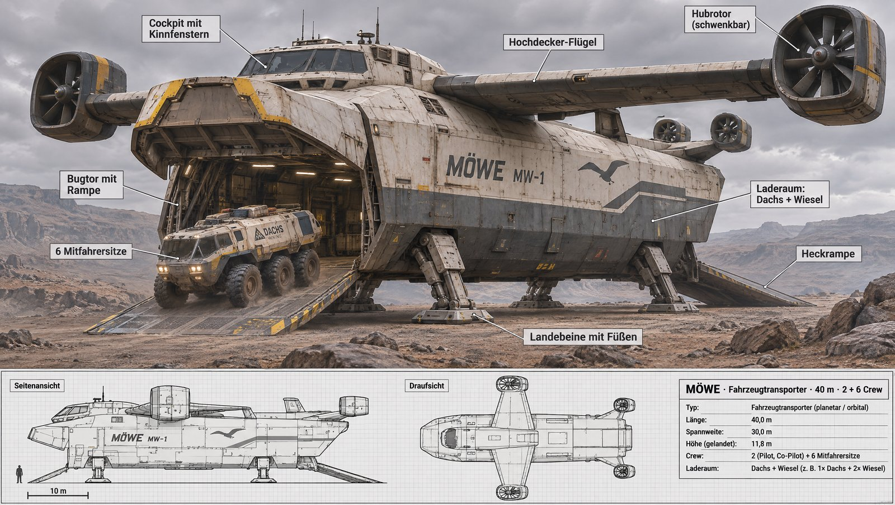
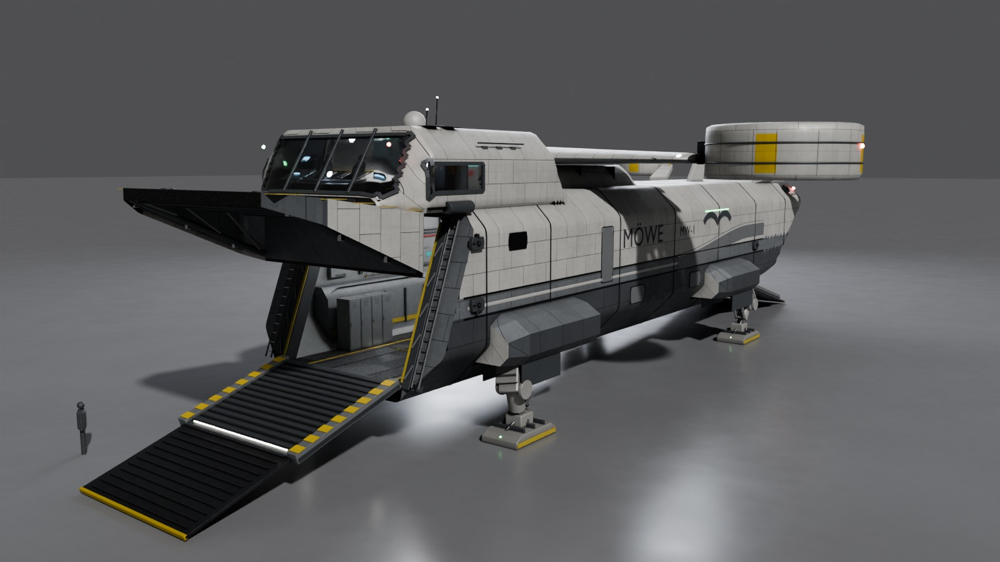
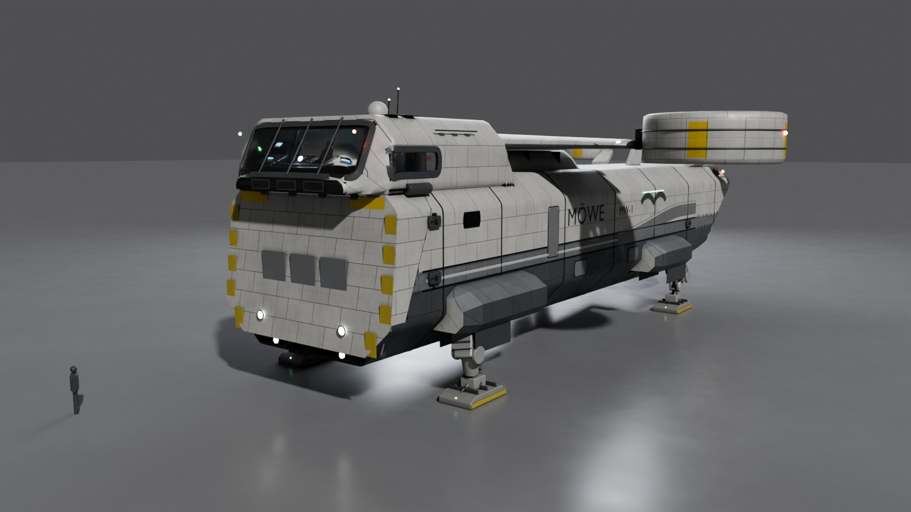
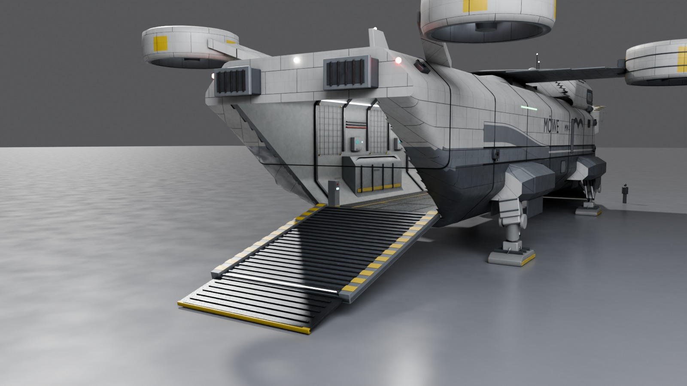
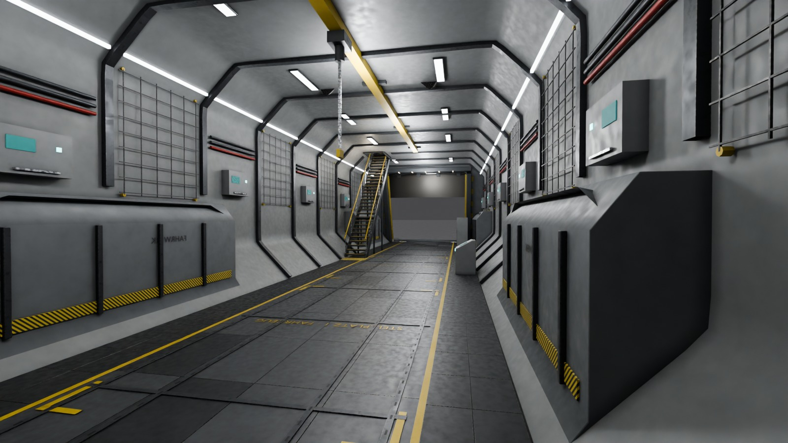
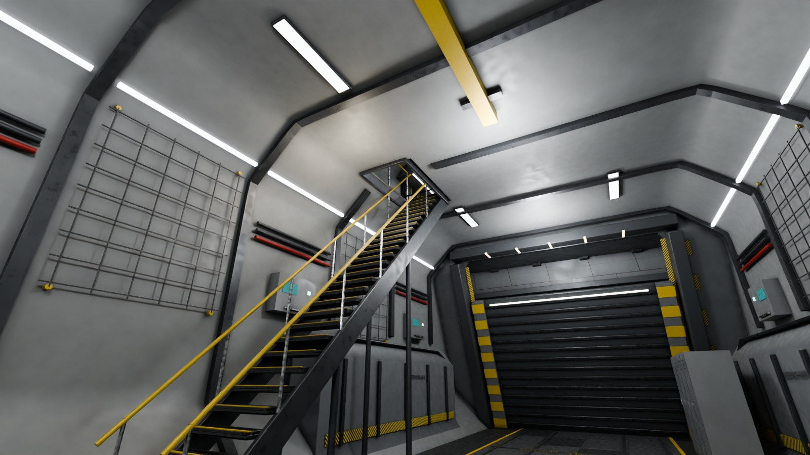
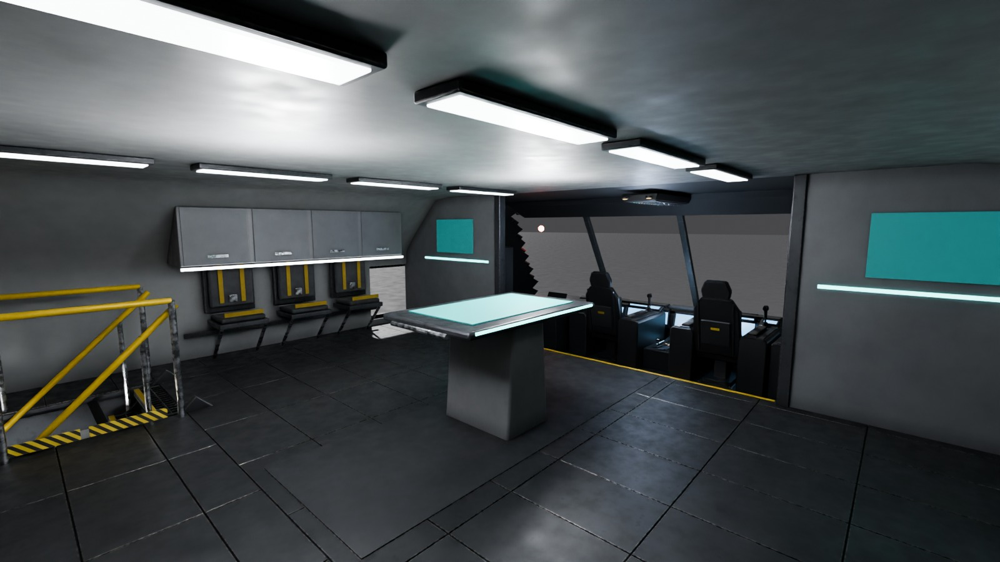
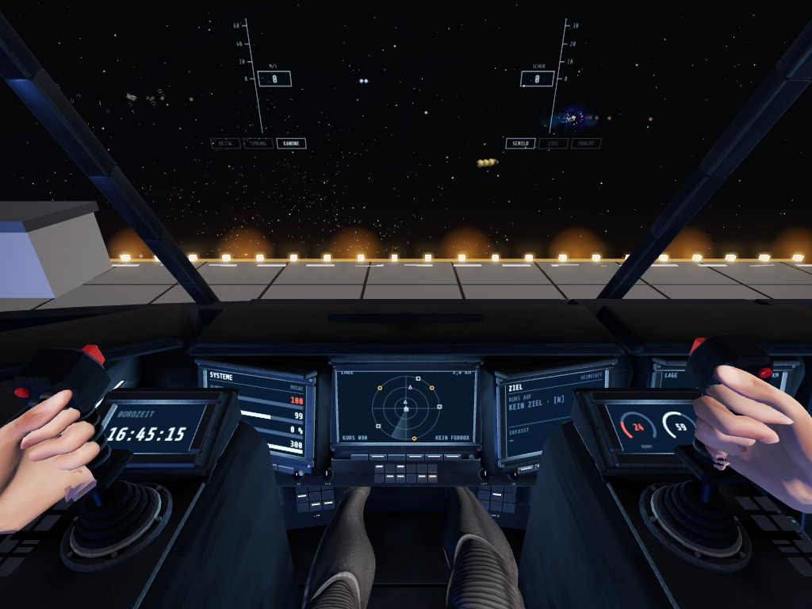
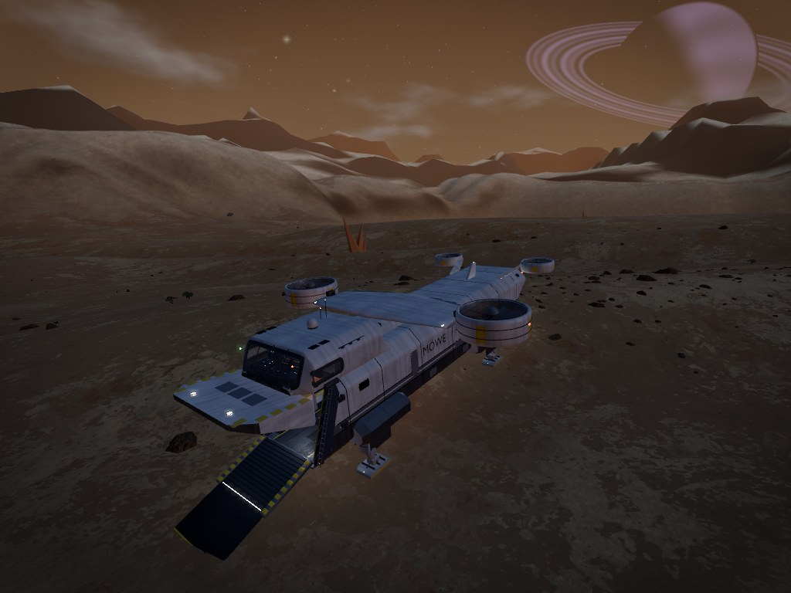

# Möwe MW-1

Eigener Fahrzeugtransporter, gebaut am 26.11.2026 nach dem Konzeptbild aus der Werftmappe. Auftrag des Nutzers: „Bau den so im Blender, wirklich Mühe geben, mach dir Gedanken über das Fahrwerk, über die Rampen, wie die ein- und ausfahren, wie das zusammenspielt mit dem Rumpf des Schiffes … Mach dir Gedanken fürs Cockpit, dass man auch eine gute Sicht im Flug hat.“ Nach dem ersten Anlauf: „Die Form ist ganz anders. Das Fahrwerk ist viel zu klein … versuch wirklich das 1:1 so nachzumachen.“ Der zweite Anlauf folgt dem Bild.





| | |
|---|---|
| Maße | 36,9 × 26,8 × 12,2 m (geschlossen; mit offener Haube 46 m lang) |
| Besatzung | 2 im Cockpit, 6 Plätze in der Kabine |
| Spielwerte | `moewe` in `src/data/ships.ts`: 30.500 Cr, Rumpf 420, Schild 150, Fracht 260, keine Flugkörper |
| Laderaum | 27 m zum Durchfahren (Bugtor und Heckrampe), Fahrgasse ±2,0 m, zwei Dachs hintereinander |
| Begehbar | ja, 281 m² Laufkarte vom Fuß der Heckrampe über die Treppe bis in beide Cockpitsitze |

## Aufbau außen

`asset-src/neu/moewe/moe_kit.py`, Achsen wie Milan, Dohle und Kranich: +X nach vorn, +Y Backbord, +Z oben, Boden z = 0. Maße aus der Bauzeichnung des Bildes (Länge 40 m als Maßstab).

- Kantiger Rumpf: Querschnitt als Vieleck mit gerundeten Kanten (flaches Dach 8,5 m, breite obere Fase, senkrechte Seiten, große untere Fase, Boden 1,9 m über Grund). Weiß oben, graues Band, dunkles Unterteil, Möwen-Logo und Kennung.
- Heck: Die Unterseite steigt hinten schräg an; die Schräge ist die geschlossene Heckrampe. An der Schräge verteilt `hull_point` die Rumpfpunkte nach Bogenlänge (sonst Sägezähne an der Schnittkante); oberhalb bleiben die Ringe gerade.
- Bug: Die gelb gestreifte Haube ist das Bugtor. Gelenk oben unter dem Cockpit (15,0 / 8,0), sie schwenkt um −92° nach oben und steht dann als Schnabel nach vorn. Dahinter die schräge Bugplatte mit großer Toröffnung (6 × 5,4 m), Torpfosten mit Fachwerk und Leitern.
- Cockpit-Aufbau fast rumpfbreit auf dem Dach, ragt vorn über die Haube: Frontscheibe mit vier Feldern, Seitenfenster, Kinnfenster. Die Glasflächen folgen dem Raster des Aufbaus; ein 22 cm breiter Rahmen entlang der geglätteten Randlinie (außen und innen) deckt die Stufen an schrägen Rändern ab.
- Rückengrat mit Trapezflügel, große Mantelrotoren an den Flügelspitzen (gelandet senkrecht, im Flug nach vorn geschwenkt), zwei kleinere Heckrotoren auf gepfeilten Stummeln, Rückenflosse.
- Antrieb: zwei Schubdüsen in der Heckfläche, acht Hubdüsen unter dem Boden, acht Steuerdüsenblöcke (`src/game/hilfsduesen.ts`, Tabelle `moewe`).



## Fahrwerk und Rampen

- Vier schwere Beine (Panzerschenkel, Knie, Doppelkolben, Federbein, Fuß 2,4 × 1,5 m). Einfahren: Das Bein klappt um die Hüfte 90° in einen kantigen Fahrwerkskasten unten an der Flanke (vorn nach hinten, hinten nach vorn). Der Fuß hängt am Bein und klappt gegenläufig mit, er liegt eingefahren flach unter dem Bein und schließt den Kasten unten. Zwei Klappen schließen den Rest des Schlitzes zuletzt.
- Im Spiel ist der Fuß ein verschachteltes Drehgelenk unter dem Bein: `rigParts` in `src/models/gltfShips.ts` setzt ein Drehgelenk unter einem Elterngelenk um den Abstand der Achsen versetzt (neu mit der Möwe).
- Innen stehen die Kästen als Höcker an den Laderaumwänden (Verkleidung bis 4,75 m), die Fahrgasse bleibt frei.
- Gruppe `rampe` öffnet Bug und Heck zusammen: Haube nach oben, Bugrampe (4,4 m + 3,8 m Verlängerung) nach vorn unten, Heckrampe (7,3 m + 2,1 m) aus der Schräge auf rund 15° nach unten. Zum Betreten zählt die Heckrampe (`RAMP_ENTRY.Moewe`).



## Innenraum

`moe_innen.py` (von `moe_kit.py` ausgeführt), Grundsätze wie beim Kranich: Innenhaut = Rumpf um 17 cm nach innen versetzt, Boden mit dem Umriss der Haut, alles schließt an.

- Laderaum, Boden 2,4 m, Decke 8,3 m: Fahrgasse aus schweren Platten mit gelben Kanten, zwei Stellplätze, Kistenbahnen an den Wänden, Spanten, Netze, Wandkästen, Lichtbänder, Kranschiene mit Kettenzug, Spinde vorn rechts (`locker`), Systempult steuerbord (`scanner`), Rampenpult backbord an der Heckrampe (`ramp`). Futter an der schrägen Bugplatte und über der Heckschräge.
- Treppe 45° an der Backbordwand (neben der Fahrgasse) durch ein Loch im Dach in die Kabine.
- Kabine im Aufbau, Boden 8,55 m: sechs Klappsitze an den Wänden, Gepäckfächer, Einsatztisch mit Kartenschirm (`log`), Schrank, Spantwand mit 3,4 m breitem Durchgang zum Cockpit.







## Cockpit und Sicht

`moe_cockpit.py`, Cockpit-Baukasten Stil 2 wie Kranich. Cockpitboden 8,15 m über der Haube, eine Stufe (0,4 m) tiefer als die Kabine. Augpunkt 1,2 m über dem Boden bei x 14,55, also 1,45 m hinter der Unterkante der Frontscheibe: 30° Blick nach unten über die Nase. Das Pult sitzt 0,3 m tiefer als im Baukasten (25° frei darüber), die Seitenkonsolen enden vor der Wand, damit die Seitenfenster auf Augenhöhe frei bleiben. Scheibensprossen 6 cm schmal.



## Ablauf

```sh
sh asset-src/neu/moewe/moe_spiel.sh     # Blender bauen, exportieren, Cockpit backen, vereinfachen, Laufkarte
npm run assets
```

Ansichten rendern: `KOR_SAMPLES=24 blender -b --python moe_lauf.py -- bild zu heckoffen in_laderaum in_kabine cp_vorn …`. Werte fürs Spiel stehen nach dem Export in `moe-gelenke.json` (Gelenke, Düsen, Augpunkt, Griffe, Auslöser in Schiffskoordinaten).



## Offen

- Bugrampe ist nur Optik: Die Laufkarte führt über die Heckrampe hinein und hinaus.
- Ein Dachs an Bord steht im Laderaum (geprüft mit `testAnBord`); Hinein- und Hinausfahren über die Rampe und der Mehrspieler sind noch nicht geprüft.
