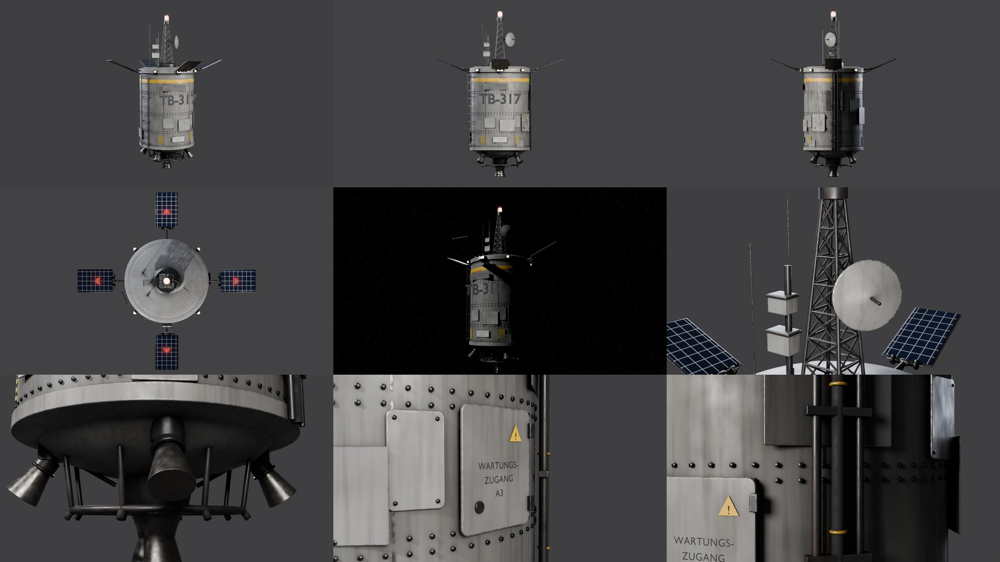
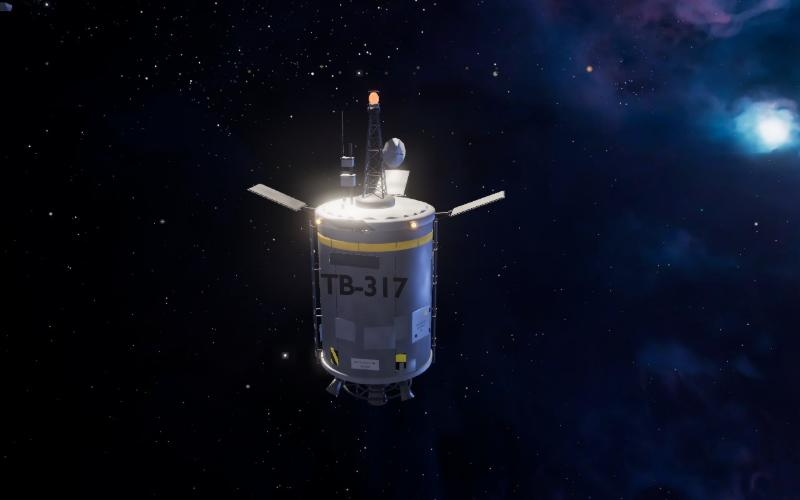

# Navigationsboje TB-317

Stand: 18.11.2026. Schaumodell in Blender nach einem Bild des Nutzers („Erstelle diese Boje, sie wird zur Markierung von Wegen genutzt.
1:1 wie auf dem Bild“). Noch nicht im Spiel.

## Maße und Aufbau

Höhe 6,0 m (Unterkante Mitteldüse bis Leuchtfeuer), Rumpf Ø 2,1 m, mit Solarflügeln 4,6 m breit; rund 60.000 Dreiecke.

- **Rumpf:** grauer, abgenutzter Stahlzylinder (z 1,0 bis 3,8 m) mit Kragen oben und unten, gelbem Band, Kennung „TB-317“, waagerechten Fugen
  mit Nietreihen, senkrechten Fugen, Klappen und Flickplatten in drei Grautönen.
- **Schilder:** Wartungsklappe „Wartungszugang A3“ mit Warndreieck, Schloss und Scharnieren; „Abstand halten · Düsen“ mit zwei Warnstreifen-Schildern.
  Schilder auf Deutsch wie bei der Gedenkboje, die Kennung wie im Bild.
- **Leiter** links über die ganze Rumpfhöhe; rechts ein Strang aus zwei Rohren und einem Kabel mit Schellen und gelben Markierungen.
- **Unten:** Kegel, vier schräg nach außen zeigende Steuerdüsen mit Trägern und Leitungen, Rohrrahmen mit Speichen und Kufen, Mitteldüse.
- **Oben:** Deckel mit Mastsockel, Gittermast (vier Beine, Kreuzstreben) mit rotem Leuchtfeuer im Käfig, Parabolantenne am Mast,
  zwei Stabantennen, Gerätemast mit zwei Kästen, vier gelbe Lampen und ein Scheinwerfer am Kragen, vier Solarflügel an Armen (22° geneigt).

## Dateien

`asset-src/neu/navboje/`: `nb_kit.py` (Bau), `nb_lauf.py -- alle` (Bau und Bilder), `nb_blatt.py` (Übersichtsblatt), Ausgabe
`Navigationsboje.blend`, Bilder `nb-<ansicht>.jpg` (schraeg, front, seite, draufsicht, weltraum, antenne, duese, wartung, leitungen).
Werkzeuge und Materialien aus `../fxjaeger/fxj_kit.py` (Helfermodus `NUR_HELFER_FXJ`).

## Im Spiel (23.11.2026)

Als Leitboje in Heimstatt (`src/game/leitbojen.ts`, siehe `docs/heimstatt.md`): alle 2 km neben den Verkehrswegen, 117 Stück. Die nächsten drei
(bis 600 m) als Nahmodell, die übrigen bis 4,5 km als Fernmodell in einer Instanzliste, dahinter nur der wandernde Lichtpuls am Leuchtfeuer.
Ausgabe mit `asset-src/neu/bojen_export.py`: `Navigationsboje.glb` (rund 16.700 Dreiecke, ohne Schrauben) und `NavigationsbojeFern.glb`
(rund 4.200, Teile unter 35 cm fehlen). Ohne Kollision (wie vorher).

## Offen

- Kennungen je Boje (alle tragen TB-317), eigenes Blinken des roten Leuchtfeuers statt des gemeinsamen Pulses, Bojen in anderen Sektoren.
