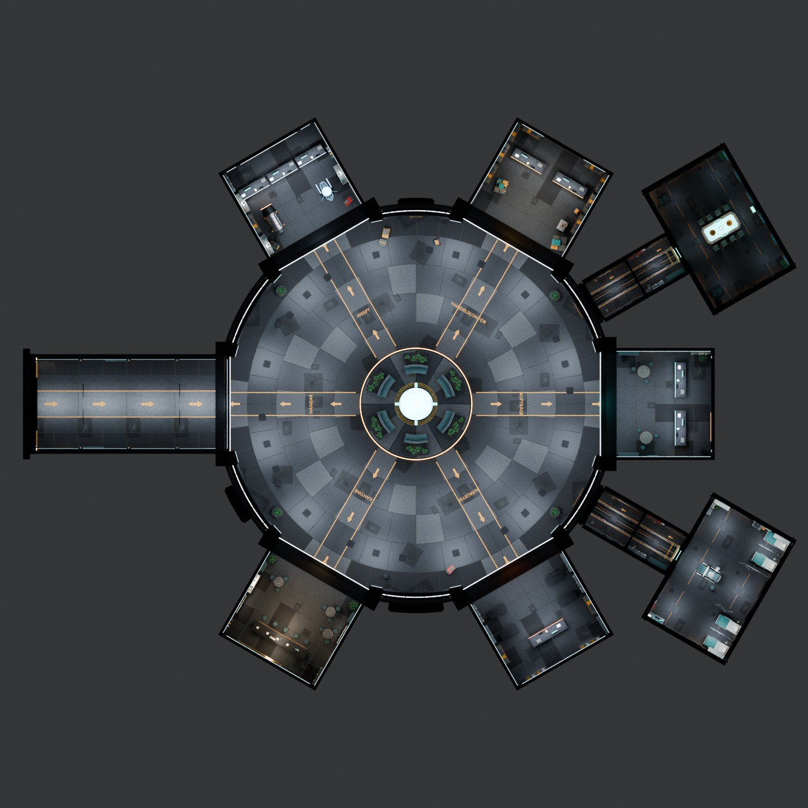
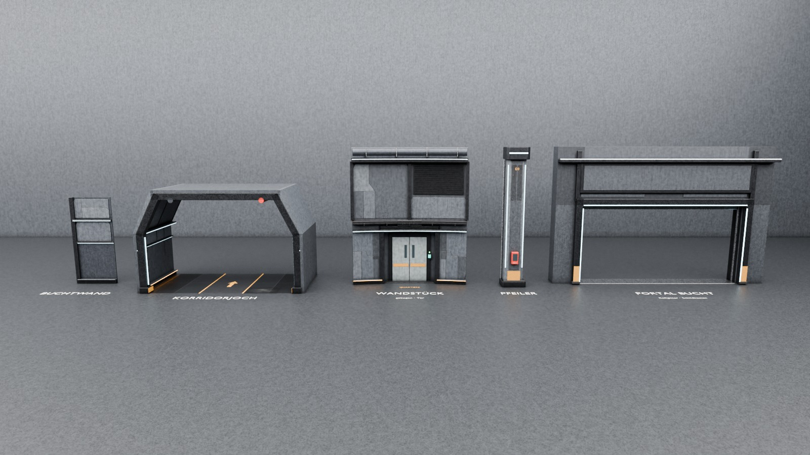
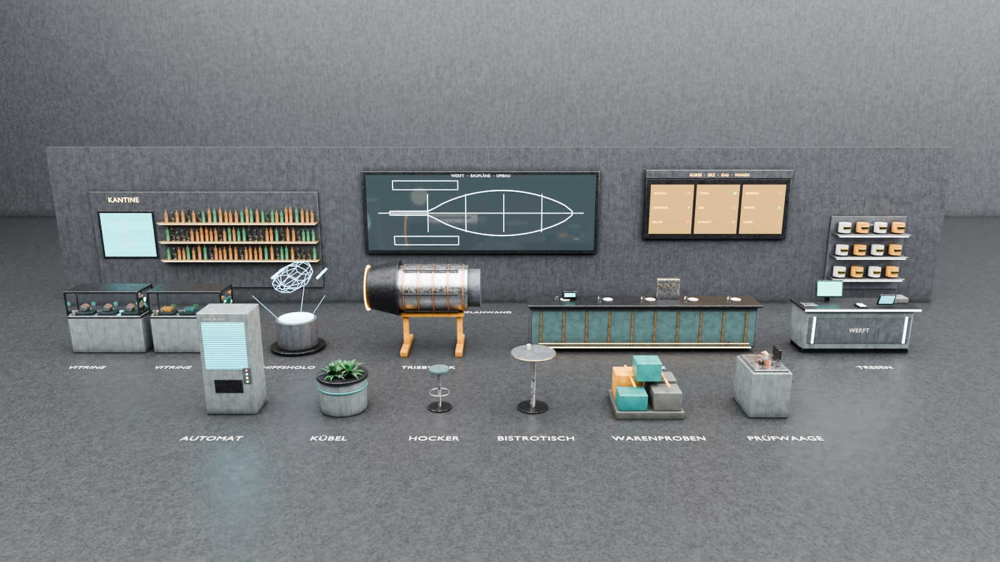
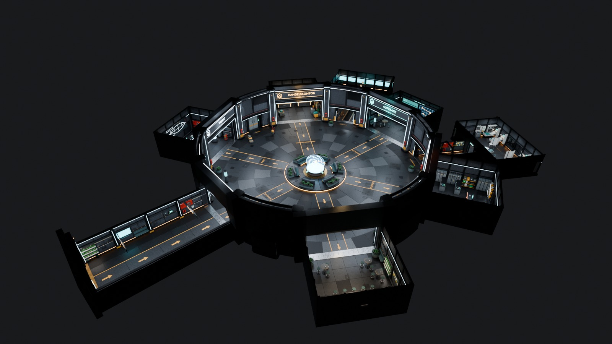
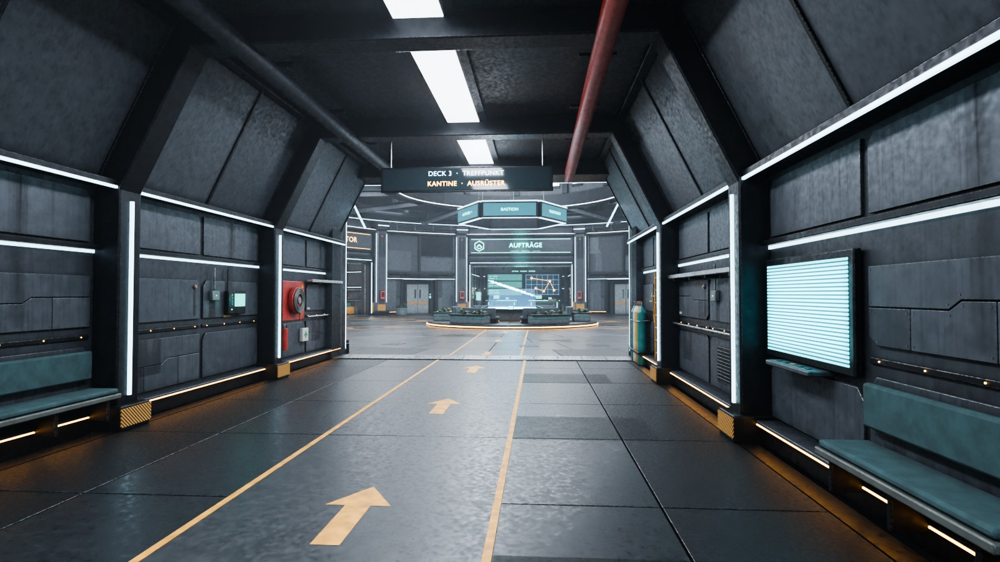
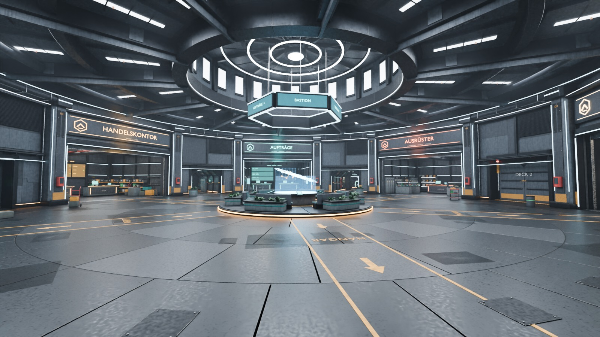
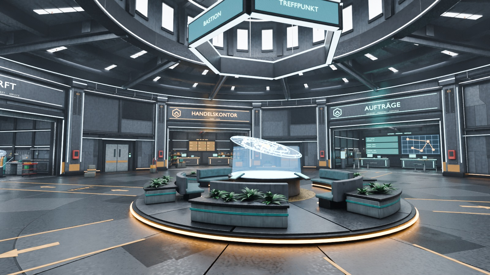
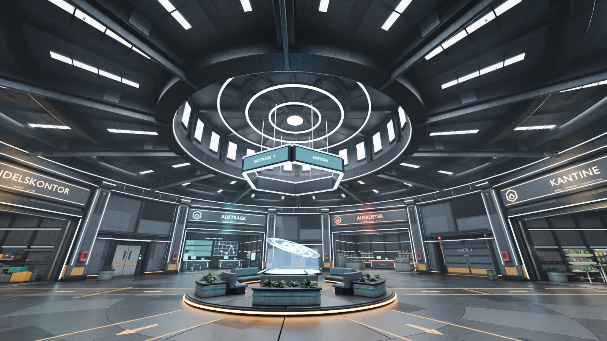

# Bastion: Rundhalle (neues Deck 3)

> Seit dem 26.11.2026 ersetzt durch das Forum (`docs/deck3.md`). Bausteine, Marktstände und Banner der Rundhalle werden dort weiterbenutzt;
> die Daten der Rundhalle (`deck_rund.json`, `Lichtraum2Rund`) sind nicht mehr im Spiel. Wiederherstellen: `rh_back_lauf.py`.

Stand 19.11.2026: im Spiel seit Alpha 1.52. Ersetzt das verwinkelte Deck 3 nach Plan D (`docs/bastion-deck.md`).

Auftrag des Nutzers (Skizze vom 18.11.2026): Das alte Deck ist zu verschachtelt, eng und unübersichtlich. Vom Hangar führt ein breiter
Korridor in einen offenen Bereich mit dem Treffpunkt in der Mitte. Ringsum liegen Einbuchtungen mit den Läden der einzelnen Dienste.

## Aufbau

| Teil | Maße | Inhalt |
|---|---|---|
| Korridor | 16 m lang, 8 m breit, 5 m hoch | vier Joche mit Spanten, Mittelspur mit Pfeilen, Bänke, Schirme, Wegweiser; Tor zum Hangar 7 × 4,4 m |
| Halle | Radius 16,5 m (33 m Durchmesser), Wand 7,2 m hoch | zwölf Pfeiler, Ringbalken, zwölf Deckenkeile mit Radialbalken, Lichtleisten, Lüftungsring |
| Trommel | Radius 6,5 m, Decke auf 10,6 m | Lichtschlitze ringsum, Lichtkrone aus drei Ringen, Ring aus sechs Bildschirmen darunter |
| Treffpunkt | Podest mit 4,6 m Radius | Galaxiekarte (Tisch mit geneigter Lichtscheibe), Bankring mit sechs Lücken für die Wege, sechs Pflanzkübel |
| Buchten | 9 m breit, 8,75 m tief, 4,6 m hoch | Portal mit Rollgitter und Leuchtschild, Tresen, Einrichtung je Dienst |

Wege: Vom Treffpunkt laufen sechs Leitspuren (Linien, Pfeile, Bodenschrift) zu den Öffnungen. Die Öffnungen liegen alle 60°:

| Winkel | Bucht | Dienste | Einrichtung |
|---|---|---|---|
| 0° (gegenüber dem Korridor) | AUFTRÄGE | Aufträge, Missionen | Auftragswand mit Sternkarte und Listen, zwei Tresen, Stehtische, Aushänge |
| 60° | HANDELSKONTOR | Markt, Lager | Kurstafel, zwei Tresen, Regale, Warenproben, Prüfwaage |
| 120° | WERFT | Werft, Werkstatt, Service | Bauplanwand, drei Tresen, Triebwerk auf dem Montagebock, Schiffsholo, Werkbänke |
| −120° | KANTINE | (neu, Kulisse) | Theke mit Hockern, Flaschenwand mit Speisekarte, Bistrotische, Ausgabe |
| −60° | AUSRÜSTER | Ausrüster | zwei Helmregale, Tresen, vier Vitrinen, Spinde |
| 180° | Korridor zum Hangar | | |

Zwischen den Öffnungen stehen gekrümmte Wandstücke: Durchgang BESPRECHUNG (30°), Tür QUARTIERE (90°, geschlossen), STATIONSPLAN (150°),
Nische mit zwei Automaten (−150°), Schott DECK 2 (−90°), Durchgang KRANKENSTATION (−30°).

### Besprechung und Krankenstation (Nutzerwunsch vom 19.11.2026)

Hinter den beiden Durchgängen liegt je ein Flügel aus Zellen des alten Baukastens (`build_wing` in `rh_deck.py`): zwei Gangzellen
(8 m, mit Schott und offenem Tor zum Raum), dann ein Raum aus 3 × 2 Zellen (12 m breit, 8 m tief). Der Flügel hat einen eigenen Rahmen:
x zeigt von der Hallenmitte nach außen, die erste Gangzelle liegt bei x = 19 (`WX0`). Er passt zwischen die Buchten, weil diese erst ab
16,5 m und nur ±4,65 m neben ihrer Achse stehen.

- **Besprechung** (30°, Licht „dunkel“): Bildschirmwand gegenüber der Tür, Fenster an beiden Seiten, Besprechungstisch mit neun Stühlen,
  Rednerpult vor den Schirmen, zwei Pendelleuchten, Sessel, Infosäule. Ort für Aufträge und Missionen der Geschichte.
- **Krankenstation** (−30°, Licht „hell“): vier Betten mit Stellwänden und Infusionsständern an der Außenwand, Fenster dazwischen,
  Untersuchungsliege mit Scannerbogen, Medizinschränke, Waschplatz, Diagnoseplatz.
- Die Wandfüllungen je Seite wählt `wing_dress`, die Einrichtung steht in `build_wing`.

## Wo was liegt

Ordner `asset-src/neu/bastion/`:

- `rh_kit.py`: die Bausteine der Rundhalle (läuft nach `bk_kit.py`, `bk_mehr.py`, `bk_med.py` im selben Namensraum und benutzt deren
  Materialien, Helfer, Wandfüllungen und Objekte mit).
- `rh_deck.py`: Zusammenbau, Einrichtung der Buchten, Licht, die zwei Baukastenblätter, Kameras, Rendern.
- `rh_lauf.py`: baut ohne Fenster `BastionRundhalle.blend` neu und rendert:
  `blender.exe -b --python rh_lauf.py -- [ansicht ... | alle] [--pct=50] [--samples=128]`. Fortschritt in `rh.txt`, Bilder `rh-<ansicht>.jpg`.
  Der Aufbau dauert 3 Sekunden, ein Bild in voller Größe rund 40 Sekunden.
- Ansichten (`VIEWS`): baukasten1, baukasten2, plan, vogel, gang, eingang, treffpunkt, kuppel, auftraege, handel, werft, kantine, ausruester,
  werft_innen, kantine_innen, auftraege_innen, flur, besprechung, krankenstation.

## Bauweisen im Baukasten

- **polar:** direkt um die Hallenmitte gebaut (`arc_mesh` für Ringstücke): Bodenkeil (60°, sechsmal), Deckenkeil (30°, zwölfmal), Treffpunkt, Lichtkrone, Bildschirmring.
- **flach:** Wandebene x = 0, Raum bei x < 0 (Pfeiler, Portale, Wandtafeln). Schrift mit `RIGHT_X/RIGHT_Y`.
- **abgerollt und gebogen:** Die Wandstücke zwischen den Öffnungen werden flach gebaut (x = Bogenlänge nach rechts, Raum bei y < 0) und dann
  mit `bend()` auf den Hallenradius gebogen. Netze werden dafür alle 0,3 m quer geteilt, Kurven und Schrift vorher zu Netzen gemacht.
  So lassen sich Platten, Rippen, Leitungen und Türen wie an einer geraden Wand bauen. Bausteine, die in einem gebogenen Stück stecken
  (die Automaten), müssen vorher gebaut sein (`prop('automat')` am Anfang von `assemble()`).
- **Buchten:** eigener Rahmen (Mündung bei x = 0, Tiefe nach +x). An die Buchtwände kommen die Wandfüllungen des alten Baukastens
  (`Frame.dress`) auf dem neuen Baustein `buchtwand` (Sockel, Lichtfuge, Ober- und Hochfelder bis 4,6 m).
- Teile über Kopf liegen in eigenen Bausteinen (Deckenkeil, Buchtdecke, `Joch oben` über `split()`), damit Plan und Vogelblick sie abschalten.

## Bausteine

| Baustein | Inhalt |
|---|---|
| `rh_pfeiler` | Fuß, Schaft mit Lichtkanten, Frontfeld, Löschposten, Warnband, Leitungen, Kopf mit Lichtband |
| `sector_fill(L, art, schrift)` | gekrümmtes Wandstück: Sockel mit Licht, Plattenfelder und Gitter, Lichtgesims, Kabelbahn, Hochfelder mit Rippen, Kranz mit Licht zur Decke, Ringleitung; Art `tuer`, `gang` (offener Durchgang im Querschnitt der alten Gänge), `schott`, `automat`, `info` |
| `b_portal` | Portal einer Bucht (Rollgitter, Schildkasten) oder des Korridors (Eckschrägen); `portal_sign` setzt Leuchtschrift, Linien, Zeichen |
| `rh_deckenkeil` | Ringbalken, Radialbalken, Zwischenring, Kassetten mit Lichtleisten, Lüftung, Sprinkler, Trommelwand mit Lichtschlitzen, Trommeldecke |
| `rh_bodenkeil` | Plattenringe, Messingring am Treffpunkt, Bodenluken, Wandrinne, Leitspur mit Pfeilen, Abrieb und Flecken |
| `rh_treffpunkt`, `rh_ringschirm`, `rh_lichtkrone` | Mitte der Halle |
| `rh_buchtschale`, `rh_buchtdecke`, `buchtwand` | Hülle einer Bucht |
| `rh_joch`, `rh_hangartor` | Korridor; der Hangar dahinter ist nur Kulisse |
| Ladenmöbel | `n_tresen(schrift, farbe, länge)`, `rh_vitrine`, `rh_vitrine2`, `rh_helmregal`, `rh_preistafel`, `rh_auftragswand`, `rh_bauplanwand`, `rh_triebwerk`, `rh_schiffsholo`, `rh_bar`, `rh_flaschenwand`, `rh_hocker`, `rh_bistro`, `rh_warenstapel`, `rh_waage`, `rh_kuebel`, `Busch` |

Jede Bucht hat ihre Leuchtfarbe (`SIG`): Aufträge petrol, Handel bernstein, Werft kaltweiß, Ausrüster rot, Kantine warm.

## Bilder

## Im Spiel (Alpha 1.52, 19.11.2026)

Die Bastion hat statt Deck 3 nach Plan D die Rundhalle. Andere Stationen sind nicht berührt.

**Ausgabe aus Blender:** `blender.exe -b --python asset-src/neu/bastion/rh_back_lauf.py` (rund 13 Minuten, als Hintergrundaufgabe).
Das Skript baut `BastionRundhalleSpiel.blend` aus `bk_kit`, `bk_mehr`, `bk_med`, `rh_kit`, `rh_deck` und `rh_spiel` und backt dann mit
`lm2_raum.py` (neue Aufteilung `split: 'rund'`). Mit `-- nur_daten` entstehen nur die Spieldaten, ohne Backen (10 Sekunden). Danach `npm run assets`.

- `rh_spiel.py` schreibt `asset-src/data/deck_rund.json`:
  - Laufflächen und Standflächen als Vielecke
  - Orte mit Deckenhöhe
  - Personal, Wege der Läufer, Gesprächsgruppen
  - die Mündung des Korridors und das Tor
- Außerdem markiert es jede Instanz mit ihrem Lichtraum-Teil (`l2part`) und schreibt die Teile mit ihren Punkten nach `lm2_rund.json`.
- **Standflächen:** der Umriss aller Teile zwischen 0,15 und 1,9 m Höhe, je Instanz als gedrehtes Rechteck. Treffpunkt, Spantpfosten und Torpfosten sind von Hand gesetzt.
  Bausteine ohne Standfläche: Boden, Treffpunkt, Joch, Tor, Buchtschale, gebogene Wandstücke, Portale, Zellhüllen.
- **Lichtraum 2 in neun Teilen:**
  - Halle: Lichtkarte 2048, 475.000 Dreiecke
  - Korridor
  - fünf Buchten
  - zwei Flügel (je Gang und Raum)

  Zusammen sind es 1,38 Millionen Dreiecke. Das rohe Modell hat 80 MB, ist in `.gitignore` eingetragen und lässt sich jederzeit neu backen.
- `lm2_raum.py` ordnet jetzt leuchtende Streifenmaterialien als `screen` ein (Ringschirm, Kurstafel, Auftragstafel, Sternkarte). Vorher
  wurden sie als `glow` ohne Farbe ausgegeben und leuchteten im Spiel weiß. `skipmats` lässt den Holoschleier weg.

**Im Spiel** (`src/game/deck.ts`, `buildRund`):

- `DECKS.bastion` nimmt `deck_rund`, wenn es da ist. Das Deck nennt seinen Lichtraum selbst (`licht2`).
- **Laufen:** Die Vielecke werden in Streifen von 0,25 m zerlegt. Daraus entstehen Rechtecke für dieselbe Laufprüfung wie in allen Innenräumen (`free` in `interior.ts`).
- **Zeichnen:** Gezeichnet wird alles in 70 m Umkreis, die Halle ist offen. Der Hangar wird nur gezeichnet, wenn Figur oder Kamera im Korridor stehen oder in der Halle auf der Sichtlinie durch die Korridormündung zum Tor.
- **Figuren und Namensschilder:** nur sichtbar, wo man sie sehen kann. Bereiche sind der Korridor, die Halle samt Buchten und je ein Flügel; vom Korridor in die Halle geht der Blick nur durch die Mündung. Die Namensschilder aller Decks fragen jetzt diese Sichtprüfung ab (`interior.ts`), vorher schienen sie durch Wände.
- **Schlüssellampen:** Sie stehen auf den Punkten des nächsten Teils. Höhe und Reichweite gelten je Art: Halle 6,8 m, Korridor 4,6 m, Bucht 4,3 m, Flügel 3,15 m.
- **Raumspiegelung:** Jeder Teil nimmt sie am ersten Punkt auf.
- **Story-Figuren** gehen durch das Tor und den Korridor und verlassen in der Halle die Sichtlinie zum Hangar.
- **Hangar:** Das Tor misst 5,6 × 4,4 m und passt in die vorhandene Öffnung der Hangarrückwand. Der Hangar musste deshalb nicht neu gebacken werden.
  Auf der Hangarseite trägt das Tor das Schild „DECK 3 · TREFFPUNKT“.

**Personal:**

| Ort | Figuren |
|---|---|
| Auftragsbüro | Aufträge, Missionen |
| Handelskontor | Markt, Lager |
| Werft | Werft, Werkstatt, Service |
| Ausrüster | Ausrüster |
| Treffpunkt | Auskunft (neben der Galaxiekarte) |
| Kantine | Wirt mit Satz |
| Krankenstation | Sanitäterin mit Satz |
| Besprechung | Einsatzleitung mit Satz |

Fünf Wege für Läufer, vier Gesprächsgruppen.

**Altes Deck 3:** Modelle, Daten und Lichtkarten von Plan D liegen jetzt in `asset-src/alt/bastion-plan-d/` und sind nicht mehr im Spielpaket.
Das Paket wurde dadurch 82 MB kleiner, nämlich 298 statt 380 MB.

**Prüfen:** `scripts/decktest.js`, dann `await __walkRund(true)`. Das füllt vom Hangar aus alles Begehbare, meldet nicht erreichbare
Ansprechpunkte und Wegpunkte und legt eine Draufsicht als Bild bei.

**Geprüft (19.11.2026, Entwicklungsfassung):**
- **Begehbarkeit:** 1.530 m² begehbar, alle zwölf Ansprechpunkte, die Galaxiekarte und alle Wegpunkte sind erreichbar.
- **Dienste:** Alle acht öffnen das Stationsmenü. Kantine, Krankenstation und Einsatzleitung sagen ihren Satz.
- **Gebaute Fassung (dist):** Spielstand vor der Bastion geladen, mit E angedockt, zu Fuß durch das Tor bis in die Halle, keine Konsolenfehler.
- **Story-Bot:** ein Durchlauf vom Prolog bis zum Ende von Kapitel 5, ohne Hänger und ohne Fehler.
- **Zeichenlast im Testfenster:**

| Ort | Dreiecke je Bild | Zeichenaufrufe | Zeit je Bild |
|---|---|---|---|
| Krankenstation, Besprechung | 0,9 bis 1,0 Mio. | 136 bis 141 | 6 bis 7 ms |
| Halle | 1,6 bis 2,6 Mio. | 240 bis 430 | 8 bis 12 ms |
| Blick durch den Korridor in den Hangar | bis 4,7 Mio. | 698 | 16 ms |

Der Hangar allein kostet 3,9 Millionen Dreiecke.

## Leben in der Halle (23.11.2026)

Wunsch des Spielers: „Fang mit dem Licht in der Rundhalle an. Sie ist auch noch ein wenig langweilig, sehr steril.“ Die Halle soll aussehen wie ein Ort,
an dem seit 38 Jahren Menschen leben. Alles steht in `asset-src/neu/bastion/rh_leben.py` (läuft nach `rh_deck.py`, in `rh_lauf.py` und `rh_back_lauf.py`).

- **Markt am Eingang:** drei Stände mit gestreiftem Stoffdach, Lichterkette, Rückwand aus Plane, Arbeitslicht und Stromkabel über eine Kabelbrücke
  zur Wanddose: Hydroponik (150°, Gemüse in Kisten, Preise mit Kreide), Teile und Tausch (−150°, Werkzeugwand, Zahnräder) und Garküche (100°,
  Kochfeld mit Glut, Töpfe, Schalen, Kreidetafel, zwei Hocker). Dafür weichen die zwei Infosäulen am Eingang, eine Kistengruppe und die Karre.
- **Banner:** sechs Stoffbahnen (1,5 × 3,9 m) unter den Radialbalken bei 30°, 90°, … mit dem Zeichen der Bastion und Sätzen aus dem Eid:
  „Wir sind die letzte Crew“, „Niemand kommt uns holen“, „Bastion Jahr 38“, „Schiff für Schiff“, „Keiner wird zurückgelassen“, „Heimstatt Deck 3“.
- **Arbeitsstelle** (78°, vor den Quartieren): offene Bodenluke mit Absperrung, aufgeklapptem Deckel, Baustrahler auf Dreibein, Werkzeugkiste,
  Kabeltrommel, Leitkegel. Der Hallenboden ist ein Stück, die Öffnung ist eine fast schwarze Fläche im Rahmen.
- **Spuren:** abgetretene Laufwege zu allen Läden und zum Hangar, Reifenspuren der Karren aus Handelskontor, Werft, Kantine und Korridor,
  Flecken vor den Ständen und an der Luke, Rost an den Pfeilerfüßen. **Neu im Spiel:** Spuren (Laufspur, Fleck, Abrieb, Rost, Staub) kamen
  bisher nur in den Blender-Bildern vor. `lm2_raum.py` gibt sie mit `OPT spuren` als eigenes Netz je Teil aus („<Teil>__spuren“, Abwicklung = Lage
  im Quad), `deck.ts` zeichnet sie mit einem eigenen Material (Art `stain`: färbt das fertige Bild um, doppelte Multiplikation, Form und Ausfransen
  wie in Blender). Achtung: glTF dreht v um, der Shader rechnet `1 − v`. Die anderen Decks bekommen ihre Spuren beim nächsten Backen, wenn ihr
  Lauf `spuren: true` setzt. Die Spurmaterialien tragen ihre Angaben seit heute in der Eigenschaft `stain` (`bk_lib.stain_mat`).
- **Licht:** Hallenleuchten von 380/200 W auf 150/60 W und wärmer (1,0 / 0,93 / 0,84); Kronenlicht über dem Treffpunkt 1000 W warm statt 1400 W kalt;
  Lichtleisten der Hallendecke gedimmt (eigenes Material `e_panel_h`, Stärke 1,8 statt 3,5); vor jeder Bucht ein Farbschein in der Ladenfarbe
  (170 W, schräg auf den Hallenboden); an jedem Pfeiler ein Fluter am Fuß (70 W, warm, nach oben); die Stände leuchten warm aus sich heraus.
- **Lichtkarte:** Die Halle ist jetzt drei Teile (`rh_halle_boden`, `rh_halle_wand`, `rh_halle_decke`, je 2048): 32, 26 und 22 Bildpunkte je Meter
  statt 13. Die Lampenplätze trägt nur der Boden. Backen 13 Minuten.
- **Geprüft:** Begehbarkeit (1.464 m², alle 12 Ansprechpunkte und alle Wegpunkte erreichbar), Spuren sichtbar, gebaute Fassung (andocken, in die
  Halle gehen, keine Fehler). Last im Testfenster: Halle rund 3,5 Mio. Dreiecke und 900 Zeichenaufrufe (vorher 1,6 bis 2,6 Mio. und 240 bis 430),
  12 bis 14 ms je Bild. Bilder: `docs/bilder/rundhalle-leben-*.jpg`.

## Offen

- **Last der Halle:** seit dem Leben in der Halle etwa doppelt so viele Zeichenaufrufe. Auf einem schwachen Rechner nicht gemessen.
- **Blick in den Hangar:** Aus der Halle durch den Korridor kostet er bis 3,9 Mio. Dreiecke. Möglich wäre, ihn in der Halle erst ab einer Nähe zum Tor zu zeichnen.
- **Kantine:** Ein Dienst fehlt noch (etwa Gerüchte oder Neuigkeiten beim Wirt).
- **Schwacher Laptop:** nicht gemessen.
