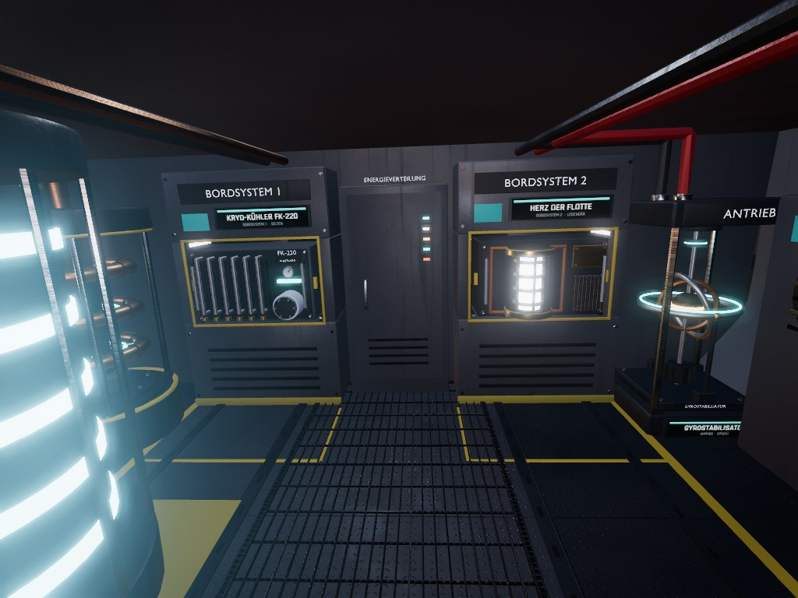
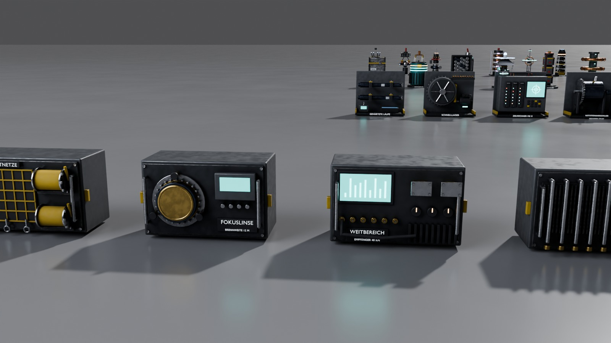
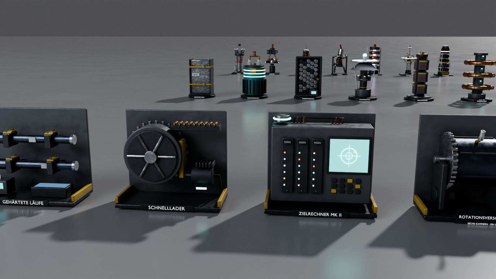
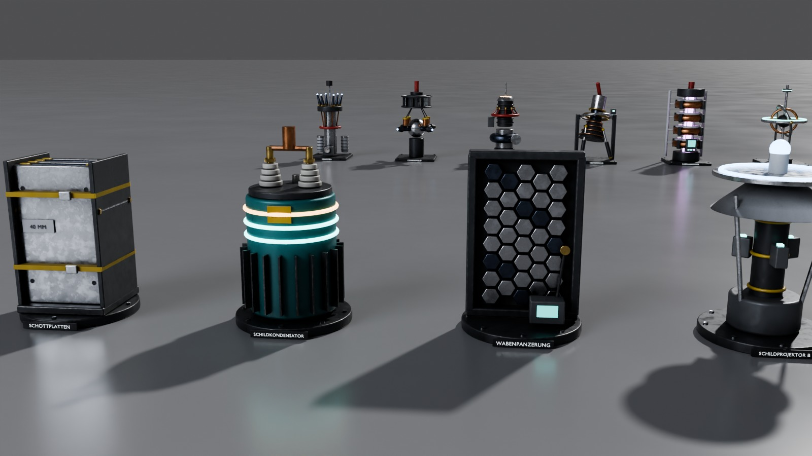
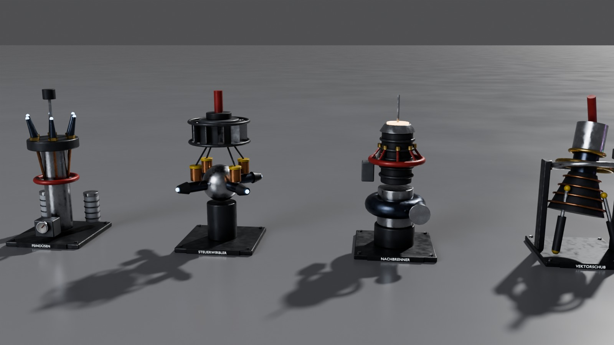

# Schiffsmodule im Technikraum

Seit dem 26.11.2026. Der Nutzer: „wir haben ja Module für Schiffe. Wenn man diese zum Beispiel im Technikraum einsetzen könnte, dazu bräuchte man im Technikraum Plätze, die Sinn ergeben, wo man diese Items dann auch sieht, wenn die eingebaut sind.“ Auf die Vorschläge hin entschied er: alle 32 Module als eigene Modelle „mit viel Details“, Umbau nur gelandet oder angedockt, die vorgeschlagene Raumaufteilung passt.



## Was es gibt

- **Fünf Plätze** für die fünf Modulplätze des Spiels (`SHIP_SLOTS` in `src/data/gear.ts`). Erstes Schiff mit Plätzen ist die Harpyie.
- **32 Modelle**, eines je Schiffsmodul (`sw_*`, `sa_*`, `st_*`, `sy_*`). Das eingebaute Modul steht an seinem Platz.
- **Namensfeld** an jedem Platz: Name, Platz und Seltenheit als Schrift, darüber ein Statuslicht (Petrol = eingebaut, Bernstein = frei). Die Seltenheit steht nur in der Schrift; das Modul leuchtet nicht in ihrer Farbe.
- **Umbau am Platz:** hingehen, [E]. Es öffnet sich die Ausrüstung im Flottenband auf der Schiffsseite, im Rucksack stehen nur die Module, die an diesen Platz passen.
- **Nur gelandet oder angedockt.** Im Flug meldet der Platz „Umbauen geht nur gelandet oder angedockt“. Das gilt seitdem auch für die Ausrüstungs-App (`invHooks.umbau`, gesetzt in `src/main.ts`), also für alle Schiffe.
- **Mehrspieler:** Ein Gast an Bord fragt die Module des Besitzers ab und sieht sie an den Plätzen (Meldungen `mq`/`mg`).

## Die Plätze

| Platz | Ort in der Harpyie | Warum dort |
|---|---|---|
| Waffensystem | offenes Gestell am Schott zur Waffenkammer, steuerbord neben der Tür | Der Gurtkanal führt von hier zur Decke, weiter zum Rückenturm. Backbord steht der Energiekern davor, dort käme man nicht heran. |
| Abwehrsystem | Schildbock neben dem Energiekern | Schilde ziehen am meisten Strom, zwei Stromschienen laufen am Boden vom Kern herüber. |
| Antrieb | Reglerkäfig steuerbord vorn | Die Treibstoffleitungen an der Decke laufen sichtbar hinein. |
| Bordsystem 1 und 2 | zwei Einschubgestelle an der Stirnwand, dazwischen die Energieverteilung | Genormte Kassetten mit Griffen und Riegeln, wie die Geräteträger in Flugzeugen. |

Die Plätze sind Baukastenteile (`asset-src/neu/innen/modulplatz.py`) und leer gebaut:

- `mp_gestell(W, u0, titel, offen=False)`: Einschubgestell an einer Wand; `offen=True` ist das hohe Gestell fürs Waffensystem.
- `mp_schildbock(cx, cy, z, zdecke, quelle)`: Sockel, vier Pfosten, Kappe; `quelle` ist der Punkt am Energiekern für die Stromschienen.
- `mp_regler(cx, cy, z, zdecke, leitungen)`: Käfig mit Sockel und Dach, Leitungen zu den Deckenleitungen.
- `mp_verteiler(W)`: fester Schrank „Energieverteilung“ (kein Modulplatz).

Jede Funktion gibt den Anker zurück: `p` Ursprung des Moduls, `n` Richtung aus dem Platz heraus, `schild` Mitte des Namensfelds, `sw`/`sh` dessen Maße. Das Innenskript des Schiffs sammelt sie in `ANCH['module']`, der Export schreibt sie in Schiffskoordinaten nach `<schiff>-gelenke.json` (`module`). Von dort stehen sie in `PLATZ` in `src/game/modulplatz.ts`.

**Ein weiteres Schiff bekommt Plätze so:** im Innenskript `modulplatz.py` laden, die Plätze setzen, `ANCH['module']` füllen, im Export die Anker schreiben (wie `har_export.py`), in der `.look.json` die Auslöser `mod_waffe`, `mod_abwehr`, `mod_antrieb`, `mod_system1`, `mod_system2` eintragen (Punkt vor dem Platz) und die Werte in `PLATZ` übernehmen.

## Die Modelle

`asset-src/neu/module/mod_kit.py` baut alle 32 Module (zusammen rund 280.000 Dreiecke). Bezugsrahmen: Ursprung im Anker des Platzes, +X nach rechts, −Y zum Betrachter, +Z nach oben. Hüllmaße je Platzart:

| Art | Hülle |
|---|---|
| system | Kassette: x ±0,47 · Tiefe 0,04…0,60 · Höhe 0,02…0,63 |
| waffe | x ±0,50 · Tiefe 0,04…0,50 · Höhe 0,02…0,90 |
| abwehr | Radius 0,42 · Höhe 0…1,20 |
| antrieb | ±0,33 × ±0,33 · Höhe 0…1,26 |

Jedes Modul zeigt, was es ist: Der Gauss-Beschleuniger hat Spulenringe um ein Rohr und eine Kondensatorbank, der Schnelllader eine Gurttrommel mit Patronen, der Gyrostabilisator drei Kreiselringe, der Kryo-Kühler sechs Kühlkreise. Die beiden Ferrox-Fundstücke (Ferrox-Lanze, Orakel-Kern) sind aus Rosteisen mit glühenden Fugen und sichtbar notdürftig angeschlossen.









## Ablauf

```sh
cd asset-src/neu/module
blender -b --python mod_lauf.py -- alle          # bauen, Module.blend, Übersichtsbilder mod-<art>-a/b.jpg
blender -b Module.blend --python mod_export.py   # Module_roh.glb, ein Netz je Kennung
cd ../../..
node scripts/pack-module.mjs                     # → asset-src/glb/lazy/Schiffsmodule.glb (2,3 MB)
npm run assets
```

Im Spiel lädt `src/game/modulplatz.ts` die Datei `lazy/Schiffsmodule` beim ersten Betreten eines Schiffs mit Plätzen. `modulRaum()` hängt Module und Namensfelder an den Innenraum (`interior.ts enterShip`), `modulBild()` baut nach einem Umbau neu auf.

Zwei Fallen aus dem ersten Versuch:

- Ein Modul mit mehreren Materialien kommt als Gruppe aus Teilnetzen an. Die Vorlage ist deshalb der Knoten, nicht ein einzelnes Netz.
- Der Knoten trägt Lage und Maßstab der Kompression. Er bleibt unverändert und kommt in eine eigene Gruppe, die an den Platz gestellt wird.

## Offen

- Plätze in Kormoran, Wisent, Kranich, Möwe und Dohle. Schiffe ohne Technikraum (Milan) rüstet man weiter nur in der Ausrüstungs-App aus.
- Bewegte Teile (drehende Kreisel, laufende Trommel) gibt es noch nicht, die Module stehen still.
