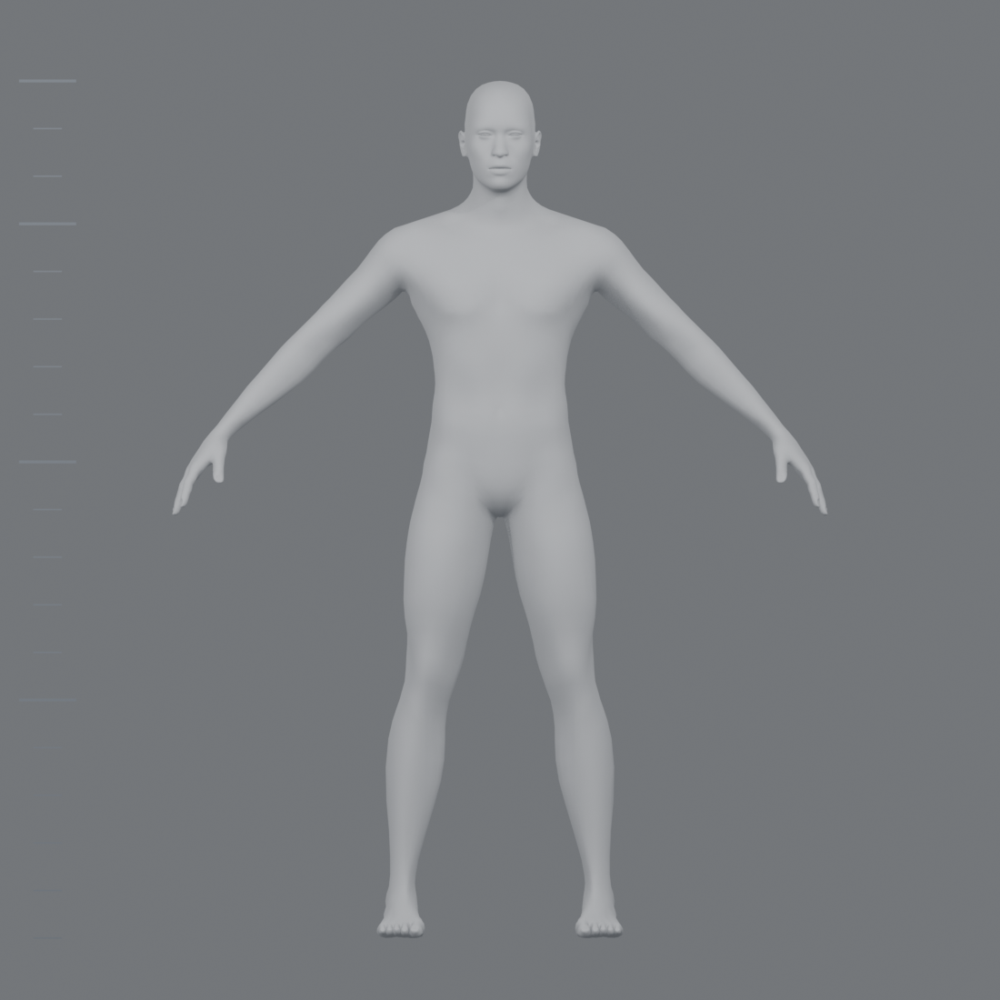
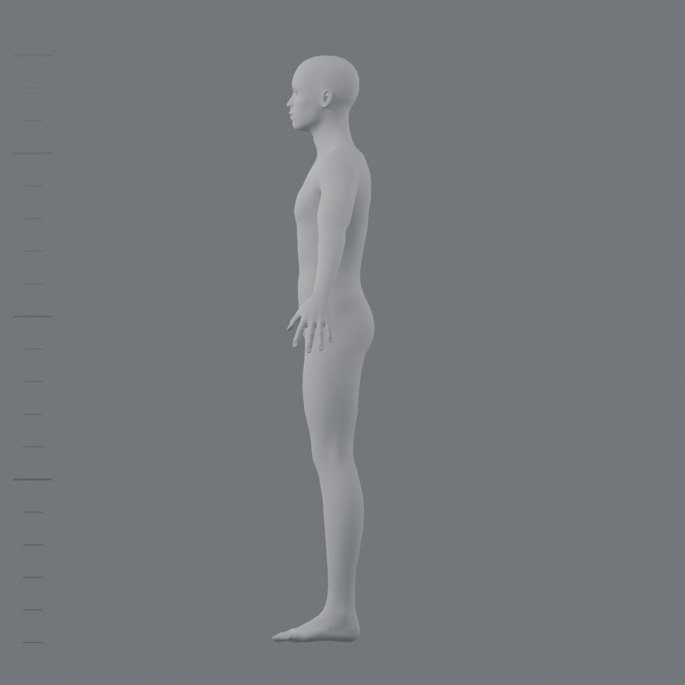
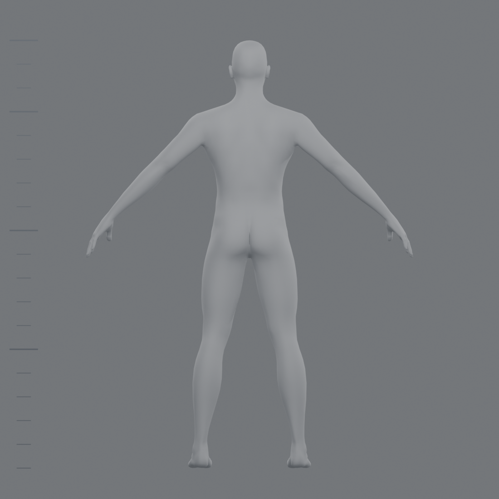

# Neue Spielfigur – Vorgaben (Stand 21.11.2026)

Ziel: eine Spielfigur wie in einem guten Third-Person-Spiel, gebaut als **ein System**: ein Skelett, ein Körper, Ausrüstung als Baukasten,
Waffen nach einer Norm, Animationen pro Waffenklasse. Wir beginnen mit dem **männlichen** Körper.

**Aufgaben:** Der Spieler erzeugt die Konzeptbilder selbst (Prompts unten) und baut daraus mit **Tripo** Körper und Ausrüstung. In Cascadeur
animiert er. Claude macht Vorgaben, Blender-Kette (Ausrichten, Retopologie, Backen, Skelett, Gewichte, Detailstufen, Export), Prüfung und
alles im Spiel (Animationssystem, IK, Ausrüstung, Waffen, Ich-Sicht, Kamera).

---

## 1. Posenvorlage

  

- Mann, **1,80 m**, athletisch. **A-Haltung:** Arme 45° unter der Waagerechten, Ellbogen gut 10° nach vorn gebeugt, Hände entspannt mit
  den Handflächen zum Körper, Beine gerade, Füße hüftbreit. Blick nach vorn.
- Höhenmarken links alle 10 cm (kräftig bei 0,5 / 1,0 / 1,5 / 1,8 m). Orthografisch, alle drei Ansichten im gleichen Maßstab.
- **Bei jedem Konzeptbild als Posen- und Proportionsvorlage mitgeben** (Bild-zu-Bild, Pose-Referenz oder „Referenzbild“ des Generators).
  So passen Körper und alle Ausrüstungsteile zusammen.
- Dateien: `docs/bilder/spielfigur-vorlage-vorne|links|hinten.png`, Kopie im OneDrive-Ordner `Blender/Spielfigur/Vorlage/`.
  Quelle: `asset-src/neu/spielfigur/vorlage.py` (graue Puppe, nur Vorlage, kein Spielmodell).

## 2. Skelett (Standard für alles)

Namen und Achsen wie das Unreal-5-Skelett (dafür gibt es die meisten Animationspakete), aber **eigene** Datei: Inhalte von Epic (Manny, Quinn,
Lyra-/GASP-Animationen) dürfen nur in Unreal verwendet werden. Ruhehaltung = A-Haltung der Vorlage. Blender: Meter, Blick nach −Y, Ursprung
am Boden zwischen den Füßen.

| Bereich | Knochen |
|---|---|
| Rumpf | `root`, `pelvis`, `spine_01` … `spine_05`, `neck_01`, `neck_02`, `head` |
| Arm (je Seite `_l`/`_r`) | `clavicle`, `upperarm`, `upperarm_twist_01`, `upperarm_twist_02`, `lowerarm`, `lowerarm_twist_01`, `lowerarm_twist_02`, `hand` |
| Finger (je Seite) | `thumb_01–03`; `index_metacarpal`, `index_01–03`; ebenso `middle`, `ring`, `pinky` |
| Bein (je Seite) | `thigh`, `thigh_twist_01`, `calf`, `calf_twist_01`, `foot`, `ball` |
| IK | `ik_foot_root` → `ik_foot_l`, `ik_foot_r`; `ik_hand_root` → `ik_hand_gun` → `ik_hand_l`, `ik_hand_r` |
| Befestigung | `weapon_r` (an `hand_r`), `weapon_l` (an `hand_l`), `backpack` (an `spine_05`), `weapon_back` (an `spine_05`), `holster_r` (an `pelvis`) |

Rund 90 Knochen. Kein Gesichtsskelett vorerst (Helme, Sturmhauben); ein `jaw` kann später für Sprechen dazukommen.

**Cascadeur:** Es legt kein Skelett aus einem Netz an. Es braucht eine Figur mit Knochen und Bindung und baut darauf mit dem Quick Rigging Tool
seine Steuerung. Ablauf: Claude bindet in Blender und gibt eine FBX aus, der Spieler animiert in Cascadeur und gibt Clips als FBX zurück.

## 3. Budgets (Browser)

Angehoben am 21.11.2026 (Spieler: „Das Spiel läuft sehr flüssig“). Die volle Stufe gilt nur aus der Nähe; Mitspieler, NPCs und Wachen auf
Entfernung nutzen die einfacheren Stufen.

| Teil | Dreiecke (volle Stufe) | Textur |
|---|---|---|
| Körper mit Kopf und Unteranzug | 45.000–55.000 (Smart Mesh von Tripo, rund 51.000) | 4096 → 2048 im Spiel (Kopf eigen 1024–2048) |
| Helm | 6.000–10.000 | 1024–2048 |
| Oberkörper (Overall, Weste) | 10.000–15.000 | 2048 |
| Beine (falls eigenes Teil) | 8.000–10.000 | 2048 |
| Handschuhe (Paar) | 4.000–6.000 | 1024 |
| Stiefel (Paar) | 6.000–8.000 | 1024 |
| Rucksack, Gürtel | je 4.000–8.000 | 1024 |

- Ganze Figur mit Ausrüstung in der vollen Stufe höchstens **90.000 Dreiecke** (bis etwa 10 m Abstand), Stufe 2 höchstens 35.000
  (bis etwa 35 m), Stufe 3 höchstens 10.000. Verdeckter Körper unter der Ausrüstung wird nicht gezeichnet und zählt nicht.
- Je Teil: Grundfarbe, Normalmap, ORM (Verdeckung, Rauheit, Metall) und eine **Farbmaske** (R/G/B = drei färbbare Zonen, z. B. Stoff,
  Platten, Streifen). So gibt es jede Uniform in jeder Fraktionsfarbe ohne neue Texturen.
- Höchstens 3–4 Materialien je Figur im Spiel.

## 4. Ausrüstung (Baukasten)

| Platz | Art | Verdeckt am Körper |
|---|---|---|
| Kopf | Helm: fest am Knochen `head` | Haare, Kopf (geschlossener Helm) |
| Oberkörper | Overall oder Weste: gebunden (Gewichte vom Körper) | Oberkörper, Oberarme (bei Ärmeln auch Unterarme) |
| Beine | Hose oder Overall-Unterteil: gebunden | Becken, Oberschenkel, Unterschenkel |
| Hände | Handschuhe: gebunden | Hände |
| Füße | Stiefel: gebunden | Füße, unterer Unterschenkel |
| Rücken | Rucksack: fest an `backpack` | – |
| Gürtel | Gürtel mit Taschen: gebunden | – |

- Jedes Teil wird auf dem Körper in A-Haltung angepasst und meldet, welche Körperzonen darunter ausgeblendet werden (kein Durchstoßen).
- Der Kopf wird am Kragen des Unteranzugs abgetrennt: Gesichter lassen sich später tauschen, ohne den Körper neu zu machen.

## 5. Waffen-Norm

- Ursprung = Griffpunkt der rechten Hand (wo Mittelfinger und Handfläche den Griff umschließen). Lauf entlang −Y (Blickrichtung der Figur),
  oben +Z, echter Maßstab.
- Punkte als leere Objekte: `grip_r` (Ursprung), `grip_l` (Vordergriff für die linke Hand), `muzzle`, `mag`, `sight` (Augenpunkt Visier),
  `eject` (Hülsenauswurf).
- Animationen gehören zur **Waffenklasse** (Gewehr, Pistole, unbewaffnet), nicht zur Waffe. Die linke Hand greift per IK an `grip_l`.
- Ich-Sicht nutzt dieselbe Waffe und dieselben Arme.

## 6. Ablauf mit Tripo

1. **Bild erzeugen** (Prompts unten), immer mit der Posenvorlage. Drei Ansichten: vorne, links, hinten. Neutraler grauer Hintergrund,
   weiches Licht, keine Schlagschatten. Lieber zwei, drei Durchläufe und das beste wählen.
2. **Tripo:** aus mehreren Ansichten (vorne, links, hinten), höchste Qualität und Detailstufe, PBR-Textur an. **Kein Auto-Rig** (wir riggen
   selbst; das Tripo-Rig hat uneinheitliche Knochen und Gewichte, daher kamen die verzerrten Gesichter der NPCs). Export als GLB.
3. **Ablage:** OneDrive `Blender/Spielfigur/` mit klaren Namen: `koerper_m_01.glb`, `helm_pilot_01.glb`, `overall_flotte_01.glb` …
   Das Konzeptbild gern daneben legen.
4. **Blender (Claude):** auf die Vorlage ausrichten (Maßstab, Lage, Symmetrie), Retopologie aufs Budget, Details als Normalmap backen,
   Licht aus der Grundfarbe nehmen, Farbmaske anlegen, Kopf abtrennen, Skelett binden, Ausrüstung anpassen und binden, Zonen, Detailstufen,
   Prüfung, Export ins Spiel und als FBX für Cascadeur.

**Retopologie (kostenlos):**
- **QRemeshify**: freies Blender-Add-on (GPL, ab Blender 4.2, unter Windows erprobt), Quad-Netz mit steuerbarem Kantenfluss (Nähte, Kanten).
  Erste Wahl; wird vor dem ersten Modell getestet.
- **Quadify Base**: inzwischen kostenlos, für KI- und Scan-Netze gedacht. Zweite Wahl.
- **QuadriFlow** (in Blender eingebaut): schnell und mit fester Zielzahl, Kantenfluss weniger gut. Für Ausrüstung oft genug.
- **Instant Meshes**: eigenständiges freies Programm, gutes Ergebnis, Umweg über Export und Import.

---

## 7. Prompts

Allgemeiner Teil, **an jeden Prompt anhängen** (der Bildgenerator versteht Englisch meist besser):

> orthographic character reference sheet, three views side by side: front view, left side view, back view, same scale, full body from head
> to toe, A-pose with arms 45 degrees down and slightly bent elbows exactly like the reference image, neutral standing pose, plain medium gray
> studio background, soft even lighting, no cast shadows, no dramatic lighting, realistic proportions, photorealistic materials,
> realistic hard-surface sci-fi, grounded industrial worker aesthetic, no text, no logos, no watermark

Stilrichtung für alles: raue Arbeiter-Science-Fiction, abgenutzt und benutzt, realistisch, kein Spielzeug- oder Arcade-Look. Farben:
mittelgrauer Stoff, dunkles Graphit für Platten, kleine orange Warnakzente, Messing für Kleinteile. (Die Farben lassen sich später über die
Maske ändern; die Bilder sollen trotzdem schon gut aussehen.)

### 7.1 Grundkörper männlich (mit Unteranzug)

> realistic man about 30 years old, 1.80 m tall, athletic build, weathered skin, short practical buzz cut, light stubble, calm focused
> expression, wearing a skintight dark graphite technical pressure undersuit with subtle seam lines, slightly reinforced textured panels at
> elbows and knees, high collar ring at the neck with small connector ports, the undersuit covers the whole body including the feet like
> thin integrated socks, bare hands, no helmet, no armor, no accessories

Hinweis: Hände frei (Handschuhe sind eigene Teile), Füße mit dünnem Unteranzug (Stiefel kommen extra). Der hohe Kragen ist wichtig, dort wird
der Kopf abgetrennt.

### 7.2 Ausrüstung (je Teil ein eigenes Bild, „Ghost Mannequin“)

Für Ausrüstung den Zusatz **statt** „full body … man“ verwenden, damit Tripo nur das Teil baut:

> isolated equipment piece only, shown as if worn by an invisible person (ghost mannequin), hollow inside, no body, no head, no hands, fitted
> to the reference pose and proportions

**Arbeitsoverall der Flotte**
> heavy-duty spacer work coverall, one piece with sleeves and legs, durable canvas-like fabric in mid gray, dark graphite reinforcement
> patches at shoulders, elbows and knees, front zip, chest and thigh utility pockets, thin orange safety piping and small reflective strips,
> blank rectangular patch area on the left shoulder, slightly worn and dusty

**Plattenweste**
> modular armored plate carrier vest for a spacer, hard composite front and back plates in dark graphite with chipped worn edges, nylon
> webbing straps, side cummerbund, three magazine pouches on the front, small brass buckles, realistic military-industrial design

**Pilotenhelm (geschlossen)**
> closed sci-fi pilot helmet with a dark tinted full-face visor, hard composite shell in matte graphite with two thin orange stripes,
> neck seal ring, small side lamp and breathing connector, realistic aerospace design, worn scratches

Für Helme genügt: „isolated helmet only, front view, left side view, back view, same scale“ statt Ghost Mannequin.

**Handschuh (rechts, wird gespiegelt)**
> single right tactical work glove, reinforced knuckle plates, grippy palm, wrist strap with a small brass buckle, dark graphite with gray
> fabric, relaxed open hand pose matching the reference hand

**Stiefel (rechts, wird gespiegelt)**
> single right heavy spacer work boot, thick magnetic deck sole, armored shin guard at the ankle, laced front with a strap, dark graphite and
> gray, worn leather-like synthetic material, standing flat on the ground

**Lebenserhaltungs-Rucksack**
> compact life-support backpack for a spacer, two slim oxygen tanks, hard graphite shell, hoses to the shoulders, small status light,
> mounting plate on the back side, realistic industrial design, worn

**Gürtel mit Taschen**
> utility belt with pouches for a spacer, sturdy nylon belt, three small pouches, a tool loop and a brass buckle, dark graphite and gray

**Reihenfolge:** zuerst der Körper (er ist die Passform für alles), dann Overall, Helm, Stiefel, Handschuhe, Weste, Rucksack, Gürtel.

## 8. Prüfliste je Teil (Claude, vor dem Einbau)

- Maßstab und Lage passen zur Vorlage (Höhe 1,80 m, Füße am Boden, Blick nach −Y).
- Dreiecke im Budget, Quad-Netz mit Schleifen an Ellbogen, Knien, Schultern, Hüfte.
- Normalmap gebacken, keine Lichtreste in der Grundfarbe, Farbmaske vorhanden.
- Gebunden ans Standard-Skelett; Gewichte geprüft in Extremposen (Arme hoch, tiefe Hocke, Kopf 60° gedreht).
- Ausrüstung: kein Durchstoßen in den Testposen, verdeckte Zonen eingetragen.
- Drei Detailstufen. Export glTF (Spiel) und FBX (Cascadeur).

---

## 9. Stand Körper m_01 (21.11.2026)

- **Netz:** Smart Mesh von Tripo (Quad, rund 20.400 Vierecke, 50.900 Dreiecke) mit seiner eigenen Farbtextur. Das HD-Modell und das Tripo-Retopo
  sind verworfen: Das Smart Mesh ist ein eigenständig erzeugtes Modell (im Mittel 2,4 cm neben dem HD-Modell), HD-Details lassen sich darauf
  nicht backen; Tripos Retopo des HD-Modells war laut Spieler unbrauchbar. QRemeshify (installiert) lieferte zerrissene Netze, QuadriFlow lehnt
  in Blender 5.3 jedes Netz ab. Normalmap und Rauheit fehlen deshalb vorerst.
- **Skelett:** `asset-src/neu/spielfigur/skelett.py`: Gelenkpunkte aus dicht abgetasteter Oberfläche (Schritt, Achseln, Handgelenke, Hüfte,
  Knie, Knöchel, Hals, Wirbelsäule; Finger nach Handvorlage), 88 Knochen (75 verformend) mit Unreal-5-Namen, Drehknochen, IK und
  Befestigungen. Gebunden mit Blenders automatischen Gewichten: alle Punkte gewichtet; nur `thumb_02` bekommt noch keine Fläche.
- **Geprüft in Posen:** Arme waagerecht, tiefe Hocke, Schritt mit gebeugten Armen, Kopf 60° gedreht (`docs/bilder/pose-*.png`): saubere
  Verformung an Schultern, Hüfte, Knien und Hals.
- **Offen:** Daumen und Finger an die tatsächliche Handform anpassen, Kopf am Kragen abtrennen, Farbmaske, FBX für Cascadeur, Ausrüstung
  (Overall, Weste, Helm, Handschuh liegen als HD vor), Einbau ins Spiel.

## 10. Ausrüstung am Körper (21.11.2026)

Kette `asset-src/neu/spielfigur/ausruestung.py` (Arbeitsdatei `Figur_m_01.blend`): `laden` → `ausrichten` → `reduzieren` → `gewichte` →
`anpassen`; Handschuh zusätzlich `deckung` (beste Deckung mit der Hand: acht Startdrehungen, beide Seiten, ICP) und `spiegeln` (links mit
den Gewichten des rechten, Seiten getauscht); `zonen` und `komplett` für die Gesamtprobe.

| Teil | Dreiecke | Ausrichtung | Bindung |
|---|---|---|---|
| Overall | 14.000 | oberer Rand am Kragen, Schritt am Schritt, Tiefe an Brust und Hüfte (+3 cm) | automatische Gewichte vom Skelett |
| Plattenweste | 12.000 | Breite der Brust +5 cm, Oberkante 6 cm unter dem Kragen | Gewichte vom Körper; liegt über dem Overall |
| Helm | 8.000 | Kopfbreite +7 cm, Dichtung am Kragen | starr am Knochen `head` |
| Handschuh (je) | 4.000 | Bündchen 6 cm über dem Handgelenk, ICP (9,5 mm mittlerer Abstand) | automatische Gewichte, links gespiegelt |

- **HD → Spielnetz:** Innenwand des hohlen Ghost-Mannequin-Modells entfernen (Flächen gegen die Körpernormale), verschweißen, alte UV
  verwerfen, ausdünnen; klemmt das (Helm, Handschuh: viele Einzelteile), vom geschlossenen HD-Modell aus im Raster 2,5–3 mm neu aufbauen und
  dann ausdünnen. Neue UV, dann Farbe, Rauheit und Normalmap vom innenwandfreien HD-Modell backen (2048).
- **Körperzonen:** Attribut `zone` je Fläche (stärkster Knochen), `zonen.json`: Overall verdeckt Oberkörper, Ober- und Unterarme, Becken,
  Oberschenkel (Unterschenkel bleiben, das Hosenbein endet über dem Knöchel); Helm verdeckt Kopf und Hals, Handschuhe die Hände.
- **Ganze Figur** mit allem: rund 44.000 Dreiecke (sichtbarer Körper nur noch Waden und Füße). Geprüft in Ruhe, Arme waagerecht, Hocke,
  Schritt, Kopf gedreht (`docs/bilder/alles-*.png`).
- **Fehlwege (nicht wiederholen):** Ausdünnen mit den Tripo-UV (bleibt bei 40.000 bzw. 32.000 stehen); Backen auf die hohle Fassung mit
  Innenwand (helle Streifen); Gewichte von der Haut für Ärmel in anderem Winkel (Ärmel lösen sich); Rasterneuaufbau der innenwandfreien Schale
  (zerbröselt); automatische Gewichte am gespiegelten Handschuh (scheitern).
- **Offen:** Stiefel (Füße stehen noch in Socken), Rucksack, Gürtel, Finger und Daumen, Farbmasken, FBX für Cascadeur, Einbau ins Spiel.
