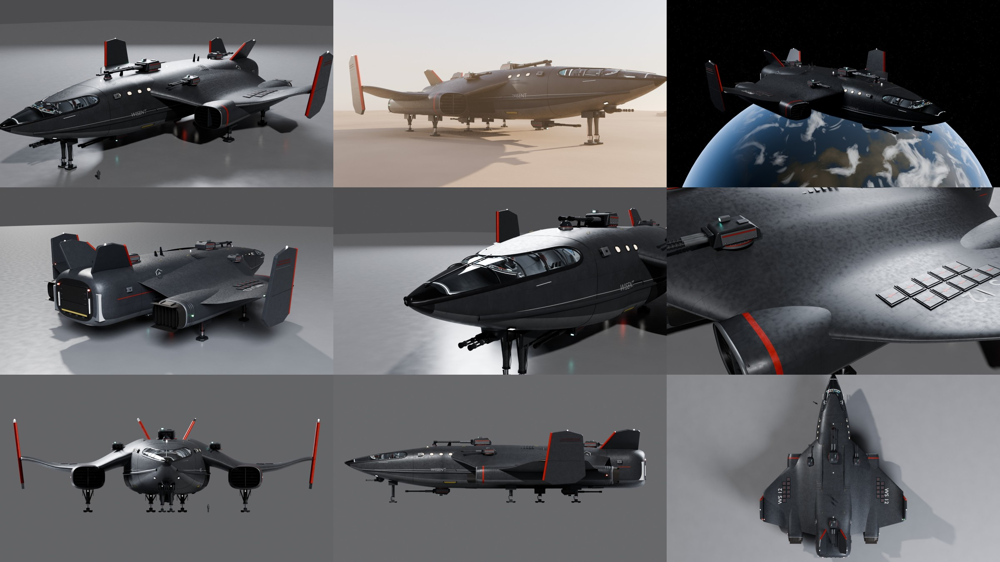
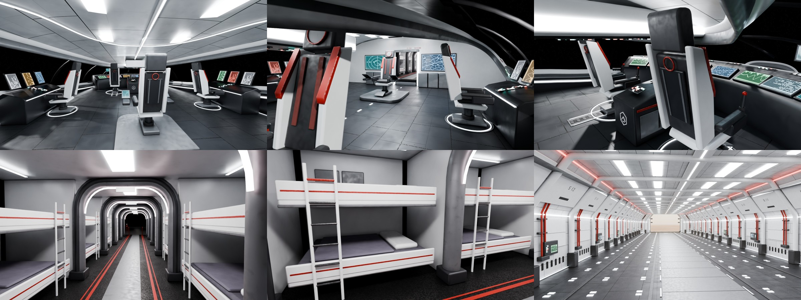
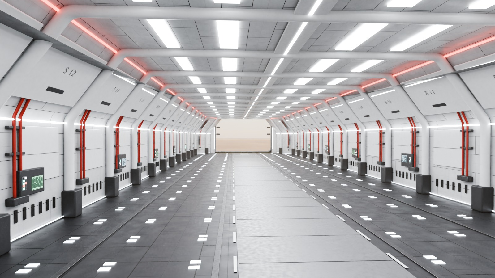
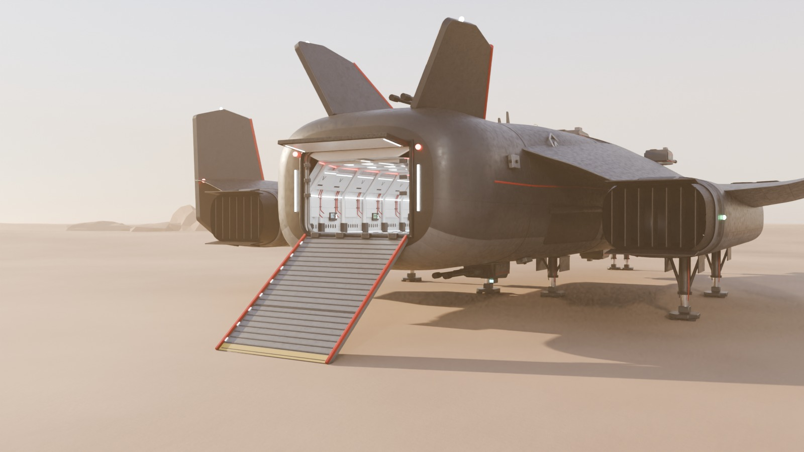
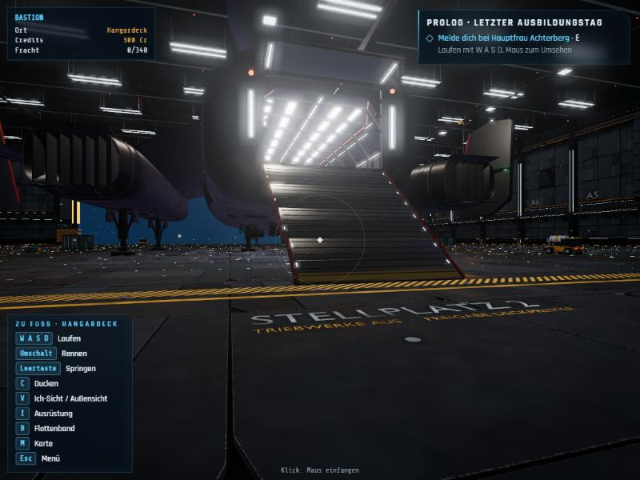
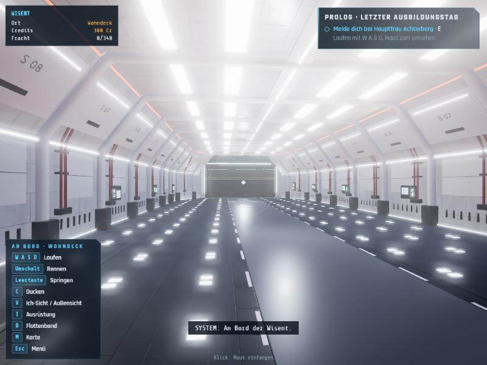
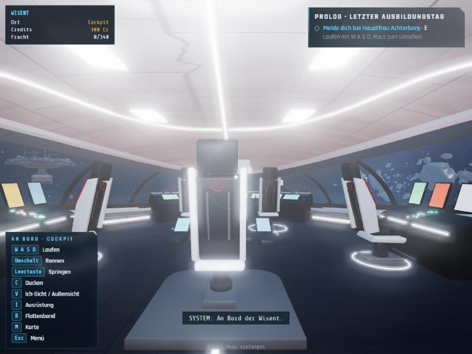

# Wisent: schwerer Frachter mit viel Feuerkraft (Schaumodell)

Gebaut am 18.11.2026. Wunsch: ein großer Frachter mit viel Feuerkraft in der Art der gezeigten Vorlage, außen und innen, „das schönste Cockpit, so viel Detail wie auf den Bildern“. Es ist ein **eigener Entwurf, keine Kopie**. Übernommen ist die Art: Delfinnase mit Sichtband, breiter Knickflügel mit ovalen Triebwerken im Knick, hohe Endscheiben, Laderaum mit Heckrampe, helle Innenräume mit roten Akzenten. Eigene Teile sind zwei schräge Heckleitwerke, Schubdüsen mit Leitschaufeln, Senkrechtstartzellen auf den Flügeln, sechs Geschütztürme, eine Kinnkanone und eine Heckklappe in der Heckplatte. Im Spiel seit 18.11.2026 (Abschnitt „Im Spiel“), mit animierter Heckrampe und Betreten ohne Taste.




## Maße und Aufbau

- Rund 83 × 66 × 20 m (mit Fahrwerk), +X nach vorn, Boden bei z = 0. Rund 520 000 Dreiecke (mit Innenräumen).
- **Rumpf**: Superellipsen-Spanten, flach und breit (18 × 12 m). Die Delfinnase ist 27 m lang und läuft spitz und flach aus. Das Sichtband fällt zur Spitze hin schräg ab und läuft um die Nase herum. Die Heckplatte ist flach und trägt eine Heckklappe, deren unterer Teil die Rampe ist. Graphit mit Plattenfugen und Nieten im Shader, unten Mittelgrau. Dazu eine rote Zierlinie, eine Seitenleiste als harte Kante, aufgesetzte Panzerplatten, Bullaugen am Oberdeck und eine Ladeluke an der Seite.
- **Flügel**: Knickflügel. Die Wurzel sitzt hoch am Rumpf und ist dick (5 m), damit sie in den Rumpf übergeht. An den Gondeln liegt der Flügel tief, außen steigt er wieder. Die Vorderkante ist 45° gepfeilt.
- **Gondeln**: ovale Superellipse unter dem Knick. Vorn ein Einlauf mit Lippe, Trennwand, zwei Verdichtern und Gitter, dahinter ein roter Ring. Hinten eine ovale Düse mit Mantel, Glutschacht, sieben Leitschaufeln und Klappen mit Stellzylindern.
- **Leitwerke**: hohe Endscheiben an den Flügelspitzen mit roter Vorderkante, Faltfuge und Blitzlicht, dazu zwei schräge Leitwerke auf dem Heck.
- **Waffen**: sechs Türme mit je zwei Kanonen, je zwei oben und unten am Rumpf und zwei auf den Flügeln. Sie haben Drehkranz, Panzergehäuse, Blende, Sensorkopf und Rohre mit Mündungsbremse. Dazu eine Doppel-Drehkanone in einer Kinnkuppel und 2 × 10 Senkrechtstartzellen auf den Flügeln.
- **Fahrwerk und Aufbauten**: zehn schwere Beine (doppelt am Bug, mittig am Rumpf, je zwei unter den Gondeln) mit offenen Schachtklappen, Scherenlenkern und Hydraulikleitungen. Außerdem Hubgitter unten, Kühllamellen und eine Sensorkuppel oben, Antennen, Haltegriffe, Steuerdüsen, Lichter und Schrift (WISENT, WS 12, Zeichen der Bastion).

## Innen

- **Brücke** in der Nase (Boden 11,2 m): gewölbte helle Innenhaut mit Plattenfugen und dunkler Zone unten. Das Sichtband ist das Fenster, mit dickem weißem Rahmen, Laibung und umlaufendem Lichtband. Fünf Plätze: zwei Piloten auf Bodenschienen mit Leuchtringen, ein Kommandantenplatz auf einem Podest, zwei Seitenstationen.
- **Sitze**: schwarze Kerne, weiße Seitenschalen mit roter Kante, Kopfteil mit Rettungsscheibe, Armkonsolen mit Anzeigen und Griffen.
- **Pulte**: ein geschwungenes Hauptpult mit acht Anzeigen, Tastenfeldern, Lichtkante und zwei Monitoren an Armen. Dazu ein Mittelpult mit vier Schubhebeln, eine Deckenkonsole, Wandgitter, Wandkästen, Rettungstafeln, Haltegriffe, Deckenleisten, Bodenlichter und eine Rückwand mit zwei Lagebildern, Spinden und Tür.
- **Bildschirme**: eigenes Shader-Material (`ui_mat`) mit dunklem Grund, Gitter und Rand. Dazu je nach Art Textzeilen, Radar mit Ringen, Strahl und Zielen, Kurven mit Balken oder eine Karte mit Zellen und Kurslinie.
- **Mannschaftsgang** (Oberdeck, Boden 11,6 m): Portalrahmen alle 3 m mit rosaweißem Lichtring. Dazwischen auf beiden Seiten Nischen mit Stockbetten, Leitern, Kissen, Decken, Leselicht und Spinden. Auf dem Boden rote Laufstreifen, am Ende eine Treppe nach unten.
- **Laderaum** (Unterdeck, Boden 6,4 m auf Höhe der Heckklappe, 45 m lang, leer; überarbeitet nach Wunsch "leer und mehr wie auf den Beispielbildern"): weiße Haut mit senkrechter Wand und Schräge nach innen (eigene UV, Plattenfugen im Shader), dunkles Sockelband mit Lüftungsschlitzen. Rippen alle 3 m dem Profil folgend, rotes Lichtband an der Deckenkante, weiße Lichtlinien an Knick und Boden, Deckenleuchtfelder. Auf den Schrägen Platten mit Feldnummer (B 01 … Backbord, S 01 … Steuerbord), Griffmulde und Lichtschlitz, rote Leitungen senkrecht bis in Anschlusskästen am Sockel, Wandkästen mit Anzeigen. Plattenboden mit Leuchtmarken, hellerer Mittelbahn, Zurrschienen, Pfeilen und Bodenschrift. Vorn eine Stirnwand mit Tor, Lichtrahmen und Leitstandfenstern.
- **Heckrampe**: Die Heckplatte hat eine echte Öffnung, die bei geschlossener Klappe verdeckt ist. In den Ansichten laderaum, laderaum2 und rampe ist die Rampe offen (Sammlung „Rampe offen“, 10,4 m bis zum Boden, mit Trittleisten, roten Wangen, Leuchten und Hydraulik), das Tor oben ist hochgeklappt. Die Wüste ist dann draußen zu sehen.



## Dateien

`asset-src/neu/wisent/`:
- `wis_kit.py`: Rumpf, Flügel, Gondeln, Leitwerke, Bänder, Bühnen. Die Werkzeuge kommen aus `../elster/els_kit.py` und `../wuerger/wue_kit.py`.
- `wis_waffen.py`: Türme, Zellen, Fahrwerk, Hubgitter, Heckklappe, Aufbauten.
- `wis_bruecke.py`: die Brücke.
- `wis_raeume.py`: Gang, Kojen und Laderaum.
- `wis_lauf.py`: baut und rendert ohne Fenster.
- `wis_blatt.py`: Übersichtsblätter, mit `-- innen` für die Innenräume.

```bash
cd asset-src/neu/wisent && /c/EXTRA/Blender/blender.exe -b --python wis_lauf.py -- alle
```

Ansichten: schraeg, draufsicht, seite, front, heck, nase, detail, wueste (Wüste mit Dunst und Himmel), weltraum, bruecke, bruecke2, bruecke3, gang, koje, laderaum, laderaum2, rampe (Rampe offen von außen). Das Glas des Sichtbands ist in den Brückenbildern ausgeblendet.

## Gelernt

- Ein runder Rumpf mit dünnem Flügel sah aus wie ein Verkehrsflugzeug. Erst ein flacher, breiter Rumpf und eine dicke, lange Flügelwurzel ergeben den Mantarochen-Umriss.
- Eine kurze runde Nase wirkt wie eine Kugel. Mit 27 m Länge und flachen Exponenten (1,25 bis 1,45) wird daraus ein Schnabel.
- Ein gerundetes Heck sah wie ein Klumpen aus. Eine flache Heckplatte mit großer Klappe zeigt sofort, dass es ein Frachter ist.
- Das Fenster ist eine Maske auf dem Rumpfnetz. Die Ränder werden als Kette aus dem Netz gelesen und in (x, Winkel) geglättet, dann laufen Rahmen und Lichtband darauf. Innenhaut und Lichtband nutzen dieselbe Maske mit Rand.
- Das Plattenmaterial braucht die UV „Platten“. Auf einfachen Quadern ohne UV wird es dunkel, deshalb haben die Wände dort eigenes Weiß (`i_wand`).

## Im Spiel





- **Schiffsklasse** `wisent` (src/data/ships.ts): Schwerer Frachter, 68.000 Cr, Hülle 560, Schild 240, Fracht 340, 20 Raketen, Schaden ×1,8, Länge 83,3 m. Triebwerksglut an den ovalen Düsen, Kanonen an den Flügeltürmen, ab Stufe 2 dazu der große Turm oben vorn (src/models/playerShips.ts), Silhouette `SIL.wisent` (src/ui/hud.ts).
- **Modell**: `Wisent.glb` (343.000 Dreiecke, 12,6 MB vor dem Packen) mit allen Innenräumen und `WisentFern.glb` (44.000 Dreiecke, ab sechs Schiffslängen). Plattenmaterialien werden zu `ext_pan_*`, das Spiel rechnet Fugen und Nieten im Shader. Die UV ist je Material auf das Plattenmaß des Spiels (1,6 m) gestreckt.
- **Heckrampe**: In Blender ist sie ein Gelenk-Rig mit Animation (wis_rampe.py, Bild 1 zu, Bild 150 offen, 6 s): Das Tor oben klappt 97° hoch, die Rampe schwenkt von senkrecht bis zum Boden, dann fahren drei Teleskopauszüge nacheinander je 2,6 m aus. Im Spiel bewegt `setDoors` dieselben Gelenke (`DOORS.Wisent` in src/models/gltfShips.ts, Materialendungen `|tor`, `|rampe` … `|rampe4`). Im Hangar ist die Rampe offen, solange `RAMP.want` gilt. Schalter: innen an der Backbordwand neben der Klappe (Auslöser `ramp`), außen am Rampenfuß. Im Flug ist sie zu.
- **Betreten ohne Taste** (src/game/interior.ts, `rampTransit`): Wer im Hangar am Fuß der ganz offenen Rampe hineinläuft, ist an Bord, an derselben Stelle und mit derselben Blickrichtung. Die Bodenhöhe folgt weich auf die Rampe. Wer innen die Rampe ganz hinuntergeht, steht wieder im Hangar. Die offene Rampe ist seitlich gesperrt. Bei geschlossener Rampe enden die Zellen innen 0,3 m vor der Klappe. Das gilt für das aktive Schiff im Hangar. Geparkte Schiffe der Flotte und Planetenlandungen gehen weiter über E.
- **Laufkarte** (asset-src/walk/Wisent.json): aus dem offenen Zustand gebaut (`Wisent_offen_roh.glb`, nicht vereinfacht). Dazu kommt eine glatte Lauffläche über der Rampe, die nur in der Laufkarten-Datei liegt, denn die Kanten zwischen den Auszügen unterbrachen die Karte. build-walkmap.mjs hat neue Schalter: `--offen=` (dort zählen Flächen ohne Decke als Boden), `--minYaussen=`, `--nurinnen=1` (vom Außenmodell nur Maß und Mitte; vorher steckte die geschlossene Rampe aus dem Außenmodell mit in der Karte), `--spawn=` und weitere Auslöser-Arten aus `--spots`. Begehbar sind 1 370 m²: Rampe, Laderaum, Treppe, Gang mit Kojen, Brücke.
- **Treppe**: Vom Laderaum führt eine neue Treppe vorn in der Mitte durch eine Deckenöffnung mit Schacht zum Mannschaftsgang. Vorher waren Laderaum und Gang nicht verbunden.
- **Weg ins Spiel**: `sh asset-src/neu/wisent/wis_spiel.sh` (Bau, Export zu und offen, Vereinfachung, Laufkarte), danach `npm run assets`. Umrechnung Blender → Schiff: x = −y, y = z − 10,17, z = −(x − 1,33).

## Offen

- Rückmeldung des Nutzers. Betreten ohne Taste auch für den Kormoran und auf Planeten. Die Hangartür ist 62 m breit, der Wisent 66 m (beim Starten nicht geprüft).
