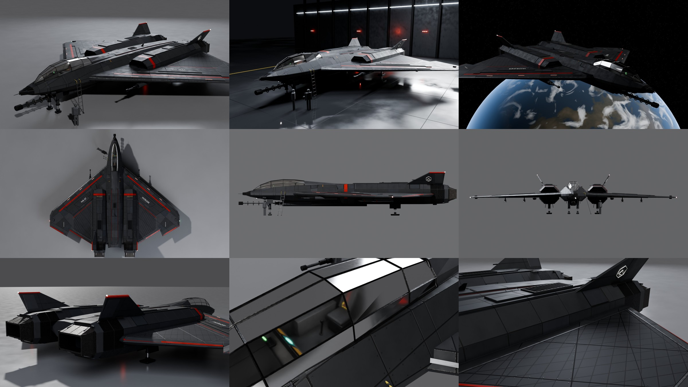
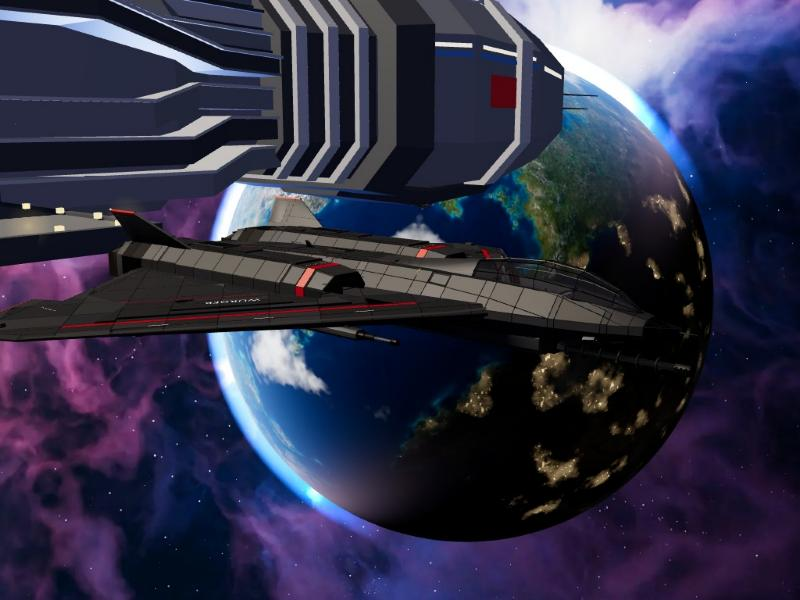

# Würger: einsitziger schwerer Jäger (Schaumodell)

Gebaut am 17.11.2026. Wunsch: ein Fighter in der Art einer gezeigten Vorlage (schwarzer Keil mit roten Akzenten, breite Flügel, große Triebwerksgondeln), ein Sitz, „mach es noch besser als zuvor“. Es ist ein **eigener Entwurf, keine Kopie**. Anders als bei der Vorlage hat er eine Schienenkanone unter dem Rumpf statt einer seitlichen Gatling, Rautenplatten statt Waben, flache Schubvektordüsen und nach außen geneigte Leitwerke auf den Gondeln. Im Spiel seit Alpha 1.37 (Abschnitt „Im Spiel“).



## Maße und Aufbau

- 24,8 × 26,2 × 5,0 m (mit Fahrwerk), +X nach vorn, Boden bei z = 0. Rund 168 000 Dreiecke, 3 300 Schrauben.
- **Rumpf**: Facettenkeil mit Seitenkante (Chine), dunkle Radomspitze, erhöhter Rückenstreifen mit roter Linie.
- **Flügel**: gepfeilt (Vorderkante 40°), zwei Stufen an der Hinterkante mit Klappen, Vorderkante abgeschrägt, leicht hängend. Schichtplatten in Vorderkantenkoordinaten. Hinten ein Rautenfeld mit heller Rahmenleiste und rotem Vorderrand, vorn ein rotes Band längs der Kante und Formationslichter.
- **Gondeln**: achteckig, Einlauf schräg (Oberlippe vorn) mit Splitterplatte, Gitter und Verdichter, roter Ring dahinter. Oben Schichtplatten, Abgaskühler und Hitzelamellen, außen eine Panzerleiste. Hinten eine flache Schubvektordüse mit zusammenlaufenden Klappen, Gelenkband und Stellzylindern. Darauf je ein um 32° nach außen geneigtes Leitwerk mit roter Spitze; links trägt es das Zeichen der Bastion.
- **Kanzel**: getöntes Glas mit Streben, dahinter die Verkleidung. Im Cockpit ein Schleudersitz mit Gurten und Zuggriff, ein Instrumentenbrett mit drei Anzeigen und HUD, Knüppel, Schubhebel und Seitenkonsolen.
- **Waffen**: Schienenkanone unter dem Rumpf (Gehäuse, Kondensatoren, Kühlrippen, Schienen mit Spulen, Mündungsbremse), zwei Kanonen unter der Flügelvorderkante, vier Flugkörper an Pylonen.
- **Sonst**: doppeltes Bugfahrwerk, Hauptfahrwerk unter den Gondeln, Einstiegsleiter links über die Seitenkante gehängt, Steuerdüsen, NACA-Einlässe, Wartungsklappen, Sensorfenster, Positions- und Blitzlichter, Beschriftung (WR 07, WÜRGER, NICHT BETRETEN, RETTUNG, MUNITION, GEFAHR ANSAUGUNG), Abgas- und Laufspuren.

## Dateien

`asset-src/neu/wuerger/`: `wue_kit.py` (Bau; Helfer aus dem Kormoran übernommen, Materialien aus `bastion/bk_lib.py`), `wue_lauf.py` (ohne Fenster bauen und rendern), `wue_blatt.py` (Übersichtsblatt).

```bash
cd asset-src/neu/wuerger && /c/EXTRA/Blender/blender.exe -b --python wue_lauf.py -- alle
```

Ansichten: schraeg, draufsicht, seite, front, heck, hangar (dunkler nasser Hangar), cockpit, detail, weltraum (Planet mit Wolken und Rand). Proben über die Umgebungsvariable `KOR_SAMPLES` (Standard 96).

## Gelernt

- `finish()` aus bk_lib nicht überschreiben (box/prism nutzen sie): die Plattenfunktion heißt hier `finish_part`.
- Auf der Oberfläche liegende Streifen an Flügelkanten verfehlen sonst die Fläche: `decal_quad` rückt dann Punkt für Punkt zur Mitte.
- Rauten: das Raster erst drehen, dann ungleich skalieren (zwei Mapping-Knoten), sonst werden es gedrehte Rechtecke.
- Ein Rumpf mit einer Breite von 1,45 m wirkte wie eine Nadel; erst mit 1,85 m und Gondeln direkt am Rumpf wird es ein schwerer Jäger.

## Im Spiel (Alpha 1.37)



- Schiffsklasse `wuerger` (src/data/ships.ts): Schwerer Jäger, 16.000 Cr, Hülle 260, Schild 110, Tempo 275, Wendigkeit 0,9, Fracht 18,
  Munition 600, 4 Flugkörper, Schaden ×1,85, kein Bergbaulaser, Länge 24,8 m. Unter 30 m: man steigt im Hangar ein und fliegt los.
- Weg: `sh asset-src/neu/wuerger/wue_spiel.sh` (baut Wuerger.blend neu, `wue_export.py` → Wuerger_roh.glb, simplify-hard 0.6 → asset-src/glb/ship/Wuerger.glb,
  101.000 → 63.000 Dreiecke, 2,8 MB), danach `npm run assets`.
- Umrechnung Blender → Schiffskoordinaten im Spiel (Nase nach −Z, Mitte des Modells im Ursprung): x = −y, y = z − 2,49, z = −(x + 0,375).
- Triebwerksglut an den Düsenenden (±3,05 / −0,04 / 12,35), Flügelkanonen (±4,9 / −0,52 / −5,2), ab Kanonenstufe 2 dazu die Schienenkanone
  unter der Nase (0 / −1,1 / −12,3). HUD-Silhouette `SIL.wuerger` (src/ui/hud.ts).
- Fahrwerk und Leiter tragen das Material „gear“ (im Flug ausgeblendet). Dessen Rauheit ist absichtlich 0,43: mit genau den Werten von „Gussgrau“
  legte simplify-hard beide zusammen, und das Fahrwerk blieb im Flug sichtbar.
- Glas halbdurchsichtig (Kanzel und Schaugläser teilen sich nach der Vereinfachung ein Material). Das Rautenmuster ist im Spiel eine glatte Farbe.

## Offen

- Flache Glasscheiben glänzen bei Studiolicht weiß (echte Spiegelung, wirkt aber flächig).
- Animationen für Fahrwerk und Leiter (bisher nur ein- und ausgeblendet), Rautenmuster als Textur, Rückmeldung des Nutzers.
