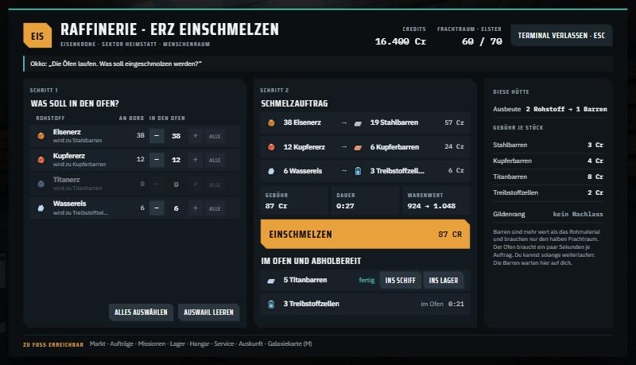

Bergbau ist das Rückgrat der Crew. Jede Werft, jede Panzerplatte und jede Treibstoffzelle beginnt als Brocken in einem Asteroidenfeld.

## Ausrüstung

Drei Schiffe der Werft haben einen Bergbaulaser. Würger, Kormoran und Wisent sind Kampf- und Frachtschiffe und können nicht abbauen.

| Schiff | Laser | Frachtraum | Besonderheit |
|---|---|---|---|
| Venom | einfach | 32 | Startschiff, gut für die ersten Runden |
| Elster | stark (1,7 ×) | 70 | weiter Scanner, vier Sprengladungen |
| Pfeil | mittel (1,2 ×) | 220 | Kreuzer mit Drohne und Sprengladungen, innen begehbar |

Werte und Modelle aller Schiffe stehen im [Schiffs-Explorer](/schiffe/).

## Ablauf

1. **Feld anfliegen.** Jeder Sektor hat eigene Asteroidenfelder: Metall, Eis, gemischt oder Kristall. Heimstatt hat den **Eisengürtel** (Metall) 20 km
   südlich der Bastion direkt neben der Eisenkrone und den **Reifschleier** (Eis) weit im Osten. Mit <kbd>N</kbd> als Ziel wählen und
   mit <kbd>H</kbd> im Kurzsprung hinfliegen.
2. **Scannen** mit <kbd>R</kbd>. Ein Puls läuft vom Schiff aus und markiert alle Asteroiden in Scannerreichweite für über eine Minute.
   So siehst du, was in welchem Brocken steckt.
3. **Laser wählen** mit <kbd>2</kbd>, auf einen Asteroiden zielen und die Maustaste **halten**. Der Brocken bekommt Risse, schrumpft und
   zerfällt, das Erz landet im Frachtraum.
4. **Hitze beobachten.** Der Laser heizt sich auf. Bei 100 % schaltet er ab und kühlt erst auf 35 % herunter, bevor er wieder feuert.
5. **Im Kühlfenster loslassen.** Kurz vor der Grenze, zwischen 72 und 94 % Hitze, leuchtet die Hitzeanzeige hellblau. Lässt du jetzt los,
   startet eine **Schnellkühlung**: Der Laser kühlt dreimal so schnell ab. Feuern, im Fenster loslassen, weiter – so baust du ohne
   Zwangspause ab.

## Sprengladungen

Elster und Pfeil tragen je vier Sprengladungen (<kbd>3</kbd>). Eine Ladung haftet am Asteroiden und sprengt ihn nach kurzer Zeit in
Bruchstücke. Das bringt insgesamt mehr Ertrag als der Laser allein, und manchmal liegt ein **seltener Kern** in den Trümmern.
Reichweite: 500 m. Nachschub gibt es an Stationen.

## Drohnen

Die Pfeil hat eine Bergbaudrohne. Mit <kbd>4</kbd> schickst du sie los: Sie baut Asteroiden in deiner Nähe selbstständig ab, während du
selbst weiter laserst.

## Was wo vorkommt

| Rohstoff | Grundpreis | Vorkommen |
|---|---|---|
| Eisenerz | 14 Cr | überall im Menschenraum |
| Wassereis | 11 Cr | Eisfelder, besonders Eisgarten |
| Kupfererz | 22 Cr | Süden des Menschenraums |
| Titanerz | 40 Cr | Grenzgebiet |
| Seltene Erden | 70 Cr | nur auf Planeten |
| Helium-3 | 58 Cr | Eis kalter Planeten |
| Ferrit-Kristall | 95 Cr | nur im Ferrox-Gebiet |
| Iridium | 160 Cr | tief im Ferrox-Gebiet |

Je gefährlicher der Sektor, desto wertvoller das Gestein.

## Auf Planeten

Über einem Planeten bietet <kbd>E</kbd> **Landen** an. Das Schiff setzt einen **Bergbau-Rover** aus: <kbd>W</kbd>/<kbd>S</kbd> Gas und Bremse,
<kbd>A</kbd>/<kbd>D</kbd> lenken, Maustaste halten zum Bohren. Nur hier findest du Seltene Erden und Helium-3. Dazu liegen Wracks und
Versorgungskisten in der Landschaft.

## Schmelzen statt verkaufen

Rohes Erz bringt wenig. An einer **Raffinerie** wird es zu Barren geschmolzen, die deutlich mehr wert sind:

| Rohstoff | wird zu | Verhältnis | Gebühr je Barren |
|---|---|---|---|
| Eisenerz | Stahlbarren | 2 : 1 | 3 Cr |
| Kupfererz | Kupferbarren | 2 : 1 | 4 Cr |
| Titanerz | Titanbarren | 2 : 1 | 8 Cr |
| Wassereis | Treibstoffzellen | 2 : 1 | 2 Cr |

Die Gildehütte **Eisenkrone** in Heimstatt hat eine Raffinerie in der Annahme. Ein Schmelzauftrag dauert je nach Menge bis zu 75 Sekunden.
Die Zeit läuft weiter, auch wenn du ablegst: Die Hütte meldet sich per Funk, wenn die Barren fertig sind.

> **Tipp:** Die Großraffinerie **Schmelzwerk Zwölf** auf dem Mond Brocken (Kupferbucht) schmilzt 3 : 2 zur halben Gebühr. Für große Ladungen
> lohnt sich der Weg.
