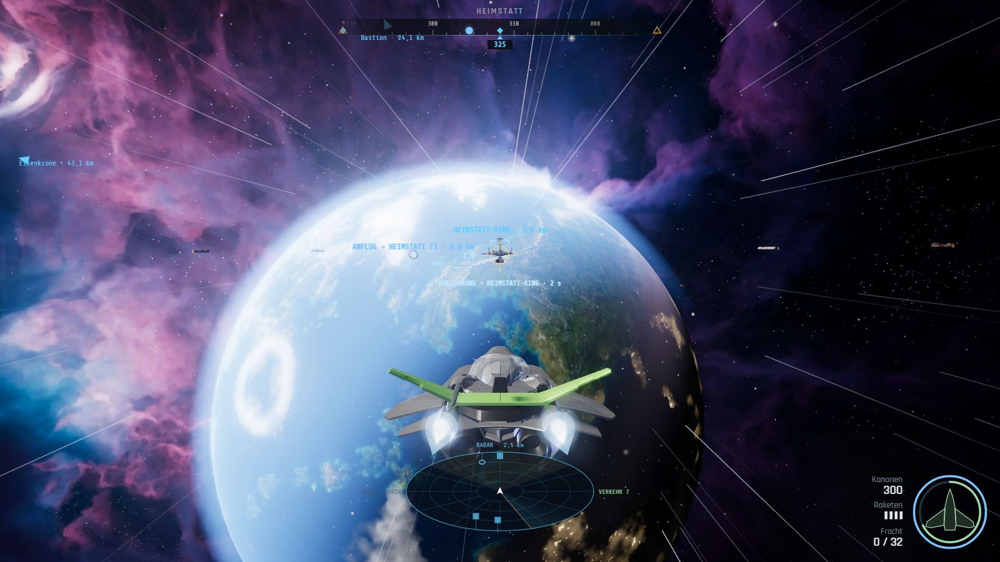
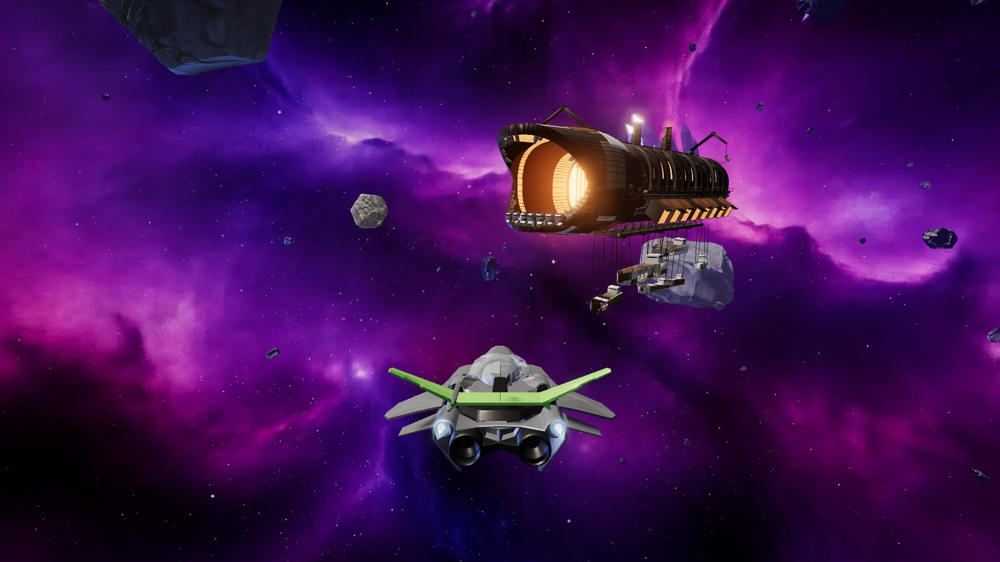

Der Heimatsektor ist gewachsen. **Heimstatt** reicht jetzt 60 km von der Bastion bis zum Rand, und die Orte liegen dort, wo sie
hingehören:

- Der **Heimstatt-Ring** ist 30 km Richtung Planet gezogen, gleich neben die Anflugzone von Heimstatt II.
- Die Gildehütte **Eisenkrone** liegt 20 km im Süden am Rand ihres Erzfelds, dem **Eisengürtel**.
- Das Eisfeld **Reifschleier** liegt weit im Osten.
- Die drei **Sprungtore** nach Lichtwall, Neuhafen und Sonnenfeld stehen 50 km draußen.

Stationen und Tore sieht man auf jede Entfernung. Fliegt man auf Heimstatt II zu, wächst der Planet, bis er an der Anflugzone einen
guten Teil des Himmels füllt. Heimstatt bleibt der sichere Sektor mit Gefahrenstufe 0.

## Schnellflug und Kurzsprung

Damit die Wege nicht zur Geduldsprobe werden, hat jedes Schiff jetzt einen **Schnellflug**. <kbd>H</kbd> lädt ihn 3,5 Sekunden, dann
geht es mit bis zu 8 km/s durch den Sektor.

- **Mit Ziel ist es ein Kurzsprung.** Fadenkreuz auf einen Ort richten und <kbd>N</kbd> drücken, oder den Ort auf der neuen
  **Sektorkarte** (<kbd>M</kbd>) anklicken. Der Autopilot fliegt hin und hält gut einen Kilometer davor. Bastion → Eisenkrone dauert gut
  neun Sekunden, Bastion → Heimstatt-Ring etwa zwölf.
- **Ohne Ziel** lenkst du selbst, mit trägem Ruder. <kbd>S</kbd> oder <kbd>H</kbd> beendet den Schnellflug, ein Treffer
  auch.
- Im Gefecht, im Asteroidenfeld und direkt an einer Station lädt er nicht.

Die Kamera bleibt dabei ruhig, nur der Raumstaub zieht Schlieren. Auch die Frachter im Sektor nutzen den Schnellflug.

## Die neuen Ferrox

Die Ferrox sehen jetzt aus, was sie sind: verwildertes Bergbaugerät der Erbauer, nie abgeschaltet, geflickt mit dem Blech gefressener
Schiffe.

- Der **Jäger** ist eine Schürfdrohne mit zwei ungleichen Greifarmen: rechts die Zange der Erbauer, links ein Ersatz aus Menschenstahl.
  Er schießt mit einer Schneidlanze, auf dem Rücken trägt er einen erbeuteten Werfer.
- Der **Bienenstock** ist eine rund 400 m lange Schmelzhütte mit glühendem Maul. An Trossen hängen halb gefressene Frachter, aus den
  Startschächten an der Flanke kommen die Jäger. Treffer zählen am ganzen Rumpf.

Mehr zum Kampf im Guide [Kampf gegen die Ferrox](/guides/kampf/).

## Alpha 1.49

- **Erstes Andocken an der Eisenkrone** in gut einer Sekunde statt fast sieben: Das Spiel bereitet die Station schon beim Anflug vor.
- **Sprünge ohne Stocken:** Der Sprungblitz hält, bis der neue Sektor fertig ist, und danach ruckelt nichts mehr.
