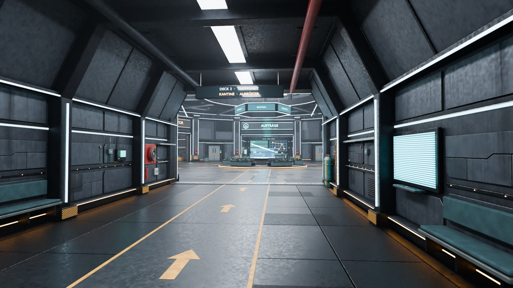
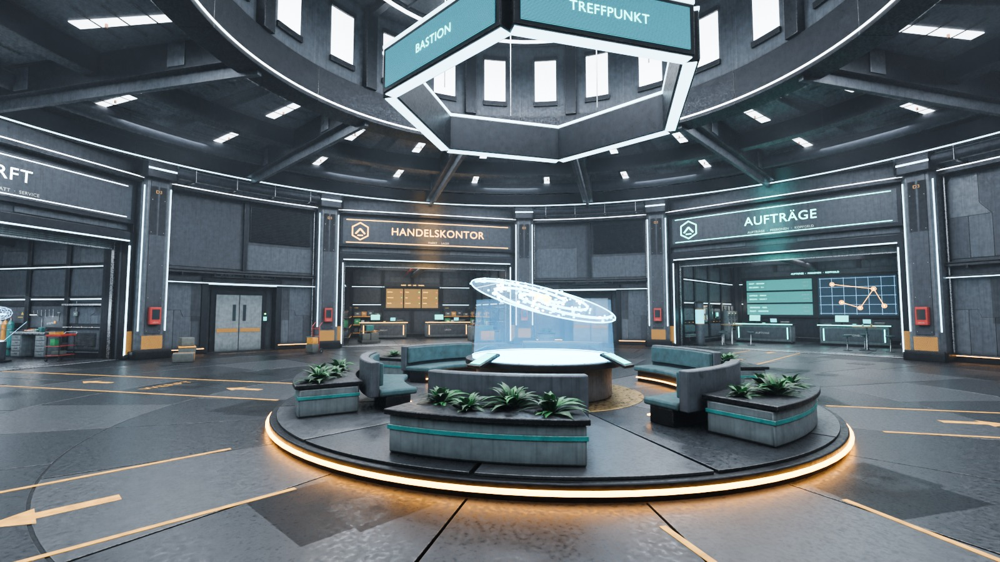
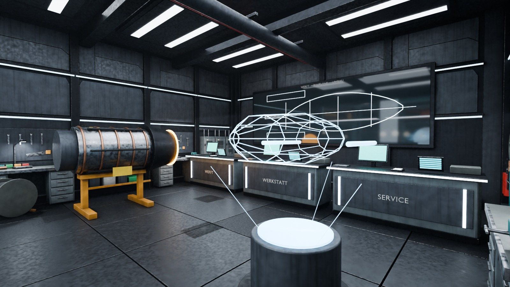
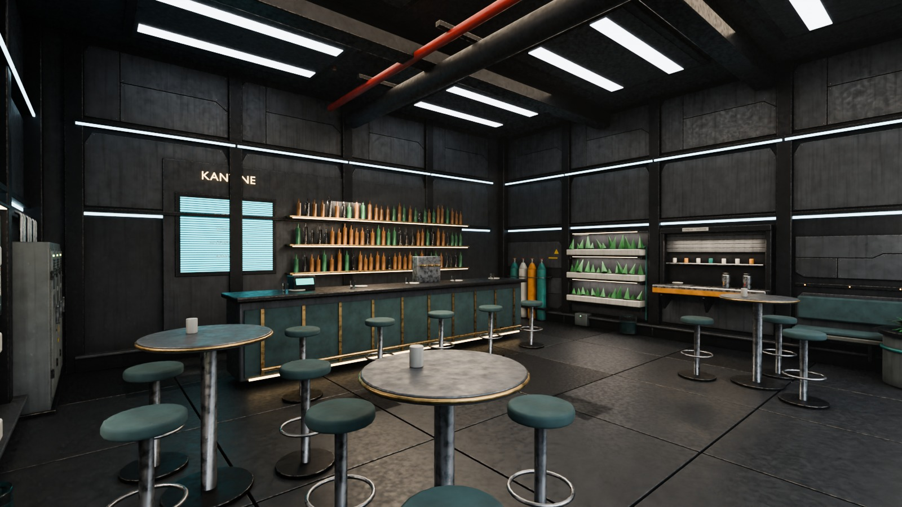

Das alte Deck 3 der Bastion war verwinkelt: schmale Gänge, viele Türen, und wer den Markt suchte, lief erst einmal falsch. Damit ist
Schluss. Wer jetzt im Hangar aussteigt, geht durch das Tor **DECK 3 · TREFFPUNKT** in einen breiten Korridor, und an seinem Ende öffnet
sich die **Rundhalle**.

## Ein Platz in der Mitte

Die Halle misst 33 m im Durchmesser. Über der Mitte steigt eine Trommel mit Lichtschlitzen auf gut zehn Meter, darunter hängt ein Ring
aus Bildschirmen. Auf dem Podest in der Mitte liegt der **Treffpunkt**: die Galaxiekarte, ein Bankring, Pflanzkübel und die Auskunft.
Von hier laufen Leitspuren mit Pfeilen und Bodenschrift zu jeder Öffnung.

## Die Läden

Ringsum liegen fünf Läden in eigenen Buchten, jeder mit Rollgitter, Leuchtschild in seiner Farbe und Tresen:

| Laden | Dienste |
|---|---|
| **Aufträge** (gegenüber dem Korridor) | Aufträge und Missionen, Auftragswand mit Sternkarte |
| **Handelskontor** | Markt und Stationslager, Kurstafel und Warenproben |
| **Werft** | Werft, Werkstatt und Service, Triebwerk auf dem Montagebock und Schiffsholo |
| **Ausrüster** | Ausrüstung und Module, Helmregale und Vitrinen |
| **Kantine** | Theke, Flaschenwand und Bistrotische, der Wirt hat immer einen Satz übrig |

Zwei Durchgänge führen weiter: in die **Besprechung** mit Bildschirmwand, langem Tisch und der Einsatzleitung, und in die
**Krankenstation** mit vier Betten und Untersuchungsliege.

Die Bilder stammen aus dem Baumodell in Blender. Ins Spiel kommt die Halle mit demselben Licht, gebacken auf die Wände.

Nebenbei ist das Spielpaket 82 MB kleiner geworden, weil das alte Deck nicht mehr mitgeladen wird. Namensschilder von Leuten hinter Wänden
scheinen auf keinem Deck mehr durch.

## Alpha 1.53

- Beim Abdocken kein schriller Sägezahnton mehr nach dem Startablauf.
- Die Eisenkrone grüßt nur noch, wenn man von draußen anfliegt, nicht direkt nach dem Ablegen.
- Funkmeldungen klicken leise statt mit hellem Piepton.
