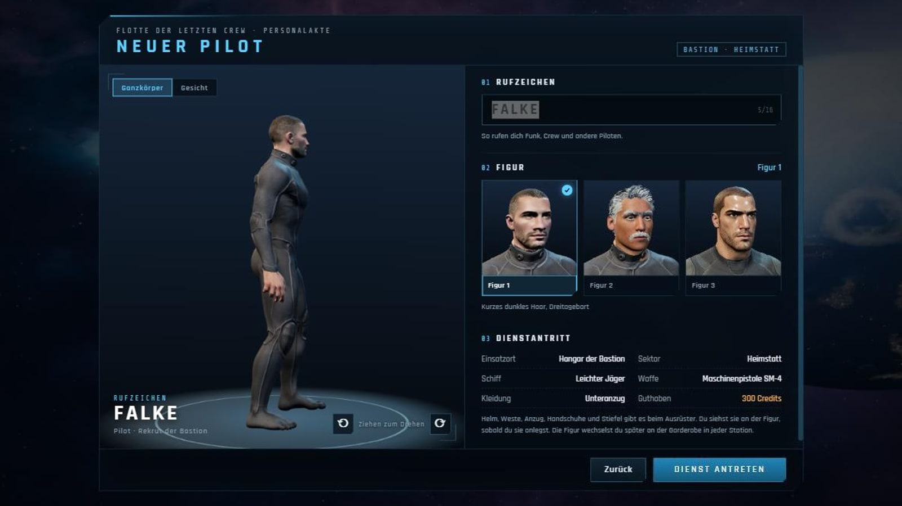
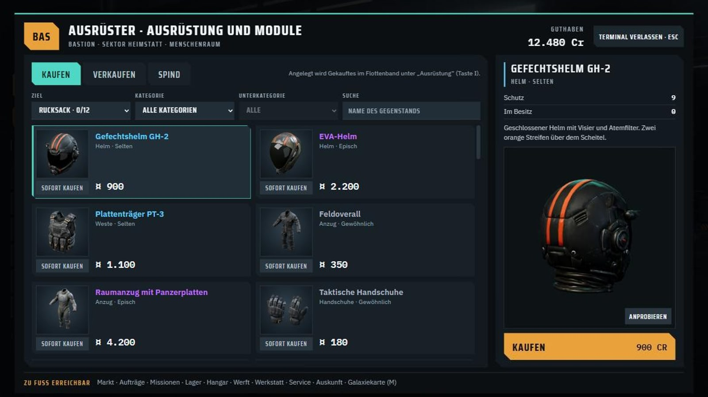
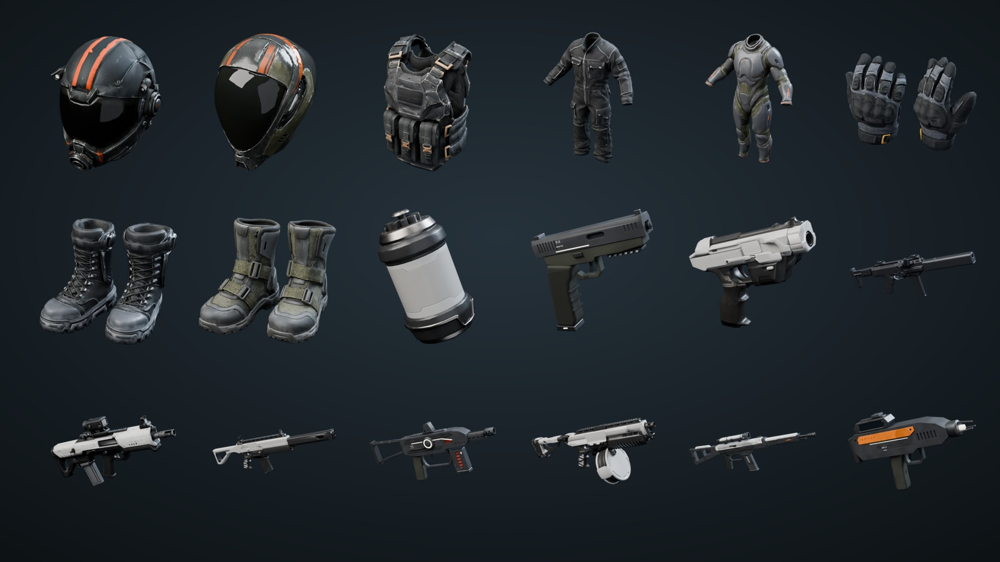
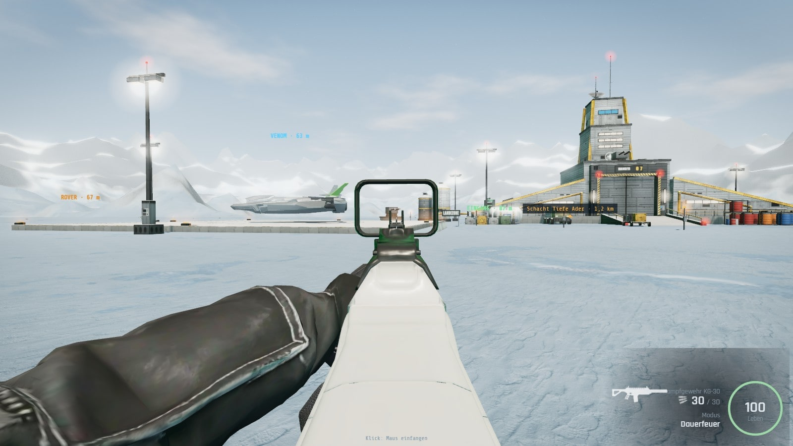
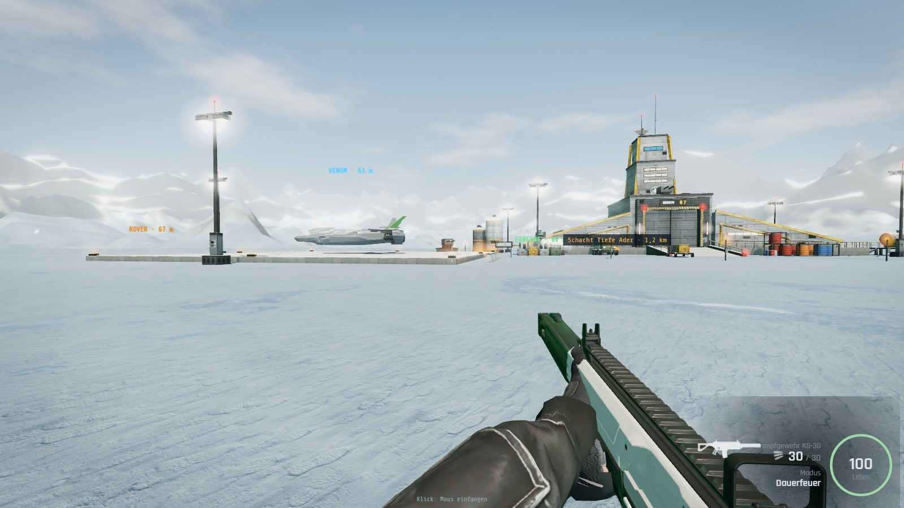

Das ist das größte Update seit Langem. Fast alles, was du zu Fuß siehst und tust, ist neu: die Figur, ihre Bewegungen, die Waffen,
die Kleidung und der Laden, in dem du sie kaufst.

## Drei Figuren zur Wahl

Beim Anlegen eines neuen Piloten wählst du eine von drei Figuren. Jeder Pilot beginnt nur im hautengen **Unteranzug**; alles Weitere
kaufst du dir. Wer schon einen Spielstand hat, behält seine Figur und kann sie an der **Garderobe** wechseln (Flottenband →
Ausrüstung → Garderobe, in jeder Station).

Die Figur selbst ist neu gebaut und bewegt sich mit einem vollständigen Bewegungssatz: Anlaufen, Abstoppen, Richtungswechsel mit
Setzschritt, Drehen auf der Stelle, Ducken, Springen. Der Blick führt Kopf und Oberkörper, und wer lange steht, verlagert das Gewicht.

## Ausrüstung, die man sieht

Es gibt drei neue Plätze am Körper: **Weste**, **Handschuhe** und **Stiefel**, zusätzlich zu Helm, Anzug und Rucksack. Was du anlegst
(<kbd>I</kbd> → Ausrüstung), trägt die Figur wirklich – in der Außensicht, in der Ich-Sicht und in jeder Vorschau.

| Gegenstand | Platz | Schutz | Preis |
|---|---|---|---|
| Gefechtshelm GH-2 | Helm | 9 | 900 |
| EVA-Helm | Helm | 14 | 2.200 |
| Plattenträger PT-3 | Weste | 12 | 1.100 |
| Feldoverall | Anzug | 5 | 350 |
| Raumanzug mit Panzerplatten | Anzug | 24 | 4.200 |
| Taktische Handschuhe | Handschuhe | 2 | 180 |
| Kampfstiefel | Stiefel | 3 | 260 |
| Raumstiefel | Stiefel | 5 | 780 |

Jedes Teil passt auf jede Figur. Ältere Helme und Anzüge aus deinem Rucksack bleiben gültig, im Laden gibt es sie nicht mehr.

## Der Ausrüster ist jetzt ein Laden

Der Ausrüster hat ein neues Terminal: oben **Kaufen**, **Verkaufen** und **Spind**, darunter Filter nach Kategorie und eine Suche.
Links stehen die Gegenstände als Kacheln mit Bild und Preis, rechts der gewählte Gegenstand mit seinen Werten, verglichen mit dem, was
du gerade trägst. Das Modell dreht sich, und mit **Anprobieren** siehst du ein Kleidungsstück an deiner eigenen Figur, bevor du zahlst.
Über **Ziel** legst du fest, ob ein Kauf in den Rucksack oder gleich in den Spind geht.

Kleidung, Waffen und die Granate haben neue Bilder, gerendert aus den Modellen, die du im Spiel in der Hand hältst.

## Ich-Sicht mit ganzem Körper

In der Ich-Sicht schweben keine Arme mehr vor der Kamera. Du schaust aus dem Kopf derselben Figur, die andere von außen sehen: Arme,
Waffe, Brust, Beine und Stiefel gehören zu dir, und wer nach unten schaut, sieht seine Füße. Mit <kbd>V</kbd> wechselst du jederzeit
in die Außensicht und zurück.

## Drei neue Waffen, Zielen und eine Granate

- **Zielen:** Halte die **rechte Maustaste**. Die Kamera rückt heran, das Sichtfeld wird enger, die Waffe streut weniger. In der
  Ich-Sicht schaust du über Kimme und Korn.
- **Pistole SP-12**, **Kampfgewehr KG-30** und **Trommelflinte TF-8** stehen bei jedem Ausrüster. Bei ihnen wächst die Streuung im
  Dauerfeuer und geht nach einer kurzen Pause zurück. Wer stillsteht, sich duckt oder zielt, trifft genauer. Das Fadenkreuz zeigt es an.
- **Splittergranate:** Wurf mit <kbd>G</kbd>. Sie prallt ab, zündet nach gut zwei Sekunden und trifft im Umkreis von fünf Metern alles,
  auch dich.
- Dazu neue Schuss- und Nachladegeräusche, Staubwolken am Einschlag, Treffermarken und eine Anzeige für Abschüsse in Folge.

## Außerdem

- **Weiterspielen** setzt dich dort ab, wo du aufgehört hast: zu Fuß in derselben Station, im All vor der nächsten Station.
- Der Weg vom Hauptmenü ins Spiel ist neu: Beim Weiterspielen fährt das Bordsystem hoch und die Anzeige schaltet sich Teil für Teil
  ein. Nach dem Intro geht das Bild ohne Schnitt im Hangar auf.
- Im **Sonnenfeld** steht die Gedenkboje MB-11 mit einem Archiv der Flotte. Die Leitbojen in Heimstatt sind neue Navigationsbojen.
- In der **Rundhalle** der Bastion ist mehr los: Marktstände, Banner und schärferes Licht.
- **Leute reagieren auf dich.** Im Vorbeigehen kommentiert die Crew, was du seit dem letzten Besuch getan hast und was im Sektor
  passiert. In Talstadt und Neonhafen reden Passanten, Händler und Wachen.
- **Im All ist mehr los.** Frachter docken an und legen wieder ab, Schürfer arbeiten an den Feldern, im Funk hörst du den Verkehr des
  Sektors. Treibende Frachtkisten lassen sich einsammeln, und außerhalb von Heimstatt ruft manchmal ein angegriffener Frachter um Hilfe.

## Noch offen

- Andere Piloten und Wachen zeigen noch die alte Soldatenfigur. Deine Figur und Kleidung sehen andere im Mehrspieler noch nicht.
- Rucksäcke haben noch kein Modell an der Figur.
