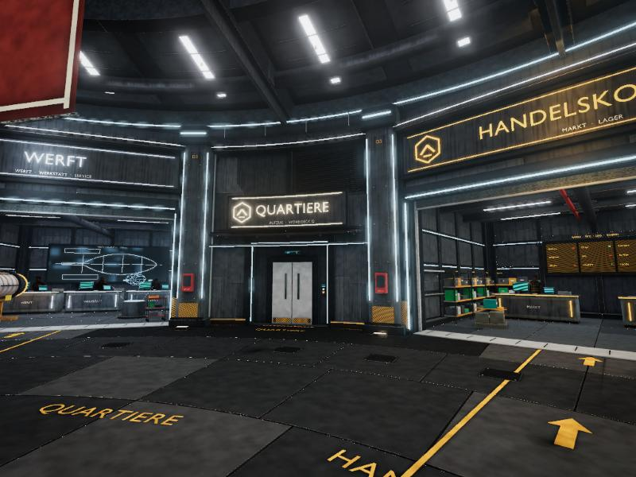
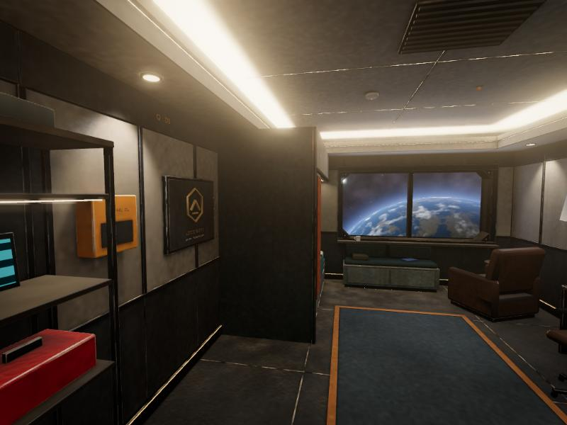
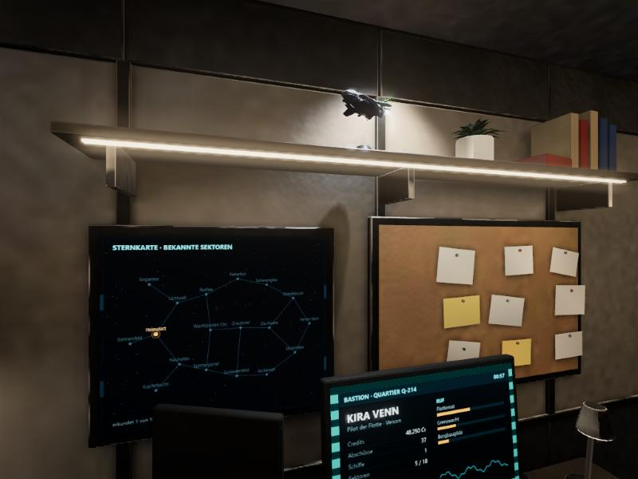
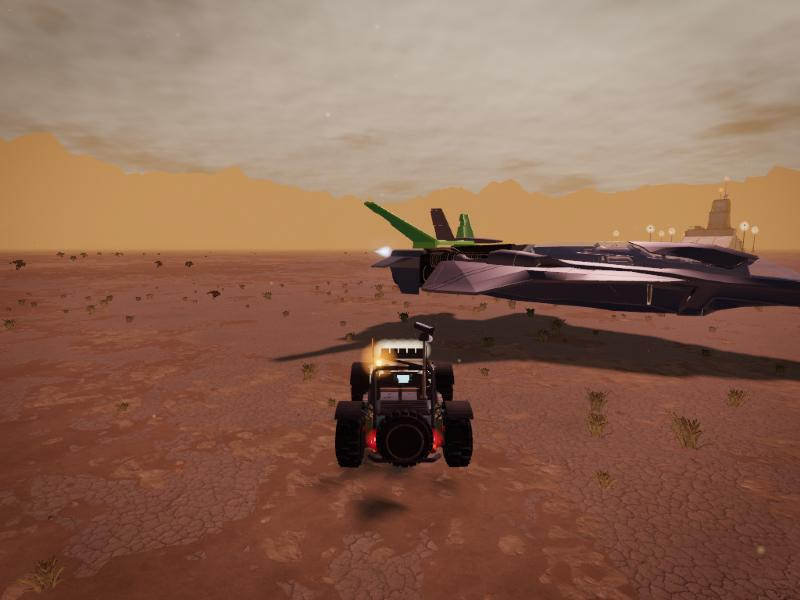
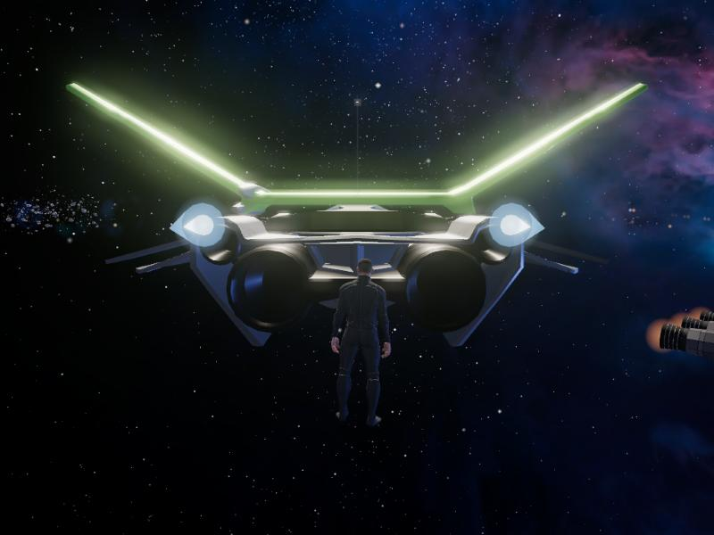

Dieses Update macht die Welt größer und wohnlicher zugleich: Auf der Bastion hast du jetzt einen eigenen Raum, und auf den Planeten
gibt es mehr zu tun als zu bohren.

## Dein Quartier auf der Bastion

Auf Deck 3 steht an der Nordseite der Halle, zwischen Handelskontor und Werft, ein Aufzug mit dem Schild **QUARTIERE**. Am Terminal
mietest du einmal für **2.500 Credits** ein Quartier, danach gehört es dir. Der Aufzug bringt dich hinauf.

Das Quartier ist ein kleiner, warm beleuchteter Raum mit Vorraum, Koje in einer Nische, Schreibtisch, Spind, Regal, Sesselecke und einem
großen Fenster. Draußen dreht sich langsam ein Planet mit Wolken und Lichtern der Städte auf der Nachtseite.

- **Koje:** Ausruhen füllt Hülle und Schild auf und sichert den Spielstand. Danach wachst du nach einem Abschuss in deiner Koje auf.
- **Spind:** einlagern und herausnehmen, derselbe Spind wie beim Ausrüster.
- **Regal und Wandbord:** Hier stehen kleine Modelle deiner Schiffe und je ein Kristall jeder Sorte, die du besitzt.
- **Schreibtisch:** Der Bildschirm zeigt deinen Piloten, Credits und Ruf, darüber hängt eine Sternkarte mit deinen erkundeten Sektoren.
- **Türschild** mit deiner Nummer und deinem Namen.

**Besuch:** Im Mehrspieler hat jeder sein eigenes Quartier. Am Bildschirm lädst du einen Piloten ein, der mit dir auf der Bastion ist.
Die Einladung kommt über Funk und gilt eine Viertelstunde; der Gast fährt mit dem Aufzug zu dir. Gäste sehen deine Sammlung, Koje,
Spind und Bildschirm bleiben aber zu.

## Zwei Bodenfahrzeuge

Der alte Rover ist ersetzt. Jeder Pilot hat den neuen **Bergbaurover „Dachs“ R-4**: schwer, sechs Räder, Druckkabine, Schneckenbohrer am Bug, 40 Einheiten Erz im Laderaum.
Neu in der Werft steht der **Erkundungsbuggy „Wiesel“ E-2** für 9.500 Credits: leicht, schnell, springt über Kuppen und hat einen
Sensormast. Mit <kbd>R</kbd> tastet er 1,6 km Umkreis ab und markiert Fundstellen. Am Schiff wechselst du mit <kbd>X</kbd> das Fahrzeug.

## Tag, Nacht und Wetter

Jeder Planet hat seine eigene Uhr: ein Tag dauert 24 Minuten, mit Dämmerung und dunkler Nacht. Je nach Planet ziehen **Stürme** auf:
Sandsturm in der Wüste, Schneesturm auf den Eiswelten, Aschenregen auf den Vulkanen, Regen auf den Felsplaneten. Im Sturm sinkt die
Sicht, der Wind heult, und Fahrzeuge halten schlechter. Alle Spieler sehen dasselbe Wetter.

## Aufgaben auf dem Boden und auf den Stationen

- An jeder Basis hängt ein **Schwarzes Brett** mit drei Aufgaben: Vorräte zu einer Außenstelle fahren, einen vermissten Rover suchen
  (mit dem Sensormast des Wiesel geht es schneller) und Erz für die Basis abliefern.
- Neue **Stationsaufgaben**: Auf der Bastion suchen Krankenstation, Einsatzleitung und Kantine Hilfe, in der Gildehütte Eisenkrone der
  Schmelzmeister. Im Pumpwerk Reifschleier gibt es drei eigene Aufgaben.
- **Ruf schaltet frei:** Würger, Kormoran, Pfeil und Wisent gibt es in der Werft erst ab einem Rang bei der passenden Fraktion, seltene
  Ausrüstung ebenso. Der Ruf-Bildschirm zeigt, was du mit dem nächsten Rang bekommst.

## Bergbau mit der Hand

In den Minen wachsen leuchtende **Kristalladern** aus den Wänden. Mit dem **Handbohrer HB-1** (beim Ausrüster, 650 Credits) hältst du
<kbd>E</kbd> an einer Ader und löst nach ein paar Sekunden ein bis drei Kristalle: Eisen, Kupfer, Titan, Iridium, Seltene Erden, Klareis
oder ein seltener Ferritsplitter. Sammler kaufen sie, und im Regal deines Quartiers stehen sie auch.

## Recht und Ordnung

Wer auf friedliche Schiffe schießt, wird gesucht. Die **Fahndungsstufe** (bis 3) steht im HUD. Ab Stufe 2 greifen Patrouillen an, und
Stationen von Flottenrat und Wacht verlangen beim Andocken ein Bußgeld (1.500 oder 4.000 Credits), das die Fahndung aufhebt; ab Stufe 3 folgen Kopfgeldjäger. Ohne neue Tat sinkt die
Stufe von selbst. Heimstatt bleibt sicher: Dort gibt es keine Kämpfe mit der Wacht, und die Bastion lässt dich immer andocken.

## Außenbordeinsatz

Steht dein Schiff im All fast still, steigst du mit <kbd>F</kbd> aus. Mit den Düsen des Anzugs schwebst du ums Schiff (<kbd>W</kbd><kbd>A</kbd><kbd>S</kbd><kbd>D</kbd>,
Leertaste, <kbd>Strg</kbd>), Sauerstoff reicht vier Minuten. Treibende Container aus den Begegnungen holst du so von Hand und bekommst
mehr heraus als mit dem Traktorstrahl. <kbd>F</kbd> an der Schleuse bringt dich zurück an Bord.

## Heimstatt wird voller

- An jedem der drei Sprungtore steht jetzt eine **Torwache** der Flotte mit Leitturm und Liegeplätzen.
- 55 km östlich lauscht der Horchposten **Fernohr** mit drei großen Antennen ins All. Wer nah genug heranfliegt, hört mit.
- Am Eisfeld Reifschleier steht das **Pumpwerk Reifschleier** der Gilde, eine eigene Station mit begehbarem Deck.

## Außerdem

- **Mitspieler** sehen jetzt deine Figur und deine Ausrüstung, und du ihre. Springen und Fallen ist für alle sichtbar, fremde
  Bodenfahrzeuge haben das richtige Modell mit drehenden Rädern.
- In Stationen und Städten gehen die Figuren lockerer und schlendern, statt im Dienstschritt zu marschieren.
- Der Boden auf den Planeten passt besser zum Gelände, und die Fahrzeuge neigen sich richtig im Hang.

## Noch offen

- Das Quartier lässt sich noch nicht einrichten. Eigene Pflanzen, Bilder und Trophäen zum Hinstellen kommen später.
- Die Sprachaufnahmen für Kapitel 5 fehlen noch.
