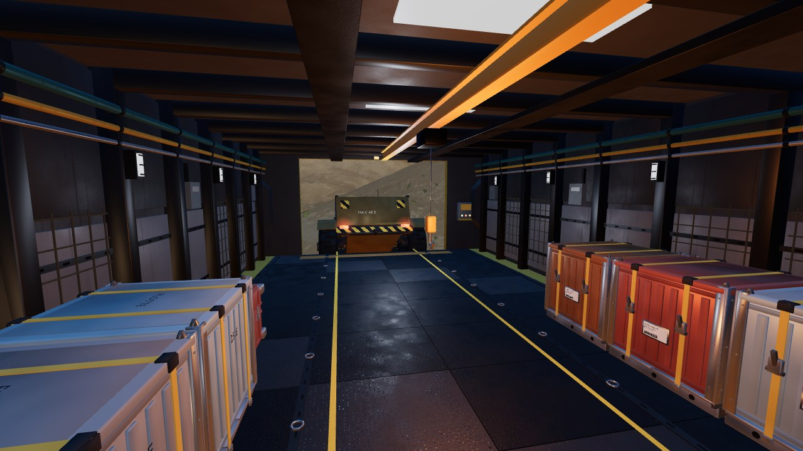
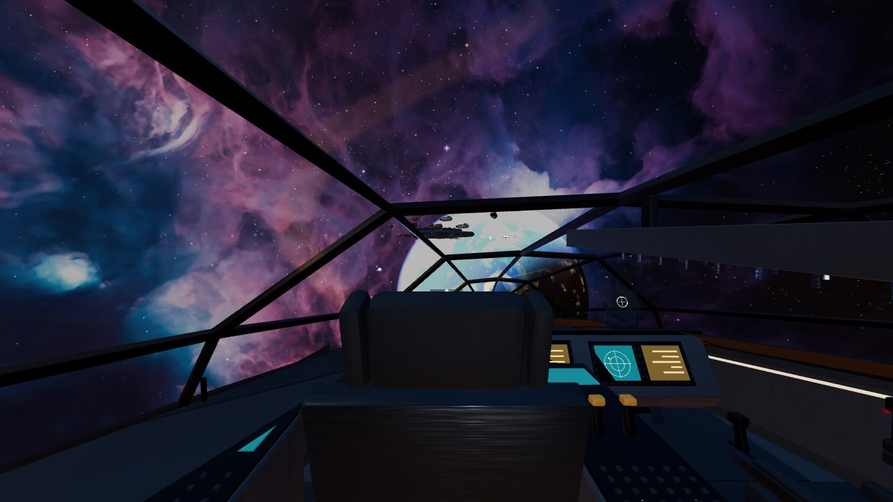
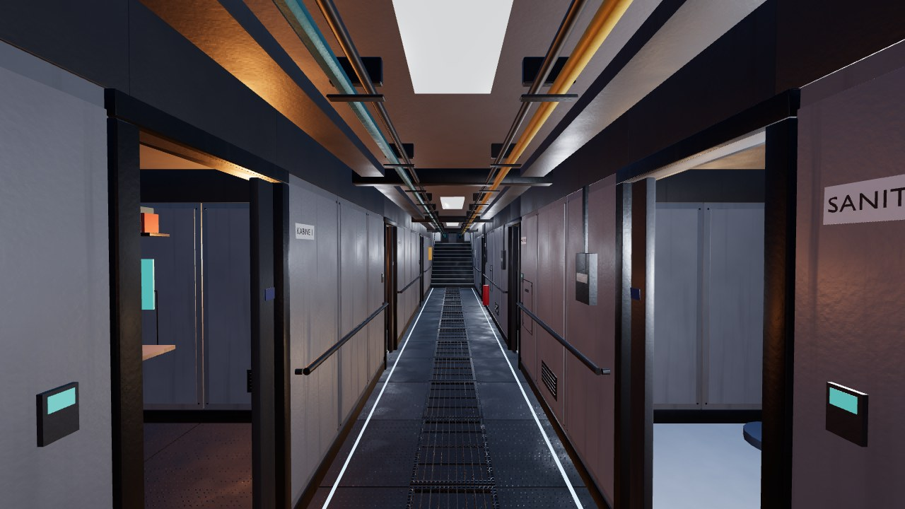
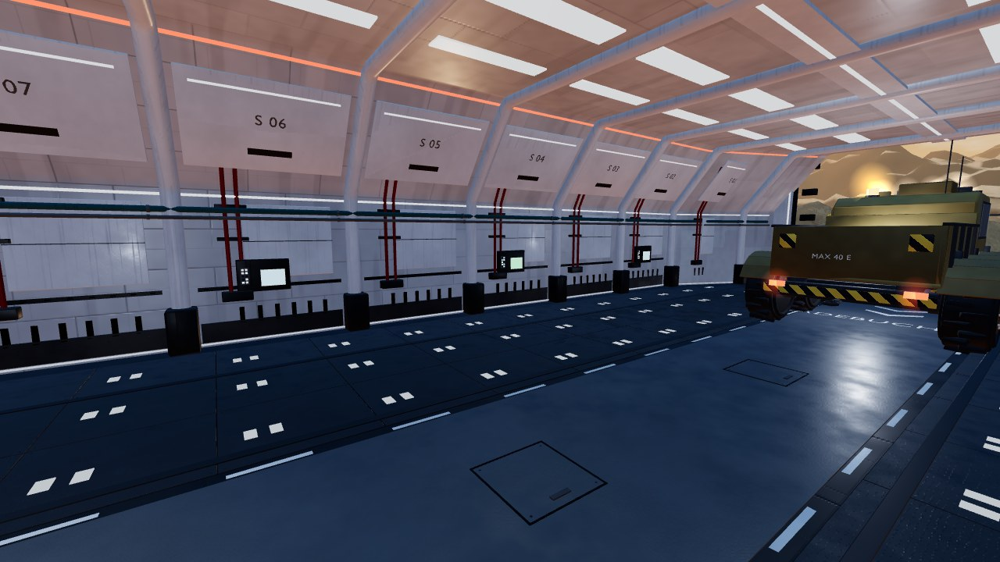
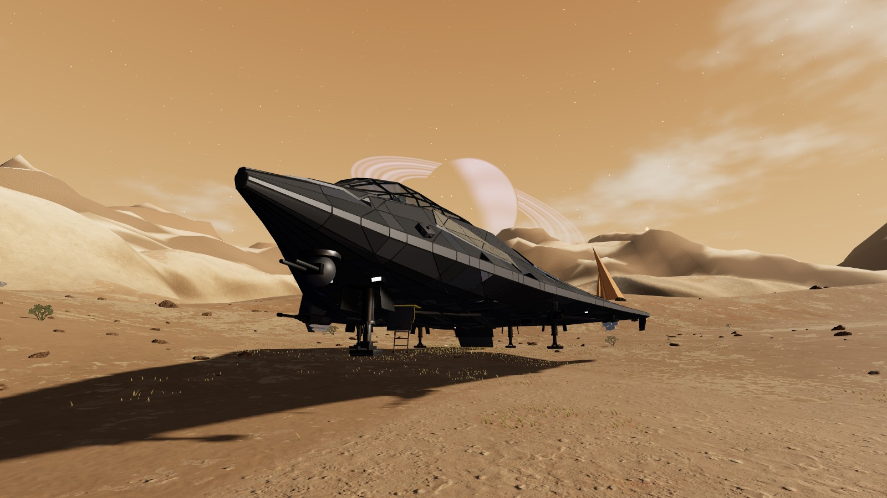

In diesem Update geht es um Schiffe, Fracht und Fahrzeuge. Alles soll zusammenpassen: Was an Bord ist, siehst du auch, und was
nicht durch die Rampe passt, kommt nicht hinein.

## Fracht als Kisten im Laderaum

Im Laderaum von **Kormoran** und **Wisent** steht deine Fracht jetzt als Normkisten in Reihen an den Wänden, in der Farbe der Ware:

- **Kiste** (10 Einheiten): Verbundkiste mit Spannverschlüssen, Klappgriffen und Stahl-Eckkappen
- **Palette** (25 Einheiten): Stahlkufen, Eckwinkel, zwei Spanngurte mit Ratsche
- **Halbcontainer** (100 Einheiten): Trapezsicken, Eckbeschläge, Flügeltür mit vier Verriegelungsstangen, nur im Wisent

Verkaufst oder lädst du, stellen sich die Kisten neu auf. Zwischen den Reihen bleibt die Gasse frei.

## Fahrzeuge passen zu den Schiffen

- Jedes Fahrzeug hat echte Maße. Der Kormoran nimmt ein Fahrzeug mit, der Wisent zwei. Jäger und Elster tragen keines.
- Am Planeten steht dein Fahrzeug im Laderaum. Du steigst ein und fährst über die Heckrampe hinaus. Zum Einladen fährst du die
  Rampe hinauf und drückst im Laderaum <kbd>E</kbd>.
- Wer ohne Fahrzeug landet, bekommt an Planetenbasen einen **Leihrover**, sonst geht es zu Fuß.
- Hebst du ab, während dein Fahrzeug draußen steht, bleibt es dort. Eine Marke über dem Planeten und ein Zeichen auf der Galaxiekarte
  zeigen, wo es steht. Für 900 Credits holt die Werft es in die Fahrzeughalle.
- In der Werft siehst du jetzt, in welche Schiffe ein Fahrzeug passt. Den Dachs gibt es dort auch zu kaufen.
- **Fahrgefühl:** Die Fahrzeuge haben Gänge und eine Drehzahl, die man hört. Mit der Handbremse (<kbd>Q</kbd>) kannst du driften,
  mit <kbd>V</kbd> wechselst du in die Fahrersicht.

## Kisten draußen und der Traktorstrahl

- **Abwerfen:** Im Flottenband unter Fracht wirfst du im Flug 10 Einheiten oder alles ab. Die Ware fliegt verpackt hinter dem Heck
  davon.
- **Traktorstrahl:** Fliegst du langsamer als 25 m/s, zieht er die nächste Kiste heran. Ziel ist die Heckrampe von Kormoran und Wisent
  (sie geht dafür auf) oder die Frachtklappe der kleinen Schiffe. Kisten passen in jedes Schiff, Paletten nur in Kormoran und Wisent,
  Halbcontainer nur in den Wisent.
- **Beute und Treibgut:** Ein zerstörter Bienenstock hinterlässt eine Palette Schrott und eine Kiste Ferrit. Verlorene Fracht treibt
  als Palette oder Halbcontainer im All, du musst sie einholen.

## Ausstiege und Außenbord

- Bei Würger, Elster und Venom klappt die **Kanzel** auf. Am Planeten steigst du über eine Bordleiter aus, im All geht es aus der
  offenen Kanzel hinaus.
- Bei Kormoran und Wisent wird zuerst der Laderaum leer gepumpt, dann öffnet die Heckrampe.
- Außenbord geht nur mit **druckdichtem Helm und Anzug**. Der neue **Manövrierrucksack MR-1** (beim Ausrüster, 2.800 Credits) lässt
  dich frei fliegen. Ohne Rucksack führt dich der Traktorstrahl des Schiffs langsam bis 60 m hinaus.
- Draußen greifst du eine Kiste mit <kbd>E</kbd> und schiebst sie zur Rampe. Schwere Stücke bremsen dich.

## Laufen im Flug

Im All stehst du an Bord von Kormoran und Wisent mit <kbd>G</kbd> vom Pilotensitz auf. Das Schiff richtet sich aus, der
**Autopilot** hält Kurs und Tempo. Du gehst durchs Schiff: Treppe, Gang, Kabinen, Laderaum.

- Liegt etwas auf dem Kurs (Station, Tor, Felsen, Planet, Sektorrand), bremst der Autopilot bis zum Stillstand und meldet sich.
- Bei Treffern und Ferrox im Anflug gibt es Alarm. Mit Ferrox in der Nähe, über Planeten und im Schnellflug bleibst du am Steuer.
- Am Pilotensitz übernimmst du mit <kbd>E</kbd> wieder. Steht das Schiff still, geht es am Rampenschalter Außenbord.

## Innenräume mit mehr Detail

Kormoran und Wisent sind innen überarbeitet:

- Bodenplatten mit Fugen und Schrauben, Gitterroste, Riffelblech
- Wandfelder mit Lüftungsgittern und Wartungsklappen
- Rohre und Kabelpritschen unter der Decke
- im Laderaum Ankerschienen, Leuchten und Stoßbleche

Die Oberflächen haben jetzt Flecken, Laufspuren und Abrieb wie die Bastion.

## Neues Planetengelände

Die Planeten haben ein neues Gelände:

- runde, verwitterte Formen und Felsbrocken nach Regeln
- Licht für jeden Bildpunkt, Bergschatten
- echte Bodentexturen: Erde, Fels, Steine, Sand und Schnee
- dichtes Gras als einzelne Halme

## Noch offen

- Kisten im All sieht nur der eigene Pilot, sie werden noch nicht mit Mitspielern geteilt.
- Die Pfeil hat keinen sichtbaren Laderaum. Sie wird bald durch eigene Schiffsmodelle ersetzt.
- Die Sprachaufnahmen für Kapitel 5 fehlen noch.
