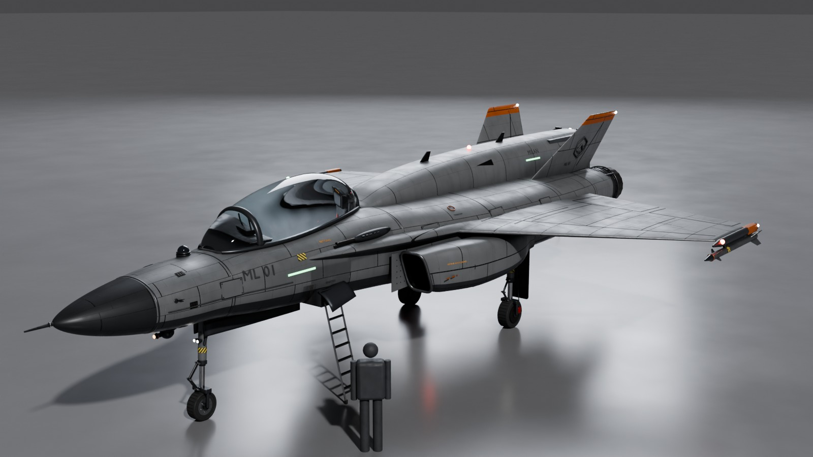
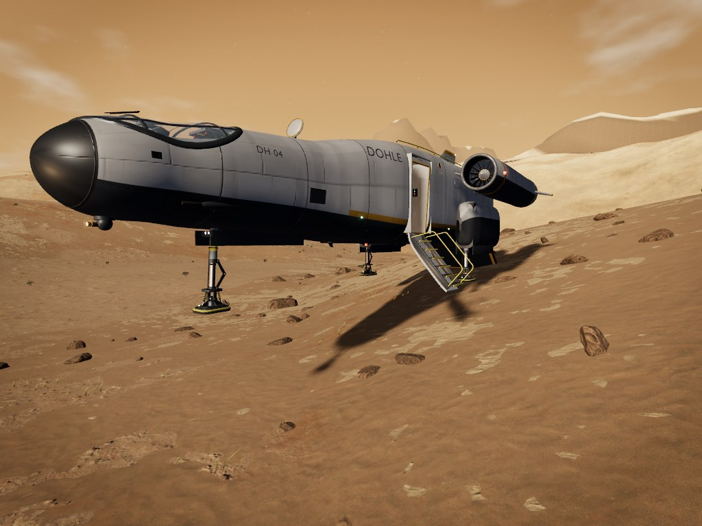
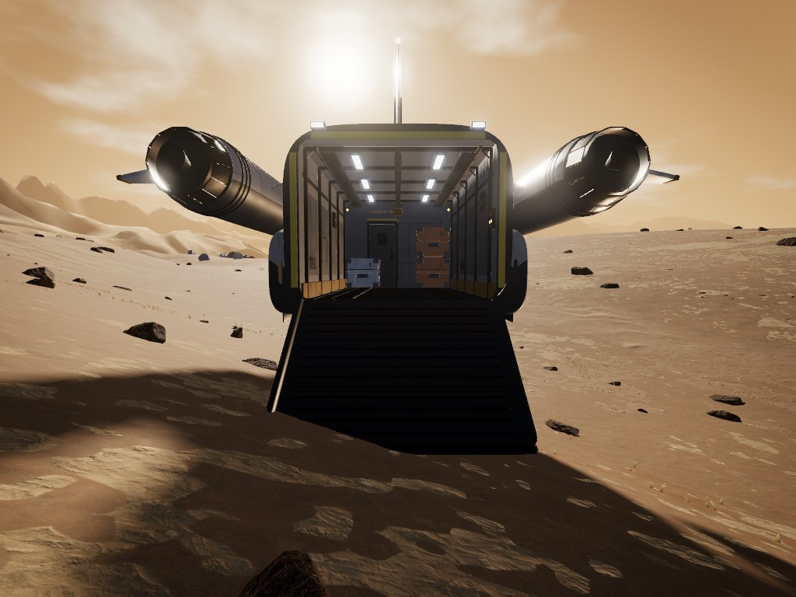
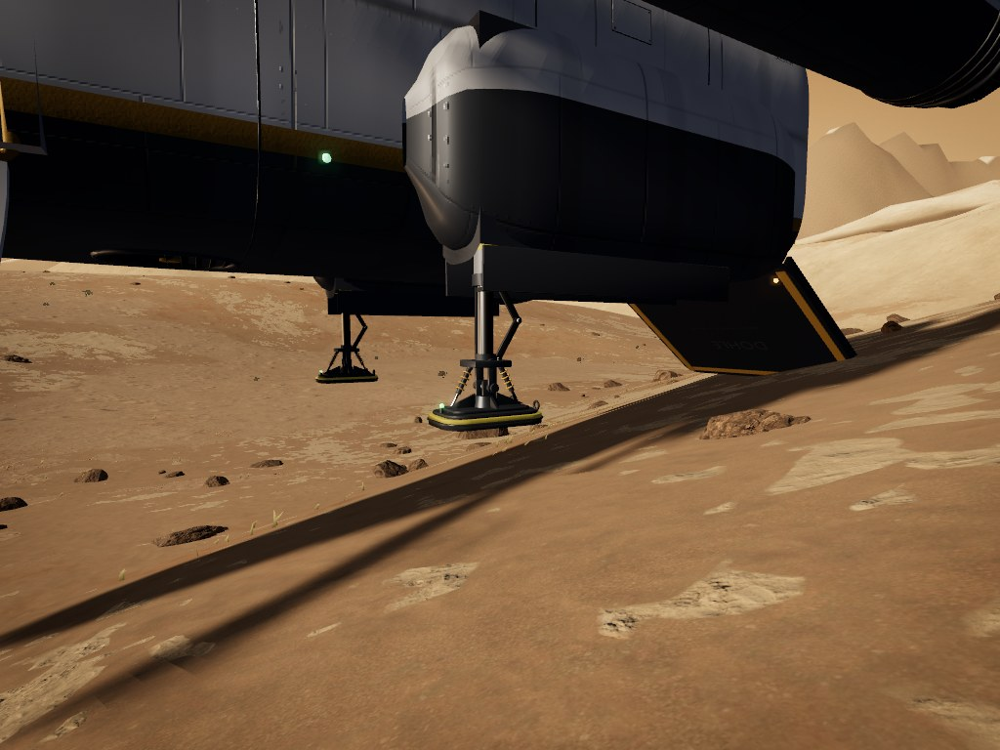
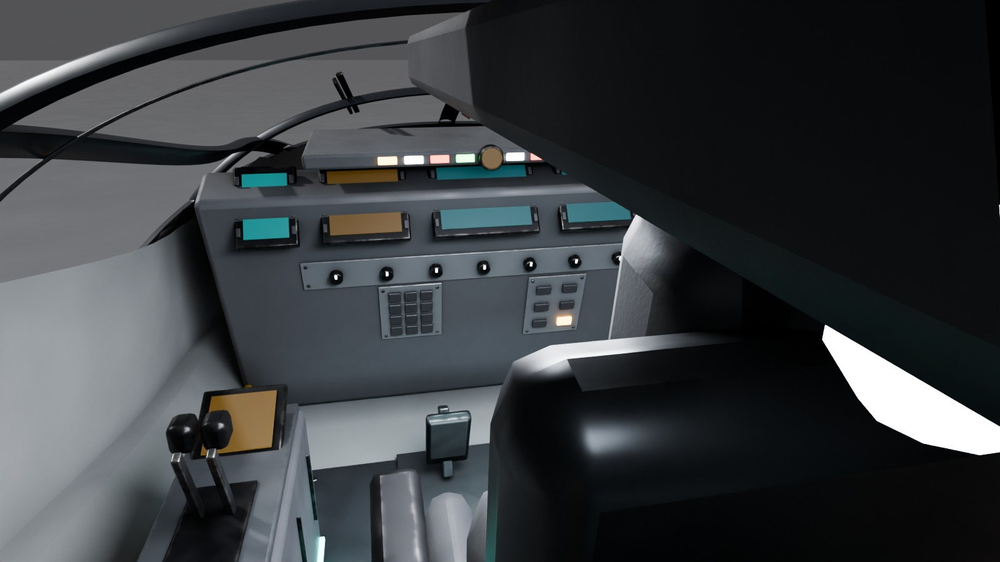

Dieses Update bringt zwei eigene Schiffe für den Anfang. Mit dem einen kämpfst du und baust ab, mit dem anderen handelst du.

## Milan: das neue Startschiff

Jeder Pilot beginnt jetzt im **Milan**, einem leichten Jäger der Bastion:

- 15,8 m lang, Blasenkanzel und Schulterflügel
- zwei Kanonen, zwei Flugkörper
- Werkzeuglaser unter dem Kinn
- ein Frachtfach für eine Normkiste, beladen über eine Heckklappe
- Fahrwerk, Kanzel und Bordleiter bewegen sich wirklich: Am Planeten klappt die Kanzel auf, und du steigst über die Leiter aus

Die **Venom** ist aus dem Spiel. Wer sie geflogen ist, bekommt einen Milan. Was nicht ins Frachtfach passt, liegt im Stationslager.

## Dohle: kleiner Frachter für Einsteiger

Die **Dohle** gibt es für **1.500 Credits** in jeder Werft. Sie ist einsitzig, gutmütig und für Händler gebaut:

- **Laderaum** 5,7 × 3,1 × 2,4 m für Paletten und Kisten, 60 Einheiten Fracht. Die Ladung steht sichtbar auf zwei Rollenbahnen.
- **Heckrampe** bis zum Boden. Im All öffnet sie sich, wenn der Traktorstrahl eine Kiste heranzieht.
- **Einstieg** durch eine Seitentür mit eingebauter Treppe, dahinter Vorraum, Gang und Cockpit
- **Landebeine mit Füßen** statt Rädern, denn die Dohle startet senkrecht. Die Füße kippen und legen sich an den Boden an.
- Cockpit mit Schalensitz, Seitenstick und Pult. Im Laderaum gibt es einen Kettenzug, Kabelpritschen und eine Rampenbedienung.

Dafür ist sie langsamer und träger als der Milan, hat zwei leichte Kanonen und keine Flugkörper.

## Mehrspieler

- Bei anderen Schiffen siehst du jetzt Fahrwerk, Rampe, Kanzel und Bordleiter so, wie der andere Pilot sie gerade stellt.
- Kisten im All (abgeworfen, Beute, Treibgut) sehen alle im Sektor. Eine Kiste, die gerade ein anderer zieht, ist gesperrt.
- Außenbordeinsätze sind für alle sichtbar.
- Steht ein Pilot im Flug auf, sehen die anderen das Schiff weiterfliegen. Gelandete Schiffe stehen am richtigen Platz.

## Licht und Leistung

- Beim Wechsel zwischen Planet, Schiff, All und Bordflug gibt es keine Hänger mehr durch neue Shader.
- Beim Betreten von Kormoran und Wisent wird der Innenraum hinter der Blende vorbereitet. Der Stillstand beim Einsteigen ist weg.
- Weniger Blendung: schwächeres Leuchten, keine Triebwerksleuchten am Boden, gedämpfte Leuchtflächen auf Planeten.
