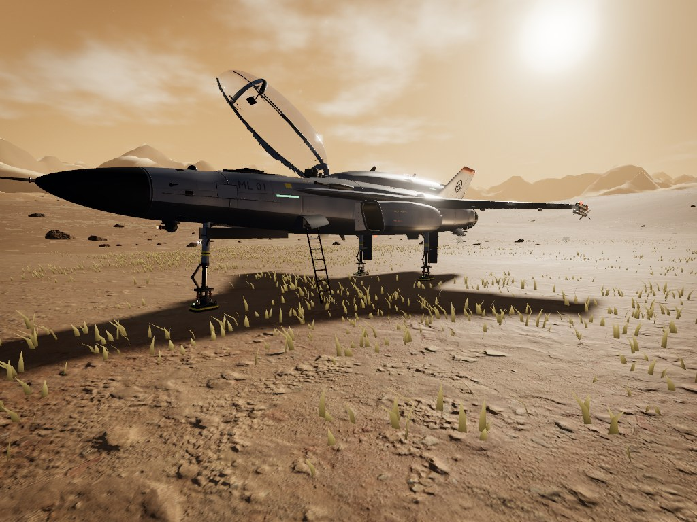
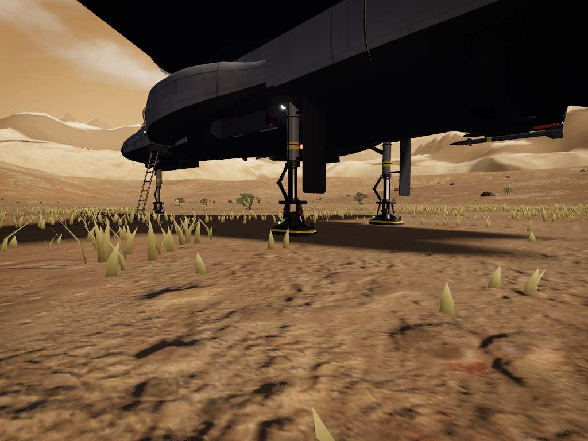

Ein kleines Update für das Startschiff: Der **Milan** hat keine Räder mehr. Bugbein und Hauptbeine stehen jetzt auf
Landefüßen, genau wie bei der Dohle:

- Gummisohle mit Warnkante und ein Fußteller, der um einen Bolzen kippt und sich an den Boden legt
- zwei Federdämpfer, die den Fuß waagrecht halten
- ein Bodenkontaktfühler mit grüner Lampe

Die Beine fahren weiter in dieselben Schächte ein, im Flug sieht der Milan aus wie bisher.

