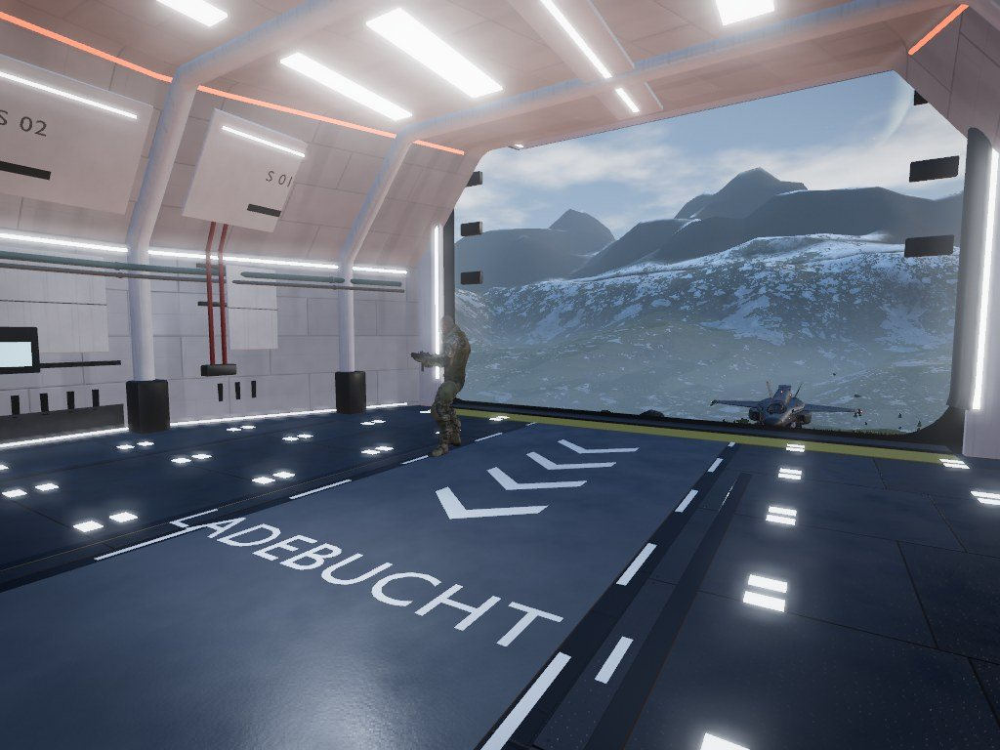
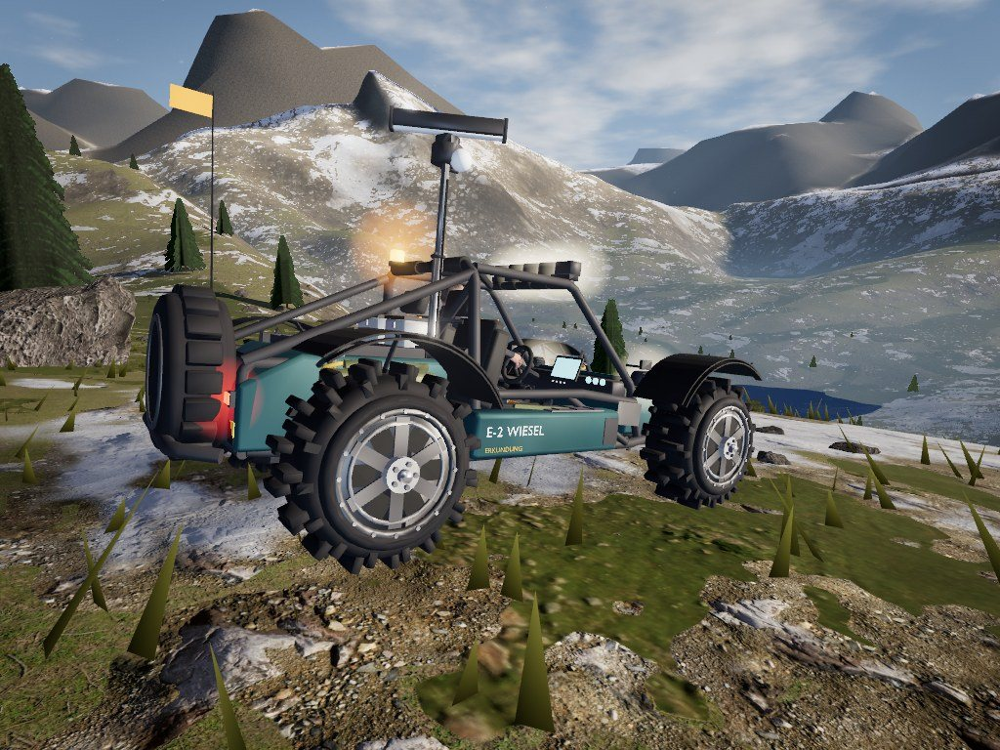

Ein Update für alle, die zusammen fliegen:

- **Zu Gast an Bord:** Steht der Kormoran oder Wisent eines anderen Piloten gelandet mit offener Rampe da, gehst du am Fuß der Rampe mit [E] an Bord. Du kannst dich umsehen, Steuer und Rampe bleiben dem Besitzer. Über die Luke geht es wieder hinaus. Hebt der Besitzer ab, stehst du draußen.
- **Piloten an Bord:** Wer in seinem gelandeten Schiff herumläuft, ist für die anderen zu sehen, auch durch die offene Rampe.
- **Schüsse:** Die Kanonen der anderen Schiffe sieht man jetzt feuern.
- **Wiesel:** Der Fahrer sitzt auch für die anderen sichtbar im Buggy.
- **Minen:** Treffermarke und Doppelabschuss zeigen nur noch deine eigenen Abschüsse, nicht mehr die deiner Mitspieler.
- **Gelandete Schiffe** stehen bei allen auf dem Boden, auch wenn jemand noch das alte Gelände eingestellt hat.

