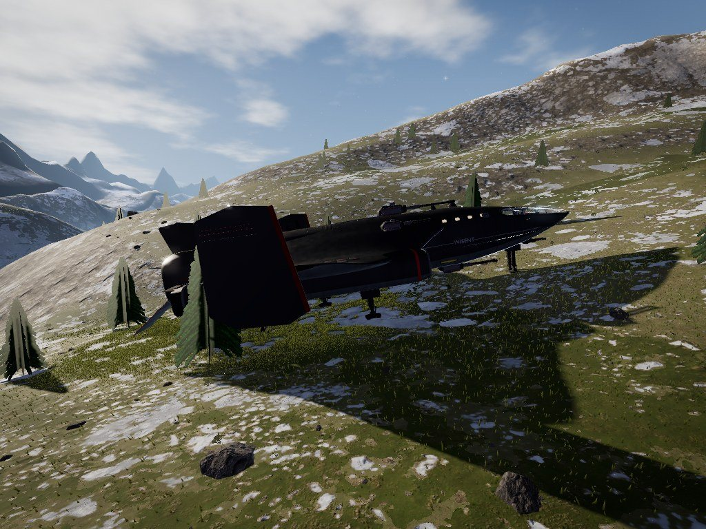
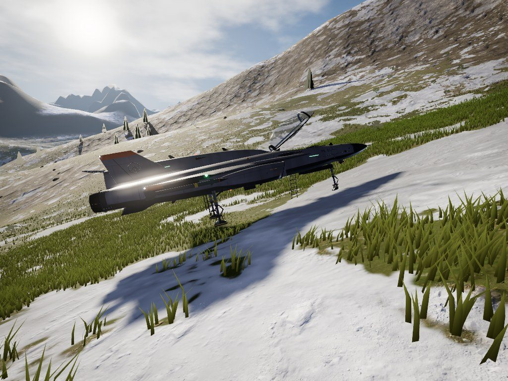
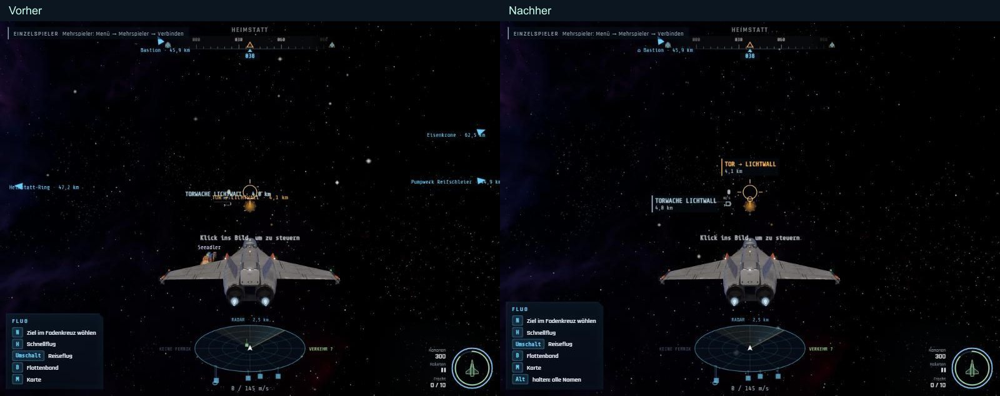

Nach dem letzten Spielabend zu viert gibt es eine Reihe Verbesserungen.

## Landen am Hang

Schiffe stehen nicht mehr immer exakt waagerecht. Beim Landen misst das Schiff den Boden unter jedem Landefuß und kippt so, dass die Beine aufstehen, bis 10° nach vorn, hinten oder zur Seite. Vorher hing am Hang oft ein Bein mehrere Meter in der Luft.

- Der Laderaum kippt mit, Kisten und Fahrzeuge fahren über die Rampe sauber hinaus.
- Im Innenraum steht man leicht schräg, die Sicht bleibt waagerecht.
- Andere Spieler sehen das Schiff genauso gekippt.

## Namen im All

Stationen, Tore und Orte zeigen aus der Ferne nur noch ein Symbol. Der Name erscheint in der Nähe, nahe am Fadenkreuz, beim Navigationsziel und beim nächsten Tor der Route, dann auf einem dunklen Schild mit der Entfernung darunter. Die Schilder weichen sich aus statt übereinander zu liegen. Mit gehaltener **Alt**-Taste siehst du alle Namen. Randpfeile gibt es nur noch für Ziel, nächstes Tor und Heimathafen.

## Zu Fuß

- Man läuft nicht mehr durch Schiffe anderer Spieler, ihre Fahrzeuge, Mineneingänge, Außenstellen und Bohrtürme.
- Um das eigene Schiff liegt kein großer Kasten mehr: Unter hohen Rümpfen wie dem Wisent läuft man hindurch, Beine und Rumpf halten auf.
- Die Treppe im Wisent vom Laderaum zum Wohndeck klappt auch beim Rennen.

## Mehrspieler

- Der Chat steht links oben und ist überall zu sehen, auch zu Fuß, an Bord, in Stationen und in Minen. Vorher sah man ihn nur im Flug.
- Links oben steht immer, ob du im Einzel- oder Mehrspieler bist, wie viele Piloten online sind und wie viele bei dir.
- Ein zweiter Klick auf „Verbinden“ trennt nicht mehr die Verbindung. Nach dem Anlegen eines Kontos bestätigt das Spiel die Anmeldung.

## Minen

- Regen und Sturm von draußen sind unter Tage nicht mehr zu hören.
- Statt des Maschinenbrummens hört man in den Stollen einen leisen Luftzug.
