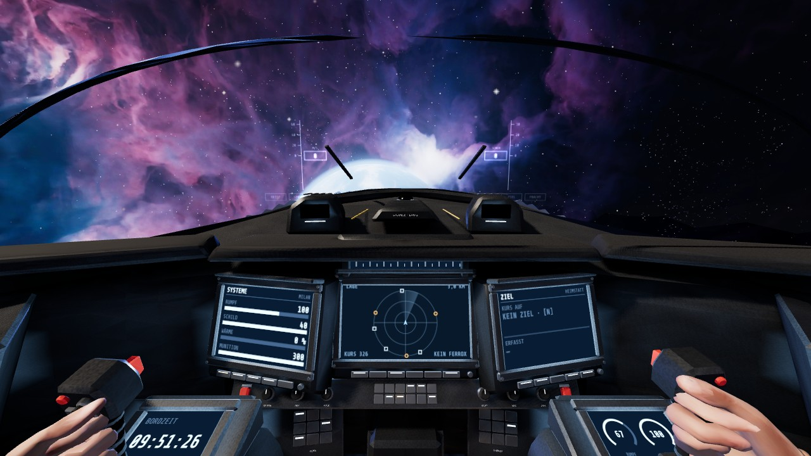
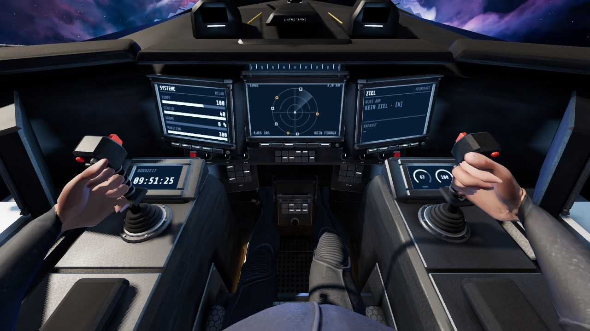
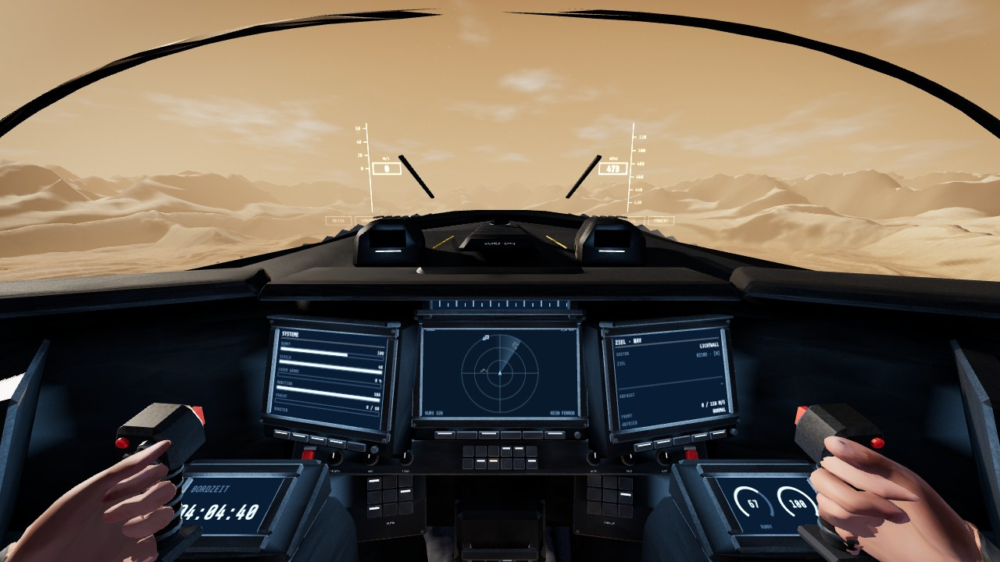
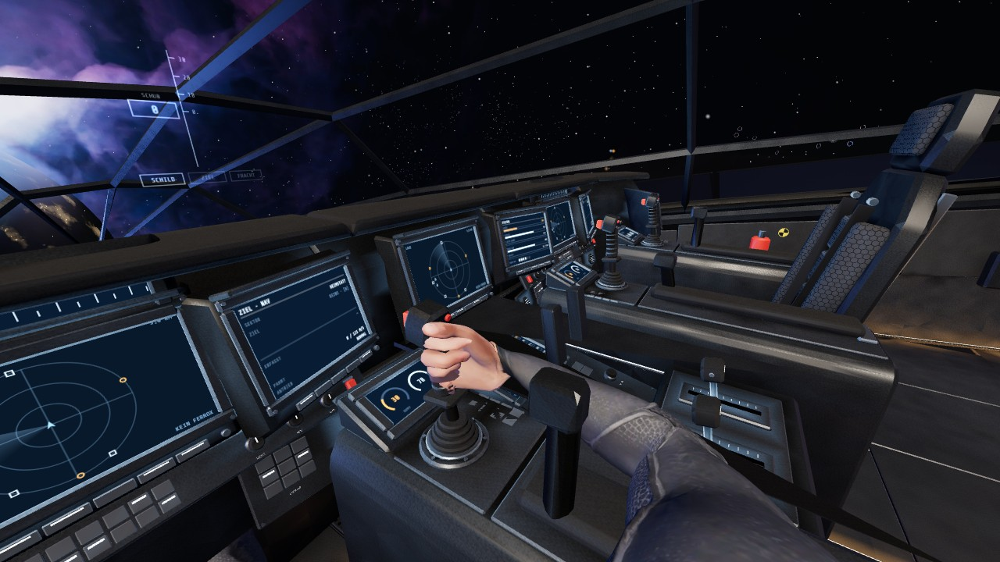
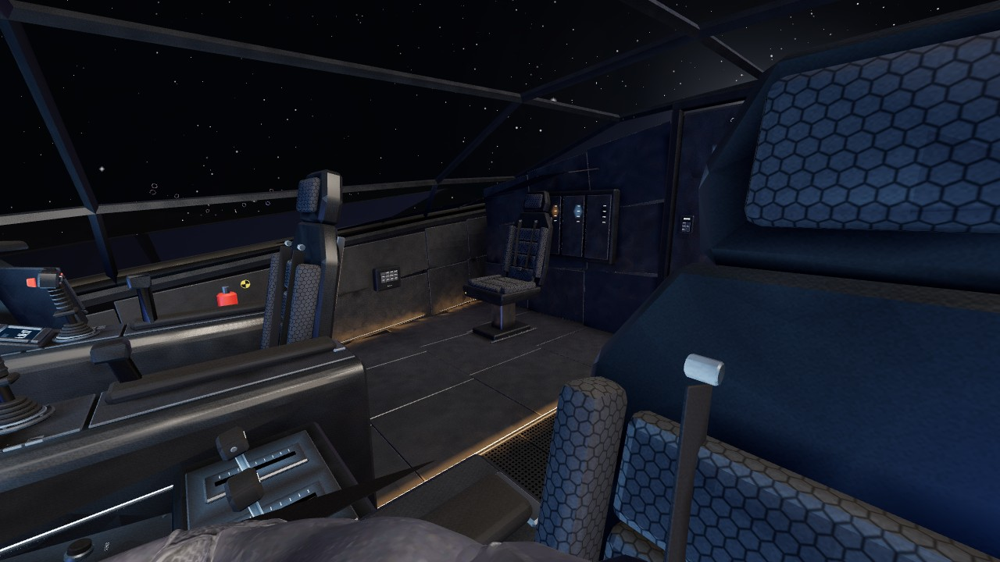
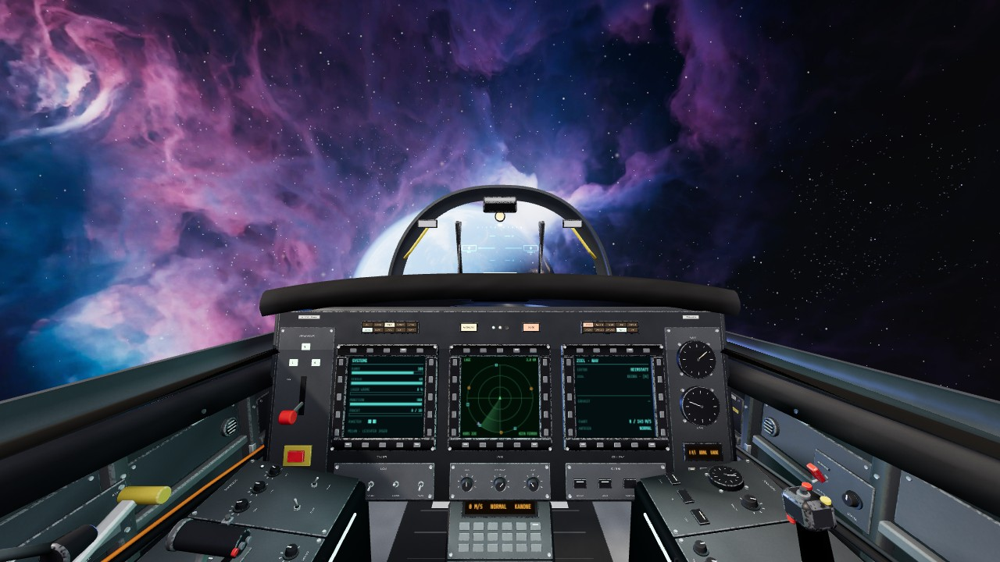

Bisher sah man das eigene Schiff nur von hinten. Jetzt gibt es die Sicht aus dem Pilotensitz.

## So geht es

- **K** schaltet im Flug zwischen Verfolgersicht und Cockpit um. Die Wahl bleibt gespeichert.
- Mit **C** (halten) oder **V** drehst du den Kopf und siehst dich in der Kabine um.
- Radar und Schiffsanzeige stehen in der Cockpit-Sicht nicht mehr am Bildrand, sondern auf den Anzeigen im Pult.
- Hinweise wie „Andocken“ und Funkgespräche stehen in der Cockpit-Sicht oben, damit das Pult frei bleibt.
- Andere Schiffe haben noch kein eigenes Cockpit. Dort meldet der Funk das beim Druck auf K.

## Dohle

Ein Einsitzer unter der Glaskuppel: Pult mit fünf Anzeigen, zwei Steuerknüppel auf den Seitenkonsolen, Sitz mit Wabenstoff, Trittrost mit warmen Lichtleisten.

Deine Figur sitzt in ihrer eigenen Tracht im Sitz. Die Hände liegen um die Steuerknüppel und gehen mit, wenn du lenkst oder Schub gibst.

## Kormoran

Eine Brücke für zwei: Du sitzt links, rechts der Platz des Kopiloten, dazwischen die Mittelkonsole mit Karte und Schubhebeln. Hinten stehen Klappsitze vor dem Schott zum Gang.

## Milan

Der Milan hat sein Cockpit als erstes bekommen: Tafel mit drei Anzeigen, Sichtgerät über dem Blendschutz, Schubhebel links, Steuerknüppel rechts.

## Licht und Anzeigen

- Die Anzeigen zeigen echte Werte: Hülle, Schild, Wärme, Munition, Radar, Ziel und Entfernung, Tempo, Schub, Fracht.
- In Dohle und Kormoran beleuchten die Anzeigen die Kabine. Fensterrahmen, Pult und Sitz werfen Schatten, die beim Wenden durch die Kabine wandern.

## Noch offen

- Wisent, Würger, Elster und Pfeil bekommen ihre Cockpits später.
- Der Milan hat noch den älteren, helleren Stil und keinen sichtbaren Piloten.
- Die Schubhebel der Kormoran und die Knüppel des Kopiloten stehen still.
