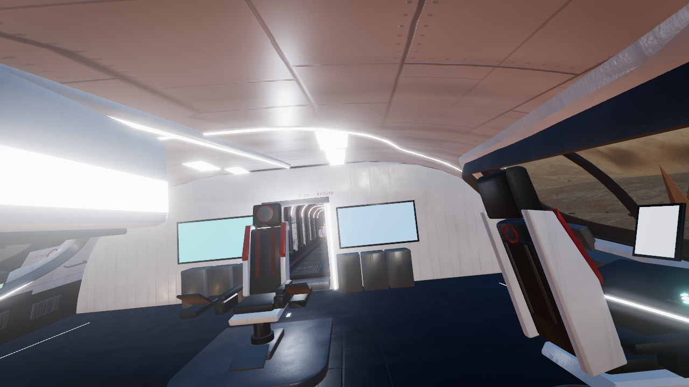
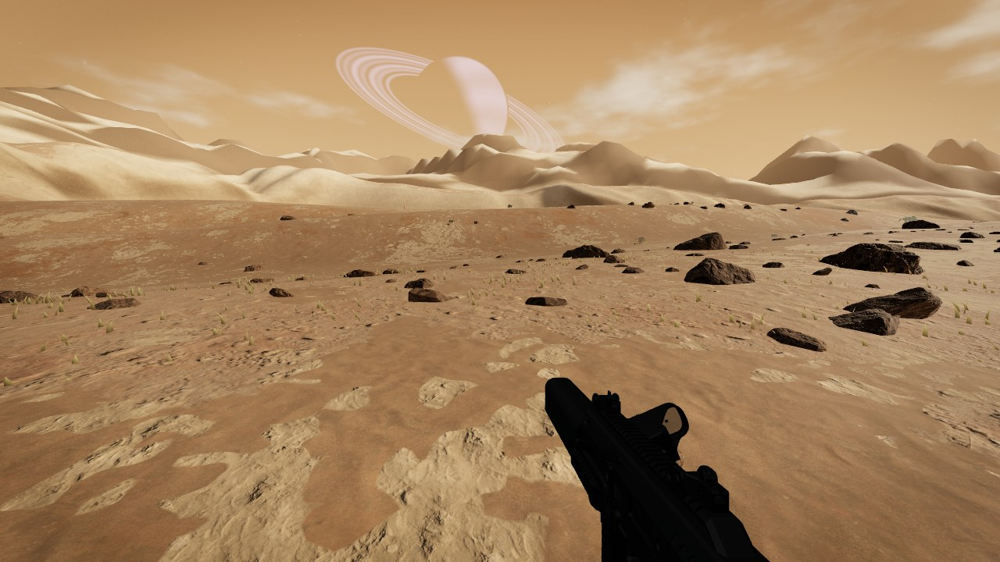
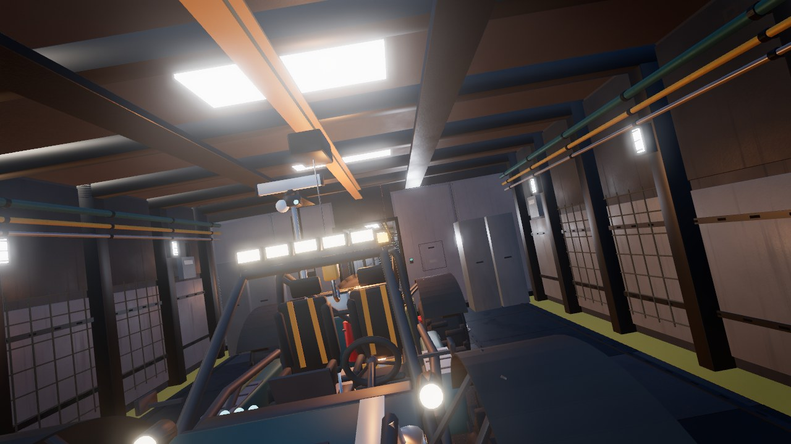
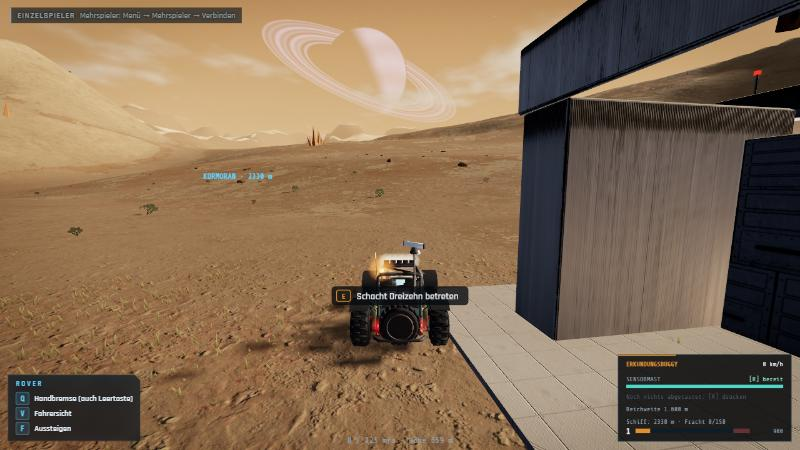

Das Hinein- und Hinausfahren mit dem Bodenfahrzeug lief schon ohne Ruckler. Zu Fuß ging es bisher nur mit E und einem Schnitt. Das ist jetzt gleich.

## Landen

- Der Hinweis heißt nur noch **[E] Landen**.
- In Kormoran und Wisent stehst du nach dem Landen hinter dem Pilotensitz auf, die Rampe öffnet sich.
- Dein Fahrzeug bleibt im Laderaum stehen. Willst du es, gehst du hin, drückst **E** und fährst über die Rampe hinaus.
- Mit kleinen Schiffen (Milan, Würger, Elster, Dohle) stehst du nach dem Landen zu Fuß an Leiter oder Treppe. Ein Leihrover der Basis steht neben dem Schiff.

## Über die Rampe

- Läufst du draußen auf die offene Heckrampe, bist du an Bord, an derselben Stelle und mit derselben Blickrichtung.
- Gehst du innen die Rampe hinunter, stehst du draußen und läufst einfach weiter.
- Endet die Rampe am Hang etwas über dem Boden, kommst du trotzdem hinauf. Steckt ihre Spitze im Boden, steigst du dort aus, wo sie im Gelände verschwindet.
- Im Hangar der Bastion geht das jetzt auch mit der Kormoran.

## Minen

- Am Eingang stand die Aufforderung zweimal, eine alte und eine neue. Jetzt steht sie einmal da, zu Fuß und im Fahrzeug gleich.
- Direkt am Fahrzeug steigst du mit **E** ein, auch wenn eine Mine oder das Schiff in der Nähe ist. Vorher gewann immer der Mineneingang.

## Noch offen

- Die Dohle hat noch keinen begehbaren Innenraum und bleibt bei ihrer Treppe.
- Als Gast im Schiff eines Mitspielers geht es weiter mit E hinein.
