Dieses Update ist das bisher größte. Es bringt ein neues Deck, eine neue Art, sich in Stationen zu treffen, und drei Schiffe.

## Deck 3 der Bastion: das Forum

Die Rundhalle ist weg. Vom Hangar führt der Korridor jetzt in eine Vorhalle und von dort ins **Forum**, eine 44 m lange Halle mit hohem Mittelschiff. In der Mitte liegt der Treffpunkt mit der Galaxiekarte, am Ende die Einsatzzentrale mit Aufträgen und Missionen.

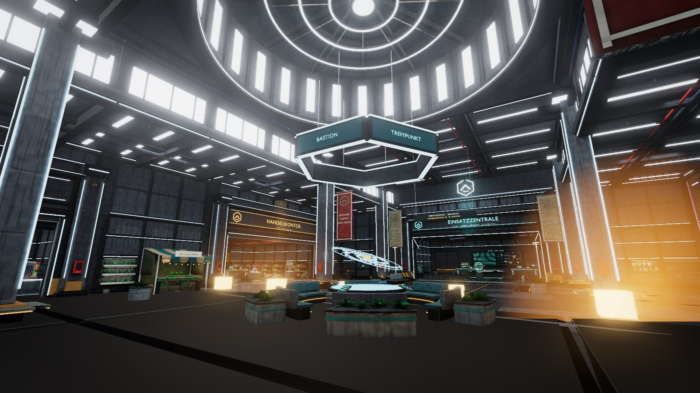

An den Längsseiten liegen vier Läden, jeder 16 × 13 m groß und mit einem 12 m breiten Portal:

- **Werft:** fünf Schiffsmodelle auf Sockeln, Bauplanwand, Lackmuster und ein Triebwerk auf dem Bock
- **Handelskontor:** sechs Erzvitrinen, Barrenstapel, Kurstafeln und Warenregale
- **Ausrüster:** acht Schaupuppen, Waffenwände, Helmregale und Vitrinen
- **Kantine:** Fensterfront ins All mit Sitznischen, Theke und Bistrotische

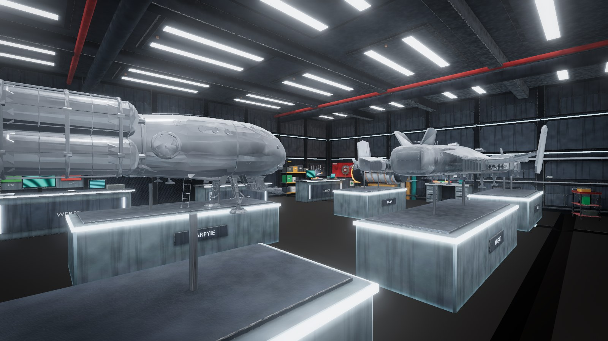

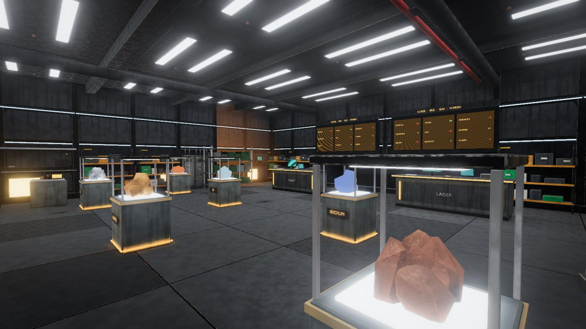

Die Schaupuppen im Ausrüster tragen die echten Ausrüstungsteile aus dem Spiel: Overalls, Helme, Weste, Handschuhe und Stiefel. Auf dem Schild am Sockel stehen Name und Preis.

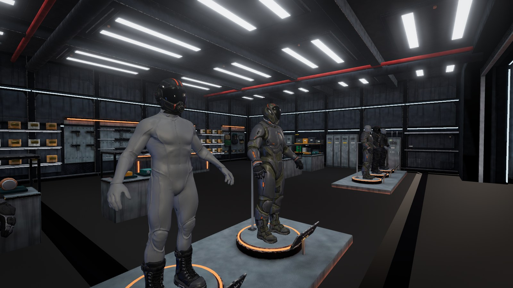

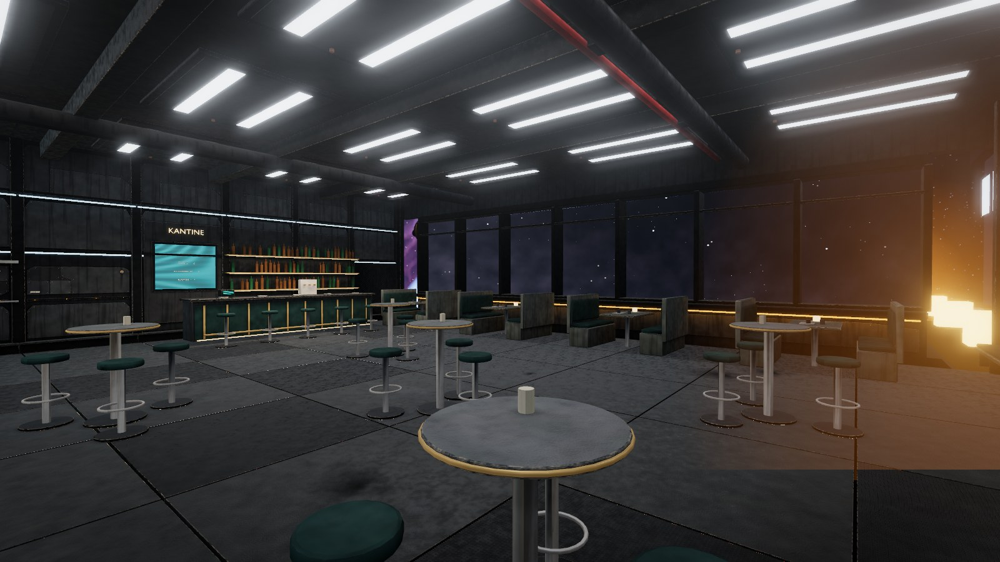

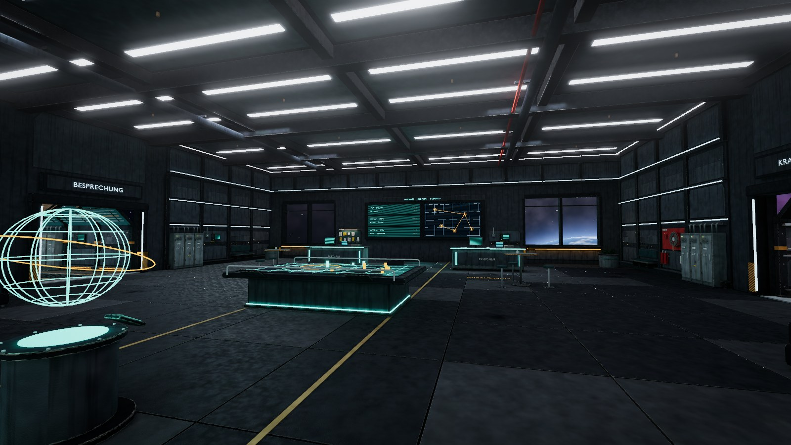

## Hangarbuchten

Bisher standen alle angedockten Piloten im selben Hangar, und niemand konnte ins Schiff eines Freundes steigen. Das ist jetzt anders:

- Jeder Pilot hat an jeder Station seine **eigene Hangarbucht**. Dort stehen nur deine Schiffe.
- Im Hangar siehst du nur Piloten, die in derselben Bucht stehen. Auf dem Deck sehen sich alle wie bisher.
- In deine Bucht kommt nur, wen du **einlädst**. Die Einladung gilt 15 Minuten.
- In der Bucht eines Freundes steht sein Schiff mit offener Rampe. Mit **E** gehst du an Bord.

Eingeladen und angenommen wird an der Buchtenwahl an der Rückwand jedes Hangars. Auf der Bastion gibt es dafür in der Vorhalle von Deck 3 einen eigenen Aufzug **HANGARBUCHTEN**. Der Aufzug **QUARTIERE** gegenüber führt nur noch zu den Quartieren.

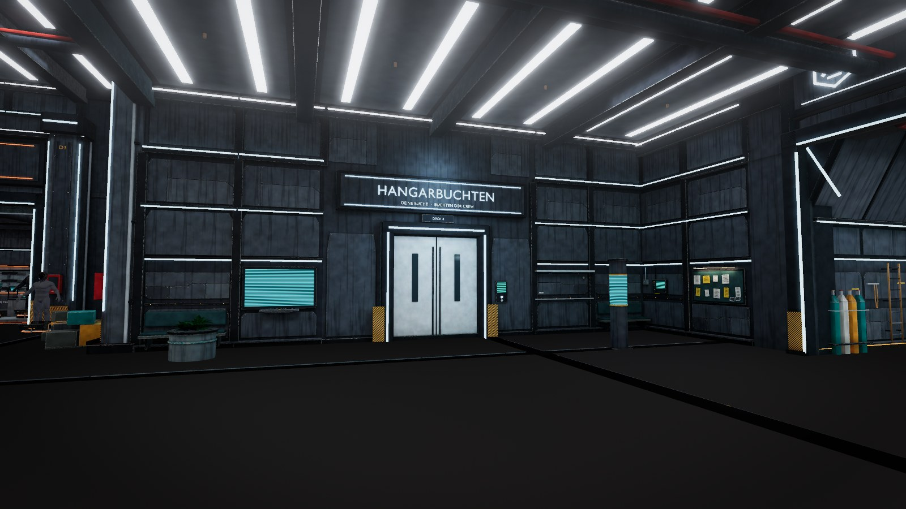

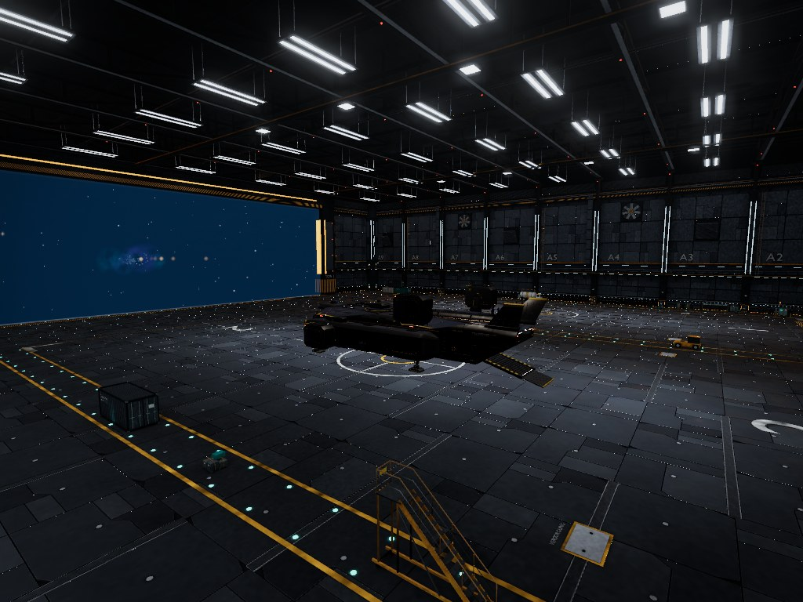

## Mitfliegen

Bist du als Gast an Bord und der Besitzer legt ab, fliegst du mit. Du bleibst an Bord bei Orbit, Landeanflug, Sprung und Andocken und kannst im Flug im Schiff herumlaufen. Dein eigenes Schiff folgt per Autopilot, wenn ihr woanders andockt oder du auf einem Planeten aussteigst.

## Kranich: Mehrzweckschiff für zwei

Der **Kranich** kostet **14.500 Credits** und ist 32 m lang:

- Laderaum mit Heckrampe für einen Wiesel und Kisten, 110 Einheiten Fracht
- Kabine mit Kojen, Kombüse und Waschzelle, dahinter die Technik mit dem Energiekern
- Cockpit mit hoher Kanzel und Glasnase, von außen und beim Herumlaufen zu sehen
- vier Hubdüsen für senkrechte Starts und zehn Steuerdüsenblöcke, die beim Manövrieren sichtbar feuern
- starker Scanner auf dem Rücken, vier Flugkörper

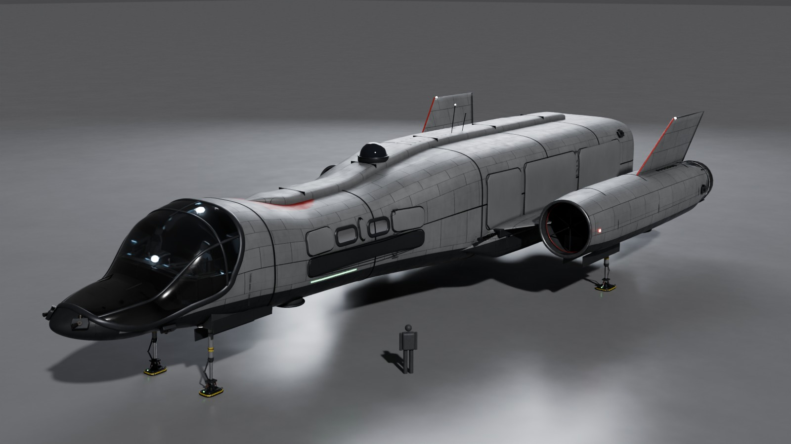

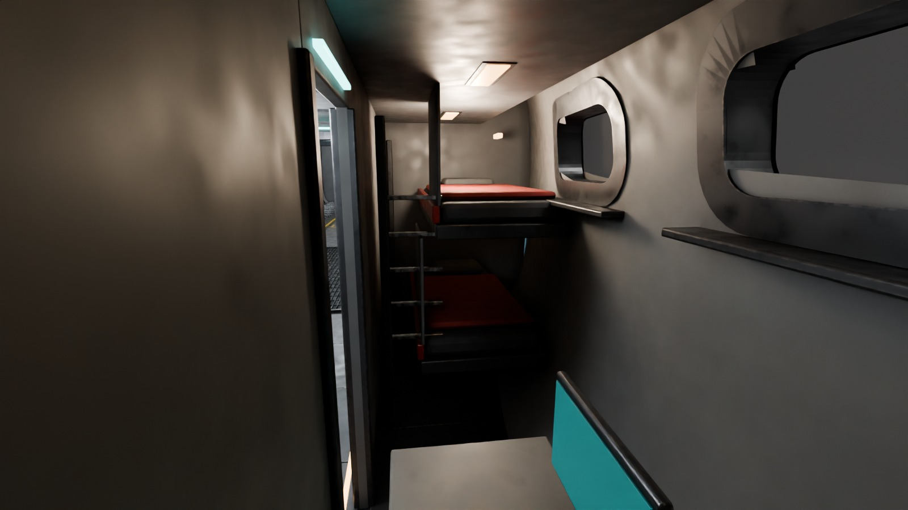

## Möwe: Fahrzeugtransporter

Die **Möwe** kostet **30.500 Credits** und ist 37 m lang:

- Laderaum zum Durchfahren für zwei Dachs, 260 Einheiten Fracht
- Bugtor mit Haube und Rampe, dazu eine Heckrampe. Über beide Rampen gehst und fährst du hinein und hinaus.
- eine Treppe führt in die Kabine mit sechs Sitzen und ins Cockpit mit großer Frontscheibe
- vier schwere Landebeine, Mantelrotoren und Hubdüsen
- keine Flugkörper, träge im Kampf

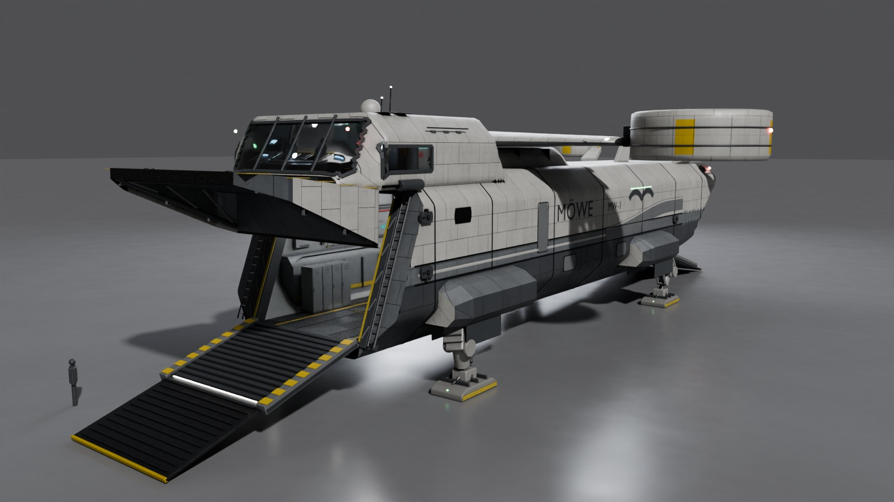

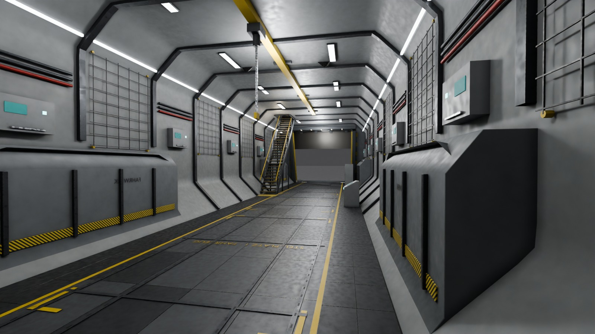

## Harpyie: schweres Landungsschiff

Die **Harpyie** kostet **38.000 Credits** und ist 37,6 m lang:

- Truppenraum mit zwölf Klappsitzen und Heckrampe, Stellplatz für einen Dachs
- darüber ein Mannschaftsdeck mit Kojen, Messe, Kombüse und Schützenplatz
- darunter Waffenkammer und Technikraum
- dicke Panzerung, Kinnkanonen, acht Flugkörper
- vier schwenkbare Triebwerksgondeln für senkrechte Starts

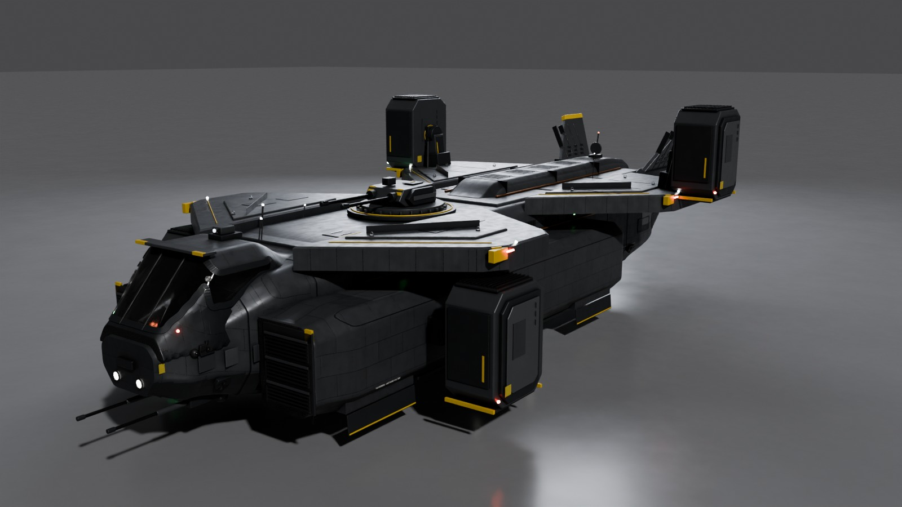

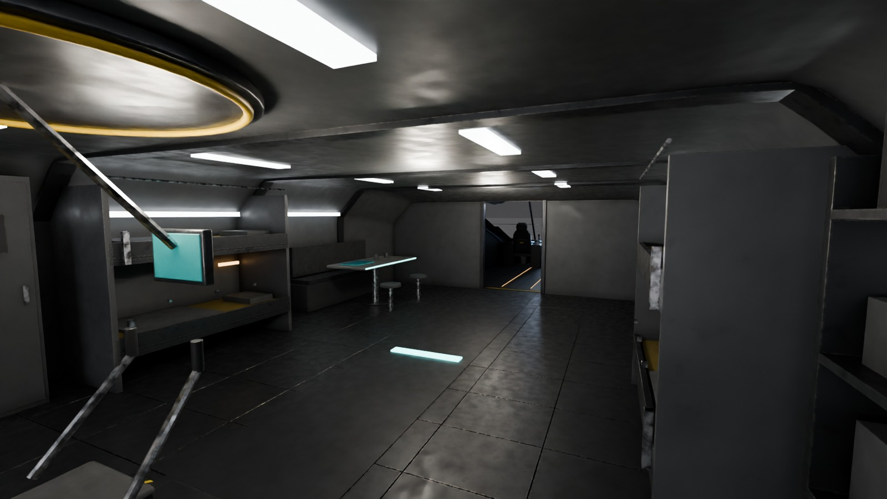

### Rückenturm und Schützenplatz

- Fliegst du allein, folgt der Turm dem Ziel, das du erfasst hast, und feuert mit der Feuertaste mit.
- Am **Schützenplatz** auf dem Mannschaftsdeck setzt du dich mit **E**. Die Maus richtet den Turm, die linke Taste feuert, die rechte vergrößert.
- Ein Gast an Bord kann den Schützenplatz übernehmen, während du fliegst.

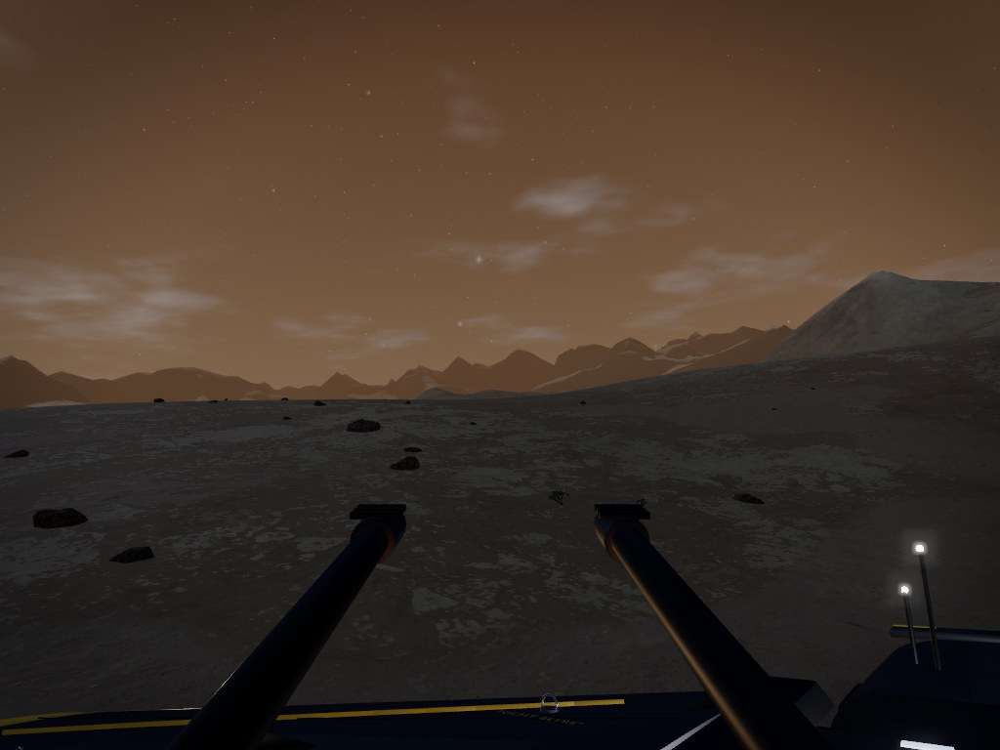

### Module im Technikraum

In der Harpyie haben die fünf Modulplätze feste Orte im Technikraum. Jedes der 32 Schiffsmodule hat ein eigenes Modell und steht eingebaut an seinem Platz.

- Am Platz öffnest du mit **E** die Ausrüstung, gefiltert auf die Module, die dort passen.
- Umbauen geht nur noch gelandet oder angedockt. Das gilt jetzt für alle Schiffe.

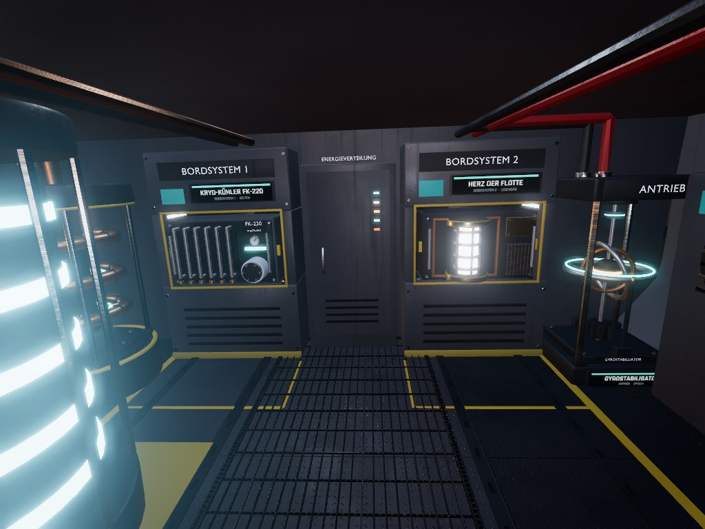

## Noch offen

- Rucksäcke hängen im Ausrüster nur als Auslage an der Wand. Zum Tragen gibt es sie noch nicht.
- In der Bucht eines Freundes steht nur sein aktives Schiff, nicht seine abgestellten weiteren Schiffe.
- Feste Modulplätze hat bisher nur die Harpyie.
- Gäste gehen bei der Möwe über die Heckrampe an Bord, nicht über das Bugtor.
- Das neue Deck ist mit zwei Spielern zugleich noch nicht geprüft.
