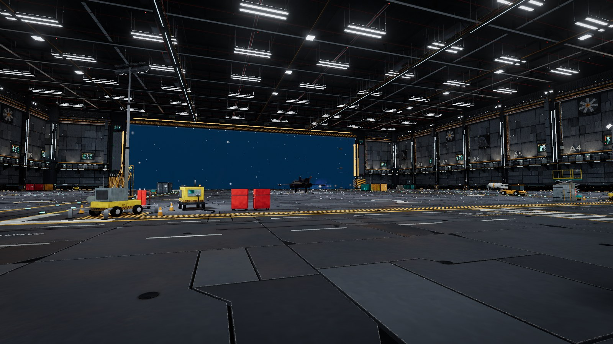
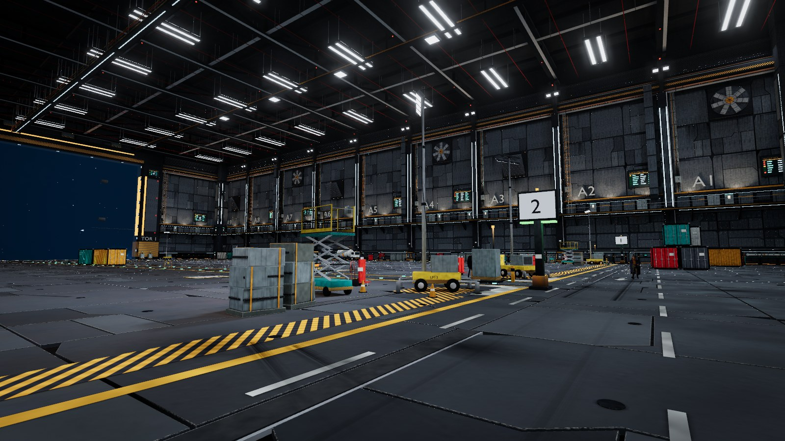
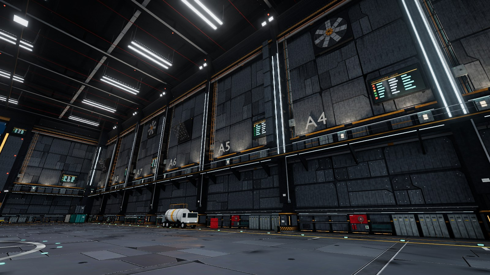
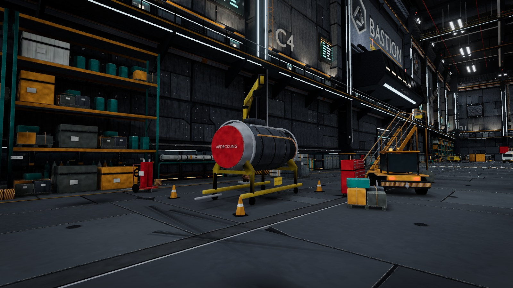
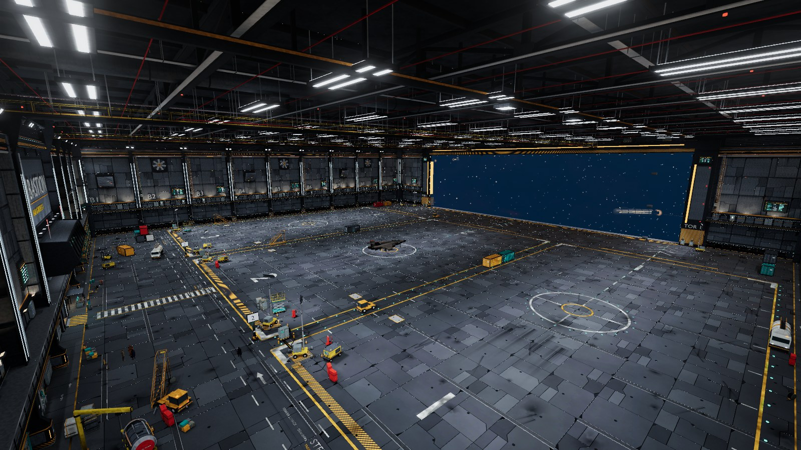
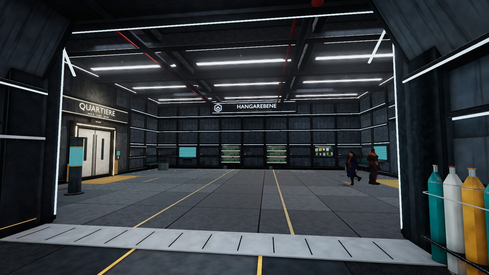
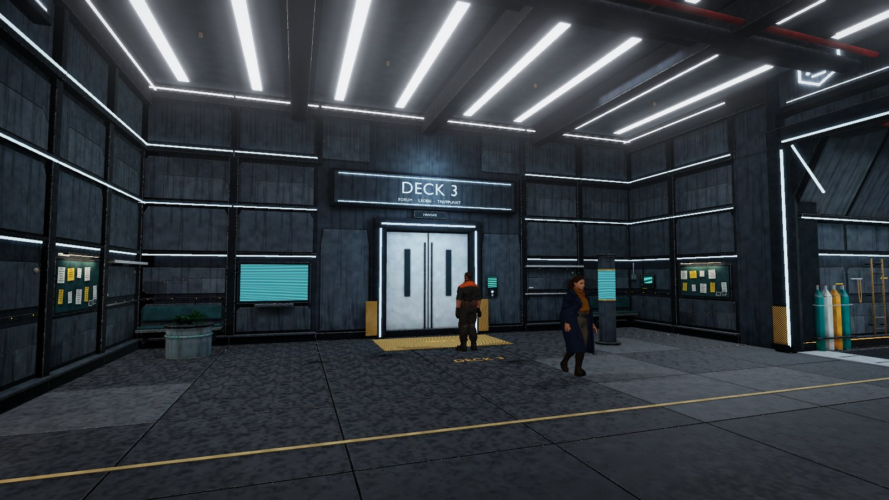
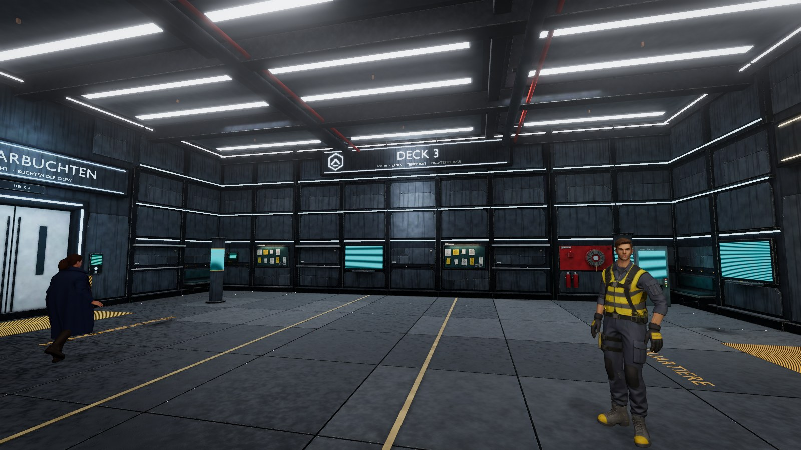

Nach dem neuen Deck 3 war der Hangar der Bastion an der Reihe. Dazu kommt eine Änderung am Weg zwischen Bucht und Deck.

## Der Hangar

Die Halle ist dieselbe, 184 m breit und 42 m hoch, mit drei Stellplätzen. Neu ist, was in ihr steht und wie sie beleuchtet ist.

- **An den Stellplätzen:** Lichtmasten, Bodenstromaggregate, Scherenbühnen, Werkzeugschränke, Frachtstapel und Löschkarren. An jedem Platz steht ein Leuchtkasten mit seiner Nummer.
- **Am Boden:** ein Fahrweg hinter den Stellplätzen, ein Zebrastreifen vom Ausgang zum mittleren Platz, Entfernungsmarken, Feuer um die Aufsetzkreise, dazu Brand- und Reifenspuren.
- **An den Wänden:** Türen, Lüftungen und Schaltschränke hinter der Galerie, Lageanzeigen, Steigtrassen und Rohre. Wandfluter strahlen die großen Wandfelder von unten warm an.
- **Unter dem Dach:** zwei Laufstege zwischen den Stellplätzen, Sprinkler und Kabelbahnen. Die Hallenleuchten strahlen jetzt auch nach oben, erst damit sieht man das Tragwerk.
- **Am Tor:** Feldprojektoren am Rahmen, Antriebe auf dem Sturz, Leitfeuer und eine Haltelinie.
- **Hinter den Plätzen:** links eine Werkstatt mit einem Ersatztriebwerk auf dem Gestell und einem Schwenkkran, rechts der Frachtumschlag mit Gabelstapler.

Das Licht der Halle ist vorberechnet. Diese Rechnung ist jetzt dreimal so fein wie bisher, im Dach fünfmal. Der Boden ist heller, und Flecken, Rost- und Laufspuren, die im Hangar bisher fehlten, sind jetzt zu sehen. Der Hangar ist dadurch von 58 auf 85 MB gewachsen; geladen wird er wie bisher im Hintergrund.

## Zwei Ebenen

Bisher ging man von der Hangarbucht zu Fuß ins Forum. Wer mit dem Aufzug in seine Bucht fuhr, stand danach wieder vor demselben Deck. Jetzt hat die Bastion zwei Ebenen:

| Ebene | Was dort liegt |
|---|---|
| **Hangarebene** | deine Hangarbucht, der Hangarzugang und eine Vorhalle mit zwei Aufzügen |
| **Deck 3** | das Forum mit Treffpunkt, Läden und Einsatzzentrale |

- Der Aufzug **DECK 3** auf der Hangarebene fährt mit <kbd>E</kbd> hinauf zum Forum.
- Auf Deck 3 heißt derselbe Aufzug **HANGARBUCHTEN**. Dort wählst du deine Bucht, nimmst Einladungen an oder lädst Gäste ein.
- Der Aufzug **QUARTIERE** steht auf beiden Ebenen. Nach dem Quartier kommst du auf der Ebene an, von der du gefahren bist.
- Die Wegmarke am Bildschirmrand führt über den Aufzug, und der Spielstand merkt sich deine Ebene.

Im Mehrspieler gehört die ganze Hangarebene zu deiner Bucht. Im Hangarzugang und in der Vorhalle siehst du also nur, wer in derselben Bucht ist. Auf Deck 3 sehen sich alle.

## Gut zu wissen

- Eisenkrone und Pumpwerk sind unverändert. Dort führt der Hangar weiter direkt aufs Deck.
- In der Ferne funkeln am Hallenboden noch einzelne helle Punkte. Das ist bekannt.
- Die Bilder zum Forum in der [Neuigkeit zu Alpha 1.67](/neuigkeiten/2026-11-27-alpha-1-67/) zeigten einen fast schwarzen Boden. Das lag an der Aufnahme, nicht am Spiel. Sie sind ersetzt.
